# Jake's Home Appliances SOMS — 고객 포털 이용 안내

> 마지막 업데이트: 2026-10-15 (전 화면 재촬영 · 포털 주소 변경 · 비밀번호 전화 안내 · 서비스 요청 5단계 반영)

---

## 이 안내서는

제이크 홈 어플라이언스에서 정수기·공기청정기·비데 등을 임대·구매·유지관리 중인 고객님을 위한 안내서입니다. 고객 포털에서 장비 현황, 방문 이력, 서비스 요청, 결제 내역을 확인할 수 있습니다.

포털 주소:

```
https://soms.jakeshomeappliances.com.vn/ko/login
```

- 주소의 `/ko`는 한국어 화면입니다. `/vi`는 베트남어, 빼면 영어입니다.
- 예전 주소 `portal.jakeshomeappliances.com.vn`은 더 이상 쓰지 않습니다.
- 휴대폰 브라우저 메뉴의 「홈 화면에 추가」로 바로가기를 만들어 두면 편합니다.

포털 계정은 계약 담당자(계약 주체)나 관리 담당자에게 제이크 홈 어플라이언스 사무실이 열어 드립니다. 계정이 필요하면 사무실로 연락하세요.

---

## 할 수 있는 것

- 홈에서 다음 방문 · 다음 필터 교체 · 대기 중인 요청 · 미수금 한눈에 보기
- 내 장비 목록과 상세 보기
- 방문 이력과 작업 내용·사진 보기
- 서비스 요청 보내기, 진행 상황 확인, 사무실과 메시지 주고받기, 요청 취소
- 결제 내역과 미납 잔액 보기
- 등록된 연락처 보기 (계약 주체 계정)
- 이름·이메일·언어·알림 수신 설정, 비밀번호 변경

---

## 1. 로그인

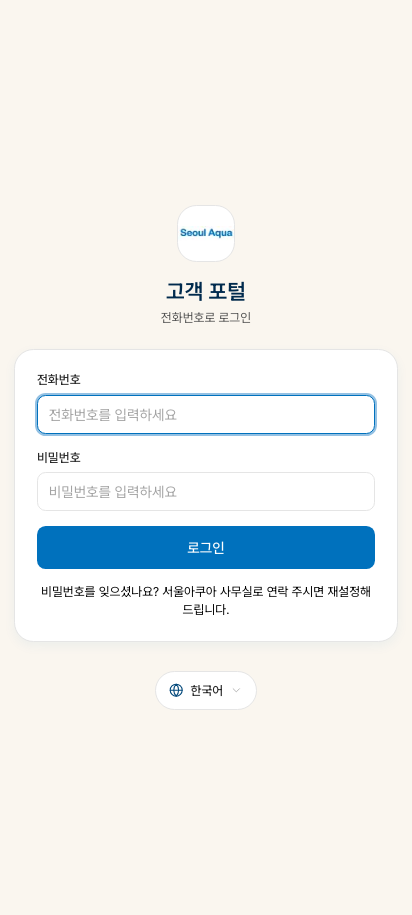

1. **전화번호**와 **비밀번호**를 넣고 **로그인**을 누릅니다.
2. 한 전화번호로 여러 계정이 등록돼 있으면 **계정 선택** 화면이 나옵니다. 해당 고객(회사)을 고르세요.

### 처음 로그인할 때

- 포털 계정이 열리면 **안내 이메일**(로그인 ID 안내)이 갈 수 있고, **임시 비밀번호는 사무실 직원이 전화로 알려드립니다.** 비밀번호는 문자나 이메일로 보내지 않습니다.
- 임시 비밀번호로 처음 로그인하면 **비밀번호 변경** 화면이 바로 열립니다. 현재 비밀번호(임시 비밀번호), 새 비밀번호(8자 이상), 새 비밀번호 확인을 넣고 **변경**을 누르세요. 바꾸기 전에는 다른 화면으로 넘어가지 않습니다.

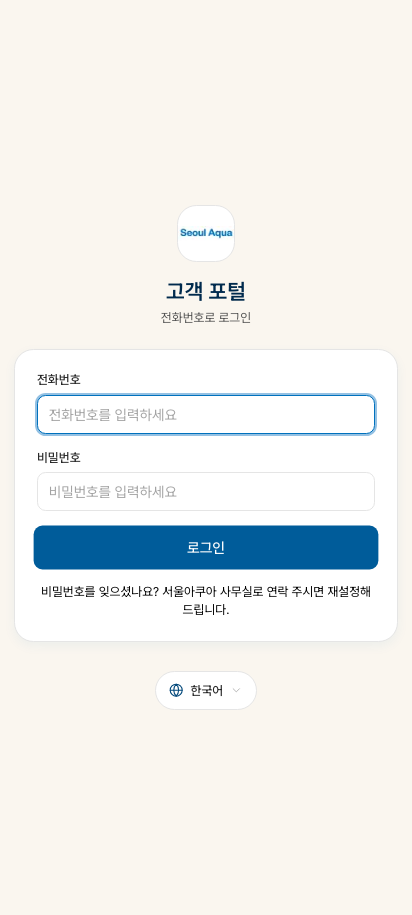

### 비밀번호를 잊으셨나요?

**제이크 홈 어플라이언스 사무실로 전화해 주세요.** 본인 확인 후 직원이 새 임시 비밀번호를 만들어 **전화로 불러드립니다.** 로그인 화면에서 스스로 재발급받는 기능은 없습니다.

### 로그인이 잠겼을 때

15분 안에 비밀번호를 5번 틀리면 "계정이 일시적으로 잠겼습니다"가 뜨고 15분 동안 로그인할 수 없습니다. 15분 뒤 다시 시도하거나, 사무실에 비밀번호 초기화를 요청하세요.

---

## 2. 화면 구성

- **위쪽**: 고객명과 담당자명, 언어 메뉴, **로그아웃** 버튼
- **아래쪽 탭 5개**: **홈 · 장비 · 방문 · 요청 · 설정**

결제 내역은 홈의 **미수금** 카드에서, 연락처는 **설정 → 연락처 관리**(계약 주체 계정)에서 엽니다.

---

## 3. 홈

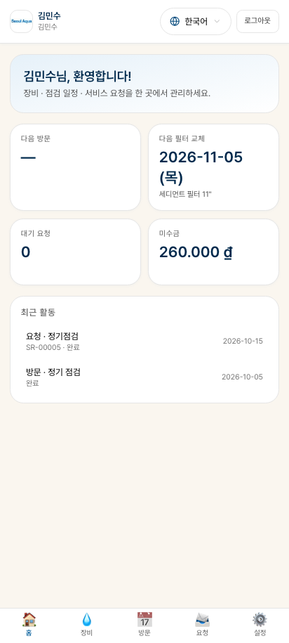

로그인하면 환영 인사와 카드 4개가 보입니다. 카드를 누르면 해당 화면으로 갑니다.

| 카드 | 내용 | 누르면 |
|---|---|---|
| **다음 방문** | 가장 가까운 방문 예정일(요일) | 방문 |
| **다음 필터 교체** | 가장 빠른 필터 교체 예정일 | 장비 |
| **대기 요청** | 사무실 검토를 기다리는 요청 수 | 요청 |
| **미수금** | 아직 내지 않은 금액 합계 | 결제 |

그 아래 **최근 활동**에 최근 방문과 요청이 나옵니다.

---

## 4. 장비

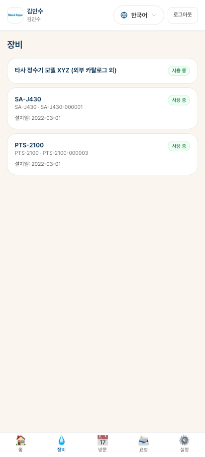

**아래 탭 → 장비**. 내 장비가 사업장별로 묶여 나옵니다. 카드마다 모델, 시리얼 번호, 상태, 설치일이 있습니다.

### 장비 상세

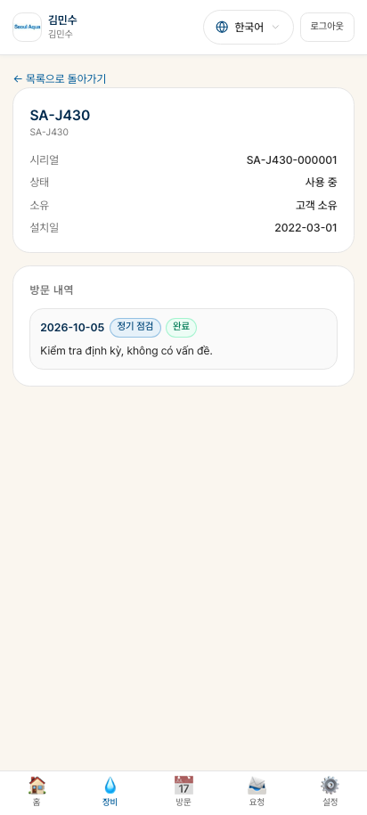

장비 카드를 누르면 열립니다.

- **기본 정보**: 시리얼, 상태, 소유, 설치일
- **사이트**: 장비가 설치된 사업장과 주소 (회사 고객)
- **필터 교체 일정**: 등록된 경우 다음 교체 예정일과 필터 종류
- **방문 내역**: 이 장비의 방문 — 날짜, 유형, 상태, 작업 내용, 사용한 소모품

---

## 5. 방문

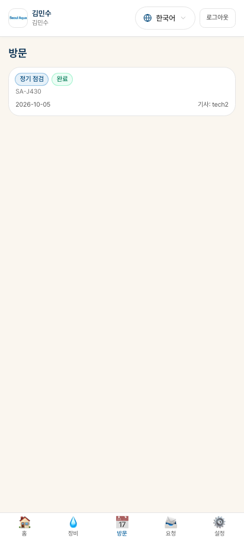

**아래 탭 → 방문**. 방문마다 유형(정기 점검·설치·수리·필터 교체·구매 소모품 배송 등), 상태, 모델, 예정일, 담당 기사가 나옵니다.

### 방문 상세

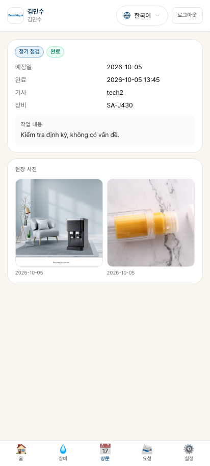

방문을 누르면 완료 시각, 기사가 적은 **작업 내용**, **현장 사진**을 볼 수 있습니다. 작업확인서가 발급된 방문에는 **작업확인서 다운로드** 버튼이 나오고, 누르면 PDF가 열립니다.

---

## 6. 서비스 요청

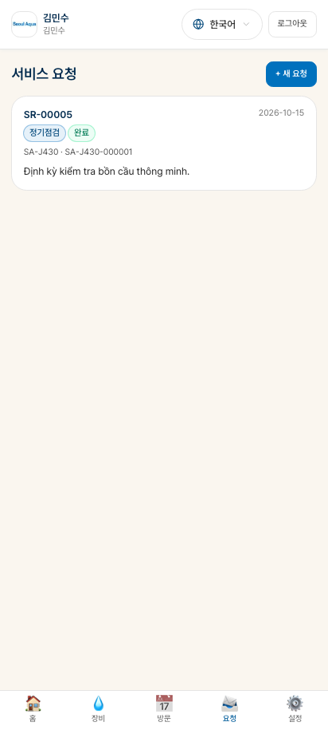

**아래 탭 → 요청**. 보낸 요청과 진행 상황이 나옵니다.

### 6.1 새 요청 보내기

**「+ 새 요청」** 을 누르고 다섯 단계를 차례로 진행합니다. 아래 「다음」·「이전」으로 오갑니다.

**1. 장비 선택** — 문제가 있는 장비를 누릅니다. 사업장이 여러 곳인 회사 고객은 사업장으로 먼저 좁힐 수 있습니다.

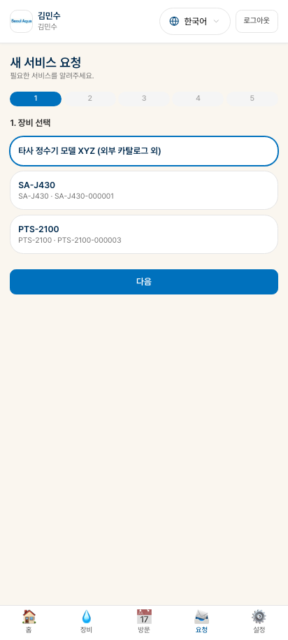

**2. 요청 유형** — 정기점검 · 수리 · 부품 교체 · 이전 설치 · 기타 중 하나를 고릅니다.

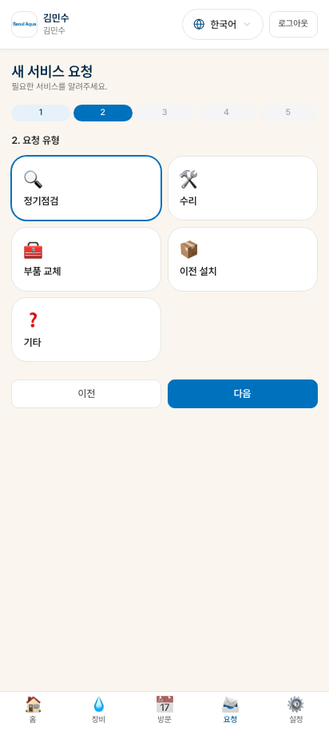

**3. 상세 내용** — 어떤 문제가 언제부터 있었는지 10자 이상 적습니다. **방문 희망 시간**을 넣으면 사무실이 일정을 잡을 때 참고합니다(선택).

**4. 사진 첨부 (선택)** — 문제 부분 사진을 최대 8장까지 올릴 수 있습니다. 사진이 있으면 처리가 빨라집니다.

**5. 확인 후 제출** — 내용을 확인하고 **요청 제출**을 누릅니다.

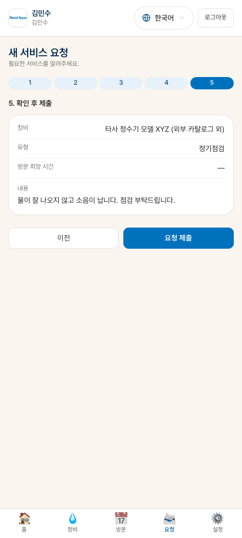

### 6.2 제출하면

- **무상 요청**(계약 범위 안)은 바로 **승인됨**이 되고 방문 일정이 자동으로 잡힙니다. 화면에 "방문 일정이 자동으로 잡혔습니다…"가 나옵니다.
- **유상 요청**은 **검토 대기**가 되고 "사무실에서 1영업일 내에 회신드립니다"가 나옵니다. 사무실이 금액과 일정을 정해 연락드립니다.

무상이 되는 경우는 대체로 다음과 같습니다. 정확한 판단은 사무실이 합니다.

| 유형 | 무상인 경우 |
|---|---|
| 정기점검 | 임대·유지관리 계약 중이거나 설치 후 90일 이내 |
| 수리 | 임대 중이거나 설치 후 6개월 이내 |
| 부품 교체 | 임대·유지관리 계약 중 |
| 이전 설치 | 설치 후 90일 이내의 첫 이전 |
| 기타 | 유상 |

### 6.3 요청 상태

| 상태 | 뜻 |
|---|---|
| 검토 대기 | 사무실이 확인 중 (유상 요청) |
| 승인됨 | 승인되었고 방문 일정을 잡는 중 |
| 일정 확정 | 기사와 방문 일시가 정해짐 |
| 완료 | 방문이 끝남 |
| 반려 | 처리하지 않기로 함 (사유 표시) |
| 취소 | 취소됨 |

### 6.4 요청 상세 — 메시지와 취소

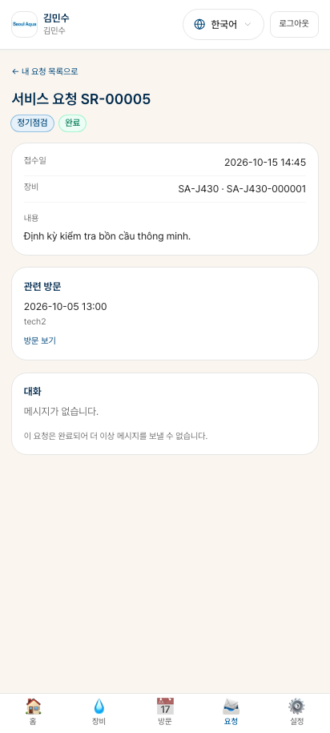

- 요청 내용과 사진, 상태가 나옵니다.
- **대화** 칸으로 사무실과 메시지를 주고받습니다.
- 검토 대기 · 승인됨 · 일정 확정 상태이고 방문이 아직 끝나지 않았으면 **요청 취소**를 누를 수 있습니다(사유는 선택).

> 승인·반려 소식은 사무실이 **전화**로 알려드립니다. 문자 안내는 준비 중입니다.

---

## 7. 결제

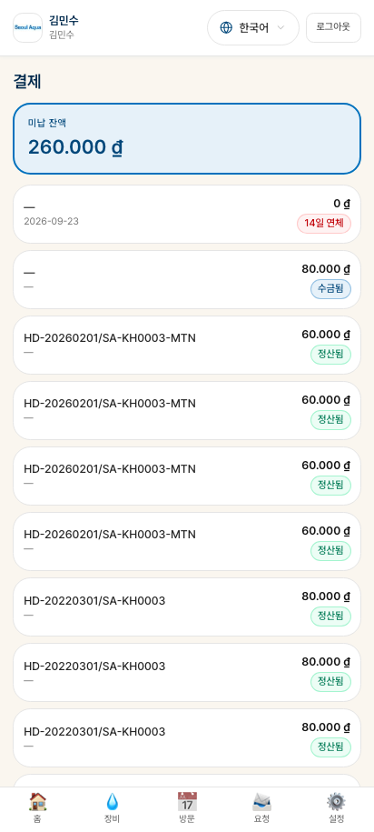

홈의 **미수금** 카드를 누르면 열립니다.

- 위쪽 **미납 잔액** 카드에 아직 내지 않은 금액 합계가 굵게 나옵니다.
- 아래 카드마다 계약번호, 납부 기한, 낸 금액, 상태가 나옵니다.

---

## 8. 세금계산서 (회사 고객)

회사(B2B) 고객은 발행된 세금계산서를 내려받을 수 있습니다. **설정 → 보안 → 「세금계산서」** 로 엽니다(회사 고객에게만 보입니다). 계산서마다 번호, 발행일, 금액, **다운로드** 버튼이 있습니다. 개인(B2C) 고객에게는 "세금계산서는 B2B 고객만 이용 가능합니다."가 보입니다.

---

## 9. 연락처 (계약 주체 계정)

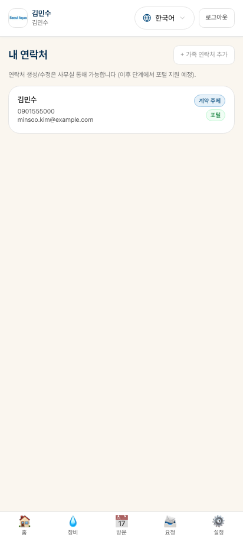

**설정 → 연락처 관리** (계약 주체 계정에만 보입니다). 제이크 홈 어플라이언스에 등록된 담당자 목록으로, 회사 고객은 「회사 연락처」, 개인 고객은 「내 연락처」로 나옵니다. 사람마다 이름, 직함, 전화, 이메일, 역할(계약 주체 / 관리 주체 · 주 담당), 포털 사용 여부, 사업장이 표시됩니다.

| 역할 | 받는 것 |
|---|---|
| **계약 주체** | 계약서, 세금계산서, 법적 통보, 연체·만료 안내 |
| **관리 주체** | 방문 일정 알림, 영수증, 필터 교체 안내 |

연락처 추가 버튼은 아직 눌리지 않습니다 — 추가·수정은 사무실에 요청해 주세요.

---

## 10. 설정

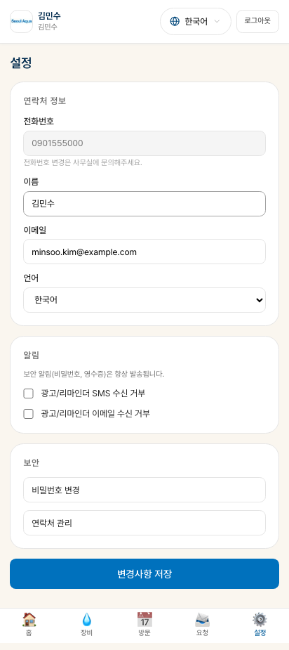

**아래 탭 → 설정**

### 연락처 정보

이름 · 이메일 · 언어를 바꾸고 **변경사항 저장**을 누릅니다. 전화번호는 로그인 ID라 포털에서 바꿀 수 없습니다. 사무실에 문의하세요.

**언어**는 제이크 홈 어플라이언스가 보내는 문서와 알림의 언어입니다. 화면 언어는 오른쪽 위 언어 메뉴에서 따로 바꿉니다.

### 알림

- **광고/리마인더 SMS 수신 거부**
- **광고/리마인더 이메일 수신 거부**

체크하고 **변경사항 저장**. 수신을 거부하면 방문 일정 알림, 필터 교체 안내, 요청 결과, 연체 안내 같은 알림도 함께 받지 않게 됩니다. 영수증·세금계산서·계약서 사본·포털 개설 안내는 거부 여부와 관계없이 보내드립니다.

### 비밀번호 변경

**보안 → 비밀번호 변경** → 현재 비밀번호 · 새 비밀번호(8자 이상, 이전과 달라야 함) · 새 비밀번호 확인 → **변경**

---

## 11. 언어 바꾸기

어느 화면에서든 오른쪽 위 언어 메뉴(지구본)에서 Tiếng Việt · 한국어 · English를 고릅니다. 로그인 화면에서는 입력 칸 아래에 있습니다.

---

## 12. 받게 되는 알림

| 언제 | 무엇이 |
|---|---|
| 방문 하루 전 | 방문 일정 SMS — 한국어를 쓰시는 고객님께는 **영어**로 갑니다(통신사 정책으로 한국어 문자 등록이 되지 않습니다) |
| 그 밖의 안내 | 이메일 안내는 준비 중입니다. 요청 결과·연체 등 중요한 내용은 사무실이 전화로 알려드립니다 |

---

## 용어

| 용어 | 뜻 |
|---|---|
| 계약 주체 | 계약서에 서명하고 세금계산서·법적 통보를 받는 담당자 |
| 관리 주체 | 방문 일정·영수증을 받는 현장 담당자 |
| 임시 비밀번호 | 계정을 열거나 초기화할 때 사무실 직원이 전화로 알려주는 10자리 비밀번호 |
| 작업확인서 | 방문을 마친 뒤 발급되는 작업 확인 문서(PDF) |
| 미수금 | 아직 내지 않은 금액 |
| B2B / B2C | 회사 고객 / 개인 가정 고객 |

---

## 문제 해결

| 증상 | 해결 |
|---|---|
| 로그인이 안 됩니다 | 전화번호와 비밀번호를 확인하세요. 5번 틀리면 15분 동안 잠깁니다. 사무실에 연락하시면 비밀번호를 초기화해 전화로 알려드립니다 |
| 임시 비밀번호를 못 받았습니다 | 비밀번호는 문자로 오지 않습니다. 사무실로 전화해 주세요 |
| 영어 화면이 나옵니다 | 주소에 `/ko`가 있는지 확인하거나 오른쪽 위 언어 메뉴에서 한국어를 고르세요 |
| 장비가 목록에 없습니다 | 아직 등록되지 않았거나, 특정 사업장 담당 계정이라 다른 사업장 장비가 보이지 않는 경우입니다. 사무실에 확인하세요 |
| 세금계산서 메뉴가 없습니다 | 회사(B2B) 고객 전용입니다. 설정 → 보안 → 「세금계산서」에 있습니다 |
| 연락처를 고치고 싶습니다 | 포털에서는 아직 안 됩니다. 사무실에 요청해 주세요 |
| 요청 상태가 바뀌지 않습니다 | 처리에 시간이 걸릴 수 있습니다. 요청 상세의 대화 칸으로 문의하세요 |
