# Seoul Aqua SOMS — 현장 기사 매뉴얼

**대상 사용자**: 기사(TECHNICIAN) — 휴대폰 사용
**버전**: 2026-10-15 (전 화면 재촬영 · 실제 동작 기준 전면 개정 — 방문 완료 5단계, 서명 사진, 보유 현금 배지, 방문 전달사항 반영)
**언어**: 한국어
**관련 문서**: [사무실 매뉴얼](./office.md) · [고객 포털 매뉴얼](./customer.md)

---

## 목차

- [1장. 시작하기](#1장-시작하기)
- [2장. 기사의 하루](#2장-기사의-하루)
- [3장. 로그인](#3장-로그인)
- [4장. 화면 구성](#4장-화면-구성)
- [5장. 「오늘」 화면](#5장-오늘-화면)
- [6장. 「예정」 화면](#6장-예정-화면)
- [7장. 방문 상세](#7장-방문-상세)
- [8장. 방문 시작과 완료 (5단계)](#8장-방문-시작과-완료-5단계)
- [9장. 수금과 보유 현금](#9장-수금과-보유-현금)
- [10장. 협업 기사로 참여할 때](#10장-협업-기사로-참여할-때)
- [11장. 방문 종류별 안내](#11장-방문-종류별-안내)
- [12장. 고객에게 연락이 필요할 때](#12장-고객에게-연락이-필요할-때)
- [13장. 고객 부재·부품 없음·인터넷 끊김](#13장-고객-부재부품-없음인터넷-끊김)
- [14장. 하루 마무리와 현금 인계](#14장-하루-마무리와-현금-인계)
- [15장. 내 정보](#15장-내-정보)
- [16장. 자주 마주치는 상황](#16장-자주-마주치는-상황)
- [부록 A. 방문 유형 빠른 참조](#부록-a-방문-유형-빠른-참조)
- [부록 B. 알려진 문제](#부록-b-알려진-문제)

---

## 1장. 시작하기

### 1.1 필요한 것

| 항목 | 권장 |
|---|---|
| 휴대폰 | Android 8 이상 또는 iPhone iOS 14 이상, 화면 5인치 이상 |
| 카메라 | 현장 사진과 고객 서명을 찍을 수 있는 카메라 |
| 인터넷 | 모바일 데이터(4G/LTE/5G) 또는 Wi-Fi |

### 1.2 기사 앱 주소

휴대폰 Chrome 또는 Safari에서 엽니다.

```
https://soms.seoulaqua.com.vn/f/ko/login
```

- 주소의 `/ko`가 한국어 화면입니다. 빼면 영어, `/vi`는 베트남어입니다.
- 앱을 따로 내려받지 않습니다. 브라우저 메뉴의 **「홈 화면에 추가」** 로 바로가기를 만들어 두면 앱처럼 열립니다.

### 1.3 처음 받는 것

관리자가 계정을 만들고 **임시 비밀번호를 직접 알려줍니다.** 문자로 오지 않습니다.

- 로그인 ID: 본인 휴대폰 번호
- 비밀번호: 관리자에게 받은 임시 비밀번호 — 처음 로그인하면 새 비밀번호를 정하는 화면이 뜹니다(§3)

비밀번호는 다른 사람에게 알려주지 마세요.

---

## 2장. 기사의 하루

```
아침 → 로그인 → 「오늘」 화면 확인
  → 방문 상세에서 장비·서류·작업 내용·본사 전달사항 확인
  → 출발 (「지도 열기」)
  → 도착 → 「방문 시작」
  → 작업 → 「방문 완료」 → 5단계 입력 (작업 내용 · 사진 · 서명 · 수금 · 확인)
  → 다음 방문
  → 퇴근 전: 보유 현금 확인
  → 다음 영업일: 사무실에 현금 인계 (받은 뒤 48시간 안)
```

---

## 3장. 로그인

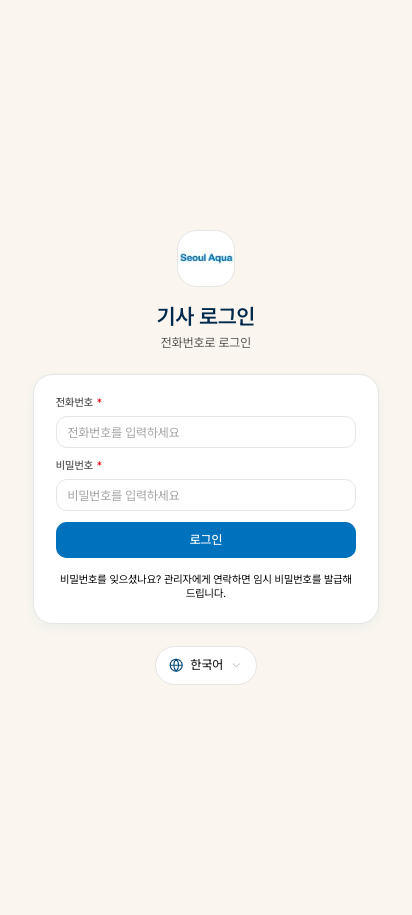

| 항목 | 설명 |
|---|---|
| 전화번호 | 본인 휴대폰 번호 |
| 비밀번호 | 관리자에게 받은 비밀번호 |

- **15분 안에 5번 틀리면 15분 동안 잠깁니다.** "로그인 실패가 반복되어 계정이 잠시 잠겼습니다…"가 뜨면 15분 뒤 다시 시도하거나, 사무실에 비밀번호 초기화를 요청하세요(초기화하면 잠금도 풀립니다).
- **임시 비밀번호로 로그인하면** 「비밀번호 변경」 화면이 먼저 뜹니다. 현재 비밀번호(임시 비밀번호) · 새 비밀번호(8자 이상, 이전과 달라야 함) · 새 비밀번호 확인을 넣고 「변경」을 누르세요. 바꾸기 전에는 다른 화면으로 갈 수 없습니다.
- **비밀번호를 잊었을 때**: 사무실에 전화하세요. 관리자가 새 임시 비밀번호를 발급해 직접 알려줍니다. 스스로 재발급받는 화면은 없습니다.
- 평소에 비밀번호를 바꾸려면 「내 정보」 → 「비밀번호 변경」(§15).
- 기사 계정으로 사무실 앱(`/o/ko/login`)에 로그인하면 "현장 직원 계정입니다…" 안내와 「현장 직원 로그인으로 이동」 링크가 나옵니다.

---

## 4장. 화면 구성

- **위쪽**: 「Seoul Aqua 현장」, 언어 메뉴(한국어 · Tiếng Việt · English), 로그아웃 아이콘
- **아래쪽 탭 3개**: **오늘 · 예정 · 내 정보**
- 인터넷이 끊기면 위쪽에 「오프라인」 배너가 뜹니다(§13.3).

---

## 5장. 「오늘」 화면

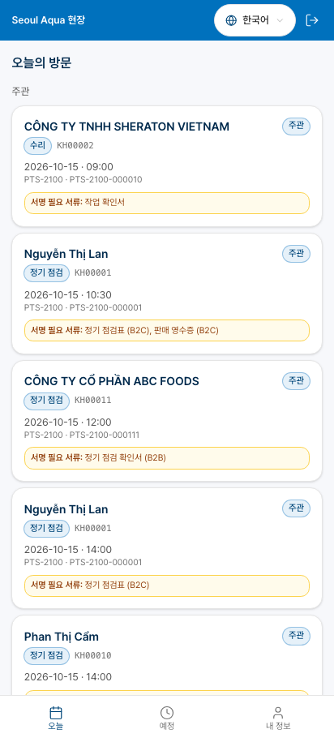

로그인하면 열리는 화면입니다.

- 맨 위 **보유 현금** 배지 — 내가 받아서 아직 사무실에 넘기지 않은 현금(§9.3)
- **주관** 묶음 — 내가 책임지는 방문
- **협업** 묶음 — 다른 기사를 돕는 방문(§10)

방문 카드에 보이는 것:

- 고객명과 「주관」 또는 「협업」 표시
- 방문 유형과 고객 코드
- 날짜·시간
- 모델 · 시리얼
- 노란 상자 **「서명 필요 서류: …」** — 이 방문에서 고객 서명을 받아야 할 서류

예정됨·진행 중·재예약 상태의 오늘 방문만 보입니다. **완료한 방문은 목록에서 빠집니다.**

카드를 누르면 방문 상세로 갑니다.

---

## 6장. 「예정」 화면

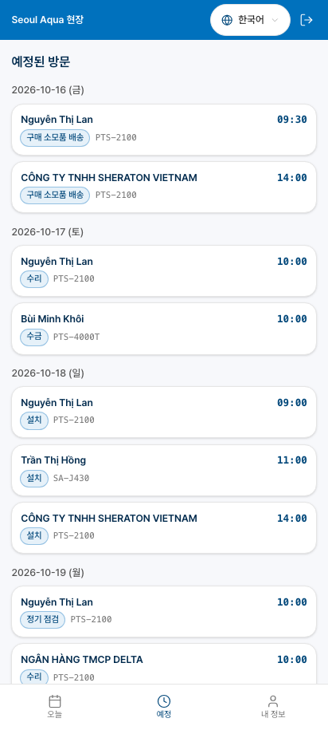

**내일부터 7일 동안**의 방문을 날짜별로 보여줍니다. 부품을 챙기거나 동선을 미리 짤 때 쓰세요. 없으면 "향후 7일간 일정이 없습니다."가 보입니다.

---

## 7장. 방문 상세

방문 카드를 누르면 열립니다. 위에서 아래 순서로 정리하면 다음과 같습니다.

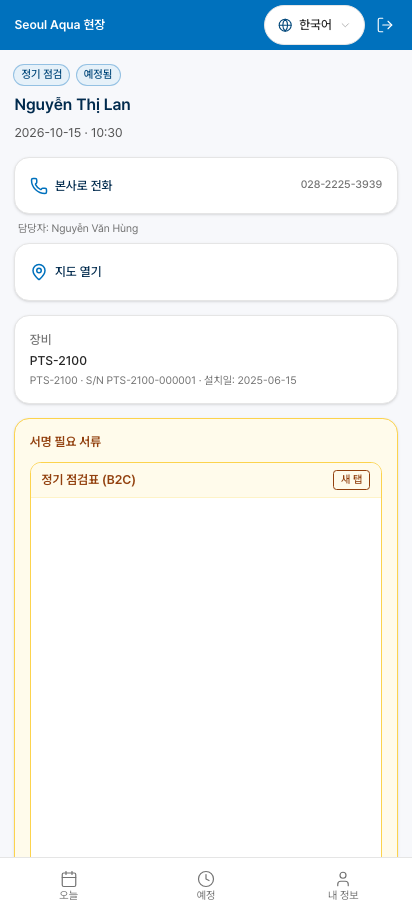

1. **머리**: 방문 유형·상태, 고객명, 날짜·시간
2. **「본사로 전화」** 버튼 — 누르면 본사 번호로 전화가 걸립니다
3. **담당자** — 고객 측 담당자 이름 (전화번호는 표시되지 않음, §12)
4. **「지도 열기」** — 고객 주소를 구글 지도로 엽니다
5. **장비** — 모델명, 모델 코드 · 시리얼 · 설치일, 사이트(사업장)

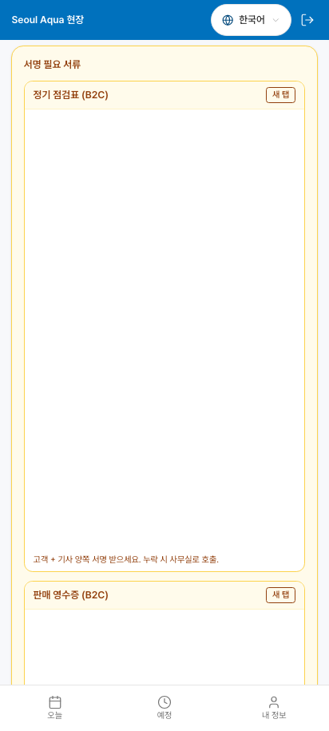

6. **서명 필요 서류** — 서류마다 PDF 미리보기와 「새 탭」 링크. **고객과 기사 양쪽 서명**을 받아야 합니다. 종이 서류는 사무실이 미리 인쇄해 줍니다.

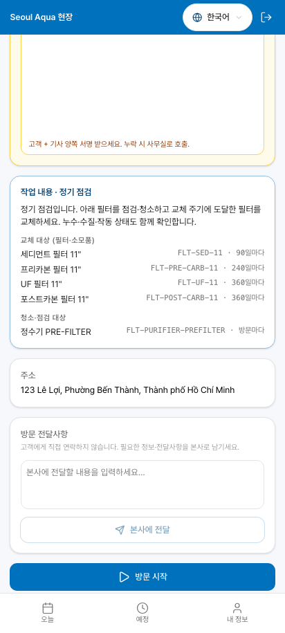

7. **작업 내용** — 방문 유형별 작업 안내, **교체 대상 (필터·소모품)** 과 **청소·점검 대상** 목록(각 주기 표시: "180일마다", "방문마다"), 예상 금액(있을 때)
8. **서비스 요청** — 고객 요청으로 생긴 방문이면 요청 코드·유형·고객이 적은 내용
9. **주소**


10. **방문 전달사항** — 본사와 주고받는 메모. 고객에게 직접 연락하지 말고 여기에 적어 「본사에 전달」을 누르세요. 고객용 서류에는 인쇄되지 않습니다.
11. **버튼** (주관 기사에게만 보임)
    - 「방문 시작」 — 예정됨 상태일 때
    - 「방문 완료」 — 진행 중 상태일 때
    - 「방문 실패 처리」 — 예정됨·진행 중 상태일 때 (§13.1)

---

## 8장. 방문 시작과 완료 (5단계)

### 8.1 방문 시작

고객 집·사무실에 도착하면 방문 상세 → **「방문 시작」**. 상태가 **진행 중**으로 바뀌고 시작 시각이 기록됩니다. 이제 「방문 완료」 버튼이 나타납니다.

### 8.2 방문 완료 — 5단계

작업을 마치면 **「방문 완료」** 를 누릅니다. 다섯 단계를 차례로 입력하고, 단계 사이는 아래 「다음」·「뒤로」로 오갑니다.

#### ① 작업 내용 + 부품

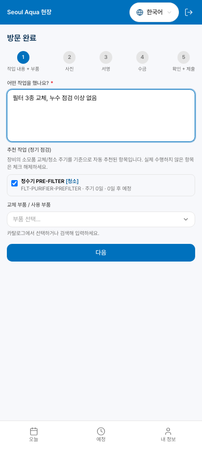

- **어떤 작업을 했나요?** (필수) — 수행한 작업을 적습니다. 고객용 작업확인서에 들어갑니다.
- **추천 작업 (정기 점검)** — 장비의 교체·청소 주기로 자동 추천된 필터 목록. 처음엔 모두 체크돼 있으니 **실제로 하지 않은 항목은 체크를 해제**하세요. 체크한 교체 항목은 다음 교체일이 다시 계산되고 재고에서 빠집니다.
- **교체 부품 / 사용 부품** — 카탈로그에서 SKU나 이름으로 검색해 고릅니다. 목록에 없으면 「+ "이름" 직접 추가」.

#### ② 사진

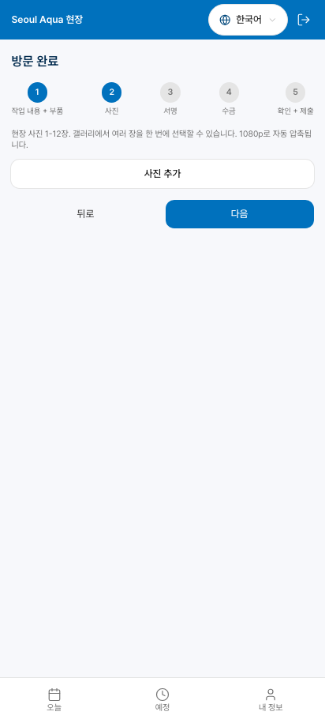

- 「사진 추가」 → 카메라나 갤러리에서 고릅니다. 여러 장을 한 번에 고를 수 있고, 1080p로 자동 압축됩니다(권장 1~12장).
- 고른 사진은 「업로드 대기」로 표시됩니다. **「선택한 N장 업로드」를 눌러야 올라갑니다.** 업로드하지 않은 사진이 있으면 다음 단계로 넘어가지 않습니다. 필요 없는 사진은 ×로 뺍니다.
- 더 찍으려면 「사진 더 추가」.
- 사진은 필수가 아니지만, 작업 전·후 사진을 남겨두면 나중에 분쟁이 생겼을 때 근거가 됩니다.

#### ③ 서명

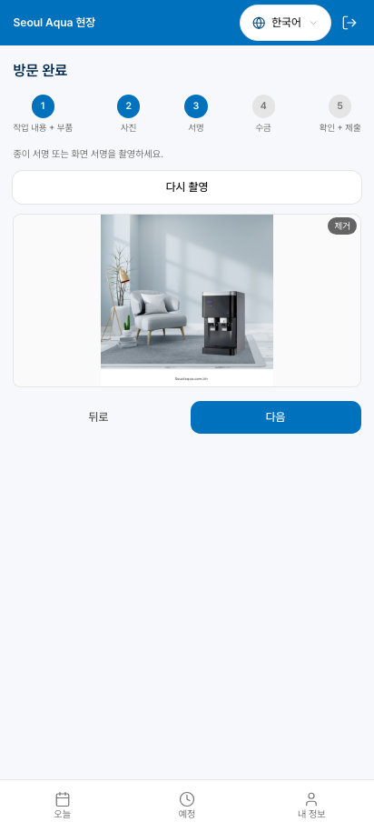

- **고객 서명 사진**을 찍어 올립니다. 종이 서류에 받은 서명이나 화면에 받은 서명을 촬영하세요.
- 「서명 사진 촬영」을 누르면 카메라가 열립니다. 잘못 찍었으면 「다시 촬영」을 누르거나 「제거」 후 다시 찍습니다.
- **서명은 필수**입니다. 없으면 마지막에 제출이 거부됩니다.

#### ④ 수금

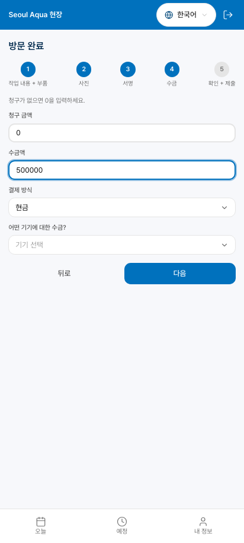

| 칸 | 설명 |
|---|---|
| 청구 금액 | 사무실이 정한 예상 금액이 채워져 있습니다. 바꾸면 **변경 사유**(5자 이상)를 꼭 적어야 합니다 |
| 수금액 | 실제로 받은 금액. **받지 않았으면 0** |
| 결제 방식 | 수금액이 0보다 크면 나타납니다. 현금 · 계좌이체 · 카드 · 기타 |
| 어떤 기기에 대한 수금? | 고객 장비가 2대 이상이면 나타납니다 |

고객이 "나중에 송금할게요"라고 하면 수금액을 **0**으로 두세요. 사무실이 입금을 확인해 처리합니다.

#### ⑤ 확인 + 제출

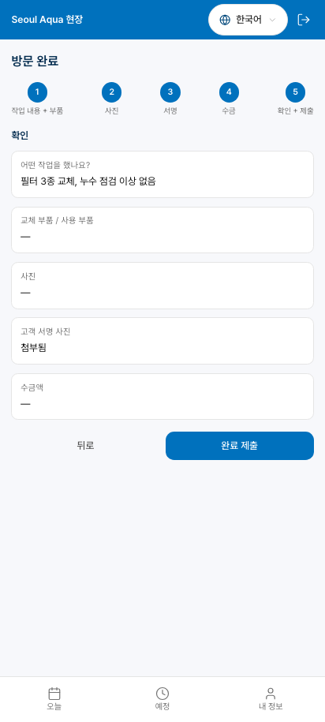

입력한 내용을 확인하고 **「완료 제출」**. 고칠 것이 있으면 「뒤로」로 돌아갑니다.

### 8.3 완료하면 일어나는 일

- 방문이 **완료**가 되고 방문 상세로 돌아갑니다. 버튼은 더 이상 나오지 않습니다.
- 작업확인서 PDF가 만들어지고, 고객 담당자에게 방문 완료 이메일이 나갑니다(이메일은 현재 발송 준비 중).
- 고객 요청으로 생긴 방문이면 그 요청도 **완료**가 됩니다.
- 체크한 교체 필터는 재고에서 빠지고 다음 교체일이 다시 잡힙니다.
- 수금액이 있으면 수금 기록이 생기고 보유 현금에 더해집니다.

> **완료 후에는 고칠 수 없습니다.** 잘못 넣었으면 바로 사무실에 연락하세요.

---

## 9장. 수금과 보유 현금

### 9.1 현장 수금

방문 완료 4단계(§8.2 ④)에서 입력합니다. 따로 수금만 하는 「수금」 방문도 같은 방식입니다.

### 9.2 영수증

고객용 영수증은 사무실이 준비합니다. 종이 영수증이 필요하면 사무실이 챙겨준 서류를 쓰세요.

### 9.3 보유 현금 배지

「오늘」 화면 맨 위의 **보유 현금** 배지에 내가 받고 아직 사무실에 넘기지 않은 현금 합계가 보입니다.

| 배지 | 뜻 |
|---|---|
| 정상 | 가장 오래된 현금을 받은 지 24시간 미만 |
| 마감 임박 | 24~47시간 |
| 마감 경과 | 48시간 이상 — 사무실 대시보드에도 경고가 뜹니다 |

배지에 "○○까지 인계"로 마감 시각이 표시됩니다. **받은 현금은 48시간 안에 사무실에 넘기세요.**

---

## 10장. 협업 기사로 참여할 때

큰 현장(B2B 여러 대 설치 등)에서는 기사 여러 명이 함께 갑니다.

| 역할 | 할 수 있는 것 |
|---|---|
| **주관 기사** | 방문 시작 · 방문 완료(작업 내용·사진·서명·수금) · 방문 전달사항 |
| **협업 기사** | 방문 보기 · 방문 전달사항 |

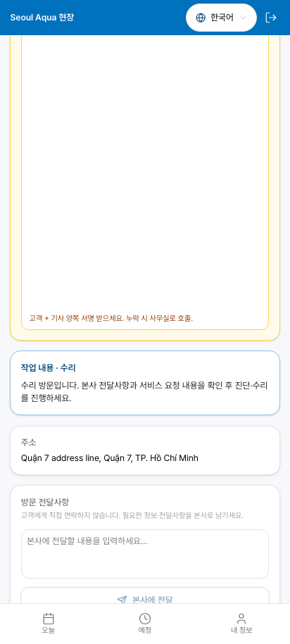

- 협업 방문은 「오늘」 화면의 **협업** 묶음에 「협업」 표시로 나옵니다.
- 협업 기사에게는 시작·완료 버튼이 없습니다. 사진은 주관 기사가 완료 단계에서 올리니, 찍은 사진은 주관 기사에게 넘겨주세요.

---

## 11장. 방문 종류별 안내

방문 상세의 **작업 내용**에 유형별 안내가 나옵니다. 아래는 요점입니다.

| 유형 | 할 일 | 서명 받을 서류 |
|---|---|---|
| 설치 | 장비 설치, 동작 확인, 시운전. 부속품·설치 키트를 모두 챙기세요 | 장비 인수증 또는 판매 영수증(B2C) / 출고서(B2B), 그리고 계약서 |
| 정기 점검 | 필터 점검·청소, 주기가 된 필터 교체, 누수·수질·작동 확인 | 정기점검표(B2C) / 정기점검 확인서(B2B) |
| 필터 교체 | 필터 교체, 잔수 배출 후 동작 확인 | 작업확인서 |
| 수리 | 본사 전달사항과 서비스 요청 내용 확인 후 진단·수리 | 작업확인서 |
| 이전 설치 | 분해 → 새 위치 재설치 → 누수 테스트 | 작업확인서 |
| 수금 | 금액 확인, 영수증 전달 | 작업확인서 |
| 구매 소모품 배송 | 주문한 소모품 전달 (§11.1) | 판매 영수증(B2C) / 출고서(B2B) |
| 장비 회수 | 장비를 깨끗이 포장해 회수, 사무실 반납 | 작업확인서 |
| 기타 | 본사 전달사항 확인 후 작업 | 작업확인서 |

### 11.1 구매 소모품 배송

- 기사 앱에는 **주문 품목 목록이 따로 나오지 않습니다.** 사무실이 인쇄해 준 **판매 영수증(B2C) 또는 출고서(B2B)** 에 품목과 수량이 적혀 있으니 그것으로 확인하세요.
- 점검 방문에 배송이 함께 붙은 경우 「서명 필요 서류」에 점검 서류와 배송 서류(판매 영수증 또는 출고서)가 함께 나옵니다. 둘 다 서명받으세요.
- 방문을 완료하면 그 방문에 연결된 주문이 「전달 완료」로 바뀝니다.
- B2B 출고서는 고객의 서명·날인을 받아 사무실에 반납합니다.
- 수량이 다르면 **완료 전에** 「본사로 전화」로 알리세요.

---

## 12장. 고객에게 연락이 필요할 때

기사 앱에는 **고객 전화번호가 나오지 않습니다.** 고객 개인정보를 보호하고 일정 관리를 사무실로 모으기 위해서입니다.

- 급한 일: 방문 상세 → **「본사로 전화」**
- 급하지 않은 일: 방문 상세 → **방문 전달사항**에 적고 「본사에 전달」

사무실이 고객에게 연락합니다.

---

## 13장. 고객 부재·부품 없음·인터넷 끊김

### 13.1 고객이 없을 때

1. 방문 상세 → **「방문 실패 처리」**
2. 사유를 고릅니다: 고객 부재 · 고객 연락 안 됨 · 고객이 일정 변경 요청 · 현장·장비 문제로 작업 불가 · 기타
3. **상세 메모**에 상황을 적습니다(도착 시각, 연락 시도 등). 「기타」를 고르면 메모가 필수입니다.
4. 「방문 실패 확정」 → 방문이 **방문 실패**가 되고 「오늘」 목록에서 빠집니다.
5. 사무실이 고객과 통화해 일정을 다시 잡으면 그 방문이 새 날짜로 「오늘」·「예정」에 다시 나타납니다.

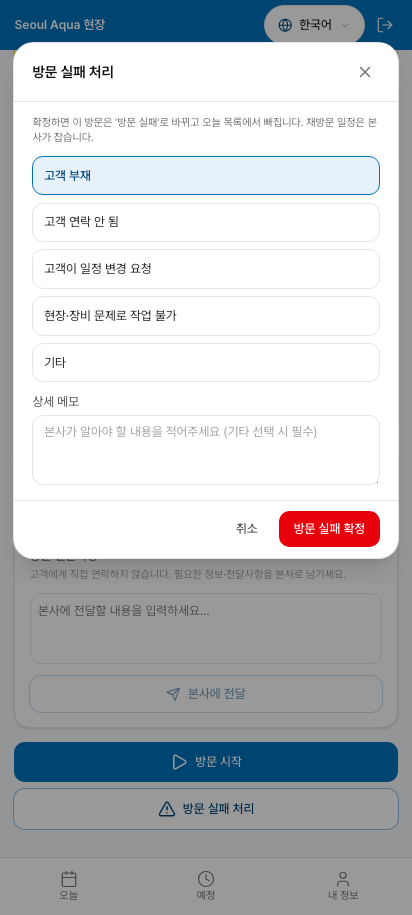

방문 실패는 주관 기사만 할 수 있습니다. 급한 상황이면 「본사로 전화」로도 알리세요.

### 13.2 부품이 없을 때 / 장비 이상을 발견했을 때

- 방문 전달사항에 무엇이 필요한지 적고(예: "PP필터 재고 없음, 재방문 필요"), 「본사로 전화」로 알립니다.
- 장비 이상은 사진을 찍어 완료 단계에 올리고, 작업 내용에 자세히 적습니다.
- 사무실이 부품을 준비해 방문을 새로 잡습니다.

### 13.3 인터넷이 끊겼을 때

- 위쪽에 **「오프라인」** 배너가 뜹니다. 다시 연결되면 「동기화 중…」, 보낼 것이 남아 있으면 「대기 N건」이 보입니다.
- 오프라인에서 「완료 제출」을 누르면 "오프라인 저장됨 — 온라인으로 돌아오면 자동 동기화됩니다."가 나오고, 연결되면 저절로 올라갑니다.
- **사진과 서명 사진 업로드는 인터넷이 있어야 합니다.** 신호가 약하면 신호 좋은 곳으로 옮기거나 Wi-Fi를 쓰세요.
- 급하면 「본사로 전화」로 구두 보고하세요.

---

## 14장. 하루 마무리와 현금 인계

### 14.1 퇴근 전 확인

- 「오늘」 화면에 남은 방문이 없는지 확인 (완료한 방문은 사라집니다)
- 보유 현금 배지로 들고 있는 현금 합계 확인
- 현금은 봉투에 넣어 영수증 사본과 함께 보관

### 14.2 현금 인계

다음 영업일에 사무실로 가져갑니다. 사무실 직원이 금액을 확인하고 건마다 「사무실 인계」로 기록하면 보유 현금에서 빠집니다. 받은 지 **48시간** 안에 넘기세요.

### 14.3 로그아웃

공용 휴대폰·태블릿을 쓰면 반드시 로그아웃하세요. 오른쪽 위 로그아웃 아이콘이나 「내 정보」의 빨간 「로그아웃」 버튼을 누르고, 로그인 화면으로 돌아갔는지 확인합니다.

---

## 15장. 내 정보

**아래 탭 → 내 정보**

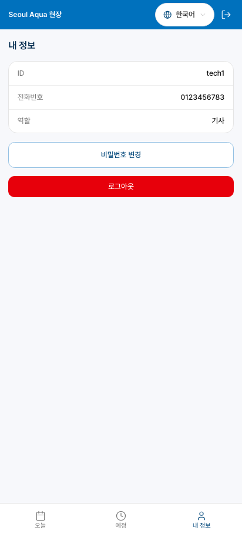

- ID(사용자명) · 전화번호 · 역할(기사)
- 「비밀번호 변경」 버튼 — 현재 비밀번호 · 새 비밀번호(8자 이상) · 새 비밀번호 확인 → 「변경」. 바꾸면 다른 기기의 로그인은 끊깁니다.
- 「로그아웃」 버튼

이름·담당 지역 수정은 사무실에 요청하세요.

---

## 16장. 자주 마주치는 상황

**「오늘」에 방문이 안 보여요**
- 아래 탭이 「예정」으로 가 있지 않은지 확인
- 이미 완료한 방문은 사라집니다
- 사무실에 배정됐는지 확인 → 그래도 없으면 로그아웃 후 다시 로그인

**사진이 안 올라가요**
- 인터넷 연결 확인
- 「선택한 N장 업로드」를 눌렀는지 확인
- 브라우저의 카메라·사진 접근 권한 허용 (휴대폰 설정 → 브라우저 앱 → 권한)
- 사진 한 장은 10MB 이하여야 합니다

**제출하니 서명이 필요하다고 나와요**
- ③ 서명 단계로 돌아가 고객 서명 사진을 올리세요

**금액을 잘못 넣었어요**
- 제출 전: 「뒤로」로 ④ 수금 단계에 돌아가 고칩니다
- 제출 후: 바로 사무실에 연락. 사무실이 수금 기록을 바로잡습니다

**완료를 잘못 눌렀어요**
- 완료된 방문은 기사가 고칠 수 없습니다. 바로 사무실에 연락하세요

---

## 부록 A. 방문 유형 빠른 참조

| 코드 | 화면 표기 | 준비물 | 서류 (B2C) | 서류 (B2B) |
|---|---|---|---|---|
| INSTALLATION | 설치 | 장비 · 설치 도구 · 부속품 | 장비 인수증 (판매 계약은 판매 영수증) + 계약서 | 출고서 + 계약서 |
| PERIODIC_INSPECTION | 정기 점검 | 필터 · 공구 | 정기점검표 | 정기점검 확인서 |
| FILTER_REPLACEMENT | 필터 교체 | 필터 | 작업확인서 | 작업확인서 |
| REPAIR | 수리 | 부품 · 공구 | 작업확인서 | 작업확인서 |
| RELOCATION | 이전 설치 | 설치 도구 | 작업확인서 | 작업확인서 |
| PAYMENT_COLLECTION | 수금 | 영수증 | 작업확인서 | 작업확인서 |
| CONSUMABLE_DELIVERY | 구매 소모품 배송 | 주문 소모품 | 판매 영수증 | 출고서 |
| RETRIEVAL | 장비 회수 | 포장재 | 작업확인서 | 작업확인서 |
| OTHER | 기타 | 본사 안내에 따름 | 작업확인서 | 작업확인서 |

서류는 사무실이 미리 인쇄해 줍니다. 기사 앱의 「서명 필요 서류」에서도 미리볼 수 있습니다.

---

## 부록 B. 알려진 문제

2026-10-15 기준으로 알려진 문제는 없습니다. 이상한 동작을 발견하면 화면을 찍어 사무실에 알려주세요.
