# Jake's Home Appliances SOMS — 사무실 직원 매뉴얼

**대상 사용자**: 관리자(ADMIN), 매니저(MANAGER), 사무실 직원(STAFF)
**버전**: 2026-10-15 (전 화면 재촬영 · 실제 동작 기준 전면 개정 — 판매원 별도 등록, 제품 유형, 사용자 관리 하향 권한, 알림 발송 현황 반영)
**언어**: 한국어
**관련 문서**: [현장 기사 매뉴얼](./field.md) · [고객 포털 매뉴얼](./customer.md) · [카탈로그 일괄 업로드 가이드](./catalog-upload.md)

---

## 목차

- [1장. 시스템 개요와 시작하기](#1장-시스템-개요와-시작하기)
- [2장. 권한 계층](#2장-권한-계층)
- [3장. 하루 흐름과 자동 처리](#3장-하루-흐름과-자동-처리)
- [4장. 로그인과 화면 구성](#4장-로그인과-화면-구성)
- [5장. 고객 관리](#5장-고객-관리)
- [6장. 판매원 관리](#6장-판매원-관리)
- [7장. 장비 관리](#7장-장비-관리)
- [8장. 계약 관리](#8장-계약-관리)
- [9장. 방문 관리](#9장-방문-관리)
- [10장. 주문 (구매 소모품·장비)](#10장-주문-구매-소모품장비)
- [11장. 서비스 요청 처리](#11장-서비스-요청-처리)
- [12장. 수금](#12장-수금)
- [13장. 세금계산서 (B2B)](#13장-세금계산서-b2b)
- [14장. 보고서와 감사 로그](#14장-보고서와-감사-로그)
- [15장. 관리자 메뉴](#15장-관리자-메뉴)
- [16장. 자주 마주치는 시나리오](#16장-자주-마주치는-시나리오)
- [부록 A. 사이드바 메뉴 빠른 찾기](#부록-a-사이드바-메뉴-빠른-찾기)
- [부록 B. 지참 서류 매트릭스](#부록-b-지참-서류-매트릭스)
- [부록 C. 알림 서식 일람](#부록-c-알림-서식-일람)
- [부록 D. 상태 코드 사전](#부록-d-상태-코드-사전)
- [부록 E. 현재 화면에서 할 수 없는 일](#부록-e-현재-화면에서-할-수-없는-일)

---

## 1장. 시스템 개요와 시작하기

### 1.1 SOMS란?

**SOMS(Service Operation Management System)** 는 Jake's Home Appliances의 통합 업무 시스템입니다. 고객 등록부터 계약, 장비 설치, 방문, 수금, 세금계산서, 감사 기록까지 한 곳에서 처리합니다.

- **고객 한 명 = 화면 하나**: 보유 장비·계약·담당자·서비스 요청이 고객 상세의 탭에 모입니다.
- **세 개의 앱, 하나의 데이터**: 사무실(PC), 현장 기사(휴대폰), 고객 포털(휴대폰)이 같은 데이터를 봅니다.
- **세 개 언어**: 한국어·베트남어·영어를 어느 화면에서나 바꿀 수 있습니다.

### 1.2 접속 주소

세 앱 모두 같은 주소(`soms.jakeshomeappliances.com.vn`)를 씁니다. 경로로 구분합니다.

| 앱 | 주소 |
|---|---|
| **사무실 앱** | `https://soms.jakeshomeappliances.com.vn/o/ko/login` |
| **현장 기사 앱** | `https://soms.jakeshomeappliances.com.vn/f/ko/login` |
| **고객 포털** | `https://soms.jakeshomeappliances.com.vn/ko/login` |

> 주소에서 `/ko`를 빼면 영어 화면이 열립니다. 베트남어는 `/vi`입니다. 예전 고객 포털 주소 `portal.jakeshomeappliances.com.vn`은 더 이상 쓰지 않습니다.

### 1.3 필요 환경

- 인터넷이 되는 PC (Chrome · Edge · Firefox · Safari 최신 버전)
- 본인 휴대폰 번호 (로그인 ID)
- 관리자가 직접 알려준 임시 비밀번호 — 문자나 이메일로는 오지 않습니다

### 1.4 고객에게 나가는 알림 — 현재 상태

화면 곳곳에 "SMS 발송", "이메일 발송"이라는 동작이 있지만, 실제로 고객에게 도달하는 것은 아래와 같습니다. 고객 응대 시 이 표를 기준으로 안내하세요.

| 채널 | 실제로 나가는 것 | 나가지 않는 것 |
|---|---|---|
| **SMS** | **방문 하루 전 알림(SMS_VISIT_REMINDER)** 하나 | 서비스 요청 승인·반려, 연체 최종 경고, 임대 만료 D-7 — 통신사에 문안이 아직 등록되지 않아 발송사가 거부합니다(코드 146) |
| **이메일** | 없음 | 모든 이메일 — 이메일 발송(Resend)은 준비돼 있지만, 운영 서버에 발송 키와 도메인 인증을 설정하기 전까지 「알림 발송 내역」에 **모의발송**으로만 기록됩니다 |

- 한국어를 쓰는 고객도 SMS는 **영어**로 받습니다. 통신사가 한국어 문안 등록을 받지 않기 때문입니다. 이메일은 고객 언어 그대로입니다.
- 비밀번호는 어떤 경로로도 문자·이메일로 보내지 않습니다. 직원이 전화로 불러줍니다.

---

## 2장. 권한 계층

### 2.1 역할 구조

```
ADMIN (관리자)       ← 모든 기능 + MANAGER·STAFF·기사 계정 관리 + 데이터 이관
  └─ MANAGER (매니저) ← 계약 활성화·수정, 수금 정산, 세금계산서, 카탈로그 + STAFF·기사 계정 관리
       └─ STAFF (직원) ← 일상 업무 전반 (고객·장비·방문·주문·수금 입력)

TECHNICIAN (기사)    ← 현장 기사 앱만 사용. 사무실 앱에는 로그인할 수 없습니다
```

부서 구분은 없습니다. STAFF도 영업·회계 메뉴를 모두 봅니다. 금액을 확정하거나 되돌리기 어려운 동작만 MANAGER 이상으로 제한됩니다.

### 2.2 기능별 권한표

| 기능 | ADMIN | MANAGER | STAFF |
|---|:---:|:---:|:---:|
| 고객·장비 등록·수정, 방문 생성·일정 변경, 주문 등록 | ● | ● | ● |
| 계약 초안 작성·서명 요청 | ● | ● | ● |
| 계약 활성화·수정(부록)·갱신·해지·판매 전환·취소, 계약서 메모 재발급 | ● | ● | — |
| 계약 주체(계약 당사자) 정보 수정 | ● | ● | — |
| 고객 비활성화 | ● | ● | — |
| 고객 재활성화 | ● | — | — |
| 고객 포털 계정 열기 | ● | ● | ● |
| 고객 포털 비밀번호 초기화 | ● | ● | — |
| 판매원 등록 | ● | ● | ● |
| 판매원 수정·비활성 | ● | ● | — |
| 서비스 요청 승인 | ● | ● | — |
| 서비스 요청 반려·취소 | ● | ● | ● |
| 수금: 사무실 인계·부분 결제 입력 (연체 건 포함) | ● | ● | ● |
| 주문 「전달 완료」·「주문 취소」 | ● | ● | ● |
| 수금: 정산·상각 | ● | ● | — |
| 세금계산서 목록 보기 | ● | ● | ● |
| 세금계산서 업로드·재발송·재발행 | ● | ● | — |
| 보고서 보기·CSV 내려받기 | ● | ● | ● |
| 감사 로그 보기·CSV 내려받기 | ● | ● | — |
| 제품 카탈로그·회사 정보·알림 서식·알림 발송 내역 | ● | ● | — |
| 사용자 추가·수정·비밀번호 초기화·비활성화 (**자기보다 낮은 역할만**) | ● | ● | — |
| 데이터 이관 | ● | — | — |
| 스케줄러 가중치 | ● | — | — |

> **사용자 관리는 아래로만 됩니다.** ADMIN은 MANAGER·STAFF·기사를, MANAGER는 STAFF·기사를 관리합니다. 같은 역할이나 윗 역할, 그리고 **자기 자신**은 수정·초기화·비활성화할 수 없습니다(§15.1).

---

## 3장. 하루 흐름과 자동 처리

### 3.1 사무실의 하루

```
출근 → 로그인 → 대시보드 확인
  ├─ 오전: 미배정 방문에 기사 배정 / 기사 현금 인계 받기 / 새 고객·장비 등록
  ├─ 오후: 서비스 요청 검토 / 수금 정리 / 주문 처리 / 세금계산서 업로드
  └─ 퇴근 전: 내일 일정 확인 → 일괄 인쇄 → 로그아웃
```

### 3.2 자동으로 처리되는 일

아래 작업은 시스템이 정해진 시각(베트남 시간)에 스스로 합니다. 직원이 누를 버튼은 없습니다.

| 시각 | 작업 | 내용 |
|---|---|---|
| 매일 01:30 | 현금 미인계 점검 | 기사가 현금을 받고 **48시간** 넘게 사무실에 인계하지 않은 건을 감사 로그에 경고로 남깁니다. 대시보드 「현금 인계 대기」 카드에 "N건 48시간 초과"로 보입니다. 따로 알림을 보내지는 않습니다 |
| 매일 02:30 | 데이터 백업 | 전체 데이터베이스 백업 |
| 매월 1일 07:00 | 정기 청구 생성 | 활성 임대·유지관리 계약마다 이번 달 **예정** 수금 건을 만듭니다(기한은 계약의 출금일, 비우면 10일 — §8.3) |
| 매일 08:00 | 연체 단계 올리기 | 기한이 지난 수금 건을 7일·14일·30일 연체로 바꾸고 알림을 보냅니다(§12.6) |
| 매일 09:00 | 필터 교체 예정 안내 | 14일 안에 교체·청소할 필터가 있는 고객의 주 운영 담당자에게 이메일 |
| 매일 10:00 | 임대 만료 안내 | 만료 60일·30일 전 이메일, 7일 전 SMS (계약 주체) |
| 매일 11:00 | 임대 종료 처리 | 종료일이 된 임대 계약을 **완료**로 바꾸고, 계약 조건에 따라 장비 소유권을 고객에게 넘기거나 **회수 방문**(제안됨)을 만듭니다. 고객에게 완료 이메일 |
| 매일 16:00 | 방문 하루 전 SMS | 다음 날 **예정됨** 상태 방문의 고객에게 SMS. 받는 사람은 사업장 담당 → 주 운영 담당 → 다른 운영 담당 → 계약 주체 순으로 정합니다. 내일 방문이면 시각과 관계없이 모두 대상입니다. 알림을 보낸 뒤 일정이 바뀌면 새 일정 전날 다시 보내고, 같은 날 두 번 돌아도 중복으로 보내지 않습니다 |

일이 생길 때 바로 나가는 알림도 있습니다.

| 언제 | 무엇이 |
|---|---|
| 기사가 방문을 완료 | 작업확인서 PDF 생성 + 고객 주 운영 담당자에게 완료 이메일 |
| 기사가 현장에서 수금 | 영수증 이메일 |
| 고객이 서비스 요청 제출 | 접수 확인 이메일 |
| 서비스 요청 승인 | SMS + 상세 이메일 |
| 서비스 요청 반려 | SMS |
| 세금계산서 업로드 | 세금계산서 이메일 |

> 이메일과 일부 SMS는 아직 고객에게 도달하지 않습니다. [§1.4](#14-고객에게-나가는-알림--현재-상태)를 보세요.

> **정기 점검 방문은 자동으로 만들어지지 않습니다.** 필터 교체 예정 이메일만 자동입니다. 점검 방문은 직원이 등록하거나(§9.5), 고객의 점검 요청을 승인하면(§11.3) 생깁니다.

---

## 4장. 로그인과 화면 구성

### 4.1 로그인

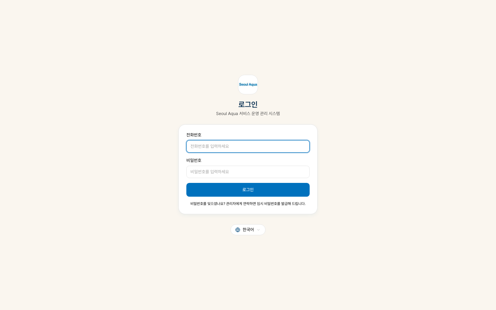

| 입력란 | 설명 |
|---|---|
| **전화번호** | 본인 휴대폰 번호 (예: `0901234567`) |
| **비밀번호** | 본인 비밀번호 |

- **15분 안에 5번 틀리면 15분 동안 잠깁니다.** 15분이 지나면 저절로 풀립니다. 급하면 상위 관리자가 비밀번호를 초기화하면 잠금도 함께 풀립니다.
- 기사 계정으로 사무실 앱에 로그인하면 "현장 직원 계정입니다…" 안내와 「현장 직원 로그인으로 이동」 링크가 나타납니다.

### 4.2 비밀번호

- 계정을 만든 관리자가 임시 비밀번호를 **직접** 알려줍니다.
- **임시 비밀번호로 로그인하면 「비밀번호 변경」 화면이 먼저 뜹니다.** 현재 비밀번호(임시 비밀번호) · 새 비밀번호(8자 이상, 이전과 달라야 함) · 새 비밀번호 확인을 넣고 「변경」을 누르기 전에는 다른 화면으로 갈 수 없습니다.
- 평소에 바꾸려면 오른쪽 위 사용자 메뉴 → **「비밀번호 변경」**. 바꾸면 다른 기기의 로그인은 모두 끊깁니다.

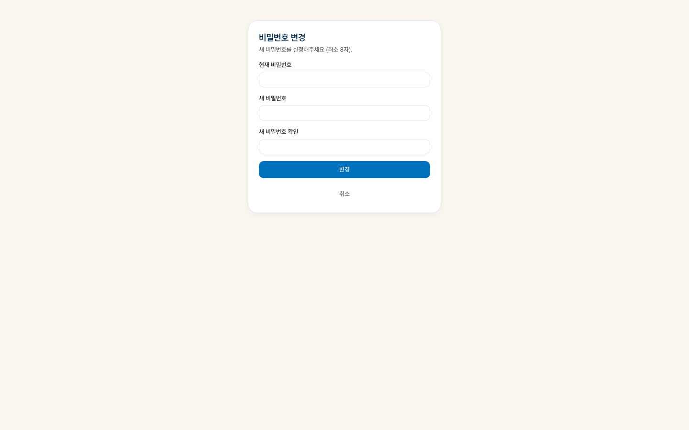

- 비밀번호를 잊으면 **자기보다 윗 역할**에게 전화하세요. 「관리자 → 사용자 관리 → 비밀번호 초기화」로 새 임시 비밀번호를 받아 그 자리에서 알려줍니다(§15.1). ADMIN 계정은 화면에서 초기화할 수 없으니 개발 담당자에게 요청합니다.

### 4.3 대시보드

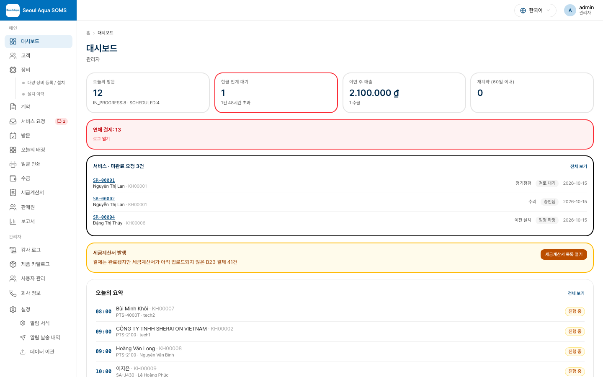

로그인하면 처음 보이는 화면입니다.

**위쪽 카드 4개**

| 카드 | 내용 |
|---|---|
| 오늘의 방문 | 오늘 방문 건수와 상태별 내역 |
| 현금 인계 대기 | 기사가 받았지만 아직 사무실에 넘기지 않은 현금 건수. 48시간이 넘은 건이 있으면 빨간 테두리 |
| 이번 주 매출 | 이번 주 수금 합계 |
| 재계약 (60일 이내) | 60일 안에 끝나는 임대 계약 수 |

**그 아래 (해당할 때만 나타남)**

- **연체 결제** — 연체 중인 수금 건수. 링크를 누르면 「연체만」이 체크된 수금 목록이 열립니다.
- **서비스 · 미완료 요청** — 검토 대기·승인됨·일정 확정 상태의 서비스 요청
- **세금계산서 발행** — 정산이 끝났는데 세금계산서가 아직 올라가지 않은 B2B 결제 건수와 「세금계산서 목록 열기」 버튼
- **오늘의 요약** — 오늘 방문을 시간순으로

### 4.4 사이드바

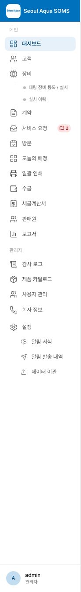

권한에 따라 보이는 메뉴가 다릅니다.

```
메인 (모든 사무실 직원)
  대시보드
  고객
  장비
    ├─ 대량 장비 등록 / 설치
    └─ 설치 이력
  계약
  서비스 요청        ← 확인하지 않은 고객 메시지가 있으면 빨간 숫자
  방문
  오늘의 배정
  일괄 인쇄
  수금
  세금계산서
  판매원
  보고서

관리자 (ADMIN · MANAGER)
  감사 로그
  제품 카탈로그
  사용자 관리
  회사 정보
  설정
    ├─ 알림 서식
    ├─ 알림 발송 내역
    └─ 데이터 이관   (ADMIN만)
```

### 4.5 언어 전환

화면 오른쪽 위의 언어 메뉴(지구본)에서 한국어 · Tiếng Việt · English를 고릅니다. 보고 있던 화면은 그대로 두고 글자만 바뀝니다.

### 4.6 뒤로 가기

화면 위 경로 표시 옆의 「뒤로」 버튼은 **직전에 보던 화면**으로 돌아갑니다. 예를 들어 고객 목록 → 고객 상세 → 장비 상세에서 「뒤로」를 누르면 고객 상세로, 한 번 더 누르면 고객 목록으로 갑니다.

- 새 탭에서 바로 열었거나 주소를 직접 입력해 들어와 직전 화면이 없을 때만 해당 메뉴의 목록으로 갑니다.
- 경로 표시의 「관리자」는 메뉴 묶음 이름일 뿐이라 눌러도 이동하지 않습니다.

---

## 5장. 고객 관리

### 5.1 고객 목록

**사이드바 → 고객**

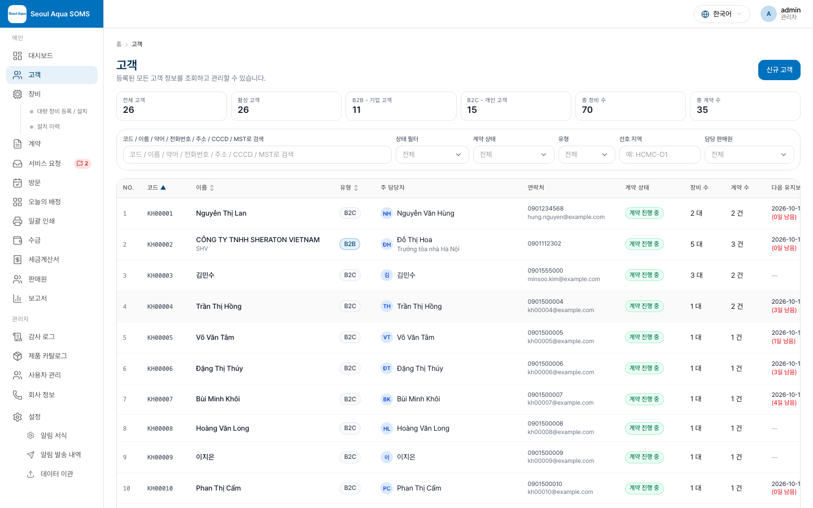

- 위쪽 요약 카드 6개로 전체 고객 현황을 봅니다.
- **필터**: 검색(코드·이름·약어·전화·주소·CCCD·세금코드) · 상태 · 계약 상태 · 유형(B2C/B2B) · 선호 지역 · 담당 판매원 · 초기화
- 오른쪽 위 **「신규 고객」** 버튼으로 등록합니다.
- 줄을 누르면 고객 상세로 이동합니다.

### 5.2 새 고객 등록 — B2C (가정집)

**고객 목록 → 신규 고객 → 「B2C — 가정집」**

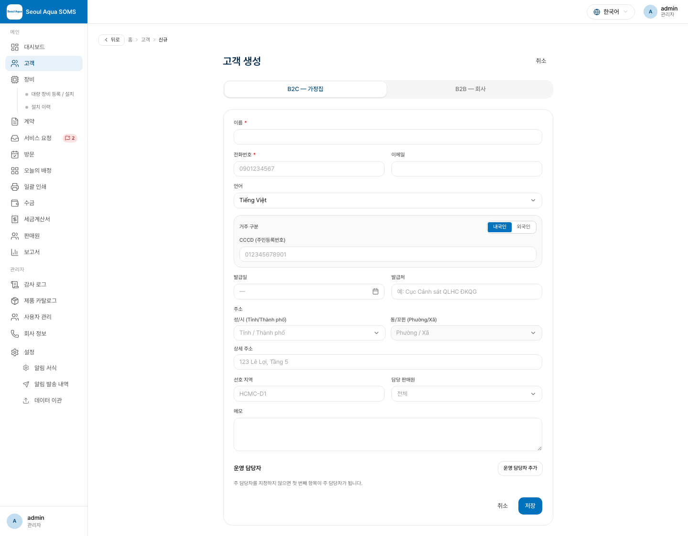

| 항목 | 필수 | 설명 |
|---|:---:|---|
| 이름 | ● | 고객 성함 |
| 전화번호 | ● | 주 연락처. 포털을 열어주면 로그인 ID가 됩니다 |
| 이메일 | | 영수증·작업확인서 수신 |
| 언어 | | 고객에게 보내는 문서·알림의 언어 |
| 거주 구분 | | 내국인 → CCCD(주민등록번호), 외국인 → 국적 + 여권번호 |
| 발급일 · 발급처 | | 신분증 정보 (계약서 표기) |
| 주소 | | 성/시 → 동/꼬뮌 → 상세 주소 |
| 선호 지역 | | 기사 추천에 쓰는 지역 코드 (예: `HCMC-D1`) |
| 담당 판매원 | | 아래 설명 참고 |
| 메모 | | 내부 메모 |
| 운영 담당자 | | 방문 알림을 받을 사람을 바로 추가할 수 있습니다 |

B2C 고객은 고객 본인이 계약 주체가 됩니다.

#### 주소 입력

2025년 행정구역 개편으로 군/구 단위가 없어져 **2단계**로 입력합니다.

1. 성/시(`Tỉnh/Thành phố`) — 전국 34개 중 선택
2. 동/꼬뮌(`Phường/Xã`) 선택
3. 상세 주소 입력

검색창은 성조 없이 입력해도 찾습니다(`Ho Chi` → `Thành phố Hồ Chí Minh`). 목록에 없는 지역은 그대로 타이핑한 뒤, 따옴표로 표시된 입력값 항목을 고르면 됩니다.

#### 담당 판매원 — 검색과 즉석 추가

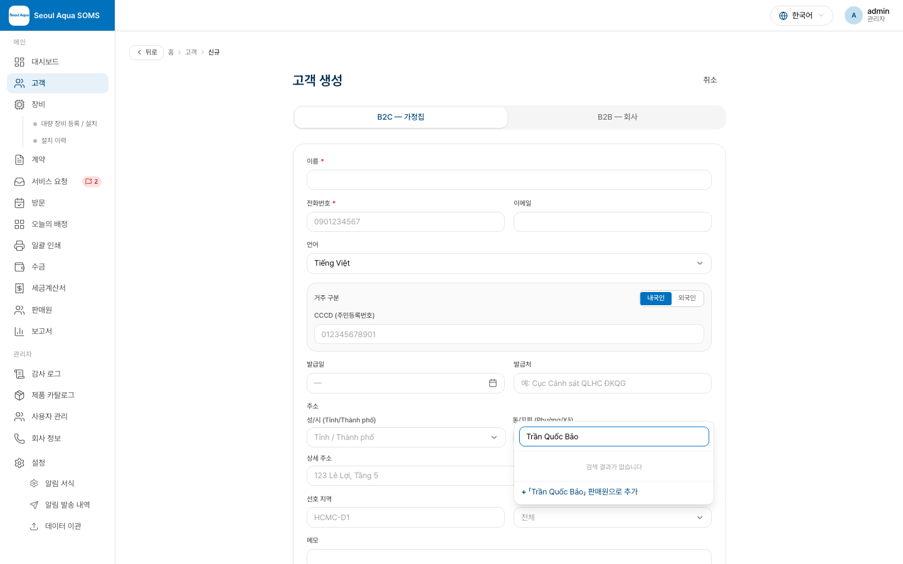

담당 판매원 칸은 타이핑으로 검색합니다. 찾는 사람이 없으면 목록 맨 아래 **「'이름' 판매원으로 추가」** 를 누르세요. 판매원 추가 창(§6.3)이 열리고, 저장하면 그 판매원이 바로 선택됩니다. 고객 등록 화면을 벗어날 필요가 없습니다.

> **고객을 등록해도 포털 계정은 만들어지지 않고, 고객에게 아무것도 발송되지 않습니다.** 포털은 등록 후 「담당자」 탭에서 담당자별로 엽니다(§5.6).

### 5.3 새 고객 등록 — B2B (회사)

**신규 고객 → 「B2B — 회사」**

| 항목 | 필수 | 설명 |
|---|:---:|---|
| 상호 | ● | 회사명 (예: `CÔNG TY TNHH SHERATON VIETNAM`) |
| 약어 코드 | ● | 영문 대문자로 시작하는 2~5자, 숫자 가능 (예: `SHV`). 계약번호에 들어갑니다 |
| 세금 코드 | ● | 베트남 사업자 등록번호 |
| 계약 주체 | ● | 계약서에 서명하는 사람의 이름과 전화번호 |
| 운영 담당자 | | 방문 일정·영수증을 받을 현장 담당자 |

나머지 칸은 B2C와 같습니다.

> **사업장(Site)**: 공장·지점처럼 설치 장소가 여러 곳인 B2B 고객은 사업장을 등록해 장비를 사업장별로 나눕니다. 저장한 뒤 고객 상세 → 「설치 장소」 탭 → 「사업장 추가」에서 사업장 이름·주소·지역을 입력합니다.

### 5.4 고객 상세

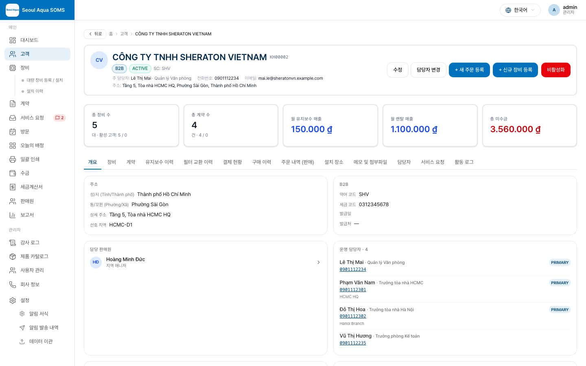

**머리 부분**: 고객명·코드·유형·상태, 주 담당자와 연락처, 주소. 오른쪽에 버튼이 있습니다.

| 버튼 | 하는 일 |
|---|---|
| 수정 | 고객 수정 화면으로 (§5.9) |
| 담당자 변경 | **담당 판매원**을 바꾸는 창 (모든 사무실 직원) |
| + 새 주문 등록 | 주문 등록 (§10) |
| + 신규 장비 등록 | 이 고객으로 장비 등록 마법사 시작 (§7.6) |
| 비활성화 / 재활성화 | §5.10 |

**요약 카드 5개**: 총 장비 수 · 총 계약 수 · 월 유지보수 매출 · 월 렌탈 매출 · 총 미수금

**탭**

| 탭 | 내용 |
|---|---|
| 개요 | 고객 기본 정보 (읽기 전용 — 고치려면 「수정」) |
| 장비 | 보유 장비 목록 + 선택한 장비 상세 (§5.5) |
| 계약 | 이 고객의 모든 계약 |
| 유지보수 이력 · 필터 교환 이력 · 결제 현황 | 준비 중 |
| 구매 이력 | 이 고객의 모든 주문 (§5.7) |
| 주문 내역 (판매) | 장비가 들어간 주문만 (§5.7) |
| 설치 장소 | 사업장 목록과 「사업장 추가」 (B2B 고객에게만 보임) |
| 메모 및 첨부파일 | 준비 중 |
| 담당자 | 계약 주체·운영 담당자 관리 (§5.6) |
| 서비스 요청 | 이 고객의 서비스 요청 |
| 활동 로그 | 이 고객에 대한 변경 기록 |

**확인이 필요한 항목 배너**: 고객 상세 맨 위에 「확인이 필요한 항목」 상자가 뜨면 아래 셋 중 하나가 있다는 뜻입니다. 확인할 것이 없으면 상자는 나오지 않습니다. 각 항목에는 바로 가는 링크가 붙어 있습니다.

| 항목 | 뜻 | 할 일 |
|---|---|---|
| 운영 담당자 확인 필요 | 시스템이 계약 주체 정보로 운영 담당자를 임시로 채워 두었습니다(데이터 이관으로 들어온 고객). 해당 담당자에 「확인 필요」 배지가 붙습니다 | 「담당자 탭 열기」 → §5.6 |
| 월 금액이 없는 계약 | 유효한 임대·유지관리 계약인데 월 금액이 없어 매월 청구가 만들어지지 않습니다. 계약 화면에도 같은 경고가 나옵니다 | 계약 수정(MANAGER 이상)으로 금액 입력 — §8.7 |
| 필터 교환 기록이 없는 장비 | 설치 후 필터 교체 주기가 한 바퀴 지났는데 교환 기록이 없어 다음 교체일을 설치일로 추정하고 있습니다. 설치한 지 한 주기가 안 된 새 장비는 나오지 않습니다 | 「한 번에 입력」으로 해당 장비를 모두 고른 채 날짜 입력 — §5.5, 또는 장비 상세에서 한 대씩 |

### 5.5 장비 탭

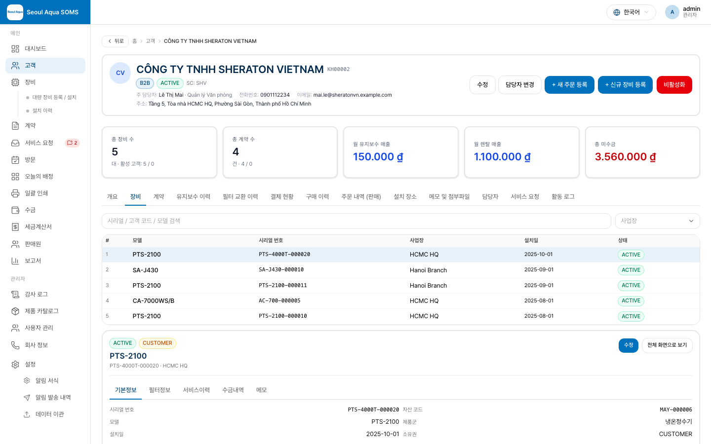

**위쪽 목록 / 아래쪽 상세** 구조입니다.

- 목록은 약 10줄 높이로 고정되고 그 안에서 스크롤합니다. 사업장 필터와 검색(시리얼·고객 코드·모델)이 있습니다.
- 줄을 누르면 그 장비가 강조되고, **목록 아래 상세 영역**이 그 장비로 바뀝니다. 아직 고르지 않았으면 "위 목록에서 장비를 선택하세요"가 보입니다.
- 상세 영역은 탭 5개입니다: **기본정보 · 필터정보 · 서비스이력 · 수금내역 · 메모**. 기본정보에서 자산 코드(`MAY-000001`), 모델, 제품군, 설치일, 소유를 봅니다.
- 상세 영역 오른쪽 위 **「전체 화면으로 보기」** 는 장비 상세 페이지(§7.3)를 엽니다. 이전·교체·해지·회수 같은 작업은 그 페이지에서 합니다.
- 아래 기능 버튼: 신규 등록(F2) · 수정(F5) · 상세 · 닫기 — 모든 사무실 직원이 쓸 수 있습니다.
- 선택한 장비는 주소에 기록되어 새로고침이나 뒤로 가기 후에도 유지됩니다.

**서비스 구성 표** — 점검 주기와 필터 교체 주기를 한 표로 봅니다.

| 열 | 설명 |
|---|---|
| 구분 · 이름 | 정기 점검 / 필터 이름 |
| 주기(기본) · 사용자 주기 | 카탈로그 기본 주기와 이 장비에만 적용하는 주기 (일) |
| 수량 | 필터 개수 |
| 과거 수행일 · 최근 수행일 | 실제로 한 날짜 |
| 다음 예정일 · 잔여일 | 최근 수행일 + 주기로 자동 계산 |
| 상태 | 정상 / 예정 / 교체 예정 / 지연 |

행마다 오른쪽 끝에 **「수정」 · 「삭제」** 버튼이 있습니다(정기 점검 행은 「수정」만). 「수정」을 누르면 그 행의 **사용자 주기 · 수량 · 최근 수행일 · 다음 예정일**(직접 추가한 필터는 **항목명**도)이 입력 칸으로 바뀌고 버튼이 **「저장」 · 「취소」** 로 바뀝니다. 「저장」을 눌러야 반영되고, 「취소」는 고친 내용을 버립니다. 한 번에 한 행씩 고칩니다. 기본 주기는 카탈로그 값이고 과거 수행일 · 잔여일 · 상태는 자동 계산이라 고칠 수 없습니다.

- **사용자 주기 단위**: 필터 행의 주기 칸 옆 드롭다운에서 **일 / 개월**을 고릅니다. 처음에는 기본 주기(일)가 채워져 있습니다. 「개월」로 저장하면 다음 예정일은 **달력 기준**으로 계산됩니다(최근 수행일 2026-08-22 + 6개월 = 2027-02-22). 「일」은 날짜 수를 그대로 더합니다(+180일 = 2027-02-18). 고객마다 주기가 다르면 그 장비에서만 이렇게 바꿉니다.
- 주기는 최대 3600일(120개월), 수량은 1~50 정수입니다. 비우면 카탈로그 기본 주기로 돌아갑니다(직접 추가한 필터는 비울 수 없음).
- **삭제**: 이 장비에 직접 추가한 필터는 지워집니다. 모델에 딸린 필터는 **이 장비에서만** 빠지고 같은 모델의 다른 장비에는 그대로 남습니다. 빠진 필터는 교체 추천·필터 교체 예정 이메일·확인 필요 항목에서도 제외됩니다. 「삭제」를 누르면 확인 창이 뜨고, 확인해야 삭제됩니다.

**필터 교환일 일괄 입력** — 고객 상세 위쪽 **「필터 교환일 일괄 입력」** 버튼(또는 확인 필요 배너의 「한 번에 입력」)을 누르면 이 고객의 장비 여러 대에 필터 최근 교환일을 한 번에 넣습니다. 100대면 100번 고칠 필요가 없습니다.

1. 왼쪽에서 장비를 고릅니다. 모델 이름 옆 체크를 누르면 그 모델 장비가 모두 선택됩니다. 배너에서 열면 교환 기록이 없는 장비가 미리 선택되어 있습니다.
2. 오른쪽에 고른 장비가 가진 필터만 나옵니다. 필터마다 최근 교환일을 넣거나, 「모든 필터에 같은 날짜」에 날짜를 넣고 「적용」.
3. 「저장」. 날짜를 넣은 필터만 저장되고, 고른 장비 중 그 필터가 없는(또는 이 장비에서 뺀) 장비는 건너뜁니다. 결과(새로 입력·수정·건너뜀 수)가 아래에 표시됩니다. 오늘 이후 날짜는 넣을 수 없습니다.

필터 표 위에 **노란 안내**("필터 N개는 교환 기록이 없어 설치일 기준으로 교체일을 계산하고 있습니다…")가 나오면, 그 필터 행의 「최근 수행일」 칸이 강조되어 있습니다. 그 칸에 실제로 마지막으로 바꾼 날짜를 입력하면 다음 예정일이 정확해지고 안내가 사라집니다.

### 5.6 담당자 — 계약 주체와 운영 담당자

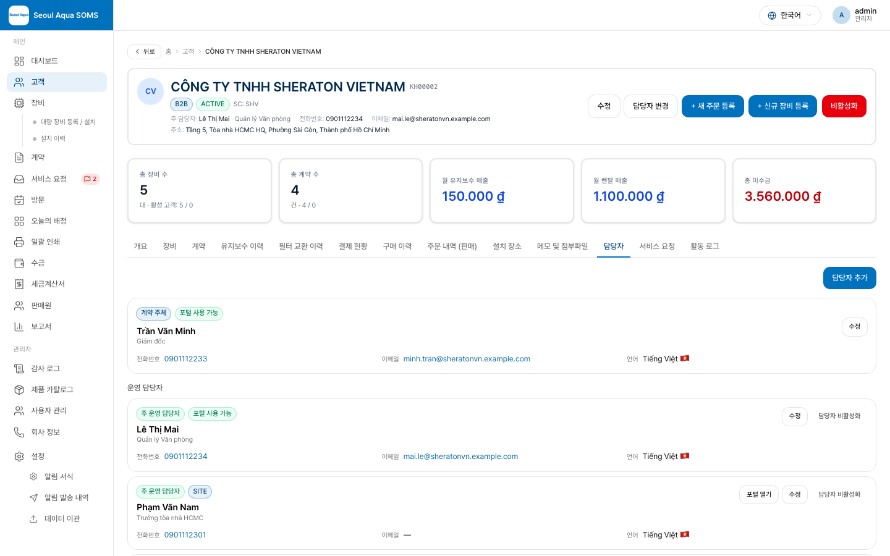

모든 고객은 **계약 주체 1명**과 **운영 담당자 0~N명**을 가집니다.

| 역할 | 받는 것 |
|---|---|
| 계약 주체 | 계약서, 법적 통보, 임대 만료 안내, 연체 안내 |
| 주 운영 담당자 | 방문 하루 전 SMS, 영수증, 필터 교체 예정, 방문 완료 안내 |
| 회계 담당 (B2B) | 세금계산서 이메일 (없으면 주 운영 담당자 → 계약 주체) |

연체 안내는 계약 주체와 주 운영 담당자 두 사람에게 갑니다. 운영 담당자가 없으면 운영 담당자 몫의 알림은 계약 주체가 받습니다.

**담당자 추가**: 「담당자」 탭 → 「담당자 추가」

- 역할(운영 담당자 / 계약 주체), 범위(고객 전체 / 특정 사업장 — B2B), 이름, 직함, 전화, 이메일, 언어, 주 담당 여부, 회계 담당 여부를 입력합니다.
- 주 운영 담당자나 회계 담당은 이메일이 필수입니다.
- 저장해도 고객에게 아무것도 발송되지 않고, 포털 계정도 만들어지지 않습니다.

**「확인 필요」 배지**: 데이터 이관으로 들어온 고객은 계약 주체가 운영 담당자로도 복사되어 있고, 이 담당자 카드(와 고객 개요)에 「확인 필요」 배지가 붙습니다. 담당자 탭에서 맞는 사람인지 확인하고, 이메일을 넣어 저장하세요(주 운영 담당자는 이메일이 필수). 다른 사람을 운영 담당자로 지정하거나 이 담당자를 삭제해도 됩니다. 수정하거나 삭제하면 배지는 사라집니다.

각 담당자 카드의 「수정」으로 고치고, 「담당자 비활성화」로 내립니다. 계약 주체 정보 수정은 MANAGER 이상입니다.

**포털 열기**: 포털이 아직 없고 전화번호가 있는 담당자 카드에 **「포털 열기」** 버튼이 있습니다(모든 사무실 직원). 포털이 열린 담당자에게는 「포털 사용 가능」 배지가 붙습니다.

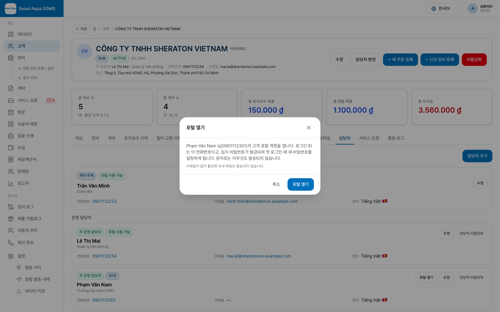

1. 「포털 열기」 → 확인 창에서 로그인 ID(그 담당자의 전화번호)와 안내 메일 발송 여부를 확인 → 「포털 열기」
2. 임시 비밀번호(10자)가 **화면에 한 번만** 표시됩니다. 그 자리에서 고객에게 **전화로 불러주고** 「전달 완료 — 닫기」를 누릅니다.

- 문자는 보내지 않습니다. 담당자에게 이메일이 있으면 비밀번호가 없는 활성화 안내 메일만 갑니다.
- 고객은 첫 로그인 때 새 비밀번호를 정합니다.
- 「담당자 비활성화」는 그 담당자의 포털을 닫습니다. 다시 열 때도 「포털 열기」를 씁니다.

### 5.7 구매 이력 · 주문 내역(판매) 탭

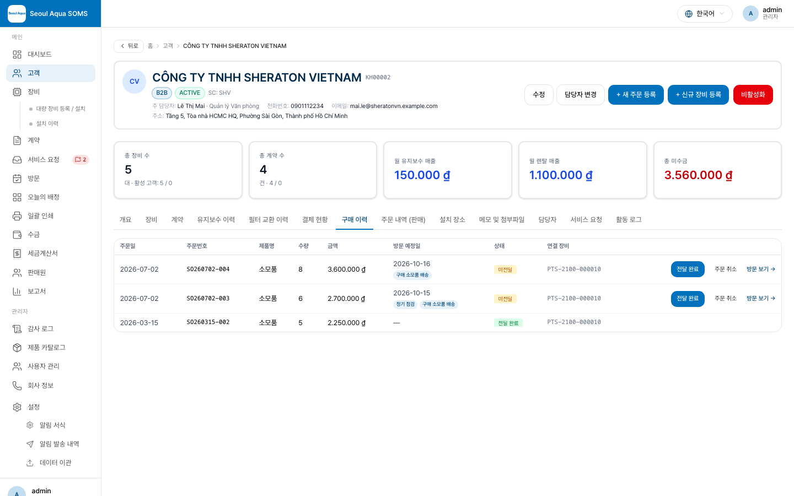

- **구매 이력**: 이 고객의 모든 주문(소모품·장비·기타)
- **주문 내역 (판매)**: 그중 장비가 들어간 주문

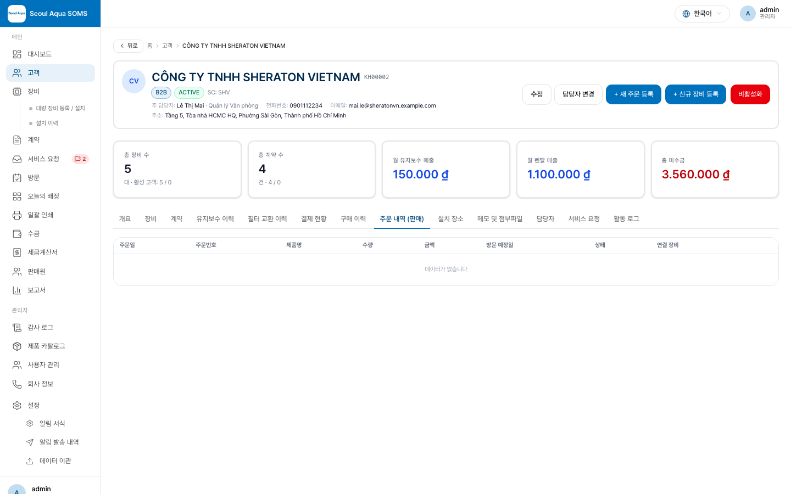

주문 등록은 탭 안이 아니라 머리 부분의 「+ 새 주문 등록」 버튼에서 합니다(§10).

### 5.8 담당 판매원 지정

두 군데서 바꿀 수 있습니다.

- 고객 상세 머리의 **「담당자 변경」** 버튼 → 판매원 선택
- **고객 수정** 화면의 「담당 판매원」 칸 (등록 화면과 같은 즉석 추가 지원)

모든 사무실 직원이 바꿀 수 있습니다.

### 5.9 고객 수정과 포털 비밀번호 초기화

고객 상세 → **「수정」**

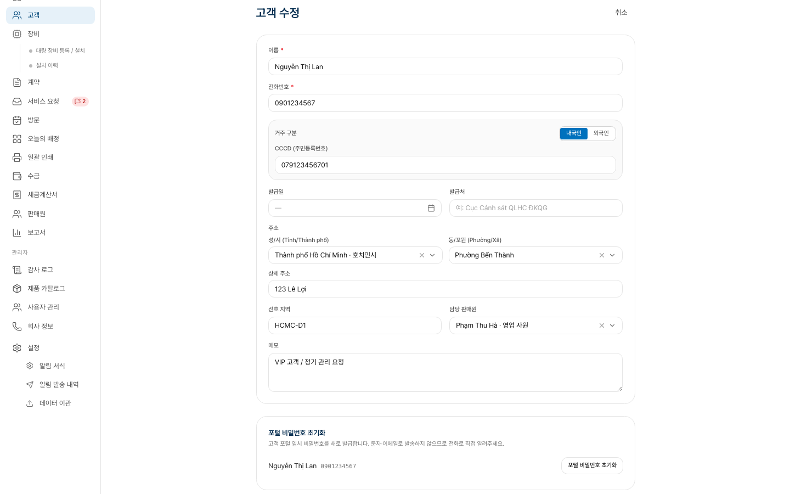

등록 때와 같은 칸을 고칩니다. 화면 아래에 **「포털 비밀번호 초기화」** 카드가 있습니다(MANAGER 이상).

1. 카드에 포털이 열린 담당자만 나열됩니다. 없으면 "포털 계정이 있는 연락처가 없습니다."가 보입니다.
2. 해당 담당자의 「포털 비밀번호 초기화」 → 확인
3. 새 임시 비밀번호(10자)가 **화면에 한 번만** 표시됩니다. 창을 닫으면 다시 볼 수 없으니 그 자리에서 고객에게 **전화로 불러주세요**.

- 문자·이메일은 보내지 않습니다.
- 고객의 기존 로그인은 모두 끊기고, 다음 로그인 때 새 비밀번호를 정하게 됩니다. 로그인 잠금도 풀립니다.

### 5.10 고객 비활성화

MANAGER 이상:

1. 고객 상세 → 「비활성화」 → 사유 입력 → 확인
2. 이 고객의 **초안·서명 대기·활성·수정됨 계약이 모두 해지**되고, 사용 중인 장비는 **비활성**으로 바뀝니다.

되돌리는 「재활성화」는 **ADMIN만** 할 수 있습니다. 고객은 삭제되지 않습니다.

---

## 6장. 판매원 관리

### 6.1 판매원이란?

판매원은 **사용자 계정과 별개로 등록하는 명단**입니다. 대부분 시스템에 로그인하지 않는 외부 영업 인력이기 때문입니다. 이름만 있으면 등록되고, 전화·이메일·직함·비고는 선택입니다.

> 2026-09-25 개편 때 판매원을 새 명단으로 옮기면서 **기존 고객의 담당 판매원 지정은 모두 비워졌습니다.** 판매원을 등록한 뒤 고객마다 다시 지정하세요(§5.8).

### 6.2 판매원 목록

**사이드바 → 판매원**

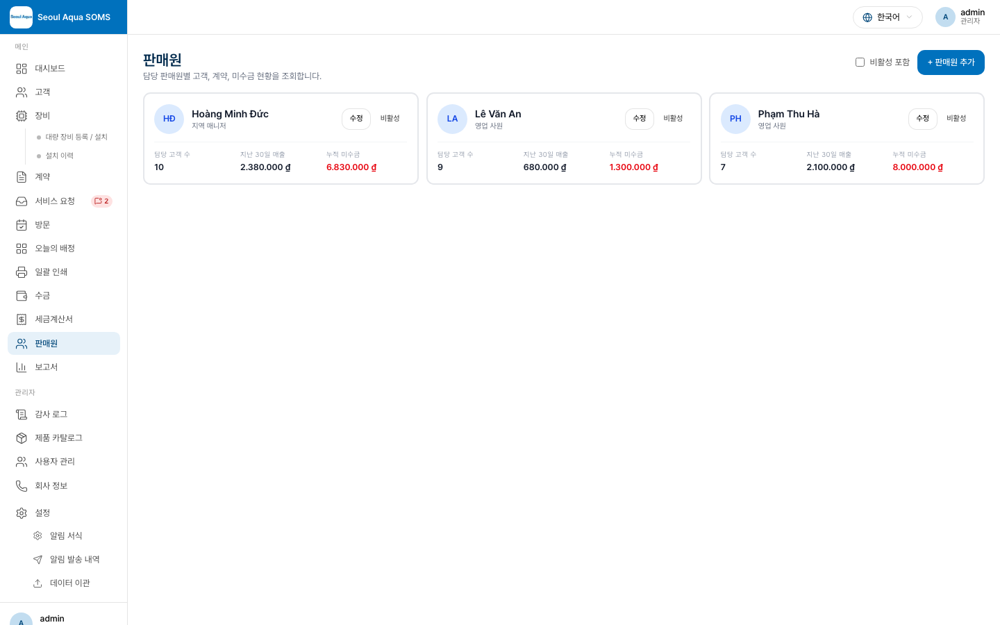

판매원마다 카드가 하나씩 있습니다.

| 카드 숫자 | 뜻 |
|---|---|
| 담당 고객 수 | 이 판매원이 담당하는 고객 수 |
| 지난 30일 매출 | 최근 30일 동안 담당 고객에게서 들어온 매출 |
| 누적 미수금 | 담당 고객의 미수금 합계 |

- 오른쪽 위 **「비활성 포함」** 을 체크하면 비활성 판매원도 보입니다.
- 카드를 누르면 상세로 갑니다.

### 6.3 판매원 등록·수정·비활성

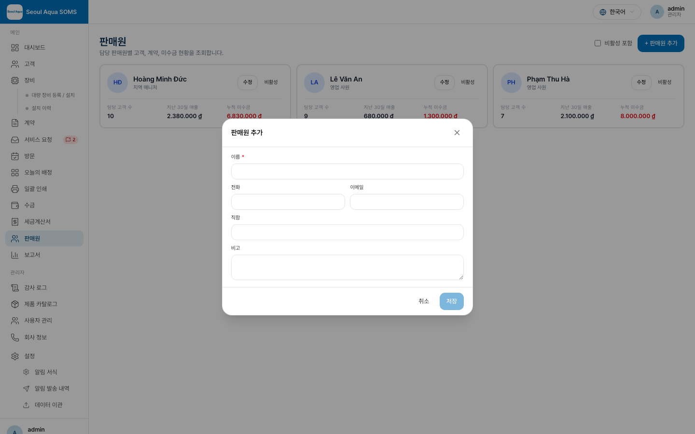

- **「+ 판매원 추가」** → 이름(필수) · 전화 · 이메일 · 직함 · 비고 → 저장. **모든 사무실 직원**이 등록할 수 있습니다. 고객 등록·수정 화면의 즉석 추가(§5.2)도 같은 창입니다.
- 카드의 **「수정」**, **「비활성」** 은 MANAGER 이상입니다.
- 비활성은 삭제가 아닙니다. 지난 고객의 판매원 기록은 그대로 남고, 새로 고를 때 목록에 나오지 않을 뿐입니다.

### 6.4 판매원 상세

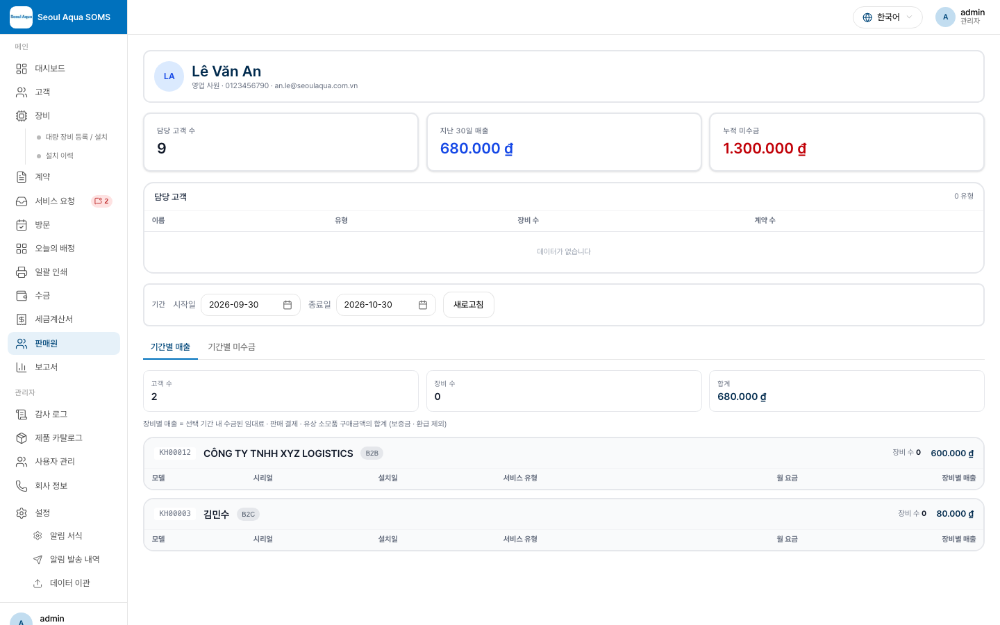

- 위쪽: 판매원 요약 카드와 **담당 고객** 목록(이름·유형·장비 수·계약 수)
- 아래: 조회 기간을 고르고 탭 2개로 봅니다.

**기간별 매출** — 담당 고객별 카드에 기간 안에 들어온 매출을 장비·주문 단위로 보여줍니다. 매출에 넣는 것은 수금된 렌탈료·장비 판매 대금·유상 소모품 주문이고, **보증금과 환불은 뺍니다.**

**기간별 미수금**

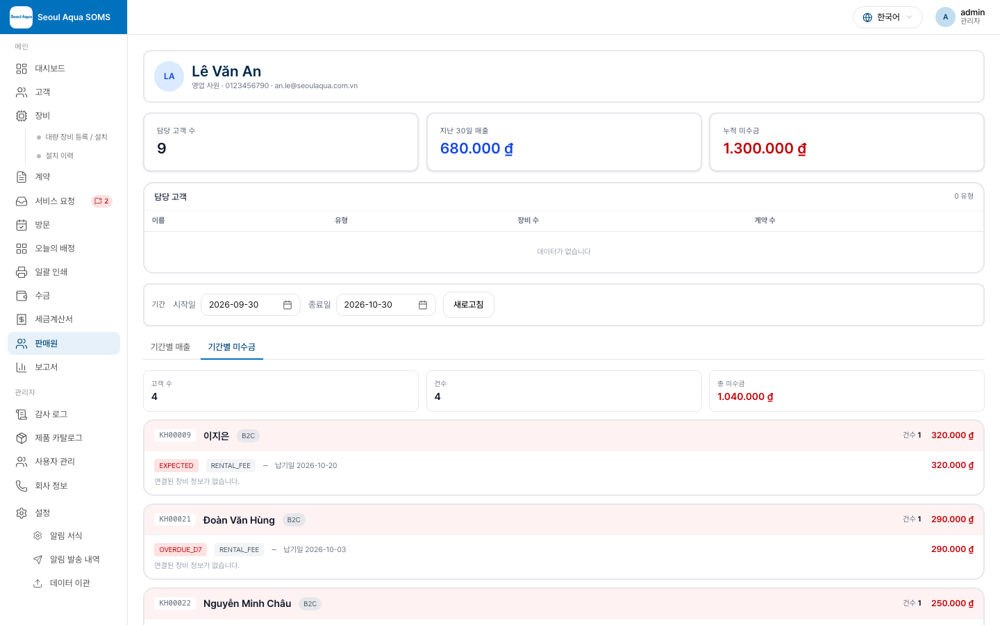

담당 고객별로 기간 안에 기한이 돌아온 미수금을 건별로 보여줍니다.

---

## 7장. 장비 관리

### 7.1 장비의 상태

| 상태 | 뜻 |
|---|---|
| 사용 중 (ACTIVE) | 고객이 쓰고 있음 |
| 이동됨 (RELOCATED) | 다른 사업장으로 옮김 |
| 교체됨 (REPLACED) | 다른 장비로 교체됨 |
| 비활성 (DEACTIVATED) | 잠시 쓰지 않음 (고객 비활성화 시 자동) |
| 해지됨 (TERMINATED) | 계약 해지로 서비스 종료 |

**자산 코드(관리번호)** — 장비가 고객에게 배정되는 순간(= 등록 완료) 시스템이 발행합니다.

- 형식: **`MAY-` + 6자리 순번** (예: `MAY-000001`)
- 순번은 **모델별**입니다. 모델마다 `MAY-000001`부터 따로 셉니다. 그래서 **모델이 다르면 같은 번호가 있습니다.** 자산 코드로 장비를 찾을 때는 모델을 함께 보세요.
- 같은 모델 안에서는 겹치지 않습니다. 고객이 달라도 같은 모델이면 순번을 이어받습니다.
- 한 번 발행되면 바꿀 수 없고, 해지·회수돼도 결번 처리하지 않습니다.
- 시리얼 번호는 자산 코드와 별개입니다.

### 7.2 장비 목록

**사이드바 → 장비**

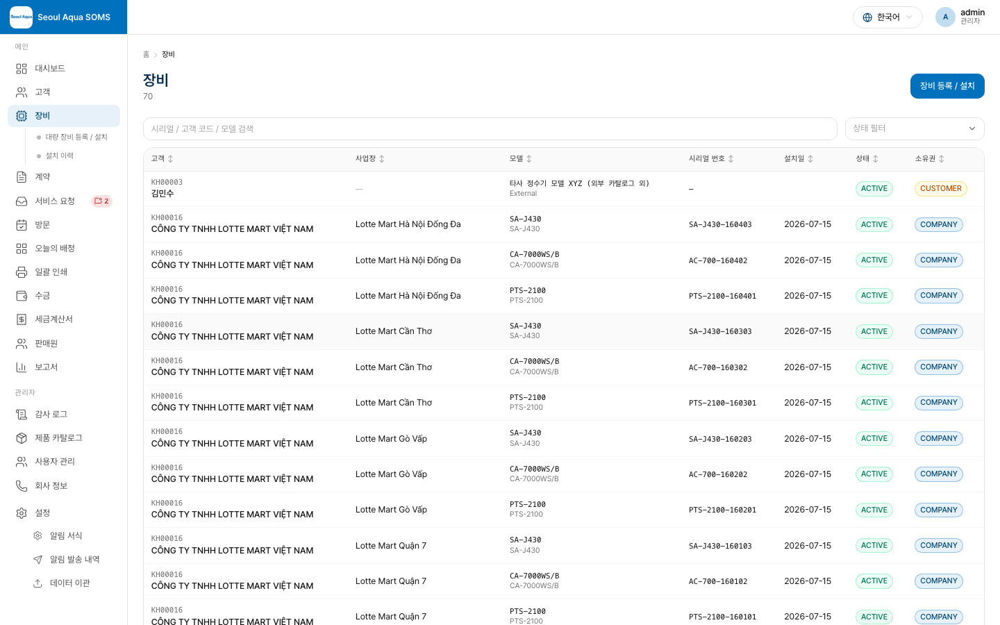

- 검색(시리얼·고객 코드·모델), 상태 필터, **설치일 기간 필터**(설치일 부터 ~ 까지, 양 끝 날짜 포함 — 한쪽만 넣어도 됨)
- 고른 필터는 주소창 주소에 그대로 붙습니다(`/o/ko/equipment?installedFrom=2024-01-01&installedTo=2024-01-31&status=ACTIVE`). 주소를 복사해 보내면 받는 사람도 같은 필터로 열립니다. 로그인 전이면 로그인 뒤 같은 화면으로 돌아옵니다.
- 열: 고객 · 사업장 · 모델 · 시리얼 · 설치일 · 상태 · 소유
- 오른쪽 위 **「장비 등록 / 설치」** 버튼 → 단일 등록 마법사(§7.6)
- 줄을 누르면 장비 상세로 갑니다.

### 7.3 장비 상세

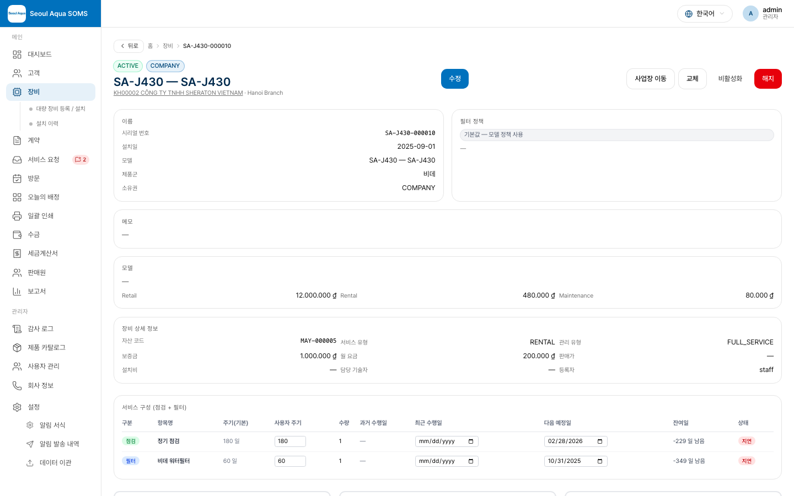

어디서 장비를 눌러도(장비 목록, 고객 상세의 「전체 화면으로 보기」) 같은 페이지가 열립니다.

- **정보 카드**: 시리얼 · 설치일 · 모델 · 제품군 · 소유 (비활성·해지·회수일이 있으면 함께)
- **상세 정보**: 자산 코드 · 서비스 유형 · 관리 유형 · 보증금 · 월 요금 · 판매가 · 설치비 · 담당 기사 · 등록자
- **서비스 구성 표**(§5.5와 같음), 구매 이력, 최근 작업, 다음 일정, 연결된 계약, 결제 내역, 필터 교환 이력

**작업 버튼** (모든 사무실 직원)

| 버튼 | 하는 일 |
|---|---|
| 수정 | 장비 정보 수정 (§7.4) |
| 사업장 이동 | B2B 고객의 다른 사업장으로 옮김 |
| 교체 | 새 장비로 교체 기록 |
| 비활성화 / 재활성화 | 일시 중지와 재개 |
| 해지 | 서비스 종료 |
| 회수 일자 기록 | 장비를 가져온 날짜 기록 |

### 7.4 장비 정보 수정

장비 상세 → **「수정」**. 모든 사무실 직원이 쓸 수 있고, 장비 상태와 관계없이 열립니다. 입력 실수를 바로잡는 화면입니다.

| 구분 | 항목 |
|---|---|
| 모델 | 브랜드·제품군을 거쳐 모델 변경 (§7.5의 연동 선택) |
| 설치 정보 | 사업장 · 설치일 · 시리얼 번호 (자산 코드는 읽기 전용) |
| 서비스 구성 | 서비스 유형(렌탈/판매/유지보수) · 관리 유형 · 소유 |
| 금액 | 보증금 · 월 요금 · 판매가 · 설치비 |
| 주기 | 정기점검 주기(일) · 필터 기본 주기(일) |
| 이력 보정 | 최근 점검일(수동) |
| 기타 | 메모 · 장비 설명(카탈로그에 없는 기기용) |

- **최근 점검일(수동)** 을 넣으면 방문 기록보다 그 값이 우선하고, 다음 점검일이 다시 계산됩니다. 비우면 방문 기록 기준으로 돌아갑니다.
- **필터별 최근 교체일**은 서비스 구성 표의 「수정」(§5.5)에서 고칩니다. 여러 대는 고객 상세의 「필터 교환일 일괄 입력」을 쓰세요.
- 주기를 **0**으로 두면 카탈로그 기본값을 씁니다.
- 이 보정값은 기사 앱의 교체 추천과 필터 교체 예정 이메일에도 반영됩니다.

- **모델을 바꾸면 필터도 새 모델 구성을 따릅니다.** 이 장비에 있던 필터 중 새 모델에 없는 것은 저장할 때 빠지며, 그 필터의 최근 교체일 기록도 함께 지워집니다. 빠질 필터가 있으면 저장 전에 목록과 함께 확인 창이 뜹니다. 새 모델에도 있는 필터는 주기·최근 교체일이 그대로 유지되고, 직접 이름을 넣어 추가한 필터는 남습니다.

> 비활성화·해지·회수는 이 수정 화면이 아니라 상세의 전용 버튼으로 하세요.

### 7.5 대량 장비 등록 / 설치 (5단계)

**사이드바 → 장비 → 대량 장비 등록 / 설치**

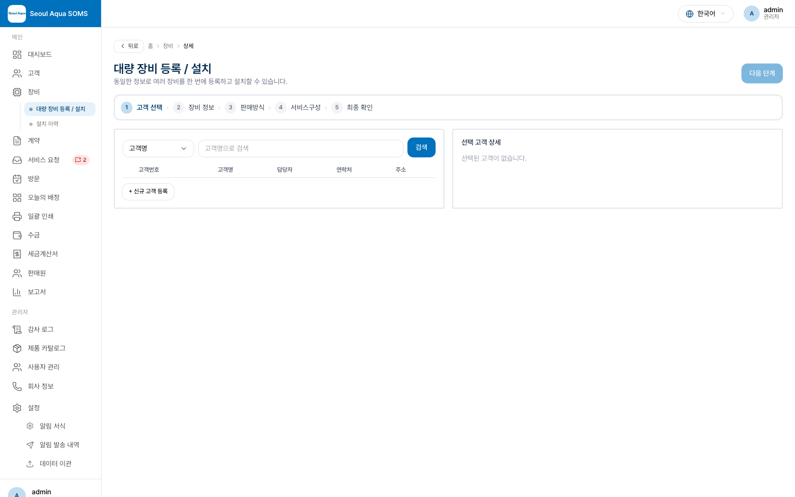

같은 모델 여러 대를 한 번에 등록·설치합니다.

1. **고객 선택** — 코드·이름·담당자·연락처로 검색. 없으면 그 자리에서 새 고객 등록. B2B는 사업장도 고릅니다.
2. **장비 정보** — 브랜드 · 제품군 · 모델을 고릅니다. 셋 중 무엇을 먼저 골라도 나머지가 좁혀집니다(모델을 먼저 고르면 브랜드·제품군이 채워짐). 수량 · 설치일 · 담당 기사 · 설치 메모 입력. 자산 코드는 완료 때 자동 발행됩니다. 이미 고객 현장에 설치되어 있는 장비를 시스템에 올리는 경우 **「이미 설치된 장비」** 를 켜세요.
3. **판매 방식** — 렌탈 / 판매 / 유지보수
   - 렌탈: 보증금 · 월 임대료 · 계약 기간 → 계약 1건
   - 판매: 판매가 · 설치비. 「계약서도 함께 생성」을 켜면 판매 계약 1건. 관리 방식이 **전체 서비스**면 유지보수 계약이 1건 더 생깁니다. **고객 자가 관리**면 점검·필터 구성이 꺼집니다.
   - 유지보수: 월 관리비 · 계약 기간 → 계약 1건
   - 계약번호는 비워두면 자동 발번, 직접 넣으면 그 번호(중복이면 거부). 계약일도 정할 수 있습니다.
4. **서비스 구성** — 정기점검 주기와 필터 목록. 모델의 기본 필터가 채워지고, 주기(일)를 고치면 다음 예정일이 다시 계산됩니다. 필터마다 **최근 교체일**을 넣을 수 있고, 「모든 필터에 같은 날짜」 → 「적용」이면 한 번에 채워집니다. 여기서 넣은 날짜가 **등록되는 모든 장비**에 똑같이 들어갑니다. 비워 두면 설치일 기준으로 계산합니다.
5. **최종 확인** — 고객·장비·수량·판매 방식·금액·**생성될 계약 수**·서비스 구성을 한 화면에서 확인하고 「완료」.

완료하면 장비와 계약, 그리고 **설치 방문**이 함께 만들어지고 설치 이력에 기록됩니다. 「이미 설치된 장비」를 켰으면 설치 방문은 설치일에 **완료**된 상태로 만들어지고 수금 예정 금액도 붙지 않습니다. 끄면 기사에게 배정되는 **예정** 방문입니다.

> 금액 칸은 `1.500.000`처럼 세 자리마다 점이 찍힙니다(베트남 표기).

### 7.6 장비 등록 / 설치 (단일·여러 줄)

**장비 목록 → 「장비 등록 / 설치」** 또는 고객 상세 → 「+ 신규 장비 등록」

서로 다른 장비를 여러 줄로 각각 등록할 때 씁니다. 단계는 4개(고객 → 장비 정보 → 판매 방식 → 서비스 구성)이고, **줄마다** 모델·판매 방식·서비스 구성을 따로 정합니다. 각 줄에서 시리얼을 「자동 생성」 또는 「직접 입력(접두어)」으로 고를 수 있습니다. 계약번호·계약일은 줄이 아니라 계약 단위로 한 번 입력합니다.

### 7.7 설치 이력

**사이드바 → 장비 → 설치 이력**

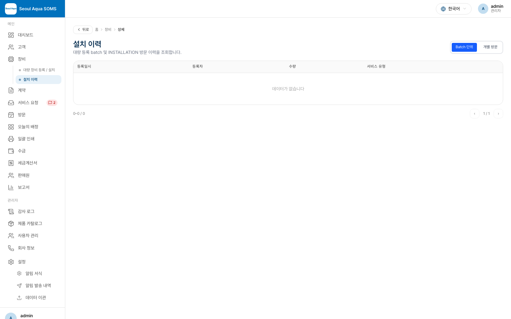

- **배치 보기**: 대량 등록 건 기준 — 누가 언제 몇 대를 등록했는지
- **방문 보기**: 설치 방문 기준 — 방문마다 어떤 장비가 설치됐는지

---

## 8장. 계약 관리

### 8.1 계약 종류

| 종류 | 설명 |
|---|---|
| 판매 (SALE) | 한 번에 대금을 받고 고객 소유로 넘김 |
| 임대 (RENTAL) | 매달 임대료를 받음. 만기 때 소유권 이전(기본) 또는 회수 |
| 유지관리 (MAINTENANCE) | 고객 소유 장비의 점검만. 카탈로그에 없는 기기도 가능 |

**계약번호**

- B2C: `HD-20261015/JH-KH00001`
- B2B: `HD-20261015/JH-SHV`, 부록은 `-A1`, `-A2` …

### 8.2 계약 목록

**사이드바 → 계약**

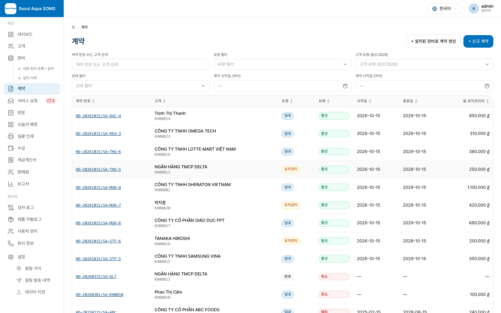

- 필터: 검색 · 계약 유형 · 고객 유형 · 상태 · 시작일 기간
- 버튼: **「+ 신규 계약」**, **「+ 설치된 장비로 계약 생성」**(이미 설치된 장비를 묶어 계약을 만듦)

### 8.3 계약 상세

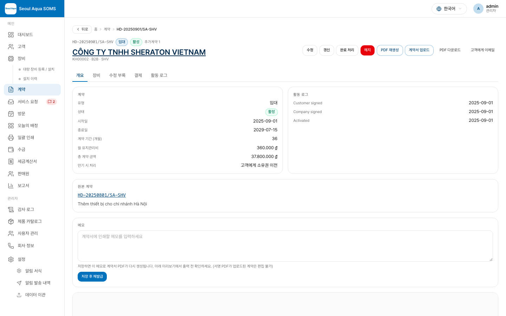

**탭**: 개요 · 장비 · 수정 부록 · 결제 · 활동 로그

**머리 부분 버튼** (계약 상태에 따라 보이는 것이 다릅니다)

| 버튼 | 권한 | 하는 일 |
|---|---|---|
| 서명 요청 | 모든 직원 | 초안 → 서명 대기 |
| 활성화 | MANAGER+ | 서명 대기 → 활성 |
| 수정 | MANAGER+ | 활성 계약 변경 (§8.6) |
| 갱신 | MANAGER+ | 새 계약 초안 만들기 (§8.7) |
| 완료 처리 | MANAGER+ | 계약을 완료로 |
| 해지 | MANAGER+ | 중도 해지. 환불과 장비 회수 여부를 함께 정함 |
| 판매로 변환 | MANAGER+ | 임대 → 판매. 보증금 환불 처리 포함 |
| 만기 SMS 발송 | MANAGER+ | 「만기 임박 알림」 카드에서 계약 주체에게 임대 만료 안내 SMS를 한 번 보냄 (현재 문안 미등록이라 실패 — §1.4) |
| PDF 재생성 · PDF 다운로드 | | 계약서 PDF |
| 계약서 업로드 | MANAGER+ | 서명된 스캔본으로 교체 (§8.4) |
| 고객에게 이메일 | | 계약서 사본 이메일 (현재 모의발송) |
| 취소 | MANAGER+ | 초안·서명 대기 계약 폐기 |

활성 계약에는 「+ 기기 설치」 버튼도 있어 이 계약에 장비를 추가 설치합니다.

**출금일 (매월)**: 임대·유지관리 계약의 「개요」 탭에 있는 칸입니다. 매달 요금을 받는 날(1~31)이며, 매월 청구의 납부기한이 이 날이 됩니다. 비우면 10일이고, 그 달에 없는 날(예: 2월의 31)은 말일로 계산합니다. 모든 사무실 직원이 초안·활성 계약에서 숫자를 입력하고 「저장」으로 바꿀 수 있습니다. 바꾼 뒤 **새로 만들어지는** 청구부터 적용되고 이미 만들어진 청구는 그대로입니다. 연체 안내(D+7 등)도 이 기한부터 셉니다(§12.6).

월 금액이 없는 임대·유지관리 계약에는 경고가 표시됩니다. 월 금액이 없으면 매월 청구가 만들어지지 않으니 계약 수정(§8.7)으로 금액을 넣으세요.

### 8.4 서명된 계약서 업로드

MANAGER 이상은 자동 생성된 PDF 대신 **서명·날인이 끝난 스캔본**을 올릴 수 있습니다. 「계약서 업로드」 → PDF 선택 → 저장. 올린 파일이 자동 생성본을 대신합니다.

### 8.5 계약서 메모 편집

계약 상세의 **메모** 칸에 계약서에 인쇄할 내용을 적고 **「저장 후 재발급」** 을 누르면 계약서 PDF가 다시 만들어지고 바로 아래 미리보기가 갱신됩니다. 초안·활성 계약에서 MANAGER 이상이 할 수 있습니다. 서명본이 업로드된 계약은 업로드본이 우선이라 메모 칸이 나오지 않습니다.

### 8.6 새 계약 작성

1. 계약 목록 → 「+ 신규 계약」
2. 4단계: **고객 → 유형 및 장비 → 가격 → 확인**
3. 저장하면 **초안**이 만들어지고 계약번호가 발급됩니다.
4. 계약서 PDF를 출력해 서명받고 → 「서명 요청」 → MANAGER가 「활성화」

> **계약을 활성화해도 설치 방문은 생기지 않습니다.** 설치 방문은 장비 등록 마법사(§7.5·§7.6)를 완료할 때 만들어집니다. 새 장비를 설치하는 계약이면 장비 등록 마법사로 시작하는 편이 빠릅니다 — 장비·계약·설치 방문이 한 번에 만들어집니다.

### 8.7 계약 수정 (활성 계약)

MANAGER 이상, 활성 계약에서 「수정」. 변경 유형을 고릅니다: **월 요금 조정 · 장비 추가 · 장비 제거 · 범위 변경**

- B2C: 계약을 그 자리에서 고치고 PDF를 다시 만듭니다.
- B2B: 부록(`-A1`, `-A2` …)이 생기고 원 계약과 연결됩니다.

변경 전후는 감사 로그에 남습니다.

### 8.8 계약 갱신

MANAGER 이상, **활성** 계약에서 「갱신」 → 유지관리 또는 임대, 월 요금, 기간(개월)을 넣으면 새 **초안** 계약이 만들어집니다. 원래 계약은 그대로 둡니다. 임대 계약의 종료와 소유권 이전은 종료일에 자동 처리됩니다(§3.2 임대 종료 처리).

### 8.9 계약 상태

```
초안(DRAFT) → 서명 대기(PENDING_SIGNATURE) → 활성(ACTIVE) ─┬→ 수정됨(AMENDED)
      │                     │                                ├→ 완료(COMPLETED)
      └──────── 취소(CANCELLED) ┘                             └→ 해지(TERMINATED)
```

- **완료**는 임대 종료일 자동 처리나 「완료 처리」 버튼으로만 됩니다. 돈을 다 받았다고 저절로 완료되지 않습니다.
- 연체는 계약 상태가 아니라 **수금 건의 상태**로 표시됩니다(§12).

---

## 9장. 방문 관리

### 9.1 방문 유형

| 유형 | 화면 표기 | 어떻게 생기나 |
|---|---|---|
| INSTALLATION | 설치 | 장비 등록·대량 등록 마법사 완료 시 |
| PERIODIC_INSPECTION | 정기 점검 | 직원이 등록, 또는 고객의 「정기점검」 요청 승인 |
| REPAIR | 수리 | 「수리」 요청 승인 또는 직원 등록 |
| FILTER_REPLACEMENT | 필터 교체 | 「부품 교체」 요청 승인 또는 직원 등록 |
| RELOCATION | 이전 설치 | 「이전 설치」 요청 승인 또는 직원 등록 |
| PAYMENT_COLLECTION | 수금 | 직원 등록 |
| RETRIEVAL | 장비 회수 | 임대 종료 처리(회수 조건) 또는 해지 |
| CONSUMABLE_DELIVERY | 구매 소모품 배송 | 주문 등록 시 (§10) |
| OTHER | 기타 | 직원 등록 |

> **추가 유형**: 주문을 기존 방문에 붙이면(§10.2) 그 방문에 「구매 소모품 배송」이 추가 유형으로 붙어, 한 번 방문에 점검과 납품을 같이 합니다. 방문을 새로 만들 때 추가 유형을 고르는 칸은 없습니다.

### 9.2 방문 목록

**사이드바 → 방문**

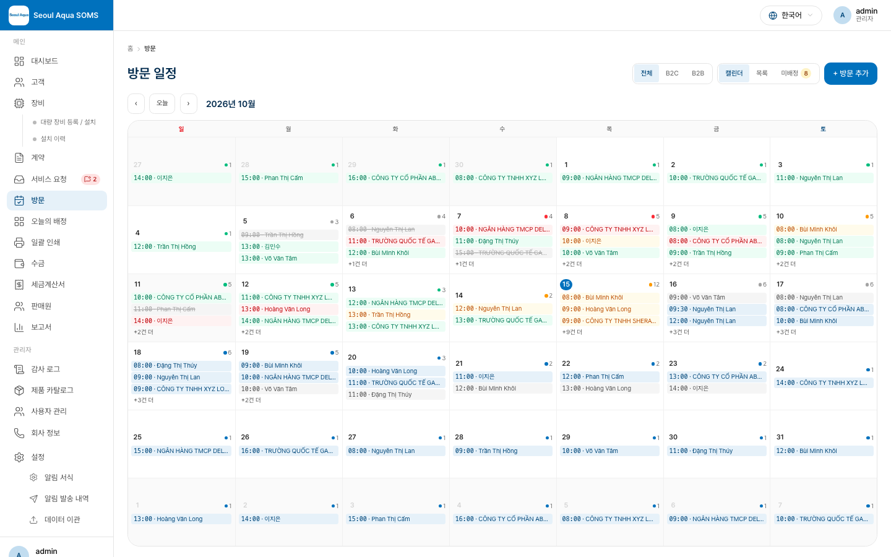

- 보기 3가지: **캘린더(기본) · 목록 · 미배정**. 미배정 보기 버튼에 기사 미배정 건수가 표시됩니다.
- 목록 필터: 상태 · 유형 · 기간, 그리고 고객 유형

### 9.3 방문 상세

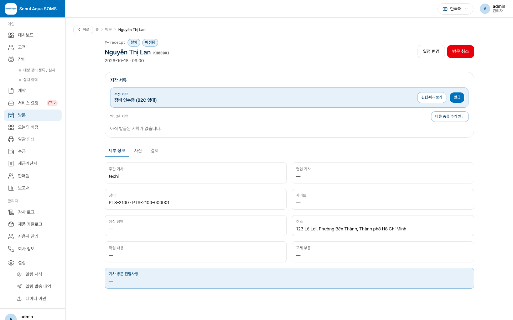

- **머리**: 유형·상태, 고객, 일시. 「일정 변경」·「방문 취소」 버튼
- **지참 서류 카드**: 방문 유형과 고객 유형에 맞는 **추천 서류**가 나오고, 서류마다 「편집·미리보기」와 「발급」 버튼이 있습니다. 「다른 종류 추가 발급」으로 추천 밖의 서류도 발급합니다. 아래에 발급된 서류 목록이 쌓입니다.
- **탭**: 세부 정보 · 사진(기사가 올린 현장 사진, 누르면 원본) · 결제
  - 세부 정보: 주관 기사 · 협업 기사 · 장비 · 사이트 · 예상 금액 · 주소 · 작업 내용 · 교체 부품 · 기사 방문 전달사항
- **기사 배정**: 기사가 정해지지 않은(제안됨) 방문에는 추천 기사 상위 3명이 보이고, 주관 기사와 협업 기사를 골라 확정합니다.
- **연관 서비스 요청 카드**: 서비스 요청에서 만들어진 방문이면 요청 코드·유형·상태와 링크
- **연관 구매 카드**: 주문이 연결된 방문이면 품목·수량·금액 (보기 전용)

#### 서류 편집·미리보기

「편집·미리보기」를 누르면 **문서 메모** 칸이 열립니다(방문 소견이 미리 채워짐). 「미리보기 새로고침」으로 실제 PDF를 확인하고 「편집 내용으로 발급」으로 발급합니다. 편집 내용은 그 PDF에만 들어가고 방문 소견 원본은 바뀌지 않습니다. 편집 창이 열려 있는 동안 그 서류의 일반 「발급」 버튼은 잠깁니다.

**발급 조건**: 주관 기사가 정해져 있고, 취소·실패 상태가 아닌 방문만 발급할 수 있습니다.

### 9.4 지참 서류 자동 추천

| 방문 유형 | 고객 | 추천 서류 |
|---|---|---|
| 설치 | B2C, 판매 계약 | 판매 영수증 (SALE_RECEIPT_B2C) |
| 설치 | B2C, 그 밖의 계약 | 장비 인수증 (DELIVERY_RECEIPT) |
| 설치 | B2B | 출고서 Mẫu 02-VT (DELIVERY_SLIP_B2B) |
| 정기 점검 | B2C | 정기점검표 (PERIODIC_CHECK_B2C) |
| 정기 점검 | B2B | 정기점검 확인서 (PERIODIC_CHECK_B2B) |
| 구매 소모품 배송 | B2C | 판매 영수증 (SALE_RECEIPT_B2C) |
| 구매 소모품 배송 | B2B | 출고서 (DELIVERY_SLIP_B2B) |
| 수리·필터 교체·이전 설치·수금·장비 회수·기타 | 모두 | 작업확인서 (WORK_CONFIRMATION) |

구매 소모품 배송 서류에는 연결된 주문의 품목이 들어갑니다.

### 9.5 새 방문 만들기

**방문 → 「+ 방문 추가」**

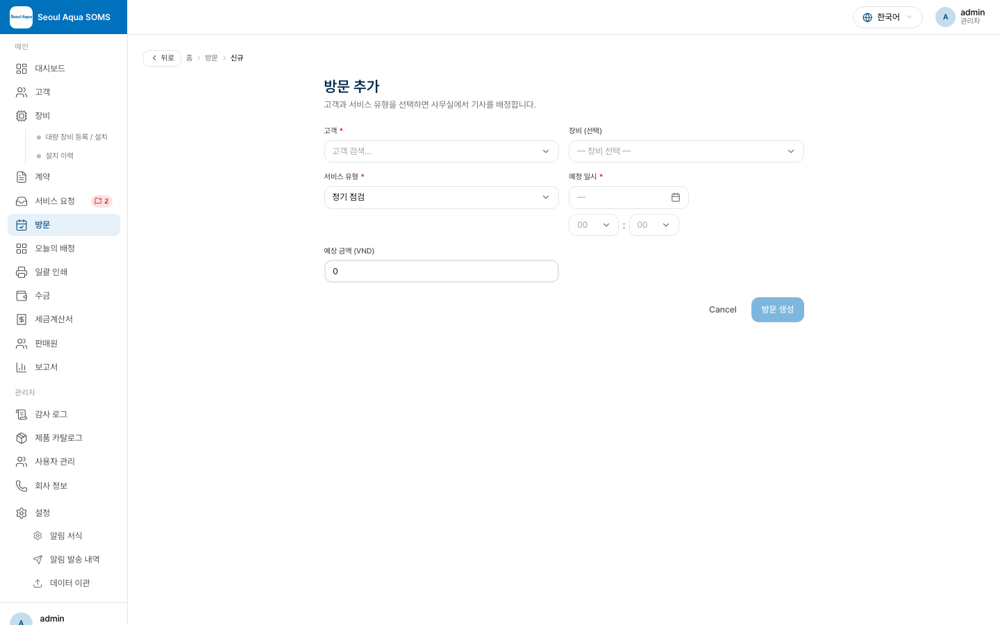

1. 고객 · 사업장 · 장비 선택
2. 방문 유형(하나) · 일시 · 예상 금액 입력
3. 저장 → **제안됨** 상태의 방문이 생깁니다.
4. 방문 상세의 기사 배정(§9.3) 또는 오늘의 배정 보드(§9.7)에서 기사를 정하면 **예정됨**이 됩니다.

추천 순서는 **선호 기사 → 지역 일치 → 그날 업무량이 적은 기사**입니다. 추천은 참고일 뿐이고 누구든 골라도 됩니다.

> 방문을 만들거나 기사를 정해도 고객·기사에게 문자가 가지 않습니다. 고객 문자는 방문 전날 16:00 자동 알림 하나입니다(§3.2).

### 9.6 일정 변경과 취소

- **일정 변경**: 방문 상세 → 「일정 변경」 → 새 날짜·시간과 사유 → 같은 방문이 새 일시의 **예정됨**으로 바뀝니다(새 방문을 따로 만들지 않음). 예정됨·방문 실패·재예약 상태에서 할 수 있어, 기사가 실패 처리한 방문을 다시 잡을 때도 씁니다. 전날 알림 SMS도 새 날짜 기준으로 다시 나갑니다.
- **취소**: 방문 상세 → 「방문 취소」 → 사유 → **취소됨**

### 9.7 오늘의 배정

**사이드바 → 오늘의 배정**

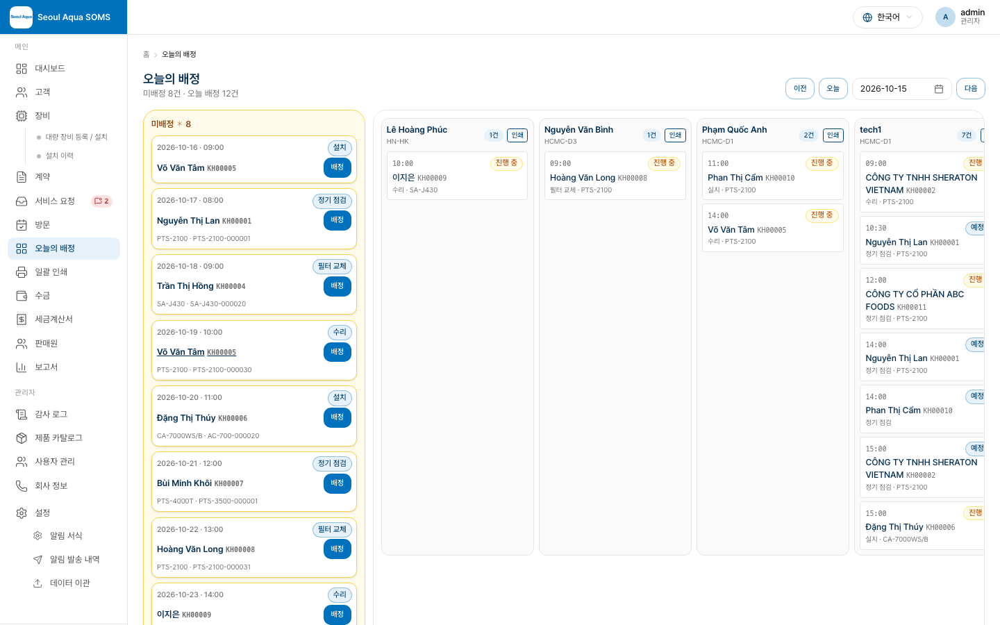

기사 배정을 한 화면에서 처리하는 보드입니다.

- 위쪽 날짜 이동: 이전 · 오늘 · 다음 · 날짜 선택
- 왼쪽: 기사가 정해지지 않은 방문 카드
- 오른쪽: 기사별 칸, 시간순
- 미배정 카드의 **「배정」** → 추천 기사 확인 → 주관(필요하면 협업) 기사 선택 → 확정. 카드가 그 기사의 칸으로 옮겨집니다.
- 기사 칸 위의 인쇄 버튼 → 그 기사의 그날 서류 묶음(§9.8)

### 9.8 일괄 인쇄

**사이드바 → 일괄 인쇄** (또는 오늘의 배정의 기사별 인쇄 버튼)

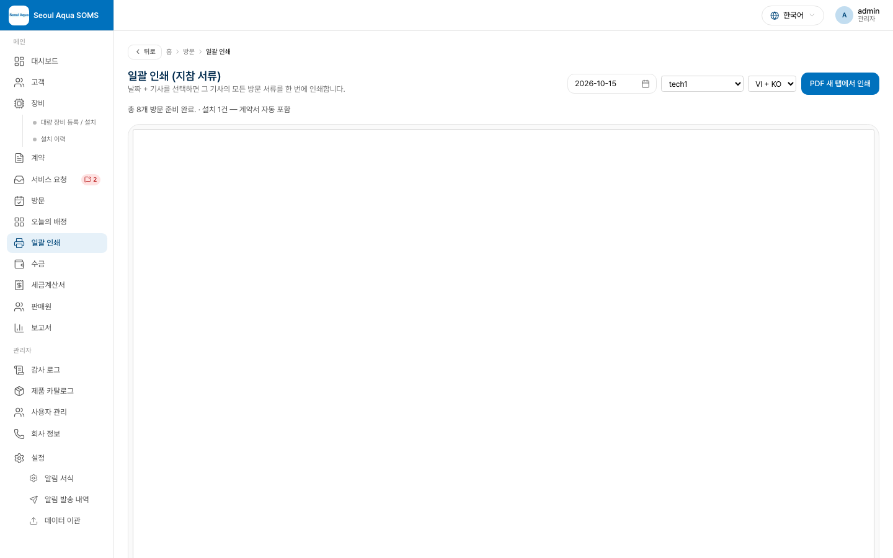

날짜와 기사를 고르면 그 기사가 그날 들고 갈 서류를 **PDF 한 파일**로 묶어 미리 보여줍니다.

- 예정됨·진행 중·재예약 방문만 들어갑니다(제안됨·완료 제외).
- 설치 방문이 있으면 계약서 2부(고객용·회사용)가 붙습니다.
- 서류 언어는 베트남어+한국어 또는 베트남어+영어 중에서 고릅니다.
- 인쇄용으로 그때그때 만드는 것이라 방문의 「발급된 서류」에는 기록되지 않습니다.
- 「PDF 새 탭에서 인쇄」 → 새 탭에서 Ctrl+P (Mac은 Cmd+P)

- 추가 유형이 있는 방문은 그 서류도 함께 들어갑니다(예: 점검+납품 방문 → 정기점검표와 판매 영수증).

---

## 10장. 주문 (구매 소모품·장비)

### 10.1 주문이란?

고객에게 파는 소모품·장비·기타 품목을 기록합니다. 주문 하나에 품목 여러 개가 들어갑니다. 주문은 **항상 방문과 연결**됩니다 — 물건을 기사가 들고 가기 때문입니다.

### 10.2 주문 등록

모든 사무실 직원이 할 수 있습니다.

- **고객 상세 → 「+ 새 주문 등록」**
- **서비스 요청 상세 → 「+ 새 주문 등록」** (반려·취소·완료된 요청 제외)

1. 품목 추가 (소모품·장비·기타, 수량, 단가)
2. 방문 연결 방법을 고릅니다.
   - **신규 방문 생성** — 새 방문(제안됨)을 만듭니다. 유형은 자동 제안되고 바꿀 수 있습니다: 소모품만 → 구매 소모품 배송, 장비 포함 → 설치, 섞여 있으면 → 기타
   - **예정된 방문에 구매 소모품 추가** — 이 고객의 다음 예정 방문에 「구매 소모품 배송」을 추가 유형으로 붙입니다. 점검 가는 길에 함께 배송할 때 씁니다.
3. 저장

### 10.3 배송 서류

연결된 방문에 주관 기사가 정해지면 배송 서류가 준비됩니다.

- B2C → 판매 영수증 (주문 품목이 줄마다 들어감)
- B2B → 출고서 Mẫu 02-VT

### 10.4 주문 확인

고객 상세의 **구매 이력**(모든 주문)과 **주문 내역 (판매)**(장비 주문) 탭, 방문 상세의 연관 구매 카드에서 봅니다.

### 10.5 전달 완료와 취소

- **자동**: 주문이 연결된 방문(구매 소모품 배송이 주 유형이든 추가 유형이든)을 기사가 완료하면, 그 방문의 미전달 주문이 **전달 완료**로 바뀌고 소모품 재고가 빠집니다.
- **수동**: 고객 상세 「구매 이력」·「주문 내역 (판매)」 탭의 미전달 주문 줄에 **「전달 완료」**·**「주문 취소」** 버튼이 있습니다(모든 사무실 직원). 확인 창을 거치며 되돌릴 수 없습니다. 전달 완료로 바꾸면 소모품 재고가 빠집니다.

> 등록한 주문의 품목·수량은 고칠 수 없습니다. 잘못 등록했으면 「주문 취소」 후 새로 등록하세요.

---

## 11장. 서비스 요청 처리

### 11.1 요청 종류와 무상·유상

고객이 포털에서 보내거나, 사무실에서 「+ 새 요청」으로 대신 접수합니다.

| 종류 | 무상 조건 |
|---|---|
| 정기점검 | 임대·유지관리 계약 중이거나 설치 후 90일 이내 |
| 수리 | 임대 중이거나 설치 후 180일 이내 |
| 부품 교체 | 임대·유지관리 계약 중 |
| 이전 설치 | 설치 후 90일 이내의 첫 이전 |
| 기타 | 항상 유상 |

- **무상 요청** → 즉시 **승인됨** + 방문(제안됨)이 자동으로 생깁니다. 고객이 적은 희망 시간, 없으면 3일 뒤로 잡힙니다.
- **유상 요청** → **검토 대기**. 사무실이 승인하거나 반려합니다.
- 어느 쪽이든 고객에게 접수 확인 이메일이 갑니다(현재 모의발송).

### 11.2 서비스 요청 목록

**사이드바 → 서비스 요청**

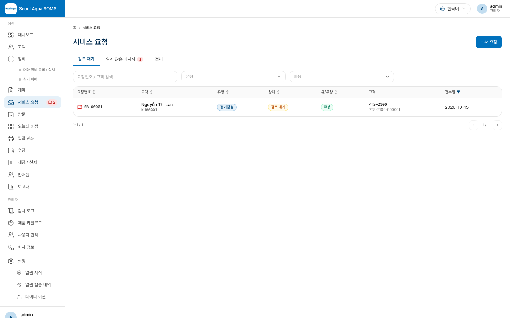

- 탭: **검토 대기 · 읽지 않은 메시지 · 전체** (전체 탭에는 상태 필터가 더 있음)
- 필터: 유형 · 유/무상
- 고객이 보낸 메시지를 아직 아무도 안 읽었으면 사이드바 「서비스 요청」 옆에 빨간 숫자가 뜹니다.

### 11.3 요청 상세 — 승인·반려

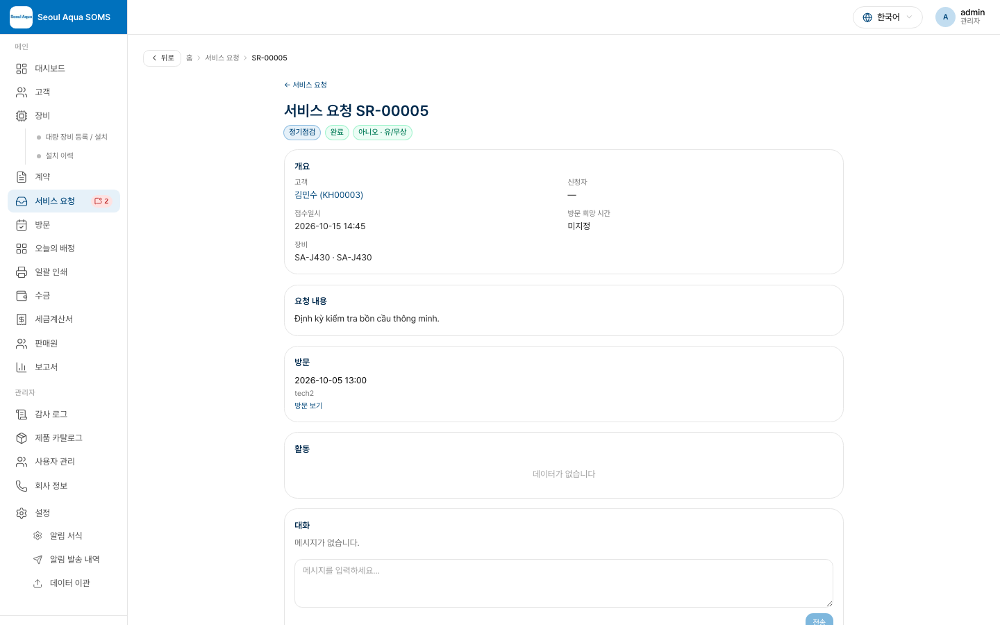

고객 정보, 요청 내용, 사진, 고객과 주고받는 **메시지**가 있습니다.

**승인** (MANAGER 이상)

1. 「승인」 → 금액(0이면 무상) · 승인 일자 · 방문 예정 시간 · 주관 기사(선택) · 내부 메모
2. 저장하면 요청 유형에 맞는 방문이 바로 만들어집니다. 주관 기사를 골랐으면 방문은 **예정됨**, 요청은 **일정 확정**이 되고, 안 골랐으면 방문은 **제안됨**, 요청은 **승인됨**입니다.
3. 고객에게 승인 SMS와 상세 이메일이 나갑니다 — 현재 SMS는 문안 미등록으로 실패하고 이메일은 모의발송입니다. **고객에게 전화로 금액과 일정을 알려주세요.**

**반려** (모든 사무실 직원) — 내부 사유와 고객 안내 메시지를 적습니다. 반려 SMS도 현재 도달하지 않으니 전화로 안내하세요.

**요청 취소** (모든 사무실 직원) — 요청을 취소합니다.

요청 상태는 연결된 방문을 따라갑니다: 방문이 예정되면 **일정 확정**, 완료되면 **완료**.

---

## 12장. 수금

### 12.1 결제 수단과 상태

**결제 수단**: 현금 · 계좌이체 · 카드 · 기타

**수금 건 상태**

| 상태 | 뜻 |
|---|---|
| 예정 | 청구됨, 아직 안 받음 |
| 수금됨 | 기사가 현장에서 받음 (아직 기사가 보관) |
| 인계됨 | 기사가 사무실에 현금을 넘김 |
| 정산됨 | 사무실이 확인 완료 |
| 7일 / 14일 / 30일 연체 | 기한이 지남 (매일 08:00 자동 변경) |
| 상각 | 받지 않기로 정리함 |

임대·유지관리 계약의 매달 청구(예정)는 매월 1일에 자동으로 만들어집니다(기한은 계약의 출금일, 비우면 10일 — §8.3).

### 12.2 수금 목록

**사이드바 → 수금**

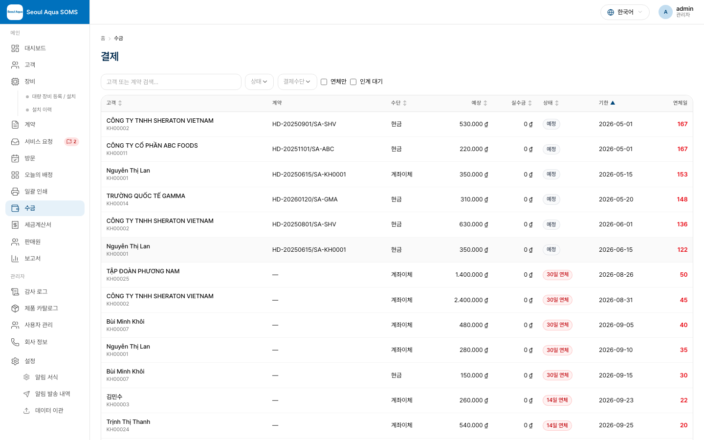

- 검색(고객·계약) · 상태 · 결제수단 · **연체만** · **인계 대기**
- 열: 고객 · 계약 · 수단 · 예상 · 실수금 · 상태 · 기한 · 연체일
- 줄을 누르면 수금 상세로 갑니다.

### 12.3 수금 상세의 버튼

| 버튼 | 권한 | 언제 | 하는 일 |
|---|---|---|---|
| 사무실 인계 | 모든 직원 (또는 받은 기사) | 수금됨 | 기사에게서 현금을 받았다고 기록 → 인계됨 |
| 정산 | MANAGER+ | 수금됨 · 인계됨 | 확인 완료 → 정산됨 |
| 부분 결제 | 모든 직원 | 예정 · 7일/14일/30일 연체 | 받은 금액을 기록하고 이 건을 정산됨으로 닫습니다. 금액 칸에는 청구액 전액이 미리 채워져 있어, 그대로 저장하면 완납입니다. 적게 넣으면 남은 금액이 새 **예정** 건으로 이어집니다 |
| 상각 | MANAGER+ | 정산됨·상각 외 | 받지 않기로 정리 |

> **계좌이체·사무실 수납은 「부분 결제」로 기록합니다.** 연체 건도 같습니다. 전액을 받았으면 미리 채워진 금액 그대로 저장하세요. 남는 금액이 없으니 이어지는 건도 생기지 않습니다.

### 12.4 기사 현금 인계 받기

1. 수금 목록에서 **「인계 대기」** 체크 → 기사가 들고 있는 현금 건이 나옵니다.
2. 기사가 가져온 현금과 금액을 맞춰본 뒤, 건마다 상세에서 **「사무실 인계」**.
3. 확인이 끝나면 MANAGER가 「정산」.

일괄로 받는 버튼은 없습니다. 기사가 받은 지 48시간이 지나면 대시보드에 경고가 뜹니다(§3.2).

### 12.5 영수증 메모 편집

수금 상세 → **영수증** 탭에서 영수증에 인쇄할 메모를 고치고 **「저장 후 재발급」** 을 누르면 영수증 PDF가 다시 만들어지고 미리보기가 갱신됩니다. 메모는 수금 기록에 저장되어 다시 열어도 남아 있습니다. 「영수증 다운로드」로 인쇄용 PDF를 받습니다.

### 12.6 연체 단계

| 단계 | 자동 처리 (매일 08:00) |
|---|---|
| D+7 | 상태 7일 연체 + 이메일 (계약 주체 + 주 운영 담당자) |
| D+14 | 상태 14일 연체 + 두 번째 이메일 |
| D+30 | 상태 30일 연체 + 최종 경고 SMS (계약 주체 + 주 운영 담당자) |

계약 상태는 바뀌지 않습니다. 이메일은 모의발송, D+30 SMS는 문안 미등록이라 현재 고객에게 도달하지 않습니다. **연체 고객에게는 직접 전화하세요.**

---

## 13장. 세금계산서 (B2B)

세금계산서는 외부 전자세금계산서 시스템(Viettel SInvoice, MISA 등)에서 발행하고, SOMS에는 **PDF를 올려 결제 건에 연결**합니다.

**사이드바 → 세금계산서**

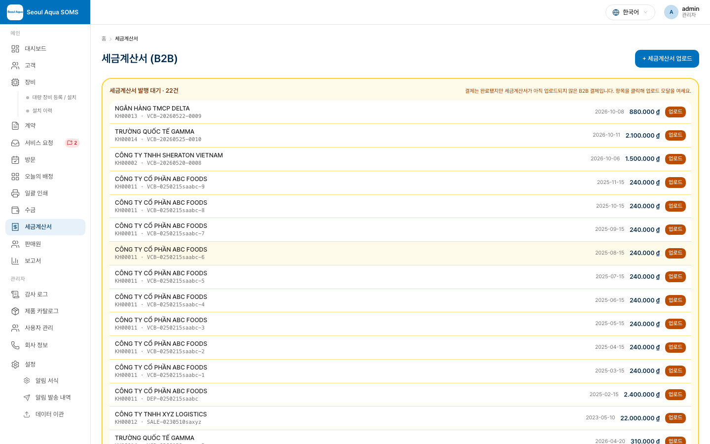

- **발행 대기 · N건**: 정산이 끝났는데 세금계산서가 없는 B2B 결제 목록. 줄마다 「업로드」 버튼이 있습니다.
- **「+ 세금계산서 업로드」**: 결제 선택(정산된 B2B 결제) · 계산서 번호 · 발행일 · PDF(10MB 이하) · 비고
- 업로드하면 고객에게 세금계산서 이메일이 나갑니다(회계 담당 → 주 운영 담당 → 계약 주체 순, 현재 모의발송).
- 업로드·재발송·재발행은 MANAGER 이상, 목록은 모든 직원이 봅니다.

세금계산서 1건은 결제 1건에 연결됩니다.

---

## 14장. 보고서와 감사 로그

### 14.1 보고서

**사이드바 → 보고서**

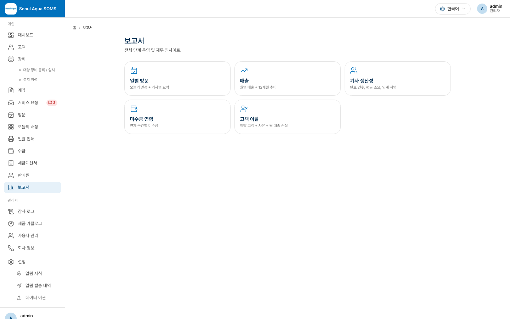

| 보고서 | 내용 |
|---|---|
| 일별 방문 요약 | 고른 날짜의 전체·기사별 방문 수 (예약·진행 중·완료·실패) |
| 월별 매출 | 계약 유형별 매출 + 서비스 요청 요금 |
| 기사 생산성 | 기사별 완료 방문 수 · 평균 소요 시간 · 현금 인계 지연(48시간 초과) 건수 |
| 미수금 연령 | 기한 내 / 1~7일 / 8~14일 / 15~30일 / 30일 초과 |
| 고객 이탈 | 분기별 이탈(비활성화) 고객과 사유, 잃은 월 매출 |

모든 보고서는 모든 사무실 직원이 보고 CSV로 내려받을 수 있습니다.

### 14.2 감사 로그

**사이드바 → 관리자 → 감사 로그** (ADMIN · MANAGER)

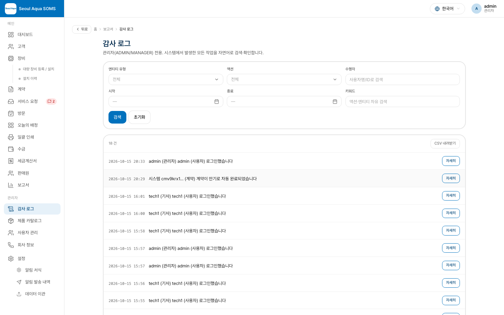

- 시스템에서 일어난 변경(사용자 추가, 계약 활성화, 수금 상각, 카탈로그 업로드 등)이 모두 남습니다.
- 각 줄은 "누가 무엇을 했다" 한 문장으로 읽힙니다.
- **「자세히」** → 오른쪽에 바뀐 항목만 변경 전/후 표로 보여줍니다. 아래 「기술 정보」에서 원본 데이터·IP·브라우저를 봅니다.
- 필터: 대상 종류 · 동작 · 수행자 · 기간 · 키워드. 같은 조건으로 CSV를 내려받습니다.
- 기록은 자동으로 지우지 않습니다.

> 동작 이름 옆 **주황색 「(미등록)」** 배지는 그 동작의 한국어 문장이 아직 없다는 뜻입니다. 기록 자체는 정상입니다.

**기록에 남지 않는 것**: 초기 데이터 넣기(seed)·DB 초기화·DB 구조 변경처럼 화면을 거치지 않고 데이터베이스에 직접 쓰는 작업

---

## 15장. 관리자 메뉴

**사이드바 → 관리자** (ADMIN · MANAGER. 데이터 이관은 ADMIN만)

### 15.1 사용자 관리

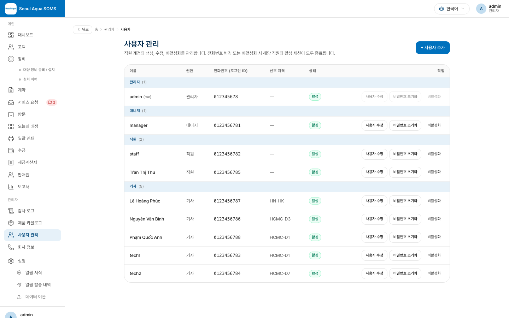

사용자는 **역할별 묶음**으로 보입니다: 관리자 → 매니저 → 직원 → 기사. 사용자가 없는 역할도 묶음 제목은 남습니다.

#### 할 수 있는 범위 — 아래로만

| 내 역할 | 관리할 수 있는 계정 |
|---|---|
| ADMIN | MANAGER · STAFF · 기사 |
| MANAGER | STAFF · 기사 |

같은 역할, 윗 역할, **자기 자신**의 줄은 버튼이 잠겨 있습니다. ADMIN 계정을 더 만들거나 고치는 일은 화면에서 할 수 없고 개발 담당자가 처리합니다.

#### 사용자 추가

「+ 사용자 추가」 → 사용자명 · 휴대폰 · 임시 비밀번호(8자 이상) · 역할 · 선호 지역(기사) → 저장. 역할 목록에는 내가 관리할 수 있는 역할만 나옵니다. 임시 비밀번호는 본인에게 **직접** 알려주세요(문자 발송 없음).

#### 줄 버튼

- **사용자 수정** — 이름·역할·휴대폰·선호 지역. 휴대폰을 바꾸면 그 사람의 로그인이 모두 끊깁니다.
- **비밀번호 초기화** — 아래 참고
- **비활성화** — 로그인을 막습니다. 기록은 남습니다.

#### 비밀번호 초기화

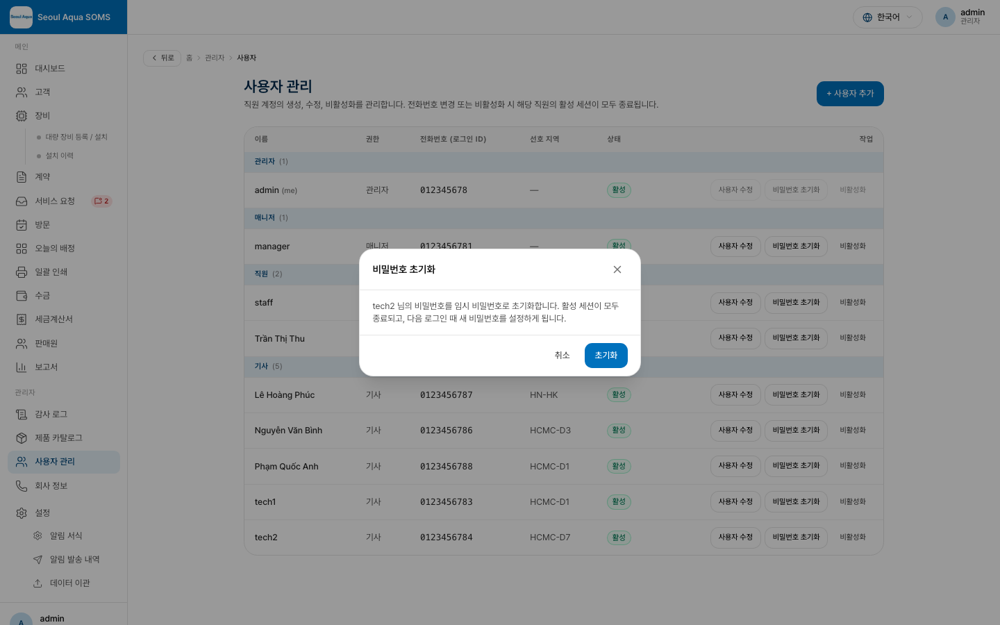

직원이나 기사가 비밀번호를 잊으면 전화를 받고 여기서 초기화합니다.

1. 해당 줄의 「비밀번호 초기화」 → 확인 창에서 「초기화」
2. 새 임시 비밀번호가 **화면에 한 번만** 표시됩니다. 그 자리에서 본인에게 알려주세요.

- 문자로 보내지 않습니다.
- 그 사람의 로그인이 모두 끊기고 잠금도 풀립니다.
- 그 사람은 다음 로그인 때 「비밀번호 변경」 화면에서 새 비밀번호를 정해야 합니다.
- 기록은 감사 로그에 「직원이 비밀번호 초기화」로 남습니다.

### 15.2 제품 카탈로그

**관리자 → 제품 카탈로그** (ADMIN · MANAGER)

탭 7개: **브랜드 · 제품군 · 제품 유형 · 모델 · 소모품 · 부속품 · 유/무상 정책**
오른쪽 위: 「카탈로그 CSV 업로드」 · 「카탈로그 CSV 다운로드」 · 「Excel 내보내기」 — CSV 업로드는 [카탈로그 일괄 업로드 가이드](./catalog-upload.md)를 보세요.

#### 분류 구조

```
제품군 (예: 냉온정수기, 공기청정기)
  ├─ 제품 유형 (예: 직수형, 스탠드형) — 제품군 1개 이상에 속함
  ├─ 모델     — 제품군 1개 이상 + 제품 유형 0~1개
  └─ 소모품·부속품 — 제품군 0개 이상 + 제품 유형 0개 이상 (검색·분류용)
```

- 모델에 제품 유형을 정하면, 그 모델의 제품군은 **모두 그 유형의 제품군 안**이어야 합니다.
- 소모품·부속품에 붙인 제품군·제품 유형은 **찾기 쉽게 하는 꼬리표**일 뿐입니다. 그 제품군의 모델에 자동으로 적용되지 않습니다. 어떤 모델에 어떤 필터가 들어가는지는 모델의 「필터 구성」에서 정합니다.

**새 모델을 등록하는 순서**

1. 그 모델에 들어갈 필터를 소모품 탭에 먼저 등록 (모델 없이 등록 가능)
2. 모델 탭에서 모델 등록
3. 모델 폼의 「필터 구성」에서 1의 필터를 골라 붙임

#### 브랜드 · 제품군 · 제품 유형 탭

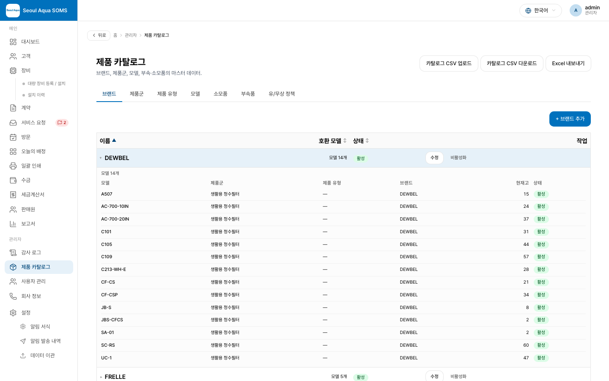

- 세 탭은 같은 모양의 표입니다. **줄을 누르면 그 아래로 소속 모델 목록이 펼쳐집니다**(모델·제품군·제품 유형·브랜드·현재고·상태). 다시 누르면 접힙니다.
- 줄의 「수정」·「비활성화」 버튼은 펼치지 않고 바로 동작합니다.

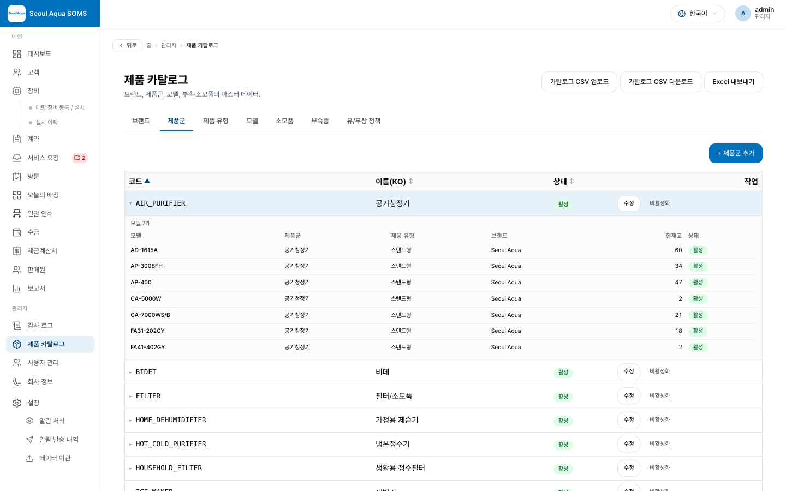

- **제품군**: 이름(한국어·베트남어·영어 각각 한 줄, 필수)과 코드. 화면 목록에는 지금 보는 언어의 이름만 나옵니다.

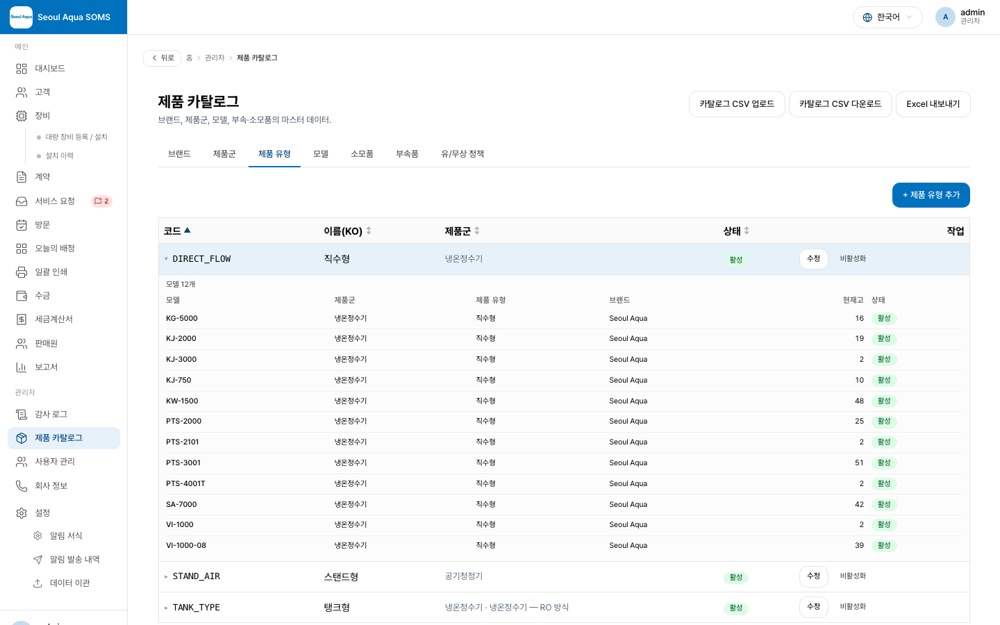

- **제품 유형**: 이름 3개 언어(필수) + **제품군(1개 이상, 필수)** + 코드

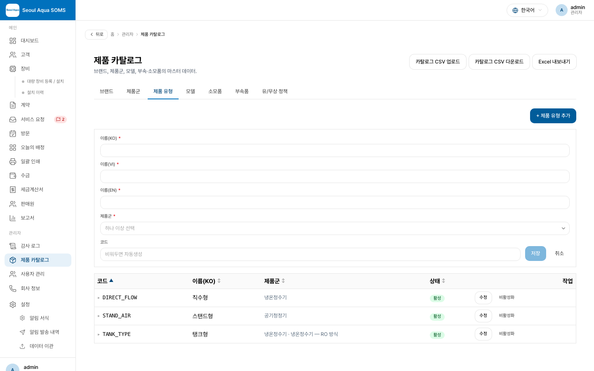

**코드 규칙** (제품군·제품 유형 공통)

- 등록할 때 비워두면 영어 이름(없으면 베트남어)에서 `MAY_LOC_NUOC` 같은 코드가 자동으로 만들어집니다.
- 「수정」 창에서 코드를 직접 고칠 수 있습니다. 입력하는 대로 대문자로 바뀌고, 띄어쓰기는 `_`가 됩니다.
- 이미 쓰는 코드면 "코드 X는 이미 사용 중입니다"가 뜨고 저장되지 않습니다.

> 제품 유형에서 제품군을 빼려는데 그 유형의 모델이 아직 그 제품군을 쓰고 있으면 저장이 거부됩니다. 모델의 제품군을 먼저 바꾸세요.

#### 모델 · 소모품 탭 — 왼쪽 상세 / 오른쪽 목록

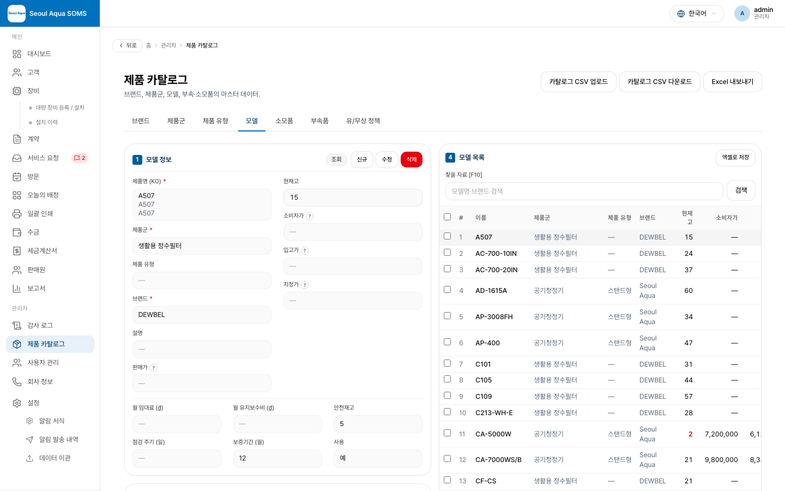

- **오른쪽 목록**에서 줄을 누르면 **왼쪽 상세**에 그 항목이 **조회** 상태로 나옵니다.
- 왼쪽 상세 머리의 **「신규」**(F2) · **「수정」**(F3) · **「삭제」**(F4). 신규·수정 중에는 **「저장」**(F5) · **「취소」**(Esc)만 보이고, 오른쪽 목록의 다른 줄을 고를 수 없습니다.
- 「삭제」는 비활성화입니다. 모델 목록에서 여러 줄을 체크한 뒤 삭제하면 한 번에 비활성화됩니다.
- 목록 위에 검색(F10)과 「엑셀로 저장」이 있습니다.

**모델 폼**

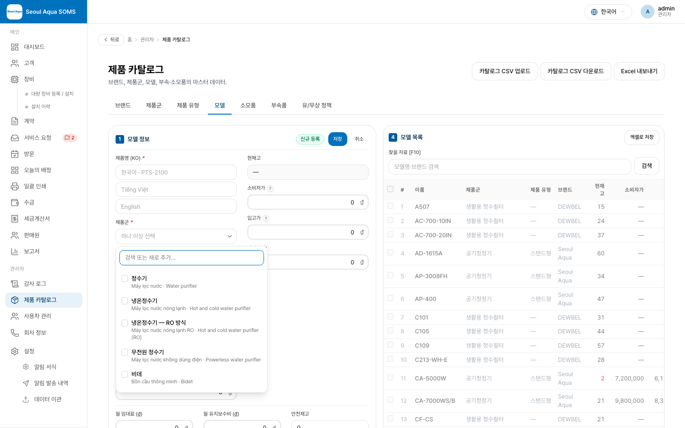

| 위치 | 항목 |
|---|---|
| 왼쪽 | 제품명 (한국어·베트남어·영어, 필수) · **제품군 (여러 개, 필수)** · **제품 유형 (선택)** · 브랜드 (필수) · 설명 · 판매가 |
| 오른쪽 | 현재고 (읽기 전용 + 「재고 조정」) · 소비자가 · 입고가 · 지정가 |
| 아래 | 월 임대료 · 월 유지보수비 · 안전재고 · 점검 주기(일) · 보증기간(월) · 사용 |
| ② 필터 구성 | 이 모델에 들어가는 필터, 필터별 수량(기본 1), 이 모델에서의 교체 주기 |

- **제품군**은 검색하며 여러 개를 고르는 칸입니다. 고른 제품군은 칩으로 표시되고, 목록에 없으면 「제품군 '이름' 추가」로 그 자리에서 새로 만듭니다.
- **제품 유형** 목록에는 **고른 제품군을 모두 포함하는 유형만** 나옵니다. 유형을 고르면 그 유형 밖의 제품군은 선택할 수 없게 흐려집니다. 목록에 없으면 「제품 유형 '이름' 추가」로 바로 만듭니다.
- **브랜드**도 같은 방식으로 검색·즉석 추가합니다.
- 필수 항목에는 빨간 `*`가 붙습니다. 저장이 거부되면 오류 문구에 어느 칸이 문제인지 나옵니다.
- 드롭다운이 열린 상태에서 Esc를 누르면 드롭다운만 닫히고 등록 창은 그대로입니다.

**필터 구성**: 「+ 필터 추가」 → 필터 검색(이름·SKU, 그리고 **제품군 이름**으로도 찾음) → 선택. **수량**에는 이 모델에 그 필터가 몇 개 들어가는지 넣습니다(기본 1 — 제빙기처럼 같은 필터를 2~4개 쓰는 모델은 그 숫자). 필터의 기본 교체 주기가 안내값으로 보이고, 이 모델에서만 다른 주기를 쓰려면 교체주기(일) 칸에 넣습니다. 같은 필터는 한 번만 넣을 수 있습니다. 기존 모델을 수정하면 현재 구성이 채워지며, 불러오는 동안은 저장 버튼이 잠시 잠깁니다.

주기 우선순위: **장비별 사용자 주기 > 모델별 주기 > 필터 기본 주기**

**소모품 폼**

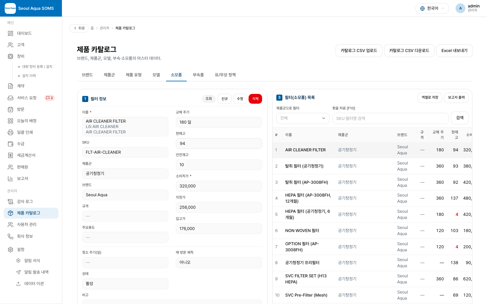

| 위치 | 항목 |
|---|---|
| 왼쪽 | 이름 (3개 언어, 필수) · SKU · 제품군 (여러 개, 선택) · 제품 유형 (여러 개, 선택) · 브랜드 · 규격 · 주요용도 |
| 오른쪽 | 교체 주기 (일/개월) · 현재고 (+ 재고 조정) · 안전재고 · 소비자가 (필수) · 지정가 · 입고가 |
| 아래 | 청소 주기(일) · 매 방문 세척 · 상태 · 비고 |
| ② 적용 가능한 장비(모델) | 이 필터가 들어가는 모델 목록 (이름·제품군·브랜드·내장 수량) |

- **SKU**를 비워두면 `FLT-000001`처럼 자동으로 발급됩니다. 등록 후에는 바꿀 수 없습니다.
- 교체 주기 단위를 일 ↔ 개월로 바꾸면 같은 기간이 유지되도록 숫자가 환산됩니다(1개월 = 30일, 저장은 일 단위). 목록의 교체 주기 열은 입력한 단위 그대로 보입니다(예: 6개월). 장비 화면의 「서비스 구성」은 일 단위로 보여 줍니다(6개월 → 180일).
- 목록 위 **「제품군으로 필터」** 로 좁혀 볼 수 있고, 「보고서 출력」도 있습니다.
- 모델↔필터 연결은 모델의 필터 구성과 소모품의 적용 가능한 장비 양쪽에 똑같이 보입니다.

#### 부속품 탭

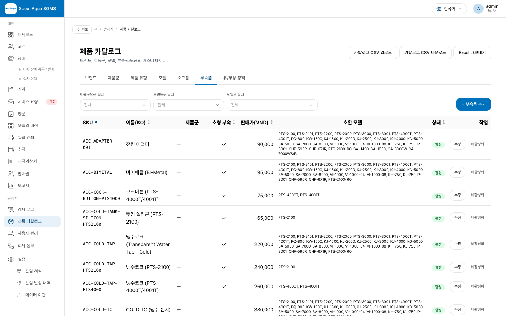

- 「+ 부속품 추가」 → 이름(한국어·베트남어·영어, 각 한 줄, 필수) · 판매가(필수) · SKU + 「소형 부속」 체크 · 제품군(여러 개) · 제품 유형(여러 개) · 호환 모델
- SKU를 비워두면 `ACC-000001`처럼 자동 발급되고, 수정 창에서는 바꿀 수 없습니다.
- **소형 부속**은 유지관리 계약 고객에게 무상으로 바꿔주는 작은 부품(코크·밸브·호스 등)입니다.
- 목록 위에서 브랜드·모델·제품군으로 걸러 봅니다.

#### 유/무상 정책 탭

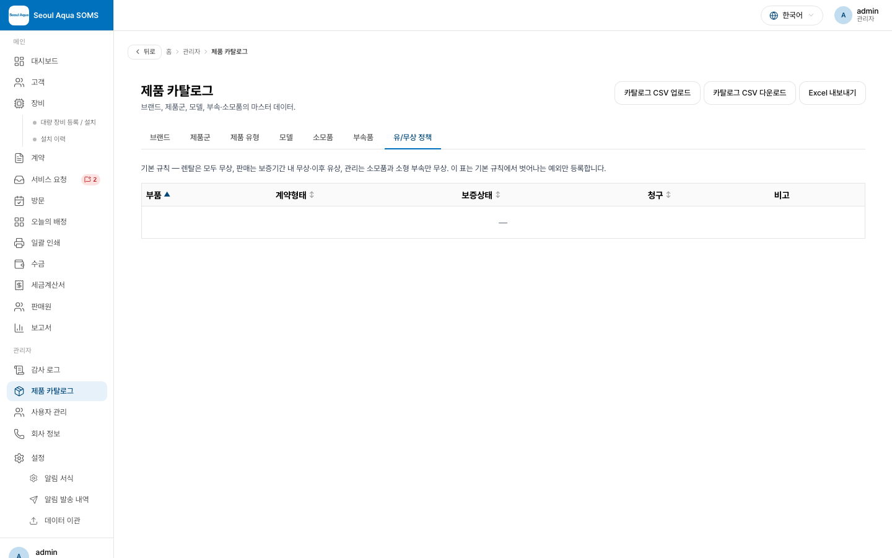

기본 규칙 — 렌탈은 모두 무상, 판매는 보증기간 안 무상·이후 유상, 유지관리는 소모품과 소형 부속만 무상. 이 표는 기본 규칙에서 **벗어나는 예외**를 보여줍니다(부품 · 계약 유형 · 보증 상태 · 청구 · 비고).

#### 재고 조정

모델·소모품 폼의 현재고 옆 **「재고 조정」**(신규·수정 중에만 보임)

- **입고**: 더하기 / **출고**: 빼기 / **조정**: 실사한 목표 수량으로 맞추기
- 모든 변동은 재고 이력에 언제·누가·왜(메모)와 함께 남고 감사 로그에도 기록됩니다.
- 자동 차감: 장비 설치 → 모델 −1, 방문에서 필터 교체 → 소모품 −1
- 현재고가 안전재고보다 적으면 빨간색. 현장 작업을 막지 않도록 마이너스 재고도 허용하니, 어긋나면 「조정」으로 맞춥니다.

#### 가격 4종

**입고가**(매입 원가) ≤ **지정가**(대리점 공급가) ≤ **소비자가**(권장 소매가). **판매가**는 계약·견적에 실제 쓰는 거래 가격입니다.

### 15.3 회사 정보

**관리자 → 회사 정보**

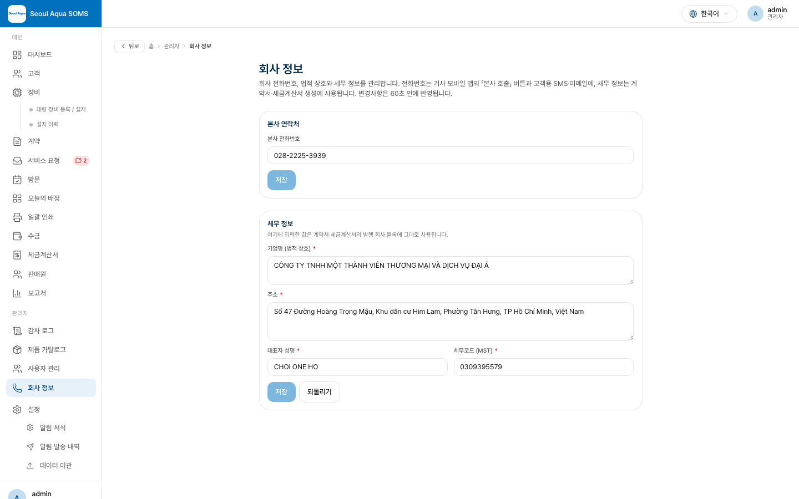

- **본사 연락처**: 본사 전화번호. 기사 앱의 「본사로 전화」 버튼과 고객 SMS·이메일의 연락처로 쓰입니다.
- **세무 정보**: 기업명(법적 상호) · 주소 · 대표자 성명 · 세무코드(MST). 계약서와 세금계산서의 회사 정보 칸에 그대로 들어갑니다.

저장하면 60초 안에 반영됩니다.

### 15.4 알림 서식

**관리자 → 설정 → 알림 서식**

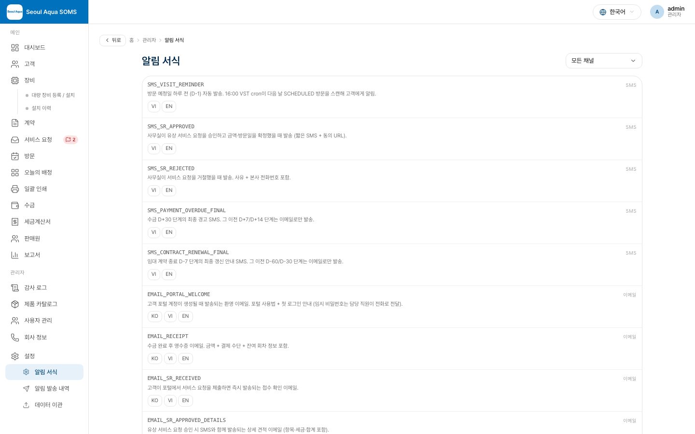

고객에게 나가는 SMS·이메일 문안 목록입니다. 오른쪽 위에서 채널(SMS/이메일)로 거릅니다.

- 서식을 열어 언어별로 본문(이메일은 제목도)을 고치거나, 기본 문안으로 되돌리거나, 서식을 켜고 끌 수 있습니다. 꺼진 서식은 발송되지 않습니다.
- **SMS는 베트남어(VI)·영어(EN) 두 언어만** 있습니다. 한국어 고객은 영어 SMS를 받습니다. 이메일은 한국어·베트남어·영어 세 언어입니다.
- **SMS 문안은 통신사에 등록된 문장과 똑같아야 전달됩니다.** 등록된 SMS(방문 하루 전 알림)의 문구를 바꾸면 발송이 거부될 수 있습니다. SMS 문구 수정은 통신사 등록과 함께 진행하세요.

### 15.5 알림 발송 내역

**관리자 → 설정 → 알림 발송 내역**

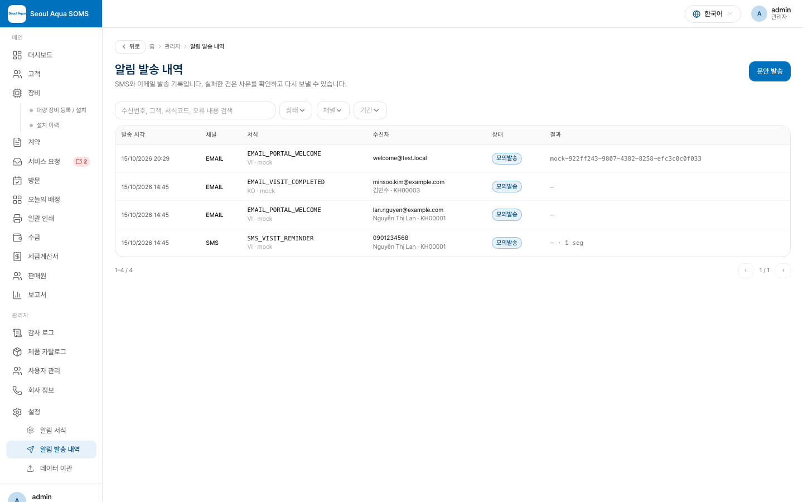

SMS와 이메일이 실제로 나갔는지 확인하는 화면입니다.

- 목록: 발송 시각 · 채널 · 서식 코드 · 수신 번호와 고객명 · 상태 · 결과(성공이면 발송사 메시지 번호, 실패면 사유)
- **상태**
  - **성공** — 발송사(eSMS)가 접수함. 통신사의 최종 도달은 별도입니다.
  - **모의발송** — 실제로 나가지 않음. 지금은 **모든 이메일**이 여기에 해당합니다.
  - **건너뜀** — 수신 거부했거나 번호·이메일이 없음
  - **실패** — 발송사가 거부. `146` = 문안이 통신사에 미등록, `104` = 브랜드네임 문제, `101` = 인증 키 문제
- **실패한 줄**에는 「재발송」 버튼이 있습니다. 저장된 문구를 그대로 다시 쏘지 않고, 현재 서식과 현재 연락처로 새로 만들어 보냅니다. 원래 실패 기록은 남고 재발송 기록이 한 줄 더 생깁니다.

#### 문안 발송 (수동)

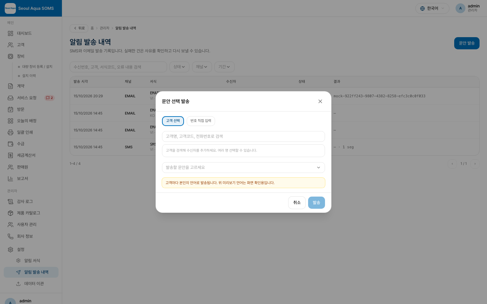

오른쪽 위 **「문안 발송」** 으로 SMS를 손으로 보냅니다.

1. 서식을 고르면 그 서식의 변수 칸이 나타납니다. 값을 채우면 실제 나갈 문장과 글자 수·세그먼트가 미리 보입니다.
2. 받는 사람: 고객을 검색해 여러 명 고르거나(칩으로 표시) 번호를 직접 입력
3. 발송 — 한 명씩 따로 나가므로 한 건이 실패해도 나머지는 나갑니다. 고객을 고르면 그 담당자의 언어와 수신 거부 설정을 따릅니다.

- 내용을 직접 타이핑하는 칸은 없습니다. 통신사는 등록된 문안만 받습니다.
- 본사 전화번호는 회사 정보 값이 자동으로 들어갑니다.
- 서식 목록에는 SMS 5종이 모두 나오지만, **실제로 전달되는 것은 방문 하루 전 알림뿐**입니다. 나머지는 146으로 실패합니다.

### 15.6 데이터 이관 (ADMIN 전용)

**관리자 → 설정 → 데이터 이관**


예전 시스템이나 장부의 고객·계약·장비·소모품을 엑셀 한 파일로 한 번에 옮깁니다. 잘못된 파일 하나로 고객 장부 전체가 바뀔 수 있어 ADMIN만 엽니다.

1. **템플릿 내려받기** — 시트 6개(Guide + 고객·계약·장비·소모품 + 선택 시트 Payments). 첫 시트(Guide)에 칸별 작성법이 한국어·베트남어로 있고, 나머지 시트에 예시가 한 줄씩 있습니다. 예시는 모두 `SAMPLE-`로 시작하니 지우고 작성하세요(남겨두면 오류로 걸립니다).
2. **파일 검사** — 아무것도 저장하지 않고, 새로 들어갈 건수·이미 있어 건너뛸 건수·잘못된 칸(시트·행 번호)을 보여줍니다.
3. **확정** — 오류가 없을 때만 버튼이 나옵니다. 전부 한 번에 저장되고, 도중에 실패하면 아무것도 저장되지 않습니다.

작성 요령:

- 모델 코드와 소모품 SKU는 **카탈로그에 먼저 등록**돼 있어야 합니다. 없는 코드가 하나라도 있으면 파일 전체가 저장되지 않습니다. 카탈로그에 없는 부품은 소모품 시트의 「Custom Name」 칸에 이름을 적으면 그 장비에만 등록됩니다.
- 고객 코드와 계약번호는 기존에 쓰던 값을 그대로 적습니다. SOMS 고객번호·계약번호는 자동으로 만들어집니다. 같은 파일을 두 번 올려도 이미 있는 고객·계약은 건너뜁니다.
- 장비 시트는 **모델 코드 + 자산 코드** 조합으로 장비를 구분합니다. 자산 코드 순번이 모델마다 따로이기 때문입니다. 모델 코드를 비우고 「Custom Description」을 적으면 카탈로그 밖 기기로 등록됩니다.
- 계약은 **활성**으로 들어가고, 실제 설치일로 **완료된 설치 방문**이 함께 기록됩니다. 다음 점검일은 설치일과 주기로 계산됩니다.
- **선택 칸**: 고객 시트의 Status(ACTIVE/INACTIVE) · Contact Phone 2 · Notes(Contact Phone은 이제 필수가 아님), 계약 시트의 State(ACTIVE/COMPLETED/TERMINATED) · End Date · Billing Day(1~31, 출금일), 장비 시트의 Status(ACTIVE/TERMINATED/DEACTIVATED)입니다. 상태를 비우면 ACTIVE이고, ACTIVE가 아닌 장비에는 필터 교체 안내가 나가지 않습니다.
- **Payments 시트(선택)**: 예전 시스템에서 이미 받은 수금 이력을 넣습니다. 칸은 Equipment Key · Billing Month(YYYY-MM) · Paid Date · Amount · Currency(VND/USD) · Method(CASH/BANK_TRANSFER/CARD/OTHER) · Notes입니다. 정산 완료된 수금으로 들어가며, 그 달의 청구가 다시 만들어지지 않습니다. 검사·결과 표에 「수금 이력」 건수가 함께 나옵니다.
- 이관으로 들어온 모든 고객은 계약 주체가 주 운영 담당자로 복사되고 「확인 필요」 배지가 붙습니다. 고객 상세의 「확인이 필요한 항목」에서 정리합니다(§5.4, §5.6).
- 큰 이관은 파일을 **여러 개로 나눠**(파일당 10MB 미만) 올리세요. 10MB를 넘으면 거부됩니다. 순서는 상관없고, 다시 올려도 이미 들어간 것은 건너뜁니다. 전환(이관 후 실제 사용 시작)은 **월초**에 하는 것을 권합니다.
- **이관 중에는 고객에게 아무것도 발송되지 않고 포털 계정도 만들어지지 않습니다.**

같은 화면의 **「현재 데이터 내려받기」** 는 지금 데이터를 업로드와 같은 양식으로 받습니다. 고쳐서 다시 올리거나 이관 전 백업으로 씁니다.

### 15.7 스케줄러 가중치 (ADMIN 전용)

기사 추천 점수를 정합니다. 사이드바에는 없고 주소 `/o/ko/admin/scheduler-weights`로 엽니다.

| 항목 | 기본값 |
|---|---|
| 선호 기사 일치 | +100점 |
| 지역 일치 | +30점 |
| 그날 이미 잡힌 방문 | 건당 −5점 |

---

## 16장. 자주 마주치는 시나리오

### 시나리오 1: 고객이 "내일 방문 못 받아요"

1. 방문 → 해당 방문 열기
2. 「일정 변경」 → 새 날짜와 사유 → 저장
3. 고객에게는 새 날짜 전날 16:00에 알림 SMS가 다시 나갑니다. 기사에게는 직접 알려주세요.

### 시나리오 2: 점검 가는 길에 필터도 팔아야 합니다

1. 고객 상세 → 「+ 새 주문 등록」 → 필터 품목 입력
2. 「예정된 방문에 구매 소모품 추가」 선택 → 저장
3. 그 방문의 지참 서류 카드에 점검 서류와 판매 영수증(B2B는 출고서)이 함께 나옵니다. 각각 발급하거나, 일괄 인쇄로 한 번에 인쇄하세요.

### 시나리오 3: B2B 고객이 "세금계산서 주세요"

1. 외부 전자세금계산서 시스템에서 발행 → PDF 저장
2. 세금계산서 → 「+ 세금계산서 업로드」 → 정산된 해당 결제 선택 → 번호·발행일·PDF → 저장 (MANAGER 이상)

### 시나리오 4: 새 판매원이 들어왔습니다

1. 판매원 → 「+ 판매원 추가」 → 이름(필수)·전화·직함 → 저장
2. 그 판매원이 맡을 고객마다 고객 상세 → 「담당자 변경」으로 지정
3. 판매원이 시스템에 로그인해야 하는 직원이라면 사용자 관리에서 계정을 따로 만듭니다. 판매원 명단과 사용자 계정은 연결되지 않습니다.

### 시나리오 5: 여러 장비를 한 번에 등록합니다

1. 장비 → 대량 장비 등록 / 설치
2. 고객 → 장비 정보 → 판매 방식 → 서비스 구성 → 최종 확인(생성될 계약 수 확인) → 「완료」
3. 장비·계약·설치 방문이 함께 생깁니다. 설치 방문에 기사가 없으면 오늘의 배정에서 정하세요.

### 시나리오 6: 기사의 내일 서류를 미리 인쇄합니다

1. 일괄 인쇄 → 날짜(내일) · 기사 선택
2. PDF 미리보기 확인 → 「PDF 새 탭에서 인쇄」 → Ctrl+P

### 시나리오 7: 연체 고객 정리

1. 대시보드 「연체 결제」 또는 수금 → 「연체만」 체크
2. 단계(7일/14일/30일 연체) 확인 → 고객에게 전화
3. 돈이 들어오면 그 수금 건의 상세 → 「부분 결제」 → 받은 금액(전액이면 그대로) → 저장

### 시나리오 8: 판매원 실적 확인

1. 판매원 → 카드 클릭
2. 조회 기간 설정 → 「기간별 매출」·「기간별 미수금」 탭 확인

### 시나리오 9: 고객이 포털 비밀번호를 잊었습니다

1. 본인 확인
2. 고객 상세 → 「수정」 → 아래 「포털 비밀번호 초기화」 카드에서 해당 담당자 초기화 (MANAGER 이상)
3. 화면에 뜬 임시 비밀번호를 전화로 불러주고, 첫 로그인 때 새 비밀번호를 정하라고 안내

### 시나리오 10: 직원이 사무실 앱 비밀번호를 잊었습니다

1. 그 직원보다 윗 역할인 사람이 관리자 → 사용자 관리 → 「비밀번호 초기화」
2. 화면에 뜬 임시 비밀번호를 본인에게 알려줌
3. 직원은 임시 비밀번호로 로그인한 뒤 바로 뜨는 「비밀번호 변경」 화면에서 새 비밀번호를 정함

---

## 부록 A. 사이드바 메뉴 빠른 찾기

| 찾는 기능 | 메뉴 |
|---|---|
| 고객 등록·검색 | 고객 |
| 담당 판매원 지정 | 고객 상세 → 담당자 변경 |
| 판매원 등록·실적 | 판매원 |
| 장비 등록 (여러 줄) | 장비 → 「장비 등록 / 설치」 버튼 |
| 장비 등록 (같은 모델 여러 대) | 장비 → 대량 장비 등록 / 설치 |
| 설치 이력 | 장비 → 설치 이력 |
| 계약 작성·수정 | 계약 |
| 방문 일정 | 방문 |
| 기사 배정 | 오늘의 배정 |
| 지참 서류 묶음 인쇄 | 일괄 인쇄 |
| 서비스 요청 검토 | 서비스 요청 |
| 수금·현금 인계 | 수금 |
| 세금계산서 업로드 | 세금계산서 (업로드는 MANAGER+) |
| 보고서 | 보고서 |
| 감사 기록 | 관리자 → 감사 로그 |
| 제품·필터 관리 | 관리자 → 제품 카탈로그 |
| 직원·기사 계정 | 관리자 → 사용자 관리 |
| 본사 전화·세무 정보 | 관리자 → 회사 정보 |
| SMS·이메일 문안 | 관리자 → 설정 → 알림 서식 |
| 발송 확인·재발송·수동 발송 | 관리자 → 설정 → 알림 발송 내역 |
| 기존 데이터 일괄 이관 | 관리자 → 설정 → 데이터 이관 (ADMIN) |
| 포털 비밀번호 초기화 | 고객 상세 → 수정 → 포털 비밀번호 초기화 (MANAGER+) |

---

## 부록 B. 지참 서류 매트릭스

| 서류 | 코드 | 언제 추천되나 |
|---|---|---|
| 장비 인수증 | DELIVERY_RECEIPT | 설치 + B2C (판매 계약 제외) |
| 판매 영수증 | SALE_RECEIPT_B2C | 설치(B2C 판매 계약) 또는 구매 소모품 배송(B2C) |
| 출고서 Mẫu 02-VT | DELIVERY_SLIP_B2B | 설치(B2B) 또는 구매 소모품 배송(B2B) |
| 정기점검표 (가정집) | PERIODIC_CHECK_B2C | 정기 점검 + B2C |
| 정기점검 확인서 (B2B) | PERIODIC_CHECK_B2B | 정기 점검 + B2B |
| 작업확인서 | WORK_CONFIRMATION | 수리·필터 교체·이전 설치·수금·장비 회수·기타 |

모든 서류는 **베트남어를 위에, 한국어(또는 영어)를 아래에** 함께 적는 2개 언어 양식입니다.

---

## 부록 C. 알림 서식 일람

**SMS** (전부 SMS 전용)

| 코드 | 받는 사람 | 언제 | 현재 |
|---|---|---|---|
| SMS_VISIT_REMINDER | 사업장 담당 → 주 운영 담당 → 운영 담당 → 계약 주체 | 방문 하루 전 16:00 | **전달됨** |
| SMS_SR_APPROVED | 계약 주체 | 서비스 요청 승인 | 미등록 (146) |
| SMS_SR_REJECTED | 계약 주체 | 서비스 요청 반려 | 미등록 (146) |
| SMS_PAYMENT_OVERDUE_FINAL | 계약 주체 + 주 운영 담당 | 연체 D+30 | 미등록 (146) |
| SMS_CONTRACT_RENEWAL_FINAL | 계약 주체 | 임대 만료 D-7, 또는 계약 상세 「만기 SMS 발송」 | 미등록 (146) |

**이메일** (전부 이메일 전용, 현재 모두 모의발송)

| 코드 | 언제 |
|---|---|
| EMAIL_PORTAL_WELCOME | 포털 계정 개설 (로그인 ID와 "비밀번호는 직원이 전화로 안내" 문구, 비밀번호는 없음) |
| EMAIL_RECEIPT | 현장 수금 |
| EMAIL_SR_RECEIVED | 서비스 요청 접수 |
| EMAIL_SR_APPROVED_DETAILS | 서비스 요청 승인 (금액 내역) |
| EMAIL_FILTER_DUE_D14 | 필터 교체·청소 14일 전 |
| EMAIL_PAYMENT_DUE_D7 | 연체 D+7 |
| EMAIL_PAYMENT_DUE_D14 | 연체 D+14 |
| EMAIL_RENTAL_DUE_D60 | 임대 만료 60일 전 |
| EMAIL_RENTAL_DUE_D30 | 임대 만료 30일 전 |
| EMAIL_VISIT_COMPLETED | 방문 완료 |
| EMAIL_TAX_INVOICE | 세금계산서 업로드·재발송 |
| EMAIL_CONTRACT_COPY | 계약 상세 「고객에게 이메일」 |
| EMAIL_RENTAL_COMPLETED | 임대 종료 처리 |

- 받는 사람에게 해당 채널(전화번호 또는 이메일)이 없으면 다른 채널로 대신 보냅니다.
- 고객이 수신 거부를 켜면 영수증·세금계산서·계약서 사본·포털 개설 안내를 뺀 모든 알림이 빠집니다.

---

## 부록 D. 상태 코드 사전

### 방문

| 코드 | 화면 표기 | 뜻 |
|---|---|---|
| SUGGESTED | 제안됨 | 만들어졌지만 기사 미정 |
| SCHEDULED | 예정됨 | 기사 배정 완료 |
| IN_PROGRESS | 진행 중 | 기사가 현장에서 시작 |
| COMPLETED | 완료 | 기사가 완료 제출 |
| FAILED_NO_SHOW | 방문 실패 | 고객 부재 등으로 실패 |
| RESCHEDULED | 재예약 | 일정이 바뀜 |
| CANCELLED | 취소됨 | 취소 |

### 계약

| 코드 | 화면 표기 |
|---|---|
| DRAFT | 초안 |
| PENDING_SIGNATURE | 서명 대기 |
| ACTIVE | 활성 |
| AMENDED | 수정됨 |
| COMPLETED | 완료 |
| TERMINATED | 해지 |
| CANCELLED | 취소 |

### 수금

| 코드 | 화면 표기 |
|---|---|
| EXPECTED | 예정 |
| COLLECTED | 수금됨 |
| HANDED_OVER | 인계됨 |
| RECONCILED | 정산됨 |
| OVERDUE_D7 / D14 / D30 | 7일 / 14일 / 30일 연체 |
| WRITTEN_OFF | 상각 |

### 서비스 요청

| 코드 | 화면 표기 |
|---|---|
| PENDING_REVIEW | 검토 대기 |
| APPROVED | 승인됨 |
| SCHEDULED | 일정 확정 |
| COMPLETED | 완료 |
| REJECTED | 반려 |
| CANCELLED | 취소 |

### 주문

| 코드 | 화면 표기 |
|---|---|
| PENDING | 미전달 |
| DELIVERED | 전달 완료 |
| CANCELLED | 취소 |

### 장비

| 코드 | 화면 표기 |
|---|---|
| ACTIVE | 사용 중 |
| RELOCATED | 이동됨 |
| REPLACED | 교체됨 |
| DEACTIVATED | 비활성 |
| TERMINATED | 해지됨 |

---

## 부록 E. 현재 화면에서 할 수 없는 일

2026-10-15 기준으로 시스템에 아직 화면이 없거나 제약이 있는 부분입니다. 필요하면 개발 담당자에게 요청하세요.

| 하려는 일 | 지금 상태와 대처 |
|---|---|
| ADMIN 계정 추가·수정·초기화 | 화면에서 불가 (사용자 관리는 아래로만) |
| 주문 품목·수량 수정 | 등록 후에는 고칠 수 없습니다. 「주문 취소」 후 새로 등록하세요 |
| 고객 이메일 발송 | 운영 서버에 발송 키(Resend)와 `jakeshomeappliances.com.vn` 도메인 인증을 설정하기 전까지 모든 이메일이 모의발송입니다 |
| SMS 4종(승인·반려·연체 최종·임대 만료) | 통신사 문안 등록 전이라 실패(146)합니다. 전화로 안내하세요 |
| 고객 「유지보수 이력·필터 교환 이력·결제 현황·메모 및 첨부파일」 탭 | 준비 중. 장비 탭의 상세 영역과 장비 상세 페이지에서 확인하세요 |
