# Jake's Home Appliances SOMS — Hướng dẫn sử dụng Cổng khách hàng

> Cập nhật lần cuối: 15/10/2026 (chụp lại toàn bộ màn hình · đổi địa chỉ cổng · hướng dẫn nhận mật khẩu qua điện thoại · bổ sung yêu cầu dịch vụ 5 bước)

---

## Giới thiệu hướng dẫn này

Hướng dẫn này dành cho quý khách đang thuê, mua hoặc sử dụng dịch vụ bảo trì máy lọc nước, máy lọc không khí, bồn cầu thông minh... của Jake's Home Appliances. Trên cổng khách hàng, quý khách có thể xem tình trạng thiết bị, lịch sử lượt thăm, yêu cầu dịch vụ và lịch sử thanh toán.

Địa chỉ cổng:

```
https://soms.jakeshomeappliances.com.vn/vi/login
```

- `/vi` trong địa chỉ là giao diện tiếng Việt. `/ko` là tiếng Hàn, bỏ đi thì là tiếng Anh.
- Địa chỉ cũ `portal.jakeshomeappliances.com.vn` không còn được sử dụng.
- Quý khách nên tạo lối tắt bằng "Thêm vào màn hình chính" trong menu trình duyệt trên điện thoại để tiện truy cập.

Tài khoản cổng khách hàng do văn phòng Jake's Home Appliances mở cho người phụ trách hợp đồng (Bên ký hợp đồng) hoặc người phụ trách vận hành. Nếu cần tài khoản, vui lòng liên hệ văn phòng.

---

## Quý khách có thể làm gì

- Xem nhanh trên Trang chính: lượt thăm kế tiếp · lần thay lõi lọc kế tiếp · yêu cầu đang chờ · công nợ
- Xem danh sách và chi tiết thiết bị của mình
- Xem lịch sử lượt thăm, nội dung công việc và hình ảnh
- Gửi yêu cầu dịch vụ, theo dõi tiến trình, trao đổi tin nhắn với văn phòng, hủy yêu cầu
- Xem lịch sử thanh toán và số dư còn nợ
- Xem các liên hệ đã đăng ký (tài khoản Bên ký hợp đồng)
- Cài đặt tên · email · ngôn ngữ · nhận thông báo, đổi mật khẩu

---

## 1. Đăng nhập

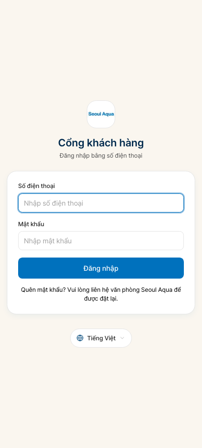

1. Nhập **Số điện thoại** và **Mật khẩu**, rồi nhấn **Đăng nhập**.
2. Nếu một số điện thoại được đăng ký cho nhiều tài khoản, màn hình **Chọn tài khoản** sẽ hiện ra. Hãy chọn đúng khách hàng (công ty) của mình.

### Khi đăng nhập lần đầu

- Khi tài khoản cổng được mở, quý khách có thể nhận **email hướng dẫn** (thông báo ID đăng nhập), còn **mật khẩu tạm thời do nhân viên văn phòng đọc cho quý khách qua điện thoại.** Mật khẩu không được gửi qua tin nhắn hay email.
- Khi đăng nhập lần đầu bằng mật khẩu tạm thời, màn hình **Đổi mật khẩu** sẽ mở ngay. Nhập mật khẩu hiện tại (mật khẩu tạm thời), mật khẩu mới (từ 8 ký tự trở lên), xác nhận mật khẩu mới rồi nhấn **Đổi mật khẩu**. Chưa đổi thì không chuyển sang màn hình khác được.

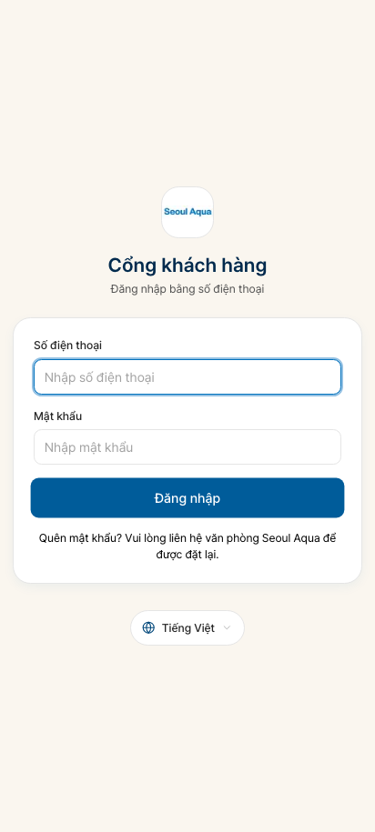

### Quên mật khẩu?

**Vui lòng gọi điện cho văn phòng Jake's Home Appliances.** Sau khi xác minh danh tính, nhân viên sẽ tạo mật khẩu tạm thời mới và **đọc cho quý khách qua điện thoại.** Màn hình đăng nhập không có chức năng tự cấp lại mật khẩu.

### Khi đăng nhập bị khóa

Nếu nhập sai mật khẩu 5 lần trong 15 phút, thông báo "Tài khoản tạm thời bị khóa. Vui lòng thử lại sau." sẽ hiện ra và quý khách không thể đăng nhập trong 15 phút. Hãy thử lại sau 15 phút, hoặc nhờ văn phòng đặt lại mật khẩu.

---

## 2. Bố cục màn hình

- **Phía trên**: tên khách hàng và tên người phụ trách, menu ngôn ngữ, nút **Đăng xuất**
- **5 tab phía dưới**: **Trang chính · Thiết bị · Lịch hẹn · Yêu cầu · Cài đặt**

Lịch sử thanh toán mở từ thẻ **Công nợ** ở Trang chính, còn liên hệ mở từ **Cài đặt → Quản lý liên hệ** (tài khoản Bên ký hợp đồng).

---

## 3. Trang chính

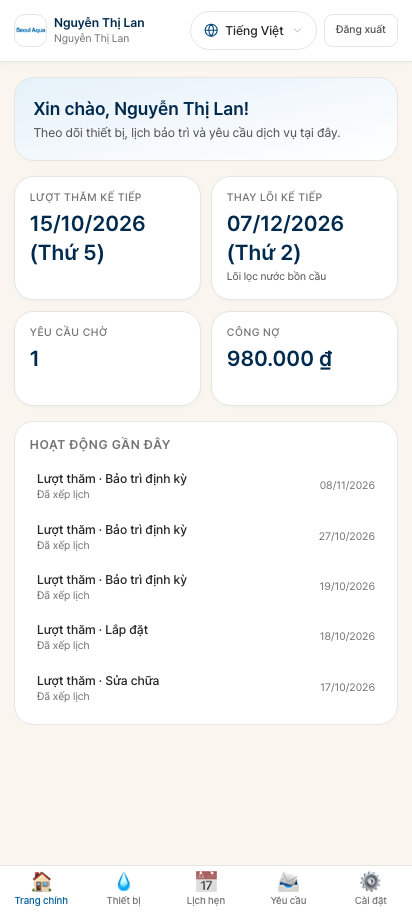

Sau khi đăng nhập, quý khách thấy lời chào và 4 thẻ. Nhấn vào thẻ để chuyển đến màn hình tương ứng.

| Thẻ | Nội dung | Khi nhấn vào |
|---|---|---|
| **Lượt thăm kế tiếp** | Ngày (thứ) của lượt thăm gần nhất | Lịch hẹn |
| **Thay lõi kế tiếp** | Ngày thay lõi lọc sớm nhất | Thiết bị |
| **Yêu cầu chờ** | Số yêu cầu đang chờ văn phòng xem xét | Yêu cầu |
| **Công nợ** | Tổng số tiền chưa thanh toán | Thanh toán |

Bên dưới là mục **Hoạt động gần đây** hiển thị các lượt thăm và yêu cầu gần đây.

---

## 4. Thiết bị

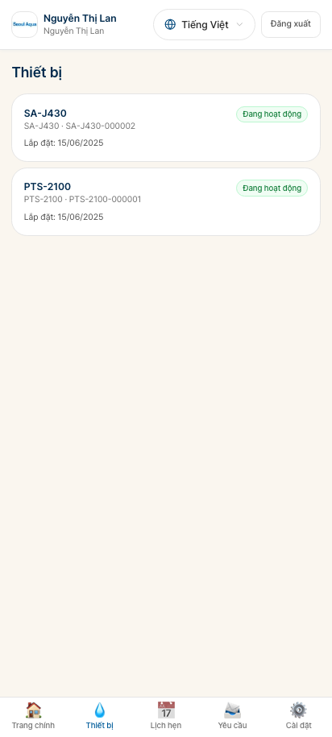

**Tab phía dưới → Thiết bị**. Thiết bị của quý khách được nhóm theo cơ sở. Mỗi thẻ có model, số seri, trạng thái và ngày lắp đặt.

### Chi tiết thiết bị

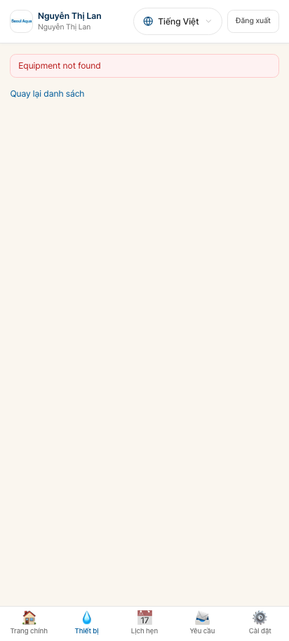

Nhấn vào thẻ thiết bị để mở.

- **Thông tin cơ bản**: Số seri, Trạng thái, Sở hữu, Ngày lắp đặt
- **Cơ sở**: cơ sở lắp đặt thiết bị và địa chỉ (khách hàng doanh nghiệp)
- **Lịch thay lõi**: nếu đã đăng ký, hiển thị ngày thay kế tiếp và loại lõi lọc
- **Lịch sử thăm**: các lượt thăm của thiết bị này — ngày, loại, trạng thái, nội dung công việc, vật tư đã dùng

---

## 5. Lịch hẹn

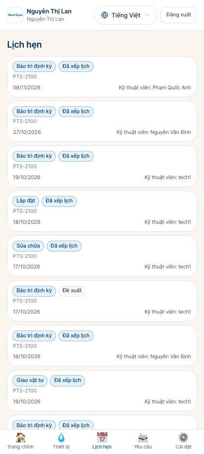

**Tab phía dưới → Lịch hẹn**. Mỗi lượt thăm hiển thị loại (bảo trì định kỳ · lắp đặt · sửa chữa · thay lõi lọc · giao vật tư...), trạng thái, model, ngày hẹn và kỹ thuật viên phụ trách.

### Chi tiết lượt thăm

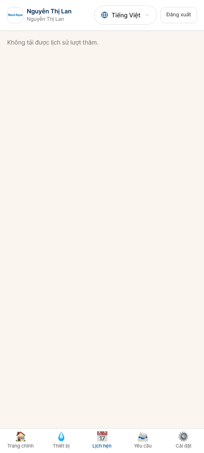

Nhấn vào lượt thăm để xem thời điểm hoàn tất, **Nội dung công việc** do kỹ thuật viên ghi và **Hình ảnh hiện trường**. Với lượt thăm đã có phiếu xác nhận công việc, nút **Tải phiếu công việc** sẽ hiện ra, nhấn vào sẽ mở tệp PDF.

---

## 6. Yêu cầu dịch vụ

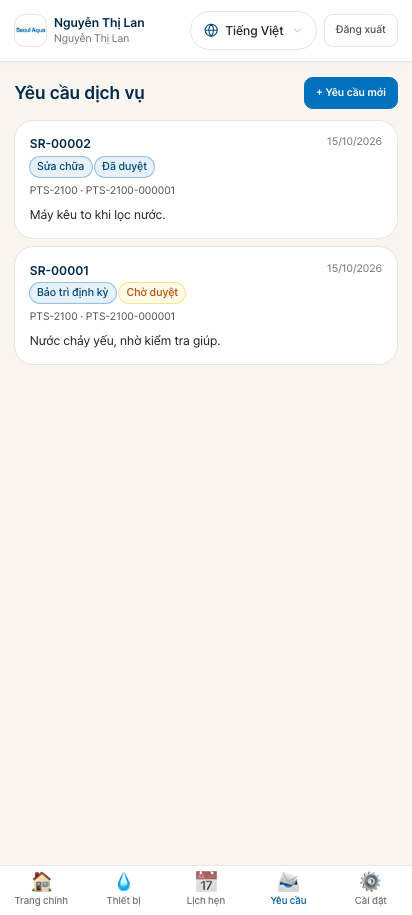

**Tab phía dưới → Yêu cầu**. Hiển thị các yêu cầu đã gửi và tiến trình.

### 6.1 Gửi yêu cầu mới

Nhấn **"+ Yêu cầu mới"** rồi thực hiện lần lượt năm bước. Di chuyển bằng "Tiếp" · "Quay lại" ở phía dưới.

**1. Chọn thiết bị** — nhấn vào thiết bị đang gặp vấn đề. Khách hàng doanh nghiệp có nhiều cơ sở có thể thu hẹp theo cơ sở trước.

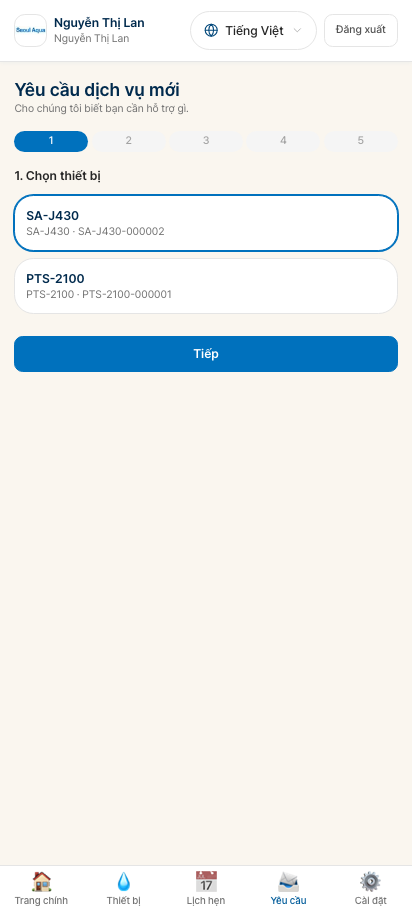

**2. Loại yêu cầu** — chọn một trong: Bảo trì định kỳ · Sửa chữa · Thay phụ tùng · Di dời · Khác.

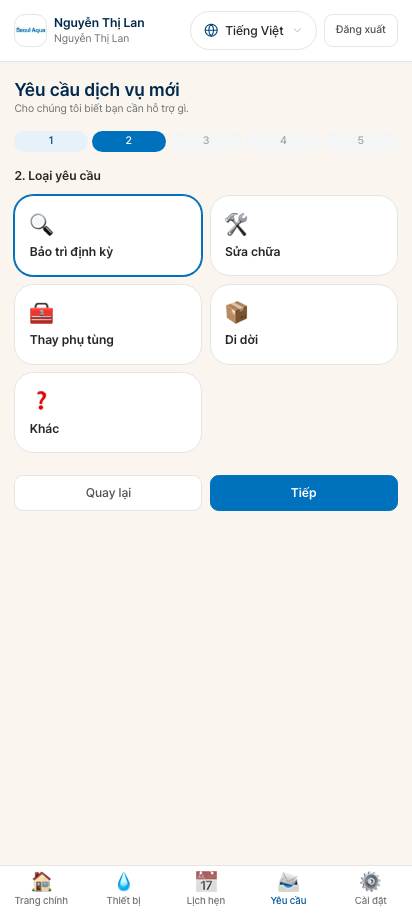

**3. Mô tả vấn đề** — ghi từ 10 ký tự trở lên về vấn đề gì và bắt đầu từ khi nào. Nếu nhập **Thời gian khách mong muốn**, văn phòng sẽ tham khảo khi xếp lịch (tùy chọn).

**4. Thêm ảnh (tùy chọn)** — có thể tải lên tối đa 8 ảnh chụp phần có vấn đề. Có ảnh thì việc xử lý sẽ nhanh hơn.

**5. Xem lại & gửi** — kiểm tra nội dung rồi nhấn **Gửi yêu cầu**.

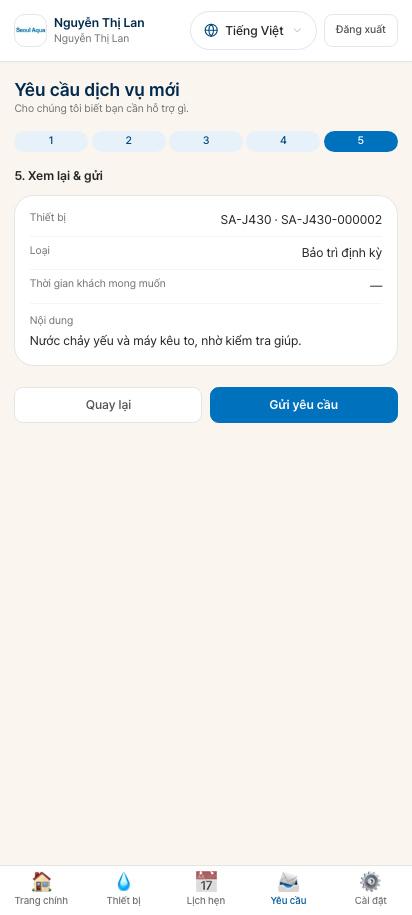

### 6.2 Sau khi gửi

- **Yêu cầu miễn phí** (thuộc phạm vi hợp đồng) chuyển ngay sang **Đã duyệt** và lịch thăm được xếp tự động. Màn hình hiện "Chúng tôi đã tự động xếp lịch. Văn phòng sẽ xác nhận KTV sớm."
- **Yêu cầu có phí** chuyển sang **Chờ duyệt** và màn hình hiện "Văn phòng sẽ phản hồi trong 1 ngày làm việc." Văn phòng sẽ xác định số tiền và lịch hẹn rồi liên hệ với quý khách.

Các trường hợp thường được miễn phí như sau. Quyết định chính xác thuộc về văn phòng.

| Loại | Trường hợp miễn phí |
|---|---|
| Bảo trì định kỳ | Đang trong hợp đồng thuê · bảo trì, hoặc trong vòng 90 ngày sau khi lắp đặt |
| Sửa chữa | Đang thuê, hoặc trong vòng 6 tháng sau khi lắp đặt |
| Thay phụ tùng | Đang trong hợp đồng thuê · bảo trì |
| Di dời | Lần di dời đầu tiên trong vòng 90 ngày sau khi lắp đặt |
| Khác | Có phí |

### 6.3 Trạng thái yêu cầu

| Trạng thái | Ý nghĩa |
|---|---|
| Chờ duyệt | Văn phòng đang xem xét (yêu cầu có phí) |
| Đã duyệt | Đã được duyệt và đang xếp lịch thăm |
| Đã xếp lịch | Đã xác định kỹ thuật viên và ngày giờ thăm |
| Hoàn tất | Lượt thăm đã kết thúc |
| Từ chối | Quyết định không xử lý (có hiển thị lý do) |
| Đã hủy | Đã hủy |

### 6.4 Chi tiết yêu cầu — tin nhắn và hủy

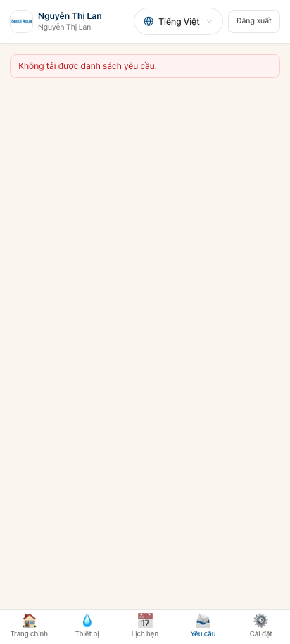

- Hiển thị nội dung yêu cầu, ảnh và trạng thái.
- Dùng khung **Trao đổi** để nhắn tin qua lại với văn phòng.
- Khi yêu cầu ở trạng thái Chờ duyệt · Đã duyệt · Đã xếp lịch và lượt thăm chưa kết thúc, quý khách có thể nhấn **Hủy yêu cầu** (lý do là tùy chọn).

> Tin duyệt hoặc từ chối yêu cầu sẽ được văn phòng báo cho quý khách **qua điện thoại**. Thông báo bằng tin nhắn đang được chuẩn bị.

---

## 7. Thanh toán

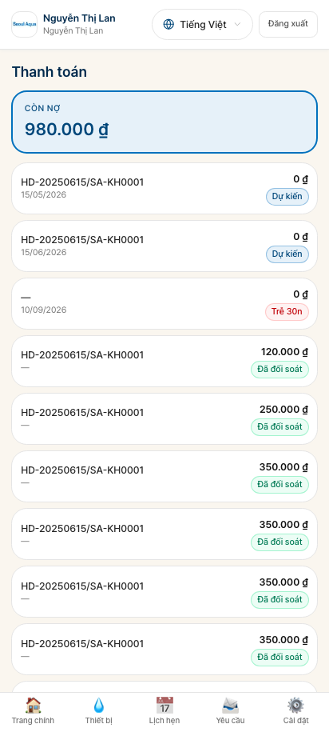

Mở bằng cách nhấn vào thẻ **Công nợ** ở Trang chính.

- Thẻ **Còn nợ** phía trên hiển thị đậm tổng số tiền chưa thanh toán.
- Mỗi thẻ bên dưới hiển thị số hợp đồng, hạn thanh toán, số tiền đã trả và trạng thái.

---

## 8. Hóa đơn GTGT (khách hàng doanh nghiệp)

Khách hàng doanh nghiệp (B2B) có thể tải về hóa đơn GTGT đã phát hành. Mở bằng **Cài đặt → Bảo mật → "Hóa đơn GTGT"** (chỉ hiện với khách hàng doanh nghiệp). Mỗi hóa đơn có số, ngày phát hành, số tiền và nút **Tải xuống**. Khách hàng cá nhân (B2C) sẽ thấy dòng "Hóa đơn GTGT chỉ dành cho khách hàng B2B."

---

## 9. Liên hệ (tài khoản Bên ký hợp đồng)

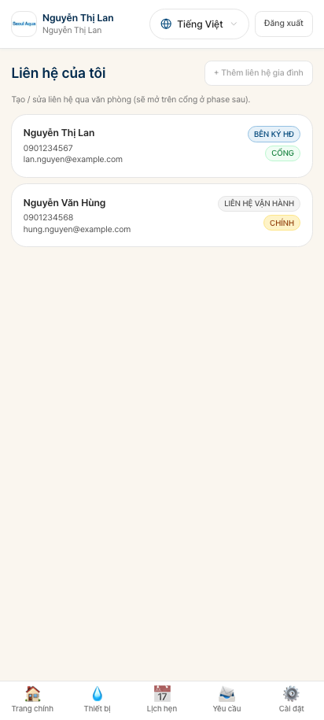

**Cài đặt → Quản lý liên hệ** (chỉ hiện với tài khoản Bên ký hợp đồng). Đây là danh sách người phụ trách đã đăng ký tại Jake's Home Appliances, khách hàng doanh nghiệp thấy là "Liên hệ công ty", khách hàng cá nhân thấy là "Liên hệ của tôi". Mỗi người được hiển thị tên, chức danh, điện thoại, email, vai trò (Bên ký HĐ / Liên hệ vận hành · Chính), việc có dùng cổng hay không và cơ sở.

| Vai trò | Nội dung nhận được |
|---|---|
| **Bên ký HĐ** | Hợp đồng, hóa đơn GTGT, thông báo pháp lý, thông báo quá hạn · hết hạn |
| **Liên hệ vận hành** | Thông báo lịch thăm, biên lai, thông báo thay lõi lọc |

Nút thêm liên hệ hiện chưa bấm được — để thêm hoặc sửa, vui lòng nhờ văn phòng.

---

## 10. Cài đặt

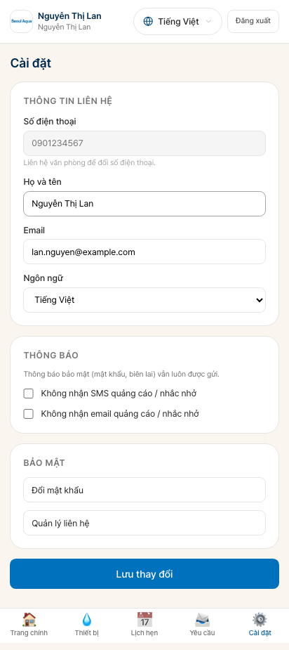

**Tab phía dưới → Cài đặt**

### Thông tin liên hệ

Thay đổi Họ và tên · Email · Ngôn ngữ rồi nhấn **Lưu thay đổi**. Số điện thoại là ID đăng nhập nên không thể đổi trên cổng. Vui lòng liên hệ văn phòng.

**Ngôn ngữ** là ngôn ngữ của tài liệu và thông báo Jake's Home Appliances gửi cho quý khách. Ngôn ngữ màn hình được đổi riêng ở menu ngôn ngữ phía trên bên phải.

### Thông báo

- **Không nhận SMS quảng cáo / nhắc nhở**
- **Không nhận email quảng cáo / nhắc nhở**

Đánh dấu rồi nhấn **Lưu thay đổi**. Nếu từ chối nhận, quý khách cũng sẽ không nhận các thông báo như nhắc lịch thăm, thông báo thay lõi lọc, kết quả yêu cầu, thông báo quá hạn. Biên lai · hóa đơn GTGT · bản sao hợp đồng · thông báo mở cổng vẫn được gửi dù quý khách có từ chối hay không.

### Đổi mật khẩu

**Bảo mật → Đổi mật khẩu** → Mật khẩu hiện tại · Mật khẩu mới (từ 8 ký tự, phải khác mật khẩu cũ) · Xác nhận mật khẩu mới → **Đổi mật khẩu**

---

## 11. Đổi ngôn ngữ

Ở bất kỳ màn hình nào, hãy chọn Tiếng Việt · 한국어 · English trong menu ngôn ngữ (hình quả địa cầu) ở phía trên bên phải. Ở màn hình đăng nhập, menu nằm bên dưới các ô nhập.

---

## 12. Thông báo quý khách sẽ nhận

| Khi nào | Nội dung |
|---|---|
| Một ngày trước lượt thăm | SMS lịch thăm — gửi bằng tiếng Việt không dấu (nội dung đã đăng ký với nhà mạng nên không có dấu) |
| Các thông báo khác | Thông báo qua email đang được chuẩn bị. Các nội dung quan trọng như kết quả yêu cầu · quá hạn sẽ do văn phòng báo qua điện thoại |

---

## Thuật ngữ

| Thuật ngữ | Ý nghĩa |
|---|---|
| Bên ký hợp đồng | Người ký hợp đồng và nhận hóa đơn GTGT · thông báo pháp lý |
| Liên hệ vận hành | Người phụ trách tại hiện trường nhận lịch thăm · biên lai |
| Mật khẩu tạm thời | Mật khẩu 10 ký tự mà nhân viên văn phòng đọc cho quý khách qua điện thoại khi mở hoặc đặt lại tài khoản |
| Phiếu xác nhận công việc | Tài liệu (PDF) xác nhận công việc, được phát hành sau khi kết thúc lượt thăm |
| Công nợ | Số tiền chưa thanh toán |
| B2B / B2C | Khách hàng doanh nghiệp / khách hàng cá nhân hộ gia đình |

---

## Khắc phục sự cố

| Hiện tượng | Cách giải quyết |
|---|---|
| Không đăng nhập được | Kiểm tra số điện thoại và mật khẩu. Nhập sai 5 lần sẽ bị khóa 15 phút. Nếu liên hệ văn phòng, văn phòng sẽ đặt lại mật khẩu và đọc cho quý khách qua điện thoại |
| Tôi không nhận được mật khẩu tạm thời | Mật khẩu không được gửi qua tin nhắn. Vui lòng gọi điện cho văn phòng |
| Hiện giao diện tiếng Anh | Kiểm tra trong địa chỉ có `/vi` không, hoặc chọn Tiếng Việt trong menu ngôn ngữ phía trên bên phải |
| Thiết bị không có trong danh sách | Có thể thiết bị chưa được đăng ký, hoặc tài khoản chỉ phụ trách một cơ sở nên không thấy thiết bị của cơ sở khác. Vui lòng hỏi văn phòng |
| Không có menu hóa đơn GTGT | Mục này chỉ dành cho khách hàng doanh nghiệp (B2B). Nằm ở Cài đặt → Bảo mật → "Hóa đơn GTGT" |
| Tôi muốn sửa liên hệ | Trên cổng hiện chưa làm được. Vui lòng nhờ văn phòng |
| Trạng thái yêu cầu không thay đổi | Việc xử lý có thể mất thời gian. Hãy hỏi qua khung trao đổi trong chi tiết yêu cầu |
