# Jake's Home Appliances SOMS — Hướng dẫn dành cho Kỹ thuật viên hiện trường

**Đối tượng**: Kỹ thuật viên (TECHNICIAN) — dùng điện thoại
**Phiên bản**: 15/10/2026 (chụp lại toàn bộ màn hình · sửa đổi toàn diện theo hoạt động thực tế — hoàn tất lượt thăm 5 bước, ảnh chữ ký, huy hiệu tiền mặt đang giữ, lời nhắn về văn phòng)
**Ngôn ngữ**: Tiếng Việt
**Tài liệu liên quan**: [Hướng dẫn Văn phòng](./office.md) · [Hướng dẫn Khách hàng](./customer.md)

---

## Mục lục

- [Chương 1. Bắt đầu](#chương-1-bắt-đầu)
- [Chương 2. Một ngày của Kỹ thuật viên](#chương-2-một-ngày-của-kỹ-thuật-viên)
- [Chương 3. Đăng nhập](#chương-3-đăng-nhập)
- [Chương 4. Bố cục màn hình](#chương-4-bố-cục-màn-hình)
- [Chương 5. Màn hình "Hôm nay"](#chương-5-màn-hình-hôm-nay)
- [Chương 6. Màn hình "Sắp tới"](#chương-6-màn-hình-sắp-tới)
- [Chương 7. Chi tiết lượt thăm](#chương-7-chi-tiết-lượt-thăm)
- [Chương 8. Bắt đầu và hoàn tất lượt thăm (5 bước)](#chương-8-bắt-đầu-và-hoàn-tất-lượt-thăm-5-bước)
- [Chương 9. Thu tiền và tiền mặt đang giữ](#chương-9-thu-tiền-và-tiền-mặt-đang-giữ)
- [Chương 10. Khi tham gia với vai trò KTV phụ](#chương-10-khi-tham-gia-với-vai-trò-ktv-phụ)
- [Chương 11. Hướng dẫn theo từng loại lượt thăm](#chương-11-hướng-dẫn-theo-từng-loại-lượt-thăm)
- [Chương 12. Khi cần liên hệ với khách hàng](#chương-12-khi-cần-liên-hệ-với-khách-hàng)
- [Chương 13. Khách vắng mặt · thiếu phụ tùng · mất mạng](#chương-13-khách-vắng-mặt--thiếu-phụ-tùng--mất-mạng)
- [Chương 14. Kết thúc ngày và bàn giao tiền mặt](#chương-14-kết-thúc-ngày-và-bàn-giao-tiền-mặt)
- [Chương 15. Hồ sơ](#chương-15-hồ-sơ)
- [Chương 16. Các tình huống thường gặp](#chương-16-các-tình-huống-thường-gặp)
- [Phụ lục A. Tra cứu nhanh loại lượt thăm](#phụ-lục-a-tra-cứu-nhanh-loại-lượt-thăm)
- [Phụ lục B. Các vấn đề đã biết](#phụ-lục-b-các-vấn-đề-đã-biết)

---

## Chương 1. Bắt đầu

### 1.1 Cần chuẩn bị gì

| Mục | Khuyến nghị |
|---|---|
| Điện thoại | Android 8 trở lên hoặc iPhone iOS 14 trở lên, màn hình từ 5 inch trở lên |
| Camera | Camera chụp được ảnh hiện trường và chữ ký của khách hàng |
| Internet | Dữ liệu di động (4G/LTE/5G) hoặc Wi-Fi |

### 1.2 Địa chỉ ứng dụng dành cho KTV

Mở bằng Chrome hoặc Safari trên điện thoại.

```
https://soms.jakeshomeappliances.com.vn/f/vi/login
```

- `/vi` trong địa chỉ là giao diện tiếng Việt. Bỏ đi thì là tiếng Anh, `/ko` là tiếng Hàn.
- Không cần tải ứng dụng. Nếu tạo lối tắt bằng **"Thêm vào màn hình chính"** trong menu trình duyệt, ứng dụng sẽ mở như một app bình thường.

### 1.3 Thông tin bạn nhận lúc đầu

Quản trị viên tạo tài khoản và **đọc trực tiếp mật khẩu tạm thời cho bạn.** Mật khẩu không gửi qua tin nhắn.

- ID đăng nhập: số điện thoại di động của bạn
- Mật khẩu: mật khẩu tạm thời nhận từ quản trị viên — lần đăng nhập đầu tiên sẽ hiện màn hình đặt mật khẩu mới ([Chương 3](#chương-3-đăng-nhập))

Không chia sẻ mật khẩu cho người khác.

---

## Chương 2. Một ngày của Kỹ thuật viên

```
Sáng → Đăng nhập → Kiểm tra màn hình "Hôm nay"
  → Trong chi tiết lượt thăm, xem thiết bị · chứng từ · nội dung công việc · lời nhắn của văn phòng
  → Xuất phát ("Mở bản đồ")
  → Đến nơi → "Bắt đầu"
  → Làm việc → "Hoàn tất" → nhập 5 bước (nội dung công việc · ảnh · chữ ký · thanh toán · xem lại)
  → Lượt thăm tiếp theo
  → Trước khi về: kiểm tra tiền mặt đang giữ
  → Ngày làm việc kế tiếp: bàn giao tiền mặt cho văn phòng (trong vòng 48 giờ kể từ lúc thu)
```

---

## Chương 3. Đăng nhập

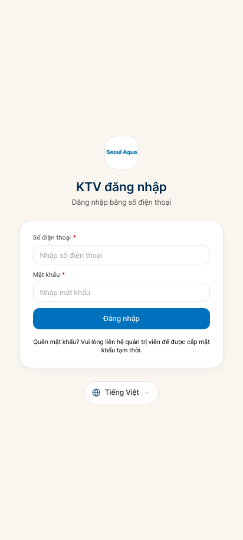

| Mục | Mô tả |
|---|---|
| Số điện thoại | Số di động của bạn |
| Mật khẩu | Mật khẩu nhận từ quản trị viên |

- **Nhập sai 5 lần trong 15 phút thì tài khoản bị khóa 15 phút.** Khi hiện "Đăng nhập sai nhiều lần nên tài khoản tạm bị khóa…", hãy thử lại sau 15 phút, hoặc nhờ văn phòng đặt lại mật khẩu (đặt lại cũng sẽ mở khóa).
- **Khi đăng nhập bằng mật khẩu tạm thời**, màn hình "Đổi mật khẩu" sẽ hiện trước. Nhập mật khẩu hiện tại (mật khẩu tạm thời) · mật khẩu mới (từ 8 ký tự, phải khác mật khẩu cũ) · xác nhận mật khẩu mới rồi nhấn "Đổi mật khẩu". Bạn không thể sang màn hình khác trước khi đổi.
- **Khi quên mật khẩu**: gọi điện cho văn phòng. Quản trị viên sẽ cấp mật khẩu tạm thời mới và đọc trực tiếp cho bạn. Không có màn hình tự cấp lại mật khẩu.
- Muốn đổi mật khẩu trong lúc dùng bình thường: "Hồ sơ" → "Đổi mật khẩu" ([Chương 15](#chương-15-hồ-sơ)).
- Nếu đăng nhập ứng dụng văn phòng (`/o/vi/login`) bằng tài khoản KTV, màn hình sẽ hiện thông báo "Đây là tài khoản kỹ thuật viên. Vui lòng đăng nhập tại trang dành cho KTV." cùng liên kết "Đến trang KTV".

---

## Chương 4. Bố cục màn hình

- **Phía trên**: "Jake's Home Appliances Hiện trường", menu ngôn ngữ (한국어 · Tiếng Việt · English), biểu tượng đăng xuất
- **3 tab phía dưới**: **Hôm nay · Sắp tới · Hồ sơ**
- Khi mất mạng, phía trên hiện biểu ngữ "Ngoại tuyến" (xem [§13.3](#133-khi-mất-mạng)).

---

## Chương 5. Màn hình "Hôm nay"

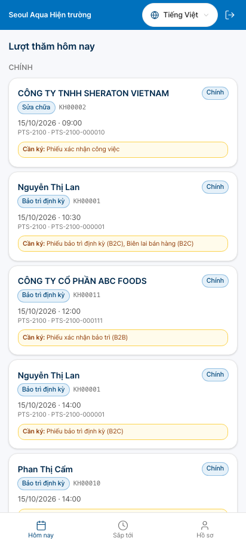

Đây là màn hình mở ra sau khi đăng nhập.

- Trên cùng là huy hiệu **Tiền mặt đang giữ** — số tiền mặt bạn đã thu nhưng chưa bàn giao cho văn phòng ([§9.3](#93-huy-hiệu-tiền-mặt-đang-giữ))
- Nhóm **Chính** — các lượt thăm bạn chịu trách nhiệm
- Nhóm **Phụ** — các lượt thăm bạn hỗ trợ KTV khác ([Chương 10](#chương-10-khi-tham-gia-với-vai-trò-ktv-phụ))

Thẻ lượt thăm hiển thị:

- Tên khách hàng và nhãn "Chính" hoặc "Phụ"
- Loại lượt thăm và mã khách hàng
- Ngày · giờ
- Model · số sê-ri
- Khung vàng **"Cần ký: …"** — các chứng từ cần lấy chữ ký khách hàng trong lượt thăm này

Chỉ hiện các lượt thăm hôm nay ở trạng thái Đã xếp lịch · Đang tiến hành · Đã đổi lịch. **Lượt thăm đã hoàn tất sẽ biến mất khỏi danh sách.**

Nhấn vào thẻ để mở chi tiết lượt thăm.

---

## Chương 6. Màn hình "Sắp tới"

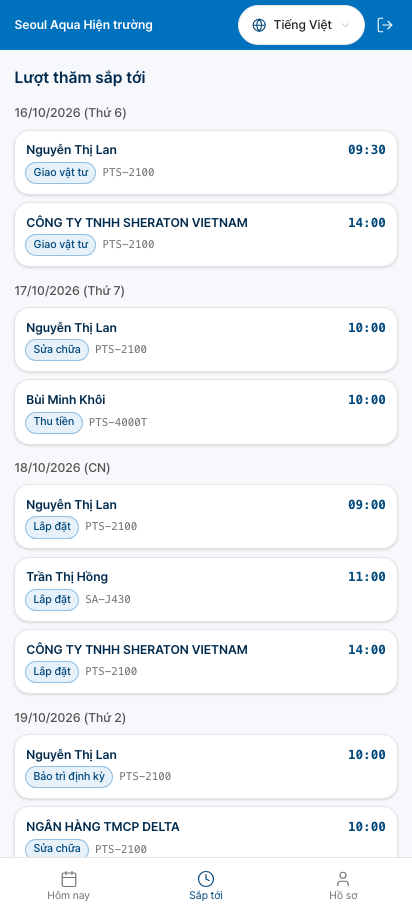

Hiển thị các lượt thăm **trong 7 ngày kể từ ngày mai**, chia theo ngày. Dùng để chuẩn bị phụ tùng hoặc lên trước lộ trình. Nếu không có, màn hình hiện "Không có lượt thăm 7 ngày tới."

---

## Chương 7. Chi tiết lượt thăm

Mở ra khi bạn nhấn vào thẻ lượt thăm. Các phần được sắp xếp từ trên xuống như sau.

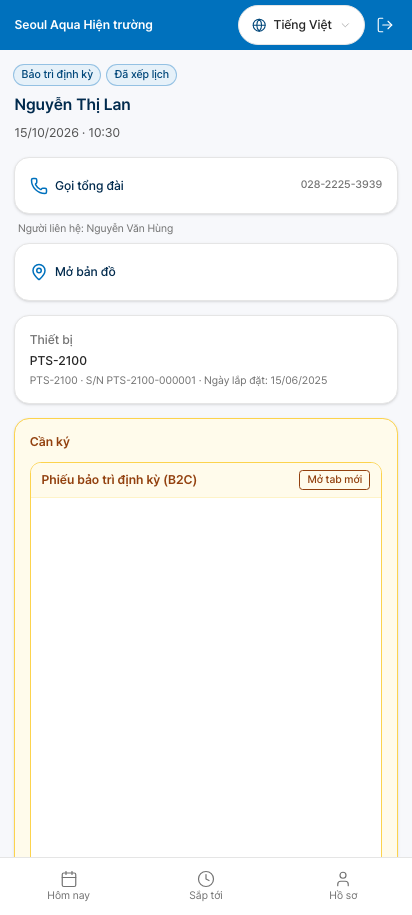

1. **Đầu trang**: loại lượt thăm · trạng thái, tên khách hàng, ngày · giờ
2. Nút **"Gọi tổng đài"** — nhấn để gọi đến số của văn phòng
3. **Người liên hệ** — tên người phụ trách phía khách hàng (không hiển thị số điện thoại, xem [Chương 12](#chương-12-khi-cần-liên-hệ-với-khách-hàng))
4. **"Mở bản đồ"** — mở địa chỉ khách hàng trên Google Maps
5. **Thiết bị** — tên model, mã model · số sê-ri · ngày lắp đặt, cơ sở (địa điểm)

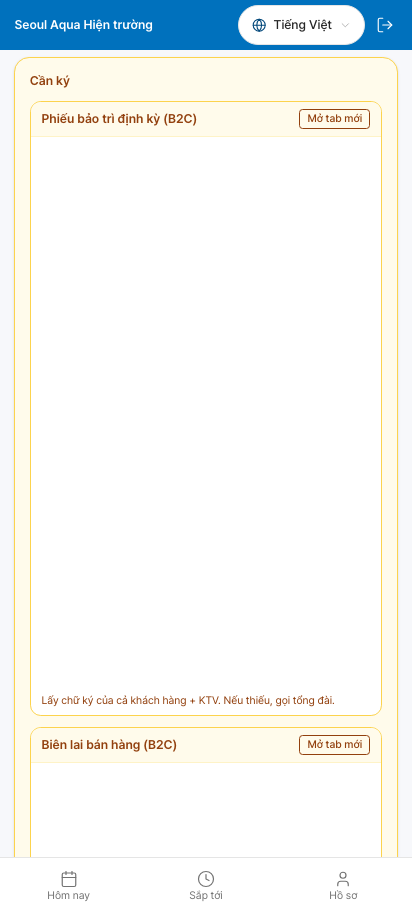

6. **Cần ký** — mỗi chứng từ có bản xem trước PDF và liên kết "Mở tab mới". Cần lấy **chữ ký của cả khách hàng và KTV.** Chứng từ giấy do văn phòng in sẵn cho bạn.


7. **Nội dung công việc** — hướng dẫn công việc theo loại lượt thăm, danh sách **Cần thay (lõi lọc · vật tư)** và **Cần vệ sinh · kiểm tra** (kèm chu kỳ: "mỗi 180 ngày", "mỗi lượt thăm"), số tiền dự kiến (nếu có)
8. **Yêu cầu dịch vụ** — nếu lượt thăm phát sinh từ yêu cầu của khách hàng thì có mã yêu cầu · loại · nội dung khách hàng đã viết
9. **Địa chỉ**

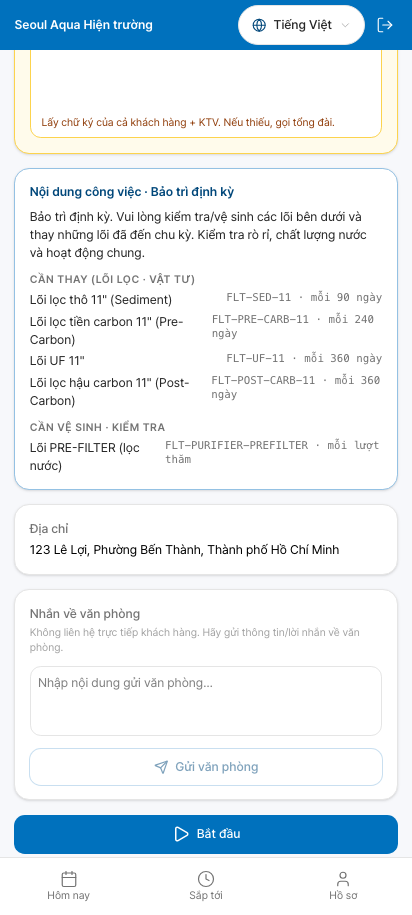

10. **Nhắn về văn phòng** — ghi chú trao đổi với văn phòng. Đừng liên hệ trực tiếp với khách hàng, hãy viết vào đây rồi nhấn "Gửi văn phòng". Nội dung này không được in trên chứng từ của khách hàng.
11. **Các nút** (chỉ KTV chính nhìn thấy)
    - "Bắt đầu" — khi trạng thái là Đã xếp lịch
    - "Hoàn tất" — khi trạng thái là Đang tiến hành
    - "KH vắng" — khi trạng thái là Đã xếp lịch hoặc Đang tiến hành ([§13.1](#131-khi-khách-hàng-không-có-nhà))

---

## Chương 8. Bắt đầu và hoàn tất lượt thăm (5 bước)

### 8.1 Bắt đầu lượt thăm

Khi đến nhà hoặc văn phòng của khách hàng, vào chi tiết lượt thăm → **"Bắt đầu"**. Trạng thái chuyển sang **Đang tiến hành** và giờ bắt đầu được ghi lại. Lúc này nút "Hoàn tất" xuất hiện.

### 8.2 Hoàn tất lượt thăm — 5 bước

Làm xong việc, nhấn **"Hoàn tất"**. Nhập lần lượt năm bước; di chuyển giữa các bước bằng "Tiếp" · "Quay lại" ở phía dưới.

#### ① Nội dung + phụ tùng

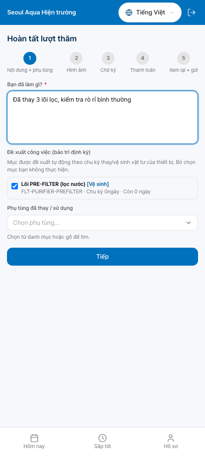

- **Bạn đã làm gì?** (bắt buộc) — ghi lại công việc đã thực hiện. Nội dung này được đưa vào phiếu xác nhận công việc gửi khách hàng.
- **Đề xuất công việc (bảo trì định kỳ)** — danh sách lõi lọc được đề xuất tự động theo chu kỳ thay · vệ sinh của thiết bị. Ban đầu tất cả đều được chọn, vì vậy hãy **bỏ chọn những mục thực tế bạn không làm.** Các mục thay đã chọn sẽ được tính lại ngày thay kế tiếp và trừ khỏi tồn kho.
- **Phụ tùng đã thay / sử dụng** — tìm trong danh mục theo SKU hoặc tên rồi chọn. Nếu không có trong danh sách, dùng "+ Thêm "tên"".

#### ② Hình ảnh

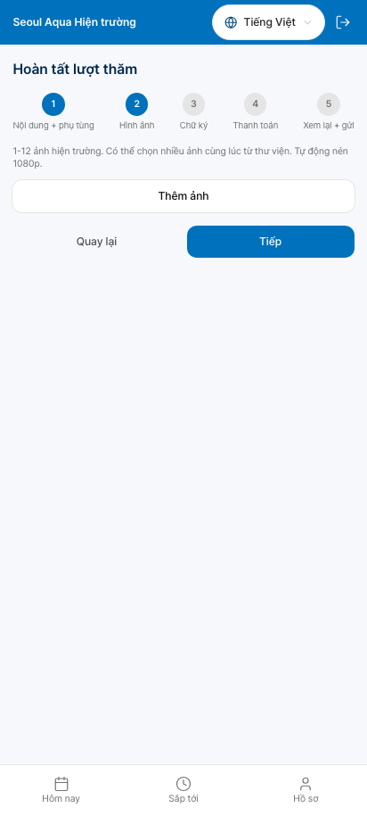

- "Thêm ảnh" → chọn từ camera hoặc thư viện. Có thể chọn nhiều ảnh cùng lúc, ảnh được tự động nén 1080p (khuyến nghị 1–12 ảnh).
- Ảnh đã chọn được đánh dấu "Chờ tải lên". **Phải nhấn "Tải lên N ảnh đã chọn" thì ảnh mới được tải lên.** Còn ảnh chưa tải lên thì không sang được bước tiếp theo. Ảnh không cần có thể bỏ bằng dấu ×.
- Muốn chụp thêm, nhấn "Thêm ảnh nữa".
- Ảnh không bắt buộc, nhưng giữ ảnh trước · sau khi làm việc sẽ là bằng chứng khi sau này phát sinh tranh chấp.

#### ③ Chữ ký

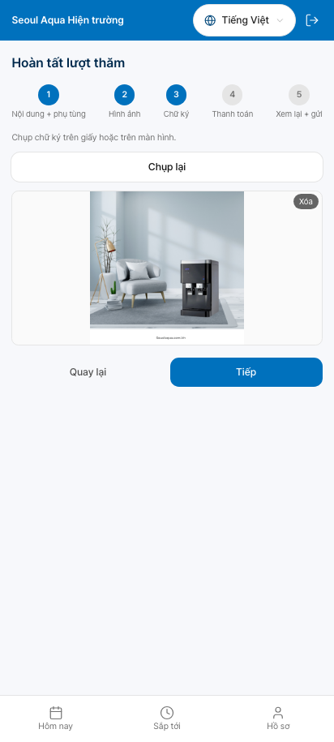

- Chụp và tải lên **ảnh chữ ký của khách hàng**. Hãy chụp chữ ký đã ký trên chứng từ giấy hoặc chữ ký ký trên màn hình.
- Nhấn "Chụp ảnh chữ ký" để mở camera. Nếu chụp sai, nhấn "Chụp lại" hoặc nhấn "Xóa" rồi chụp lại.
- **Chữ ký là bắt buộc.** Nếu thiếu, đến bước cuối hệ thống sẽ từ chối khi gửi.

#### ④ Thanh toán

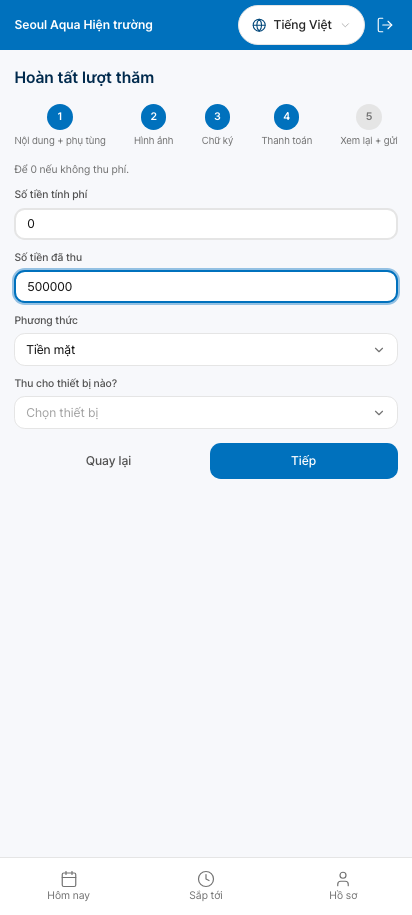

| Ô | Mô tả |
|---|---|
| Số tiền tính phí | Số tiền dự kiến do văn phòng đặt đã được điền sẵn. Nếu thay đổi, bắt buộc ghi **Lý do điều chỉnh** (từ 5 ký tự trở lên) |
| Số tiền đã thu | Số tiền thực nhận. **Nếu chưa thu thì nhập 0** |
| Phương thức | Hiện ra khi số tiền đã thu lớn hơn 0. Tiền mặt · Chuyển khoản · Thẻ · Khác |
| Thu cho thiết bị nào? | Hiện ra khi khách hàng có từ 2 thiết bị trở lên |

Nếu khách hàng nói "để lát nữa tôi chuyển khoản", hãy để số tiền đã thu là **0**. Văn phòng sẽ xác nhận tiền vào và xử lý.

#### ⑤ Xem lại + gửi

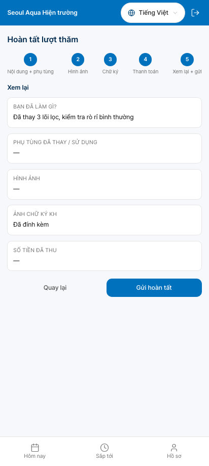

Kiểm tra nội dung đã nhập rồi nhấn **"Gửi hoàn tất"**. Nếu cần sửa, nhấn "Quay lại".

### 8.3 Điều gì xảy ra sau khi hoàn tất

- Lượt thăm chuyển sang **Hoàn tất** và bạn quay về chi tiết lượt thăm. Các nút không còn hiện nữa.
- Phiếu xác nhận công việc dạng PDF được tạo, và email thông báo hoàn tất lượt thăm được gửi đến người liên hệ của khách hàng (hiện email đang trong giai đoạn chuẩn bị gửi).
- Nếu lượt thăm phát sinh từ yêu cầu của khách hàng thì yêu cầu đó cũng chuyển sang **Hoàn tất.**
- Lõi lọc thay đã chọn được trừ khỏi tồn kho và ngày thay kế tiếp được đặt lại.
- Nếu có số tiền đã thu thì bản ghi thu tiền được tạo và cộng vào tiền mặt đang giữ.

> **Sau khi hoàn tất không thể sửa.** Nếu nhập nhầm, hãy liên hệ văn phòng ngay.

---

## Chương 9. Thu tiền và tiền mặt đang giữ

### 9.1 Thu tiền tại hiện trường

Nhập ở bước 4 của phần hoàn tất lượt thăm (§8.2 ④). Lượt thăm "Thu tiền" chỉ để thu tiền cũng làm theo cách tương tự.

### 9.2 Biên lai

Biên lai cho khách hàng do văn phòng chuẩn bị. Nếu cần biên lai giấy, hãy dùng chứng từ văn phòng đã chuẩn bị cho bạn.

### 9.3 Huy hiệu tiền mặt đang giữ

Huy hiệu **Tiền mặt đang giữ** ở trên cùng màn hình "Hôm nay" hiển thị tổng số tiền mặt bạn đã thu mà chưa bàn giao cho văn phòng.

| Huy hiệu | Ý nghĩa |
|---|---|
| OK | Khoản tiền mặt thu lâu nhất chưa đến 24 giờ |
| Sắp đến hạn | 24–47 giờ |
| Quá hạn | Từ 48 giờ trở lên — bảng điều khiển của văn phòng cũng hiện cảnh báo |

Trên huy hiệu có hiển thị hạn chót dạng "bàn giao trước …". **Hãy bàn giao tiền mặt đã thu cho văn phòng trong vòng 48 giờ.**

---

## Chương 10. Khi tham gia với vai trò KTV phụ

Ở những hiện trường lớn (như lắp nhiều máy cho khách B2B), nhiều KTV cùng đi.

| Vai trò | Việc có thể làm |
|---|---|
| **KTV chính** | Bắt đầu lượt thăm · hoàn tất lượt thăm (nội dung công việc · ảnh · chữ ký · thanh toán) · lời nhắn về văn phòng |
| **KTV phụ** | Xem lượt thăm · lời nhắn về văn phòng |

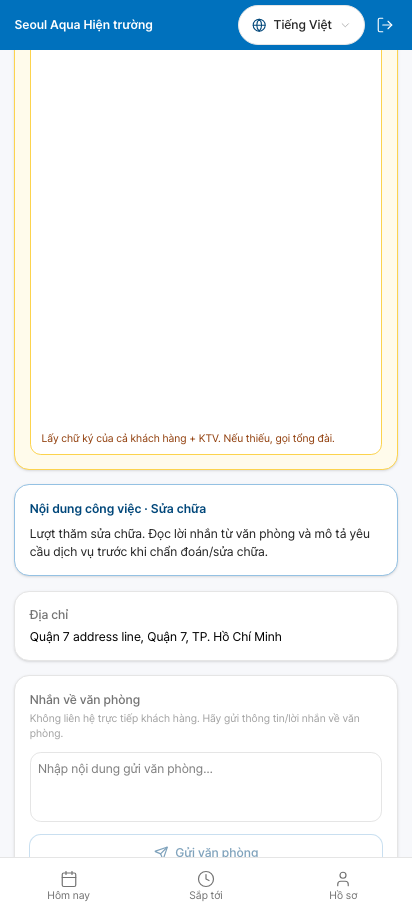

- Lượt thăm cùng làm hiện trong nhóm **Phụ** của màn hình "Hôm nay", kèm nhãn "Phụ".
- KTV phụ không có nút bắt đầu · hoàn tất. Ảnh do KTV chính tải lên ở bước hoàn tất, vì vậy hãy chuyển ảnh bạn chụp cho KTV chính.

---

## Chương 11. Hướng dẫn theo từng loại lượt thăm

Mục **Nội dung công việc** trong chi tiết lượt thăm có hướng dẫn theo từng loại. Dưới đây là những điểm chính.

| Loại | Việc cần làm | Chứng từ cần ký |
|---|---|---|
| Lắp đặt | Lắp thiết bị, kiểm tra hoạt động, chạy thử. Mang đầy đủ phụ kiện và bộ lắp đặt | Biên bản bàn giao hoặc biên lai bán hàng (B2C) / phiếu xuất kho (B2B), và hợp đồng |
| Bảo trì định kỳ | Kiểm tra · vệ sinh lõi lọc, thay lõi lọc đến chu kỳ, kiểm tra rò rỉ · chất lượng nước · hoạt động | Phiếu bảo trì định kỳ (B2C) / phiếu xác nhận bảo trì (B2B) |
| Thay lõi lọc | Thay lõi lọc, xả hết nước cũ rồi kiểm tra hoạt động | Phiếu xác nhận công việc |
| Sửa chữa | Đọc lời nhắn của văn phòng và nội dung yêu cầu dịch vụ rồi chẩn đoán · sửa chữa | Phiếu xác nhận công việc |
| Di dời | Tháo → lắp lại ở vị trí mới → thử rò rỉ | Phiếu xác nhận công việc |
| Thu tiền | Xác nhận số tiền, giao biên lai | Phiếu xác nhận công việc |
| Giao vật tư | Giao vật tư khách đã đặt ([§11.1](#111-giao-vật-tư)) | Biên lai bán hàng (B2C) / phiếu xuất kho (B2B) |
| Thu hồi thiết bị | Đóng gói thiết bị sạch sẽ để thu hồi, trả về văn phòng | Phiếu xác nhận công việc |
| Khác | Đọc lời nhắn của văn phòng rồi làm việc | Phiếu xác nhận công việc |

### 11.1 Giao vật tư

- Ứng dụng KTV **không có danh sách riêng các mặt hàng đã đặt.** Mặt hàng và số lượng được ghi trên **biên lai bán hàng (B2C) hoặc phiếu xuất kho (B2B)** do văn phòng in cho bạn, hãy đối chiếu theo đó.
- Nếu lượt thăm bảo trì có kèm giao hàng, mục "Cần ký" sẽ hiện cả chứng từ bảo trì và chứng từ giao hàng (biên lai bán hàng hoặc phiếu xuất kho). Hãy lấy chữ ký cho cả hai.
- Khi hoàn tất lượt thăm, đơn hàng gắn với lượt thăm đó chuyển sang "Đã giao".
- Phiếu xuất kho B2B cần có chữ ký · con dấu của khách hàng rồi trả lại văn phòng.
- Nếu số lượng không khớp, hãy báo bằng "Gọi tổng đài" **trước khi hoàn tất.**

---

## Chương 12. Khi cần liên hệ với khách hàng

Ứng dụng KTV **không hiển thị số điện thoại của khách hàng.** Mục đích là bảo vệ thông tin cá nhân của khách hàng và tập trung việc quản lý lịch hẹn về văn phòng.

- Việc gấp: chi tiết lượt thăm → **"Gọi tổng đài"**
- Việc không gấp: chi tiết lượt thăm → viết vào **Nhắn về văn phòng** rồi nhấn "Gửi văn phòng"

Văn phòng sẽ liên hệ với khách hàng.

---

## Chương 13. Khách vắng mặt · thiếu phụ tùng · mất mạng

### 13.1 Khi khách hàng không có nhà

1. Chi tiết lượt thăm → **"KH vắng"**
2. Chọn lý do: Khách hàng vắng nhà · Không liên lạc được khách hàng · Khách hàng yêu cầu đổi lịch · Không thể làm do sự cố hiện trường/thiết bị · Khác
3. Ghi tình hình vào **Ghi chú chi tiết** (giờ đến, các lần cố liên hệ...). Nếu chọn "Khác" thì ghi chú là bắt buộc.
4. Nhấn "Xác nhận KH vắng" → lượt thăm chuyển sang **KH vắng** và rời khỏi danh sách "Hôm nay".
5. Khi văn phòng gọi điện cho khách hàng và sắp xếp lại lịch, lượt thăm đó sẽ hiện lại trong "Hôm nay" · "Sắp tới" với ngày mới.

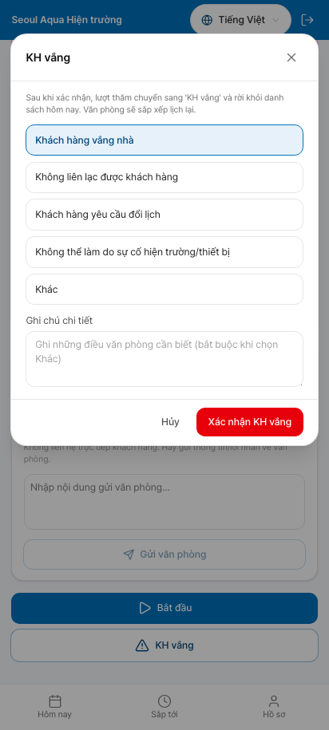

Chỉ KTV chính mới xử lý được KH vắng. Nếu việc gấp, hãy báo thêm bằng "Gọi tổng đài".

### 13.2 Khi thiếu phụ tùng / phát hiện thiết bị bất thường

- Ghi vào lời nhắn về văn phòng cần những gì (ví dụ: "Hết lõi PP, cần thăm lại") và báo bằng "Gọi tổng đài".
- Với thiết bị bất thường, hãy chụp ảnh tải lên ở bước hoàn tất và ghi chi tiết vào nội dung công việc.
- Văn phòng chuẩn bị phụ tùng và đặt lại lượt thăm mới.

### 13.3 Khi mất mạng

- Phía trên hiện biểu ngữ **"Ngoại tuyến"**. Khi kết nối lại sẽ hiện "Đang đồng bộ…", và nếu còn dữ liệu chưa gửi thì hiện "N đang chờ".
- Nếu nhấn "Gửi hoàn tất" khi đang ngoại tuyến, màn hình hiện "Đã lưu offline — sẽ đồng bộ khi có mạng." và khi có mạng, dữ liệu sẽ tự được gửi lên.
- **Tải ảnh và ảnh chữ ký lên cần có internet.** Nếu sóng yếu, hãy di chuyển đến nơi sóng tốt hơn hoặc dùng Wi-Fi.
- Nếu gấp, hãy báo miệng bằng "Gọi tổng đài".

---

## Chương 14. Kết thúc ngày và bàn giao tiền mặt

### 14.1 Kiểm tra trước khi về

- Kiểm tra trong màn hình "Hôm nay" không còn lượt thăm nào chưa làm (lượt thăm đã hoàn tất sẽ biến mất)
- Kiểm tra tổng số tiền mặt đang giữ bằng huy hiệu tiền mặt đang giữ
- Cho tiền mặt vào phong bì và giữ cùng bản sao biên lai

### 14.2 Bàn giao tiền mặt

Mang đến văn phòng vào ngày làm việc kế tiếp. Nhân viên văn phòng kiểm tra số tiền và ghi nhận từng khoản bằng "Bàn giao văn phòng", khi đó khoản tiền được trừ khỏi tiền mặt đang giữ. Hãy bàn giao trong vòng **48 giờ** kể từ lúc thu.

### 14.3 Đăng xuất

Nếu dùng điện thoại hoặc máy tính bảng dùng chung, nhất định phải đăng xuất. Nhấn biểu tượng đăng xuất ở góc trên bên phải hoặc nút "Đăng xuất" màu đỏ trong "Hồ sơ", rồi kiểm tra đã quay về màn hình đăng nhập.

---

## Chương 15. Hồ sơ

**Tab phía dưới → Hồ sơ**

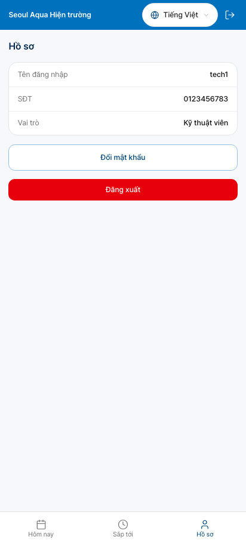

- Tên đăng nhập (ID) · SĐT · Vai trò (Kỹ thuật viên)
- Nút "Đổi mật khẩu" — mật khẩu hiện tại · mật khẩu mới (từ 8 ký tự) · xác nhận mật khẩu mới → "Đổi mật khẩu". Sau khi đổi, các thiết bị khác sẽ bị đăng xuất.
- Nút "Đăng xuất"

Muốn sửa tên · khu vực phụ trách, hãy nhờ văn phòng.

---

## Chương 16. Các tình huống thường gặp

**Không thấy lượt thăm nào trong "Hôm nay"**
- Kiểm tra xem tab phía dưới có đang ở "Sắp tới" không
- Lượt thăm đã hoàn tất sẽ biến mất
- Kiểm tra xem văn phòng đã phân công chưa → nếu vẫn không có, đăng xuất rồi đăng nhập lại

**Ảnh không tải lên được**
- Kiểm tra kết nối internet
- Kiểm tra bạn đã nhấn "Tải lên N ảnh đã chọn" chưa
- Cho phép trình duyệt truy cập camera · ảnh (Cài đặt điện thoại → ứng dụng trình duyệt → Quyền)
- Mỗi ảnh phải từ 10MB trở xuống

**Khi gửi thì báo cần chữ ký**
- Quay lại bước ③ Chữ ký và tải ảnh chữ ký của khách hàng lên

**Tôi nhập nhầm số tiền**
- Trước khi gửi: nhấn "Quay lại" để về bước ④ Thanh toán và sửa
- Sau khi gửi: liên hệ văn phòng ngay. Văn phòng sẽ chỉnh lại bản ghi thu tiền

**Tôi nhấn nhầm hoàn tất**
- KTV không thể sửa lượt thăm đã hoàn tất. Hãy liên hệ văn phòng ngay

---

## Phụ lục A. Tra cứu nhanh loại lượt thăm

| Mã | Tên trên màn hình | Cần chuẩn bị | Chứng từ (B2C) | Chứng từ (B2B) |
|---|---|---|---|---|
| INSTALLATION | Lắp đặt | Thiết bị · dụng cụ lắp đặt · phụ kiện | Biên bản bàn giao (hợp đồng bán là biên lai bán hàng) + hợp đồng | Phiếu xuất kho + hợp đồng |
| PERIODIC_INSPECTION | Bảo trì định kỳ | Lõi lọc · dụng cụ | Phiếu bảo trì định kỳ | Phiếu xác nhận bảo trì |
| FILTER_REPLACEMENT | Thay lõi lọc | Lõi lọc | Phiếu xác nhận công việc | Phiếu xác nhận công việc |
| REPAIR | Sửa chữa | Phụ tùng · dụng cụ | Phiếu xác nhận công việc | Phiếu xác nhận công việc |
| RELOCATION | Di dời | Dụng cụ lắp đặt | Phiếu xác nhận công việc | Phiếu xác nhận công việc |
| PAYMENT_COLLECTION | Thu tiền | Biên lai | Phiếu xác nhận công việc | Phiếu xác nhận công việc |
| CONSUMABLE_DELIVERY | Giao vật tư | Vật tư đã đặt | Biên lai bán hàng | Phiếu xuất kho |
| RETRIEVAL | Thu hồi thiết bị | Vật liệu đóng gói | Phiếu xác nhận công việc | Phiếu xác nhận công việc |
| OTHER | Khác | Theo hướng dẫn của văn phòng | Phiếu xác nhận công việc | Phiếu xác nhận công việc |

Chứng từ do văn phòng in sẵn cho bạn. Bạn cũng có thể xem trước trong mục "Cần ký" của ứng dụng KTV.

---

## Phụ lục B. Các vấn đề đã biết

Tính đến 15/10/2026 không có vấn đề nào đã biết. Nếu thấy hoạt động bất thường, hãy chụp màn hình và báo cho văn phòng.
