# Jake's Home Appliances SOMS — Hướng dẫn dành cho nhân viên văn phòng

**Đối tượng**: Quản trị viên (ADMIN), Quản lý (MANAGER), Nhân viên văn phòng (STAFF)
**Phiên bản**: 15/10/2026 (chụp lại toàn bộ màn hình · viết lại toàn diện theo đúng thao tác thực tế — đăng ký nhân viên bán hàng riêng, loại sản phẩm, quyền quản lý người dùng chỉ theo chiều xuống, lịch sử gửi tin)
**Ngôn ngữ**: Tiếng Việt
**Tài liệu liên quan**: [Hướng dẫn Kỹ thuật viên](./field.md) · [Hướng dẫn Cổng khách hàng](./customer.md) · [Hướng dẫn tải lên danh mục hàng loạt](./catalog-upload.md)

---

## Mục lục

- [Chương 1. Tổng quan hệ thống và bắt đầu](#chương-1-tổng-quan-hệ-thống-và-bắt-đầu)
- [Chương 2. Phân quyền](#chương-2-phân-quyền)
- [Chương 3. Quy trình trong ngày và việc tự động](#chương-3-quy-trình-trong-ngày-và-việc-tự-động)
- [Chương 4. Đăng nhập và bố cục màn hình](#chương-4-đăng-nhập-và-bố-cục-màn-hình)
- [Chương 5. Quản lý khách hàng](#chương-5-quản-lý-khách-hàng)
- [Chương 6. Quản lý nhân viên bán hàng](#chương-6-quản-lý-nhân-viên-bán-hàng)
- [Chương 7. Quản lý thiết bị](#chương-7-quản-lý-thiết-bị)
- [Chương 8. Quản lý hợp đồng](#chương-8-quản-lý-hợp-đồng)
- [Chương 9. Quản lý lượt thăm](#chương-9-quản-lý-lượt-thăm)
- [Chương 10. Đơn hàng (vật tư và thiết bị mua thêm)](#chương-10-đơn-hàng-vật-tư-và-thiết-bị-mua-thêm)
- [Chương 11. Xử lý yêu cầu dịch vụ](#chương-11-xử-lý-yêu-cầu-dịch-vụ)
- [Chương 12. Thu tiền](#chương-12-thu-tiền)
- [Chương 13. Hóa đơn GTGT (B2B)](#chương-13-hóa-đơn-gtgt-b2b)
- [Chương 14. Báo cáo và nhật ký kiểm tra](#chương-14-báo-cáo-và-nhật-ký-kiểm-tra)
- [Chương 15. Menu quản trị](#chương-15-menu-quản-trị)
- [Chương 16. Các tình huống thường gặp](#chương-16-các-tình-huống-thường-gặp)
- [Phụ lục A. Tìm nhanh menu thanh bên](#phụ-lục-a-tìm-nhanh-menu-thanh-bên)
- [Phụ lục B. Ma trận tài liệu mang theo](#phụ-lục-b-ma-trận-tài-liệu-mang-theo)
- [Phụ lục C. Danh mục mẫu thông báo](#phụ-lục-c-danh-mục-mẫu-thông-báo)
- [Phụ lục D. Từ điển mã trạng thái](#phụ-lục-d-từ-điển-mã-trạng-thái)
- [Phụ lục E. Những việc chưa làm được trên màn hình hiện tại](#phụ-lục-e-những-việc-chưa-làm-được-trên-màn-hình-hiện-tại)

---

## Chương 1. Tổng quan hệ thống và bắt đầu

### 1.1 SOMS là gì?

**SOMS (Service Operation Management System)** là hệ thống nghiệp vụ tích hợp của Jake's Home Appliances. Từ đăng ký khách hàng, hợp đồng, lắp đặt thiết bị, lượt thăm, thu tiền, hóa đơn GTGT đến nhật ký kiểm tra — tất cả được xử lý tại một nơi.

- **Một khách hàng = một màn hình**: thiết bị, hợp đồng, người liên hệ và yêu cầu dịch vụ đều nằm trong các tab của trang chi tiết khách hàng.
- **Ba ứng dụng, một dữ liệu**: văn phòng (máy tính), kỹ thuật viên hiện trường (điện thoại) và cổng khách hàng (điện thoại) cùng xem một dữ liệu.
- **Ba ngôn ngữ**: tiếng Hàn · tiếng Việt · tiếng Anh, đổi được ở mọi màn hình.

### 1.2 Địa chỉ truy cập

Cả ba ứng dụng dùng chung một địa chỉ (`soms.jakeshomeappliances.com.vn`) và được phân biệt bằng đường dẫn.

| Ứng dụng | Địa chỉ |
|---|---|
| **Ứng dụng văn phòng** | `https://soms.jakeshomeappliances.com.vn/o/vi/login` |
| **Ứng dụng kỹ thuật viên** | `https://soms.jakeshomeappliances.com.vn/f/vi/login` |
| **Cổng khách hàng** | `https://soms.jakeshomeappliances.com.vn/vi/login` |

> `/vi` là tiếng Việt, `/ko` là tiếng Hàn; bỏ phần ngôn ngữ trong địa chỉ thì màn hình mở bằng tiếng Anh. Địa chỉ cổng khách hàng cũ `portal.jakeshomeappliances.com.vn` không còn được dùng.

### 1.3 Yêu cầu

- Máy tính có kết nối Internet (Chrome · Edge · Firefox · Safari phiên bản mới nhất)
- Số điện thoại di động cá nhân (ID đăng nhập)
- Mật khẩu tạm thời do quản trị viên trực tiếp cho bạn biết — hệ thống không gửi qua SMS hay email

### 1.4 Thông báo gửi đến khách hàng — hiện trạng

Trên màn hình có nhiều thao tác như "gửi SMS", "gửi email", nhưng thực tế khách hàng chỉ nhận được những gì ghi trong bảng dưới đây. Khi tư vấn cho khách, hãy dựa vào bảng này.

| Kênh | Thực tế được gửi đi | Không gửi được |
|---|---|---|
| **SMS** | Chỉ **nhắc lượt thăm trước một ngày (SMS_VISIT_REMINDER)** | Duyệt/từ chối yêu cầu dịch vụ, cảnh báo cuối về nợ quá hạn, nhắc hết hạn thuê D-7 — nhà mạng chưa đăng ký nội dung nên nhà cung cấp từ chối (mã 146) |
| **Email** | Không có | Toàn bộ email — chức năng gửi email (Resend) đã sẵn sàng, nhưng cho đến khi máy chủ vận hành được cấu hình khóa gửi và xác thực tên miền, email chỉ được ghi vào «Lịch sử gửi tin» với trạng thái **Giả lập** |

- Khách hàng dùng tiếng Hàn cũng nhận SMS bằng **tiếng Anh**, vì nhà mạng không nhận đăng ký nội dung tiếng Hàn. Email vẫn gửi theo ngôn ngữ của khách.
- Mật khẩu không bao giờ được gửi qua SMS hay email ở bất kỳ luồng nào. Nhân viên đọc trực tiếp qua điện thoại.

---

## Chương 2. Phân quyền

### 2.1 Cơ cấu vai trò

```
ADMIN (Quản trị viên) ← Toàn bộ chức năng + quản lý tài khoản MANAGER·STAFF·KTV + nhập dữ liệu
  └─ MANAGER (Quản lý) ← Kích hoạt/sửa hợp đồng, đối soát thu tiền, hóa đơn GTGT, danh mục + quản lý tài khoản STAFF·KTV
       └─ STAFF (Nhân viên) ← Công việc hằng ngày (khách hàng·thiết bị·lượt thăm·đơn hàng·thu tiền)

TECHNICIAN (Kỹ thuật viên) ← Chỉ dùng ứng dụng hiện trường. Không đăng nhập được ứng dụng văn phòng
```

Không có phân chia phòng ban. STAFF cũng thấy toàn bộ menu kinh doanh và kế toán. Chỉ những thao tác chốt số tiền hoặc khó hoàn tác mới giới hạn từ MANAGER trở lên.

### 2.2 Bảng quyền theo chức năng

| Chức năng | ADMIN | MANAGER | STAFF |
|---|:---:|:---:|:---:|
| Đăng ký/sửa khách hàng và thiết bị, tạo lượt thăm và đổi lịch, tạo đơn hàng | ● | ● | ● |
| Soạn hợp đồng nháp, gửi đi ký | ● | ● | ● |
| Kích hoạt · sửa (phụ lục) · gia hạn · chấm dứt · chuyển sang bán · hủy hợp đồng, phát hành lại hợp đồng theo ghi chú | ● | ● | — |
| Sửa thông tin bên ký hợp đồng | ● | ● | — |
| Vô hiệu hóa khách hàng | ● | ● | — |
| Kích hoạt lại khách hàng | ● | — | — |
| Xóa khách hàng (chuyển·xóa dữ liệu liên quan) | ● | ● | — |
| Mở tài khoản cổng khách hàng | ● | ● | ● |
| Đặt lại mật khẩu cổng khách hàng | ● | ● | — |
| Đăng ký nhân viên bán hàng | ● | ● | ● |
| Sửa · vô hiệu hóa nhân viên bán hàng | ● | ● | — |
| Duyệt yêu cầu dịch vụ | ● | ● | — |
| Từ chối · hủy yêu cầu dịch vụ | ● | ● | ● |
| Thu tiền: bàn giao văn phòng · nhập thanh toán một phần (kể cả khoản quá hạn) | ● | ● | ● |
| Đơn hàng «Đã giao» · «Hủy đơn» | ● | ● | ● |
| Thu tiền: đối soát · xóa nợ | ● | ● | — |
| Xem danh sách hóa đơn GTGT | ● | ● | ● |
| Tải lên · gửi lại · phát hành lại hóa đơn GTGT | ● | ● | — |
| Xem báo cáo · tải CSV | ● | ● | ● |
| Xem nhật ký kiểm tra · tải CSV | ● | ● | — |
| Danh mục sản phẩm · thông tin công ty · mẫu thông báo · lịch sử gửi tin | ● | ● | — |
| Thêm · sửa · đặt lại mật khẩu · vô hiệu hóa người dùng (**chỉ vai trò thấp hơn mình**) | ● | ● | — |
| Nhập dữ liệu | ● | — | — |
| Trọng số scheduler | ● | — | — |

> **Quản lý người dùng chỉ theo chiều xuống.** ADMIN quản lý MANAGER·STAFF·KTV, MANAGER quản lý STAFF·KTV. Bạn không thể sửa, đặt lại mật khẩu hay vô hiệu hóa tài khoản cùng vai trò, vai trò cao hơn, và cả **chính mình** (§15.1).

---

## Chương 3. Quy trình trong ngày và việc tự động

### 3.1 Một ngày làm việc ở văn phòng

```
Đến làm → Đăng nhập → Xem bảng điều khiển
  ├─ Sáng: Phân KTV cho lượt thăm chưa phân công / Nhận tiền mặt từ KTV / Đăng ký khách hàng·thiết bị mới
  ├─ Chiều: Xem xét yêu cầu dịch vụ / Sắp xếp thu tiền / Xử lý đơn hàng / Tải lên hóa đơn GTGT
  └─ Trước khi về: Xem lịch ngày mai → In hàng loạt → Đăng xuất
```

### 3.2 Những việc hệ thống tự làm

Các tác vụ dưới đây do hệ thống tự chạy vào giờ cố định (giờ Việt Nam). Nhân viên không cần bấm nút nào.

| Giờ | Tác vụ | Nội dung |
|---|---|---|
| Hằng ngày 01:30 | Kiểm tra tiền mặt chưa bàn giao | Ghi cảnh báo vào nhật ký kiểm tra với các khoản KTV đã thu tiền mặt nhưng **quá 48 giờ** chưa bàn giao cho văn phòng. Thẻ «Chờ bàn giao tiền» trên bảng điều khiển hiện "N quá 48h". Hệ thống không gửi thông báo riêng |
| Hằng ngày 02:30 | Sao lưu dữ liệu | Sao lưu toàn bộ cơ sở dữ liệu |
| Ngày 1 hằng tháng 07:00 | Tạo phiếu thu định kỳ | Tạo khoản thu **Dự kiến** của tháng này cho mỗi hợp đồng thuê·bảo trì đang hiệu lực (hạn là ngày thu tiền của hợp đồng, để trống thì ngày 10 — §8.3) |
| Hằng ngày 08:00 | Nâng cấp độ quá hạn | Chuyển các khoản thu quá hạn sang trạng thái trễ 7·14·30 ngày và gửi thông báo (§12.6) |
| Hằng ngày 09:00 | Nhắc lịch thay lõi lọc | Gửi email cho liên hệ vận hành chính của khách có lõi lọc cần thay·vệ sinh trong vòng 14 ngày |
| Hằng ngày 10:00 | Nhắc hết hạn thuê | Email trước khi hết hạn 60 ngày·30 ngày, SMS trước 7 ngày (gửi bên ký hợp đồng) |
| Hằng ngày 11:00 | Kết thúc hợp đồng thuê | Chuyển hợp đồng thuê đến ngày kết thúc sang **Hoàn tất**, theo điều khoản hợp đồng mà chuyển quyền sở hữu thiết bị cho khách hoặc tạo **lượt thu hồi** (Đề xuất). Gửi email hoàn tất cho khách |
| Hằng ngày 16:00 | SMS nhắc lượt thăm trước một ngày | Gửi SMS cho khách có lượt thăm trạng thái **Đã xếp lịch** vào ngày mai. Người nhận theo thứ tự: liên hệ của cơ sở → liên hệ vận hành chính → liên hệ vận hành khác → bên ký hợp đồng. Mọi lượt thăm của ngày mai đều được nhắc, bất kể giờ hẹn. Nếu lịch thay đổi sau khi đã nhắc, hệ thống nhắc lại vào hôm trước ngày mới; chạy hai lần trong cùng một ngày cũng không gửi trùng |

Cũng có những thông báo được gửi ngay khi sự việc xảy ra.

| Khi nào | Gì được gửi |
|---|---|
| KTV hoàn tất lượt thăm | Tạo PDF phiếu xác nhận công việc + email hoàn tất cho liên hệ vận hành chính của khách |
| KTV thu tiền tại hiện trường | Email biên lai |
| Khách gửi yêu cầu dịch vụ | Email xác nhận đã tiếp nhận |
| Duyệt yêu cầu dịch vụ | SMS + email chi tiết |
| Từ chối yêu cầu dịch vụ | SMS |
| Tải lên hóa đơn GTGT | Email hóa đơn GTGT |

> Email và một số SMS hiện chưa đến được khách hàng. Xem [§1.4](#14-thông-báo-gửi-đến-khách-hàng--hiện-trạng).

> **Lượt thăm bảo trì định kỳ không được tạo tự động.** Chỉ email nhắc thay lõi lọc là tự động. Lượt thăm bảo trì do nhân viên đăng ký (§9.5) hoặc được tạo khi duyệt yêu cầu kiểm tra của khách (§11.3).

---

## Chương 4. Đăng nhập và bố cục màn hình

### 4.1 Đăng nhập

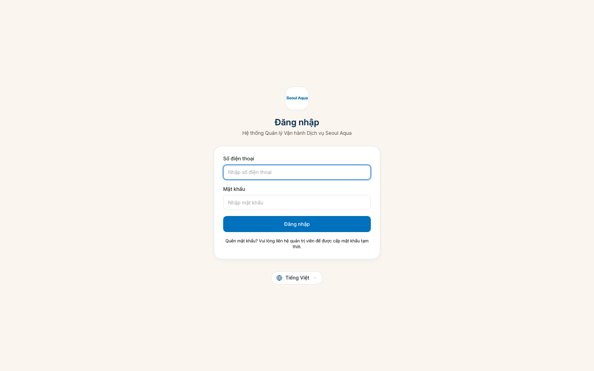

| Ô nhập | Mô tả |
|---|---|
| **Số điện thoại** | Số di động cá nhân của bạn (ví dụ: `0901234567`) |
| **Mật khẩu** | Mật khẩu của bạn |

- **Nhập sai 5 lần trong 15 phút thì bị khóa 15 phút.** Hết 15 phút tự mở khóa. Nếu gấp, quản trị viên cấp trên đặt lại mật khẩu thì khóa cũng được mở.
- Nếu đăng nhập ứng dụng văn phòng bằng tài khoản kỹ thuật viên, màn hình hiện thông báo "Đây là tài khoản kỹ thuật viên…" cùng liên kết «Đến trang KTV».

### 4.2 Mật khẩu

- Quản trị viên tạo tài khoản sẽ **trực tiếp** cho bạn biết mật khẩu tạm thời.
- **Khi đăng nhập bằng mật khẩu tạm thời, màn hình «Đổi mật khẩu» sẽ hiện trước.** Bạn không thể sang màn hình khác trước khi nhập mật khẩu hiện tại (mật khẩu tạm thời) · mật khẩu mới (từ 8 ký tự, phải khác mật khẩu cũ) · xác nhận mật khẩu mới rồi bấm «Đổi mật khẩu».
- Muốn đổi trong lúc dùng bình thường: menu người dùng ở góc trên bên phải → **«Đổi mật khẩu»**. Sau khi đổi, đăng nhập trên các thiết bị khác đều bị ngắt.

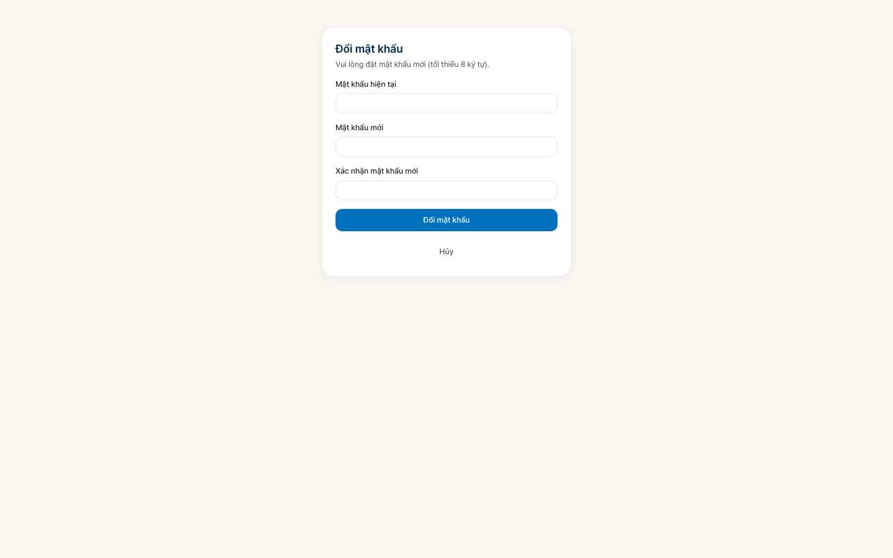

- Nếu quên mật khẩu, hãy gọi cho người **có vai trò cao hơn mình**. Họ dùng «Quản trị → Quản lý người dùng → Đặt lại mật khẩu» để nhận mật khẩu tạm thời mới và đọc cho bạn ngay tại chỗ (§15.1). Tài khoản ADMIN không thể đặt lại trên màn hình, hãy nhờ bộ phận phát triển.

### 4.3 Bảng điều khiển

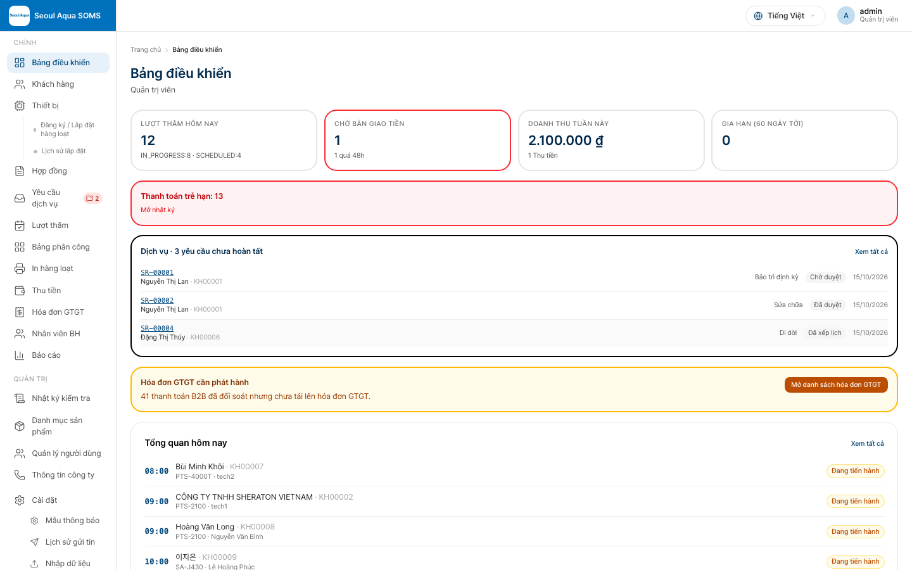

Đây là màn hình đầu tiên sau khi đăng nhập.

**4 thẻ phía trên**

| Thẻ | Nội dung |
|---|---|
| Lượt thăm hôm nay | Số lượt thăm hôm nay và chi tiết theo trạng thái |
| Chờ bàn giao tiền | Số khoản tiền mặt KTV đã thu nhưng chưa nộp văn phòng. Viền đỏ nếu có khoản quá 48 giờ |
| Doanh thu tuần này | Tổng thu trong tuần này |
| Gia hạn (60 ngày tới) | Số hợp đồng thuê sẽ kết thúc trong 60 ngày |

**Bên dưới (chỉ hiện khi có)**

- **Thanh toán trễ hạn** — số khoản thu đang quá hạn. Bấm liên kết sẽ mở danh sách thu tiền với «Chỉ trễ hạn» đã được chọn.
- **Dịch vụ · N yêu cầu chưa hoàn tất** — yêu cầu dịch vụ ở trạng thái Chờ duyệt·Đã duyệt·Đã xếp lịch
- **Hóa đơn GTGT cần phát hành** — số khoản thanh toán B2B đã đối soát nhưng chưa tải lên hóa đơn GTGT và nút «Mở danh sách hóa đơn GTGT»
- **Tổng quan hôm nay** — các lượt thăm hôm nay theo thứ tự thời gian

### 4.4 Thanh bên

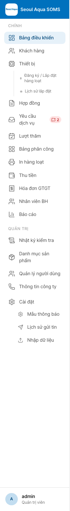

Menu hiển thị khác nhau tùy theo quyền.

```
Chính (mọi nhân viên văn phòng)
  Bảng điều khiển
  Khách hàng
  Thiết bị
    ├─ Đăng ký / Lắp đặt hàng loạt
    └─ Lịch sử lắp đặt
  Hợp đồng
  Yêu cầu dịch vụ    ← số đỏ nếu có tin nhắn khách hàng chưa đọc
  Lượt thăm
  Bảng phân công
  In hàng loạt
  Thu tiền
  Hóa đơn GTGT
  Nhân viên BH
  Báo cáo

Quản trị (ADMIN · MANAGER)
  Nhật ký kiểm tra
  Danh mục sản phẩm
  Quản lý người dùng
  Thông tin công ty
  Cài đặt
    ├─ Mẫu thông báo
    ├─ Lịch sử gửi tin
    └─ Nhập dữ liệu   (chỉ ADMIN)
```

### 4.5 Đổi ngôn ngữ

Ở menu ngôn ngữ (biểu tượng quả địa cầu) góc trên bên phải, chọn 한국어 · Tiếng Việt · English. Màn hình đang xem giữ nguyên, chỉ chữ thay đổi.

### 4.6 Quay lại

Nút «Quay lại» cạnh đường dẫn ở đầu màn hình đưa bạn về **màn hình vừa xem trước đó**. Ví dụ: Danh sách khách hàng → Chi tiết khách hàng → Chi tiết thiết bị, bấm «Quay lại» sẽ về chi tiết khách hàng, bấm thêm lần nữa về danh sách khách hàng.

- Chỉ khi mở từ tab mới hoặc nhập thẳng địa chỉ nên không có màn hình trước đó thì mới về danh sách của menu tương ứng.
- «Quản trị» trong đường dẫn chỉ là tên nhóm menu, bấm vào không chuyển trang.

### 4.7 Nhập ngày

Ô ngày có thể **chọn trên lịch hoặc gõ trực tiếp bằng bàn phím**.

- Bấm vào ô thì lịch mở ra, và có thể gõ số luôn. Chỉ cần gõ số như `26102026` là tự chuyển thành `26/10/2026` (màn hình tiếng Hàn·tiếng Anh: `20261026` → `2026-10-26`). Dán `26.10.2026` cũng được.
- Đủ 8 chữ số và là ngày có thật thì được áp dụng ngay, lịch cũng chuyển sang tháng đó.
- Ngày không có thật (ví dụ 40/13/2026) hoặc ngày không được chọn (ví dụ ô chặn ngày tương lai) thì viền chuyển **đỏ** và không được áp dụng. Rời khỏi ô thì giá trị cũ được đặt lại.
- Xóa trống ô rồi rời đi thì ngày bị xóa. Cũng có thể xóa bằng ✕ bên phải.

---

## Chương 5. Quản lý khách hàng

### 5.1 Danh sách khách hàng

**Thanh bên → Khách hàng**

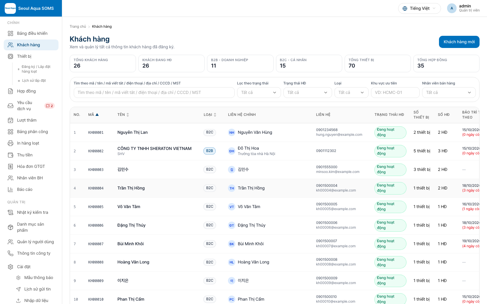

- Phía trên có 6 thẻ tóm tắt tình hình khách hàng.
- **Bộ lọc**: tìm kiếm (mã·tên·mã viết tắt·điện thoại·địa chỉ·CCCD·MST) · trạng thái · trạng thái HĐ · loại (B2C/B2B) · khu vực ưu tiên · nhân viên bán hàng · đặt lại bộ lọc
- Nút **«Khách hàng mới»** ở góc trên bên phải dùng để đăng ký.
- Bấm vào một dòng để mở chi tiết khách hàng.
- Bộ lọc·từ khóa·sắp xếp·trang đã chọn được giữ trong địa chỉ trang. Từ chi tiết khách hàng bấm «Quay lại» sẽ về đúng danh sách đó; sao chép địa chỉ gửi người khác thì họ cũng thấy cùng danh sách.

### 5.2 Đăng ký khách hàng mới — B2C (hộ gia đình)

**Danh sách khách hàng → Khách hàng mới → «B2C — Hộ gia đình»**

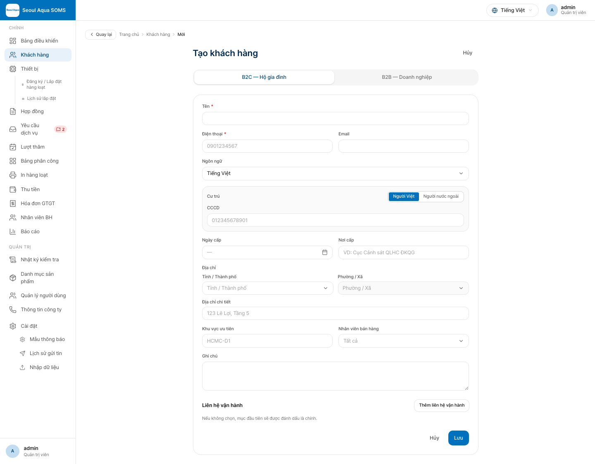

| Mục | Bắt buộc | Mô tả |
|---|:---:|---|
| Tên | ● | Họ tên khách hàng |
| Điện thoại | ● | Liên hệ chính. Nếu mở cổng khách hàng thì đây là ID đăng nhập |
| Email | | Nhận biên lai·phiếu xác nhận công việc |
| Ngôn ngữ | | Ngôn ngữ của tài liệu·thông báo gửi cho khách |
| Cư trú | | Người Việt → CCCD, Người nước ngoài → Quốc tịch + Số hộ chiếu |
| Ngày cấp · Nơi cấp | | Thông tin giấy tờ tùy thân (ghi trên hợp đồng) |
| Địa chỉ | | Tỉnh/Thành phố → Phường/Xã → Địa chỉ chi tiết |
| Khu vực ưu tiên | | Mã khu vực dùng để gợi ý KTV (ví dụ: `HCMC-D1`) |
| Nhân viên bán hàng | | Xem giải thích bên dưới |
| Ghi chú | | Ghi chú nội bộ |
| Liên hệ vận hành | | Có thể thêm ngay người sẽ nhận thông báo lượt thăm |

Với khách B2C, chính khách hàng là bên ký hợp đồng.

#### Nhập địa chỉ

Theo cải cách hành chính năm 2025, cấp quận/huyện đã bị bãi bỏ nên địa chỉ nhập theo **2 cấp**.

1. Chọn Tỉnh/Thành phố (`Tỉnh/Thành phố`) — trong 34 tỉnh/thành trên cả nước
2. Chọn Phường/Xã (`Phường/Xã`)
3. Nhập địa chỉ chi tiết

Ô tìm kiếm vẫn tìm được khi gõ không dấu (`Ho Chi` → `Thành phố Hồ Chí Minh`). Với khu vực không có trong danh sách, hãy gõ nguyên văn rồi chọn mục có tên bạn vừa nhập (hiển thị trong dấu ngoặc kép).

#### Nhân viên bán hàng — tìm kiếm và thêm nhanh

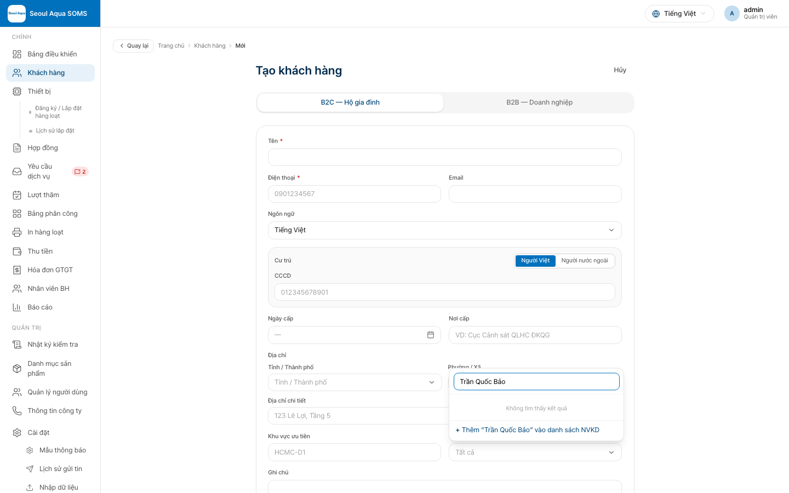

Ô nhân viên bán hàng tìm kiếm bằng cách gõ. Nếu không có người cần tìm, hãy bấm mục cuối danh sách **«Thêm “tên” vào danh sách NVKD»**. Cửa sổ thêm nhân viên bán hàng (§6.3) mở ra, và khi lưu thì người đó được chọn ngay. Bạn không cần rời khỏi màn hình đăng ký khách hàng.

> **Đăng ký khách hàng không tự tạo tài khoản cổng và không gửi gì cho khách.** Cổng được mở sau khi đăng ký, ở tab «Liên hệ», theo từng liên hệ (§5.6).

### 5.3 Đăng ký khách hàng mới — B2B (doanh nghiệp)

**Khách hàng mới → «B2B — Doanh nghiệp»**

| Mục | Bắt buộc | Mô tả |
|---|:---:|---|
| Tên doanh nghiệp | ● | Tên công ty (ví dụ: `CÔNG TY TNHH SHERATON VIETNAM`) |
| Mã viết tắt | ● | 2–5 ký tự bắt đầu bằng chữ in hoa tiếng Anh, có thể có số (ví dụ: `SHV`). Được dùng trong số hợp đồng |
| Mã số thuế | ● | Mã số doanh nghiệp tại Việt Nam |
| Bên ký hợp đồng | ● | Tên và số điện thoại của người ký hợp đồng |
| Liên hệ vận hành | | Người phụ trách tại hiện trường nhận lịch lượt thăm·biên lai |

Các ô còn lại giống B2C.

> **Cơ sở (Site)**: với khách B2B có nhiều nơi lắp đặt như nhà máy·chi nhánh, hãy đăng ký cơ sở để chia thiết bị theo cơ sở. Sau khi lưu, vào chi tiết khách hàng → tab «Địa điểm lắp đặt» → «Thêm cơ sở» rồi nhập tên cơ sở·địa chỉ·khu vực.

### 5.4 Chi tiết khách hàng

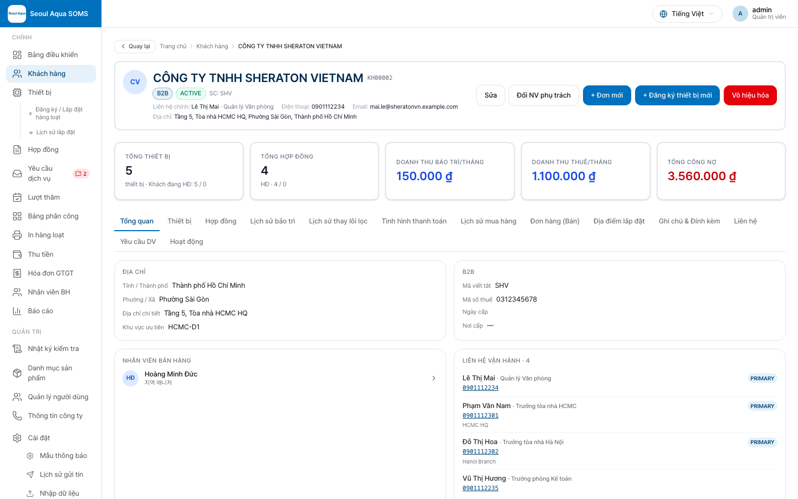

**Phần đầu**: tên khách hàng·mã·loại·trạng thái, liên hệ chính và thông tin liên hệ, địa chỉ. Các nút ở bên phải:

| Nút | Chức năng |
|---|---|
| Sửa | Đến màn hình sửa khách hàng (§5.9) |
| Đổi NV phụ trách | Cửa sổ đổi **nhân viên bán hàng phụ trách** (mọi nhân viên văn phòng) |
| + Đơn mới | Tạo đơn hàng (§10) |
| + Đăng ký thiết bị mới | Bắt đầu trình hướng dẫn đăng ký thiết bị cho khách này (§7.6) |
| Vô hiệu hóa / Kích hoạt lại | §5.10 |
| Xóa khách hàng | §5.11 |

**5 thẻ tóm tắt**: Tổng thiết bị · Tổng hợp đồng · Doanh thu bảo trì/tháng · Doanh thu thuê/tháng · Tổng công nợ

**Các tab**

| Tab | Nội dung |
|---|---|
| Tổng quan | Thông tin cơ bản của khách (chỉ xem — muốn sửa hãy bấm «Sửa») |
| Thiết bị | Danh sách thiết bị đang có + chi tiết thiết bị được chọn (§5.5) |
| Hợp đồng | Mọi hợp đồng của khách này |
| Lịch sử bảo trì · Lịch sử thay lõi lọc · Tình hình thanh toán | Đang chuẩn bị |
| Lịch sử mua hàng | Mọi đơn hàng của khách này (§5.7) |
| Đơn hàng (Bán) | Chỉ các đơn có thiết bị (§5.7) |
| Địa điểm lắp đặt | Danh sách cơ sở và «Thêm cơ sở» (chỉ hiện với khách B2B) |
| Ghi chú & Đính kèm | Đang chuẩn bị |
| Liên hệ | Quản lý bên ký hợp đồng·liên hệ vận hành (§5.6) |
| Yêu cầu DV | Các yêu cầu dịch vụ của khách này |
| Hoạt động | Lịch sử thay đổi liên quan đến khách này |

**Hộp «Mục cần kiểm tra»**: nếu đầu trang chi tiết khách hàng hiện hộp «Mục cần kiểm tra» thì có một trong ba việc dưới đây. Không có gì cần kiểm tra thì hộp không hiện. Mỗi mục có liên kết đi thẳng tới chỗ cần xử lý.

| Mục | Ý nghĩa | Việc cần làm |
|---|---|---|
| Cần xác nhận liên hệ vận hành | Hệ thống tạm điền liên hệ vận hành theo thông tin bên ký hợp đồng (khách hàng được đưa vào bằng nhập dữ liệu). Liên hệ đó có nhãn «Cần xác nhận» | «Mở tab liên hệ» → §5.6 |
| Hợp đồng chưa có phí tháng | Hợp đồng thuê·bảo trì đang hiệu lực nhưng chưa có phí tháng nên không tạo hóa đơn hằng tháng. Màn hình hợp đồng cũng hiện cảnh báo tương tự | Nhập phí bằng sửa đổi hợp đồng (từ MANAGER trở lên) — §8.7 |
| Thiết bị chưa có lịch sử thay lõi lọc | Đã qua trọn một chu kỳ thay lõi kể từ khi lắp đặt mà không có ghi nhận thay, nên ngày thay tiếp theo chỉ được ước tính từ ngày lắp đặt. Thiết bị mới lắp chưa đủ một chu kỳ thì không hiện | Bấm «Nhập một lần» để chọn sẵn các thiết bị đó rồi nhập ngày — §5.5, hoặc sửa từng máy ở chi tiết thiết bị |

### 5.5 Tab Thiết bị

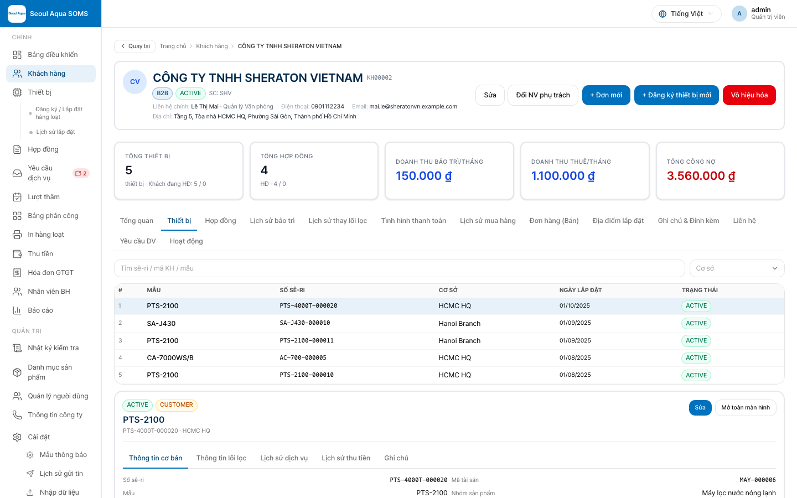

Bố cục **danh sách ở trên / chi tiết ở dưới**.

- Danh sách cố định cao khoảng 10 dòng và cuộn bên trong. Có bộ lọc cơ sở và tìm kiếm (sê-ri·mã KH·mẫu).
- Bấm một dòng thì thiết bị đó được tô sáng và **vùng chi tiết bên dưới danh sách** chuyển sang thiết bị đó. Nếu chưa chọn, hiện "Chọn một thiết bị từ danh sách phía trên".
- Vùng chi tiết có 5 tab: **Thông tin cơ bản · Thông tin lõi lọc · Lịch sử dịch vụ · Lịch sử thu tiền · Ghi chú**. Ở Thông tin cơ bản bạn xem mã tài sản (`MAY-000001`), mẫu, nhóm sản phẩm, ngày lắp đặt, sở hữu.
- Liên kết **«Mở toàn màn hình»** ở góc trên bên phải vùng chi tiết mở trang chi tiết thiết bị (§7.3). Các thao tác như chuyển, thay thế, kết thúc, thu hồi được thực hiện ở trang đó.
- Các nút chức năng bên dưới: Đăng ký mới (F2) · Sửa (F5) · Trang chi tiết · Đóng — mọi nhân viên văn phòng đều dùng được.
- Thiết bị đang chọn được ghi vào địa chỉ nên vẫn giữ nguyên sau khi tải lại trang hoặc quay lại.

**Bảng cấu hình dịch vụ** — xem chu kỳ kiểm tra và chu kỳ thay lõi lọc trong một bảng.

| Cột | Mô tả |
|---|---|
| Loại · Hạng mục | Kiểm tra định kỳ / tên lõi lọc |
| Chu kỳ (mặc định) · Chu kỳ tùy chỉnh | Chu kỳ mặc định theo danh mục và chu kỳ chỉ áp dụng cho thiết bị này (ngày) |
| SL | Số lượng lõi lọc |
| Lần trước · Lần gần nhất | Ngày thực hiện thực tế |
| Dự kiến · Còn lại | Tự tính bằng lần gần nhất + chu kỳ |
| Trạng thái | Bình thường / Đã lên lịch / Sắp đến hạn / Quá hạn |

Cuối mỗi dòng có nút **«Sửa» · «Xóa»** (dòng kiểm tra định kỳ chỉ có «Sửa»). Bấm «Sửa», các ô **chu kỳ tùy chỉnh · số lượng · lần gần nhất · dự kiến** của dòng đó (lõi lọc thêm thủ công có thêm **tên hạng mục**) chuyển thành ô nhập và nút đổi thành **«Lưu» · «Hủy»**. Chỉ khi bấm «Lưu» thay đổi mới được ghi; «Hủy» bỏ thay đổi. Mỗi lần sửa một dòng. Chu kỳ mặc định lấy từ danh mục, còn lần trước · còn lại · trạng thái được tính tự động nên không sửa được.

- **Đơn vị chu kỳ tùy chỉnh**: ở dòng lõi lọc, chọn **ngày / tháng** trong ô thả xuống cạnh ô chu kỳ. Ban đầu ô được điền sẵn chu kỳ mặc định (ngày). Lưu theo «tháng» thì ngày dự kiến tính **theo lịch** (lần gần nhất 2026-08-22 + 6 tháng = 2027-02-22); «ngày» thì cộng đúng số ngày (+180 ngày = 2027-02-18). Khách hàng nào có chu kỳ khác thì chỉ đổi ở thiết bị đó.
- Chu kỳ tối đa 3600 ngày (120 tháng), số lượng là số nguyên 1–50. Để trống thì quay về chu kỳ mặc định theo danh mục (lõi lọc thêm thủ công không được để trống).
- **Xóa**: lõi lọc thêm thủ công cho thiết bị này sẽ bị xóa. Lõi lọc thuộc mẫu chỉ bị bỏ **khỏi thiết bị này**, các thiết bị khác cùng mẫu vẫn giữ. Lõi lọc đã bỏ cũng không còn trong gợi ý thay, email sắp đến hạn thay lõi và mục cần kiểm tra. Bấm «Xóa» sẽ hiện hộp xác nhận; chỉ xóa khi bạn xác nhận.

**Nhập hàng loạt ngày thay lõi** — nút **«Nhập hàng loạt ngày thay lõi»** ở đầu trang chi tiết khách hàng (hoặc «Nhập một lần» trong hộp mục cần kiểm tra) cho phép nhập ngày thay lõi gần nhất cho nhiều thiết bị của khách hàng cùng lúc. 100 máy không còn phải sửa 100 lần.

1. Chọn thiết bị ở bên trái. Tích ô cạnh tên mẫu để chọn toàn bộ thiết bị của mẫu đó. Mở từ hộp cảnh báo thì các thiết bị chưa có lịch sử thay đã được chọn sẵn.
2. Bên phải chỉ hiện các lõi lọc mà thiết bị đã chọn có. Nhập ngày cho từng lõi, hoặc nhập vào «Cùng một ngày cho mọi lõi lọc» rồi bấm «Áp dụng».
3. Bấm «Lưu». Chỉ lõi lọc có ngày mới được lưu; thiết bị không có lõi đó (hoặc đã bỏ lõi đó) sẽ được bỏ qua. Kết quả (mới·sửa·bỏ qua) hiện bên dưới. Không nhập được ngày sau hôm nay.

Nếu phía trên bảng lõi lọc có **ghi chú màu vàng** («N lõi lọc chưa có lịch sử thay nên ngày thay đang tính từ ngày lắp đặt…»), ô «ngày thực hiện gần nhất» của các dòng đó được tô nổi. Hãy nhập ngày thay thực tế gần nhất vào ô đó, ngày dự kiến sẽ chính xác và ghi chú biến mất.

### 5.6 Liên hệ — bên ký hợp đồng và liên hệ vận hành

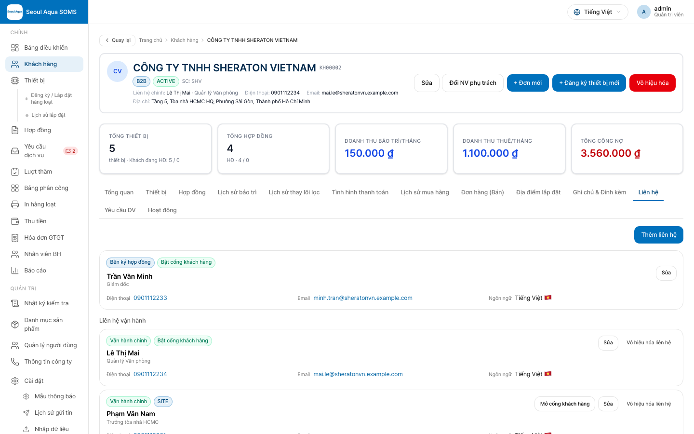

Mỗi khách hàng có **1 bên ký hợp đồng** và **0–N liên hệ vận hành**.

| Vai trò | Nhận gì |
|---|---|
| Bên ký hợp đồng | Hợp đồng, thông báo pháp lý, nhắc hết hạn thuê, nhắc nợ quá hạn |
| Liên hệ vận hành chính | SMS nhắc lượt thăm trước một ngày, biên lai, nhắc thay lõi lọc, thông báo hoàn tất lượt thăm |
| Kế toán (B2B) | Email hóa đơn GTGT (nếu không có thì liên hệ vận hành chính → bên ký hợp đồng) |

Thông báo nợ quá hạn gửi cho hai người: bên ký hợp đồng và liên hệ vận hành chính. Nếu không có liên hệ vận hành thì thông báo dành cho liên hệ vận hành do bên ký hợp đồng nhận.

**Thêm liên hệ**: tab «Liên hệ» → «Thêm liên hệ»

- Nhập vai trò (liên hệ vận hành / bên ký hợp đồng), phạm vi (toàn khách hàng / cơ sở cụ thể — B2B), tên, chức danh, điện thoại, email, ngôn ngữ, có phải liên hệ chính không, có phải kế toán không.
- Liên hệ vận hành chính hoặc kế toán bắt buộc phải có email.
- Lưu xong cũng không gửi gì cho khách và không tạo tài khoản cổng.

**Nhãn «Cần xác nhận»**: với khách hàng được đưa vào bằng nhập dữ liệu, bên ký hợp đồng được sao chép thành liên hệ vận hành, và thẻ liên hệ này (cùng phần tổng quan khách hàng) có nhãn «Cần xác nhận». Ở tab liên hệ, hãy xác nhận đúng người rồi nhập email và lưu (liên hệ vận hành chính bắt buộc có email). Bạn cũng có thể chỉ định người khác làm liên hệ vận hành hoặc xóa liên hệ này. Sau khi sửa hoặc xóa, nhãn sẽ biến mất.

Sửa bằng «Sửa» trên thẻ từng liên hệ, gỡ bằng «Vô hiệu hóa liên hệ». Sửa thông tin bên ký hợp đồng từ MANAGER trở lên.

**Mở cổng**: trên thẻ liên hệ chưa có cổng và có số điện thoại có nút **«Mở cổng khách hàng»** (mọi nhân viên văn phòng). Liên hệ đã mở cổng có nhãn «Bật cổng khách hàng».

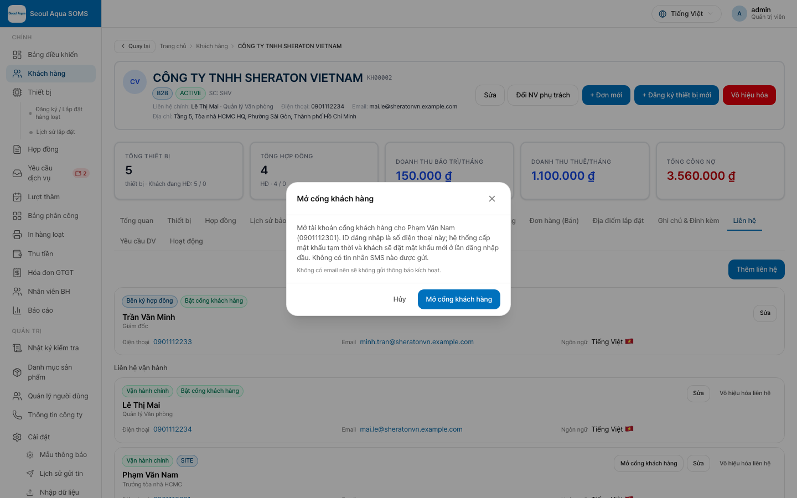

1. «Mở cổng khách hàng» → trong cửa sổ xác nhận, kiểm tra ID đăng nhập (số điện thoại của liên hệ đó) và việc có gửi email thông báo hay không → «Mở cổng khách hàng»
2. Mật khẩu tạm thời (10 ký tự) hiện trên màn hình **chỉ một lần**. Hãy đọc cho khách qua điện thoại ngay tại chỗ rồi bấm «Đã báo khách — Đóng».

- Không gửi tin nhắn SMS. Nếu liên hệ có email, chỉ gửi email thông báo kích hoạt không chứa mật khẩu.
- Khách đặt mật khẩu mới ở lần đăng nhập đầu tiên.
- «Vô hiệu hóa liên hệ» sẽ đóng cổng của liên hệ đó. Khi mở lại cũng dùng «Mở cổng khách hàng».

### 5.7 Tab Lịch sử mua hàng · Đơn hàng (Bán)

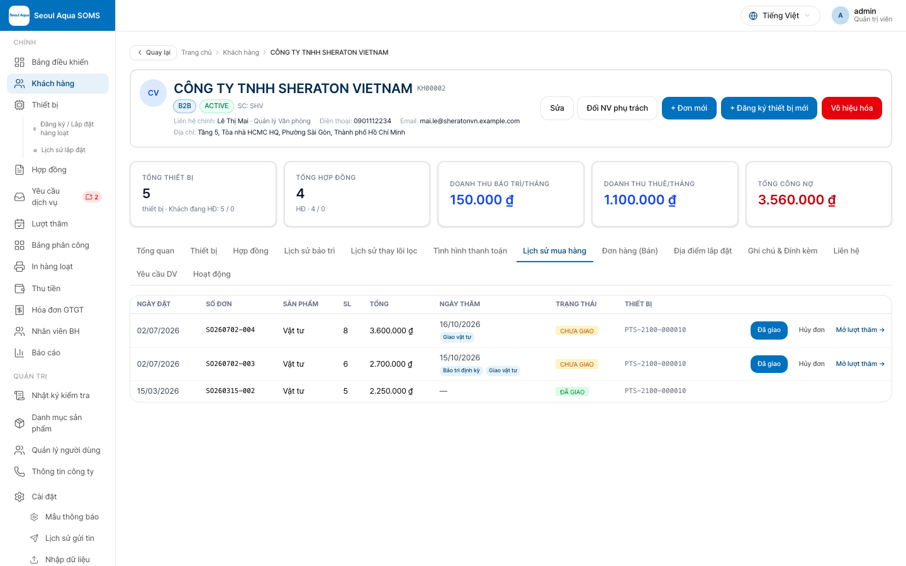

- **Lịch sử mua hàng**: mọi đơn hàng của khách này (vật tư·thiết bị·khác)
- **Đơn hàng (Bán)**: trong đó là các đơn có thiết bị

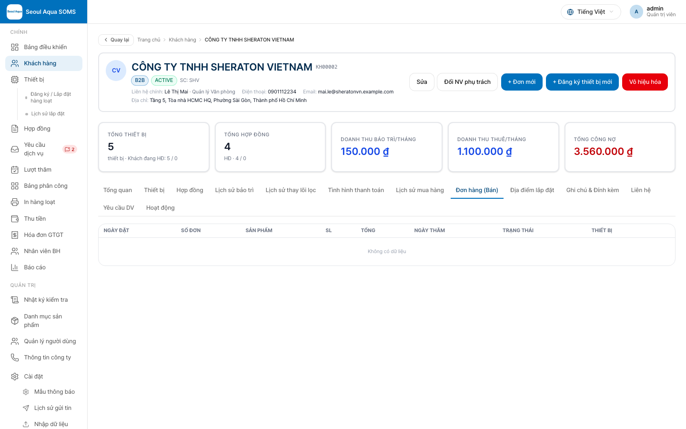

Việc tạo đơn không làm trong tab mà bằng nút «+ Đơn mới» ở phần đầu (§10).

### 5.8 Gán nhân viên bán hàng phụ trách

Có hai nơi để đổi.

- Nút **«Đổi NV phụ trách»** ở phần đầu chi tiết khách hàng → chọn nhân viên bán hàng
- Ô «Nhân viên bán hàng» trên màn hình **Sửa khách hàng** (cũng có thêm nhanh như màn hình đăng ký)

Mọi nhân viên văn phòng đều đổi được.

### 5.9 Sửa khách hàng và đặt lại mật khẩu cổng

Chi tiết khách hàng → **«Sửa»**

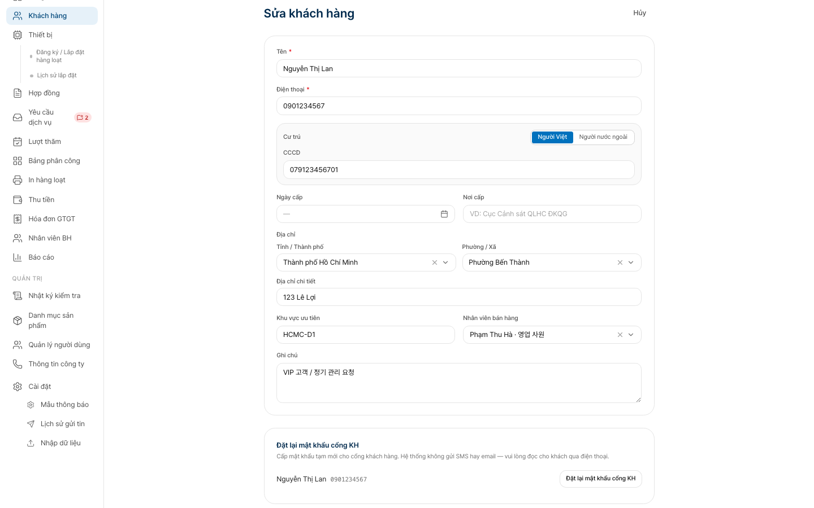

Bạn sửa các ô giống lúc đăng ký. Cuối màn hình có thẻ **«Đặt lại mật khẩu cổng KH»** (từ MANAGER trở lên).

1. Thẻ chỉ liệt kê các liên hệ đã mở cổng. Nếu không có sẽ hiện "Không có liên hệ nào đã mở tài khoản cổng."
2. Bấm «Đặt lại mật khẩu cổng KH» của liên hệ cần thiết → xác nhận
3. Mật khẩu tạm thời mới (10 ký tự) hiện trên màn hình **chỉ một lần**. Đóng cửa sổ là không xem lại được, nên hãy **đọc qua điện thoại cho khách** ngay tại chỗ.

- Hệ thống không gửi SMS hay email.
- Mọi phiên đăng nhập hiện có của khách bị ngắt, và lần đăng nhập tới khách sẽ đặt mật khẩu mới. Khóa đăng nhập cũng được mở.

### 5.10 Vô hiệu hóa khách hàng

Từ MANAGER trở lên:

1. Chi tiết khách hàng → «Vô hiệu hóa» → nhập lý do → xác nhận
2. **Mọi hợp đồng nháp·chờ ký·hiệu lực·đã sửa đổi của khách này đều bị chấm dứt**, và thiết bị đang dùng chuyển sang **vô hiệu**.

«Kích hoạt lại» để hoàn tác chỉ **ADMIN** làm được. Khách hàng không bị xóa.

### 5.11 Xóa khách hàng

Từ MANAGER trở lên. Dùng khi cần **xóa hẳn** một khách hàng (ví dụ đăng ký trùng). Không thể hoàn tác, nên dữ liệu cần giữ hãy chuyển sang khách hàng khác.

1. Chi tiết khách hàng → «Xóa khách hàng»
2. Dữ liệu liên quan hiện theo bốn nhóm kèm số lượng. Mỗi nhóm chọn **«Chuyển sang khách hàng khác»** hoặc **«Xóa cùng»** (mặc định là «Xóa cùng»).
   | Nhóm | Gồm |
   |---|---|
   | Thiết bị·hợp đồng·lượt thăm·thu tiền | Liên kết với nhau nên luôn được chuyển hoặc xóa cùng nhau |
   | Liên hệ·cơ sở | Khi chuyển, liên hệ thành **liên hệ vận hành** của khách hàng nhận (bên ký hợp đồng·liên hệ chính của khách nhận giữ nguyên) |
   | Yêu cầu dịch vụ·đơn hàng | |
   | Lịch sử thông báo·tài liệu | |
3. Nếu có nhóm cần chuyển, tìm và chọn **khách hàng nhận** theo mã·tên.
4. Nhập **mã khách hàng** để xác nhận rồi bấm «Xóa hẳn».

- Nếu chuyển thiết bị nhưng xóa cơ sở thì thông tin cơ sở của thiết bị·lượt thăm được chuyển sẽ bị bỏ trống (màn hình có thông báo).
- Việc chuyển gì sang đâu và xóa gì được ghi trong nhật ký kiểm tra với hành động «Xóa».

---

## Chương 6. Quản lý nhân viên bán hàng

### 6.1 Nhân viên bán hàng là gì?

Nhân viên bán hàng (NV BH) là **danh sách đăng ký riêng, tách khỏi tài khoản người dùng**. Phần lớn họ là nhân sự kinh doanh bên ngoài, không đăng nhập hệ thống. Chỉ cần có tên là đăng ký được; điện thoại·email·chức danh·ghi chú là tùy chọn.

> Khi cải tổ ngày 25/09/2026, nhân viên bán hàng được chuyển sang danh sách mới nên **toàn bộ việc gán nhân viên bán hàng phụ trách của khách hàng cũ đã bị xóa trống.** Sau khi đăng ký nhân viên bán hàng, hãy gán lại cho từng khách hàng (§5.8).

### 6.2 Danh sách nhân viên bán hàng

**Thanh bên → Nhân viên BH**

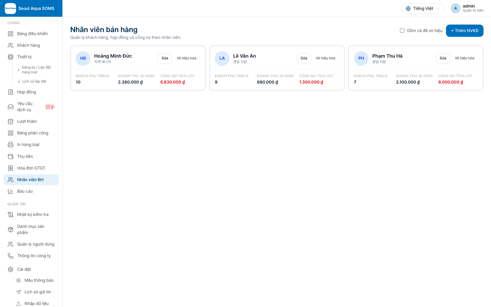

Mỗi nhân viên bán hàng có một thẻ.

| Số trên thẻ | Ý nghĩa |
|---|---|
| Khách phụ trách | Số khách hàng nhân viên này phụ trách |
| Doanh thu 30 ngày | Doanh thu từ khách phụ trách trong 30 ngày gần nhất |
| Công nợ tích lũy | Tổng công nợ của khách phụ trách |

- Chọn **«Gồm cả đã vô hiệu»** ở góc trên bên phải để hiện cả nhân viên đã vô hiệu hóa.
- Bấm vào thẻ để mở chi tiết.

### 6.3 Đăng ký · sửa · vô hiệu hóa nhân viên bán hàng

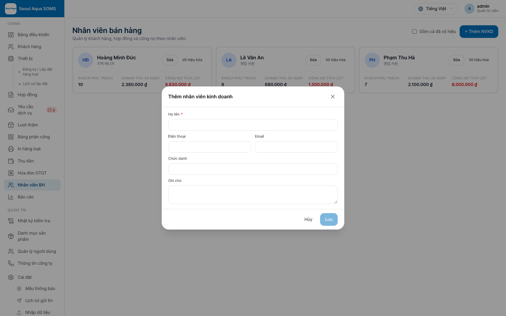

- **«Thêm NVKD»** → Họ tên (bắt buộc) · Điện thoại · Email · Chức danh · Ghi chú → Lưu. **Mọi nhân viên văn phòng** đều đăng ký được. Thêm nhanh ở màn hình đăng ký·sửa khách hàng (§5.2) cũng dùng cùng cửa sổ này.
- **«Sửa»** và **«Vô hiệu hóa»** trên thẻ chỉ từ MANAGER trở lên.
- Vô hiệu hóa không phải là xóa. Thông tin nhân viên bán hàng của các khách trước đây vẫn được giữ, chỉ là người đó không còn hiện trong danh sách khi chọn mới.

### 6.4 Chi tiết nhân viên bán hàng

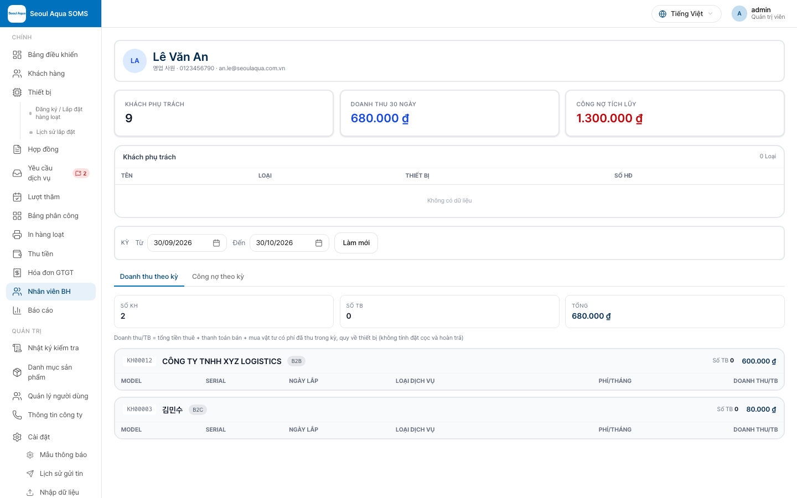

- Phía trên: thẻ tóm tắt nhân viên bán hàng và danh sách **khách phụ trách** (tên·loại·số thiết bị·số hợp đồng)
- Phía dưới: chọn kỳ xem và xem qua 2 tab.

**Doanh thu theo kỳ** — thẻ theo từng khách phụ trách hiển thị doanh thu thu được trong kỳ, chia theo thiết bị·đơn hàng. Doanh thu tính gồm tiền thuê đã thu, tiền bán thiết bị và đơn vật tư có phí; **không tính tiền đặt cọc và tiền hoàn trả.**

**Công nợ theo kỳ**

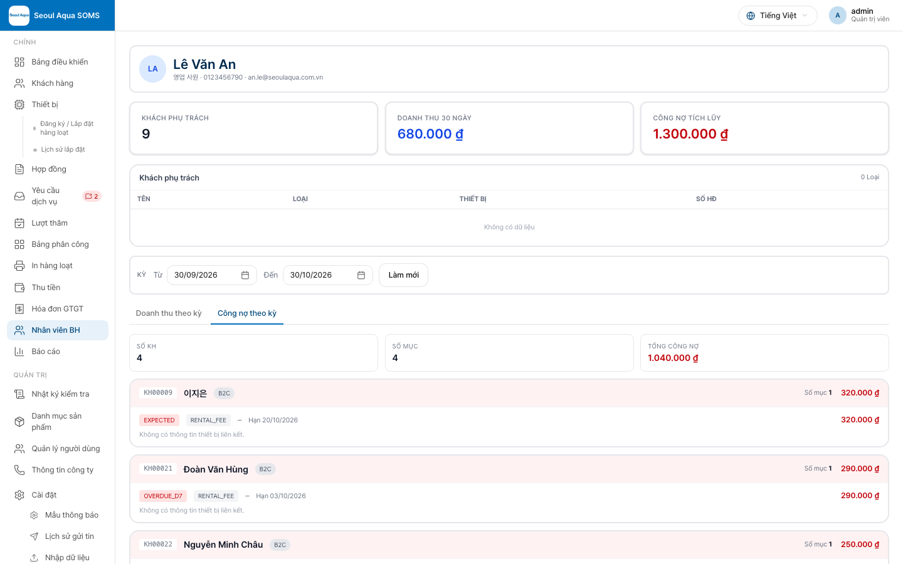

Hiển thị từng khoản công nợ đến hạn trong kỳ, theo từng khách phụ trách.

---

## Chương 7. Quản lý thiết bị

### 7.1 Trạng thái thiết bị

| Trạng thái | Ý nghĩa |
|---|---|
| Đang hoạt động (ACTIVE) | Khách đang sử dụng |
| Đã chuyển (RELOCATED) | Đã chuyển sang cơ sở khác |
| Đã thay thế (REPLACED) | Đã được thay bằng thiết bị khác |
| Đã vô hiệu (DEACTIVATED) | Tạm ngừng sử dụng (tự động khi vô hiệu hóa khách hàng) |
| Đã kết thúc (TERMINATED) | Dịch vụ kết thúc do chấm dứt hợp đồng |

**Mã tài sản (mã quản lý)** — do hệ thống cấp vào lúc thiết bị được gán cho khách hàng (= hoàn tất đăng ký).

- Định dạng: **`MAY-` + số thứ tự 6 chữ số** (ví dụ: `MAY-000001`)
- Số thứ tự tính **theo từng mẫu**. Mỗi mẫu đếm riêng từ `MAY-000001`, nên **mẫu khác nhau có thể có cùng một số.** Khi tìm thiết bị theo mã tài sản, hãy xem kèm cả mẫu.
- Trong cùng một mẫu thì không trùng. Khách khác nhau nhưng cùng mẫu thì tiếp tục số thứ tự.
- Đã cấp thì không đổi được, và dù kết thúc·thu hồi cũng không bị đánh dấu bỏ trống.
- Số sê-ri là thông tin riêng, không liên quan đến mã tài sản.

### 7.2 Danh sách thiết bị

**Thanh bên → Thiết bị**

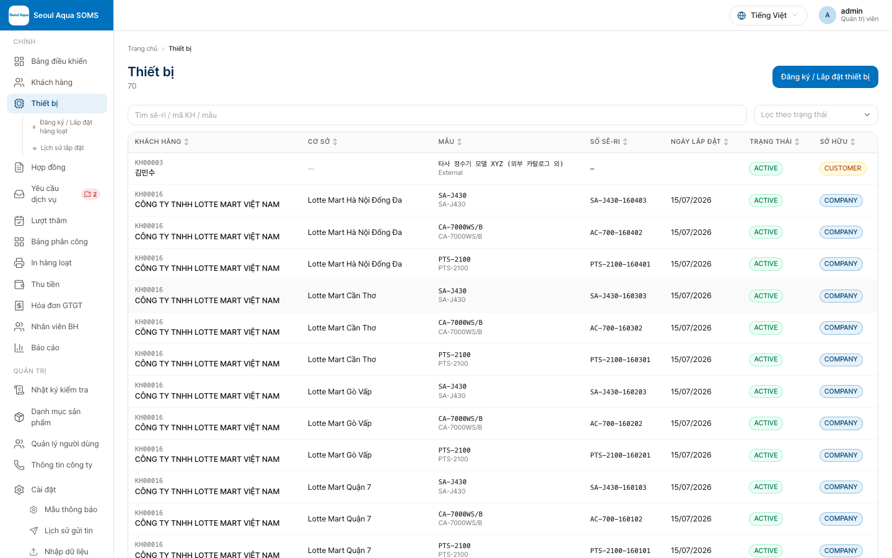

- Tìm kiếm (sê-ri·mã KH·mẫu), lọc theo trạng thái và **lọc theo khoảng ngày lắp đặt** (từ ~ đến, tính cả hai đầu — có thể chỉ nhập một đầu)
- Bộ lọc đã chọn được gắn vào địa chỉ trang (`/o/vi/equipment?installedFrom=2024-01-01&installedTo=2024-01-31&status=ACTIVE`). Sao chép địa chỉ gửi cho người khác thì họ mở ra cùng bộ lọc. Nếu chưa đăng nhập, sau khi đăng nhập sẽ quay lại đúng trang đó.
- Các cột: khách hàng · cơ sở · mẫu · sê-ri · ngày lắp đặt · trạng thái · sở hữu
- Nút **«Đăng ký / Lắp đặt thiết bị»** ở góc trên bên phải → trình hướng dẫn đăng ký đơn (§7.6)
- Bấm vào một dòng để mở chi tiết thiết bị.

### 7.3 Chi tiết thiết bị

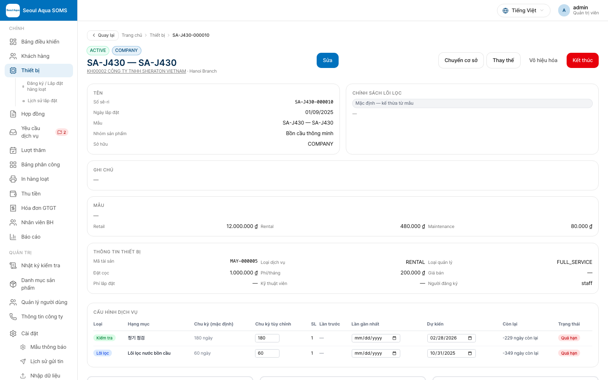

Dù bấm vào thiết bị từ đâu (danh sách thiết bị, «Mở toàn màn hình» trong chi tiết khách hàng) thì cũng mở cùng một trang.

- **Thẻ thông tin**: sê-ri · ngày lắp đặt · mẫu · nhóm sản phẩm · sở hữu (kèm ngày vô hiệu·kết thúc·thu hồi nếu có)
- **Thông tin chi tiết**: mã tài sản · loại dịch vụ · loại quản lý · đặt cọc · phí/tháng · giá bán · phí lắp đặt · kỹ thuật viên · người đăng ký
- **Bảng cấu hình dịch vụ** (giống §5.5), lịch sử mua, công việc gần đây, lịch tiếp theo, hợp đồng liên kết, lịch sử thanh toán, lịch sử thay lõi lọc

**Nút thao tác** (mọi nhân viên văn phòng)

| Nút | Chức năng |
|---|---|
| Sửa | Sửa thông tin thiết bị (§7.4) |
| Chuyển cơ sở | Chuyển sang cơ sở khác của khách B2B |
| Thay thế | Ghi nhận việc thay bằng thiết bị mới |
| Vô hiệu hóa / Kích hoạt lại | Tạm dừng và tiếp tục |
| Kết thúc | Kết thúc dịch vụ |
| Ghi nhận ngày thu hồi | Ghi ngày đã mang thiết bị về |

### 7.4 Sửa thông tin thiết bị

Chi tiết thiết bị → **«Sửa»**. Mọi nhân viên văn phòng dùng được, mở được bất kể trạng thái thiết bị. Đây là màn hình để sửa lỗi nhập liệu.

| Nhóm | Mục |
|---|---|
| Mẫu | Đổi mẫu qua thương hiệu·nhóm sản phẩm (chọn liên động như §7.5) |
| Thông tin lắp đặt | Cơ sở · ngày lắp đặt · số sê-ri (mã tài sản chỉ đọc) |
| Cấu hình dịch vụ | Loại dịch vụ (Thuê/Bán/Bảo trì) · loại quản lý · sở hữu |
| Số tiền | Đặt cọc · phí/tháng · giá bán · phí lắp đặt |
| Chu kỳ | Chu kỳ kiểm tra (ngày) · chu kỳ lõi lọc mặc định (ngày) |
| Hiệu chỉnh lịch sử | Ngày kiểm tra gần nhất (thủ công) |
| Khác | Ghi chú · mô tả thiết bị (cho thiết bị không có trong danh mục) |

- Nếu nhập **Ngày kiểm tra gần nhất (thủ công)** thì giá trị đó được ưu tiên hơn ghi nhận lượt thăm và ngày kiểm tra tiếp theo được tính lại. Để trống thì quay về tính theo ghi nhận lượt thăm.
- **Ngày thay lõi lọc gần nhất của từng lõi** được sửa bằng «Sửa chu kỳ» trong bảng «Lịch sử thay lõi lọc» ở chi tiết thiết bị.
- Đặt chu kỳ là **0** thì dùng giá trị mặc định của danh mục.
- Các giá trị hiệu chỉnh này cũng được phản ánh vào gợi ý thay lõi trong ứng dụng KTV và email nhắc thay lõi lọc.

- **Đổi model thì lõi lọc cũng theo cấu hình của model mới.** Lõi lọc nào của thiết bị không có trong model mới sẽ bị bỏ khi lưu, kèm ngày thay gần nhất của nó. Nếu có lõi lọc sẽ bị bỏ, trước khi lưu sẽ hiện hộp xác nhận kèm danh sách. Lõi lọc có trong cả model mới vẫn giữ chu kỳ·ngày thay gần nhất; lõi lọc tự nhập tên vẫn được giữ.

> Vô hiệu hóa·kết thúc·thu hồi hãy dùng các nút riêng ở trang chi tiết, không làm ở màn hình sửa này.

### 7.5 Đăng ký / Lắp đặt hàng loạt (5 bước)

**Thanh bên → Thiết bị → Đăng ký / Lắp đặt hàng loạt**

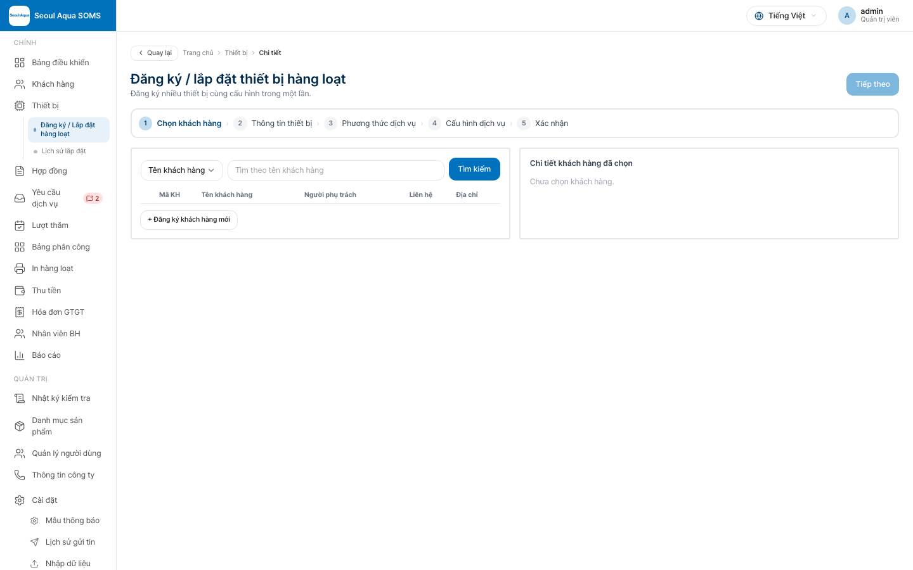

Đăng ký·lắp đặt nhiều thiết bị cùng mẫu trong một lần.

1. **Chọn khách hàng** — tìm theo mã·tên·người phụ trách·liên hệ. Nếu chưa có thì đăng ký khách hàng mới ngay tại đó. Với B2B, chọn cả cơ sở.
2. **Thông tin thiết bị** — chọn Thương hiệu · Nhóm sản phẩm · Mẫu. Chọn cái nào trước cũng được, các mục còn lại sẽ được thu hẹp (chọn mẫu trước thì thương hiệu·nhóm sản phẩm tự điền). Nhập số lượng · ngày lắp đặt · kỹ thuật viên · ghi chú lắp đặt. Mã tài sản được cấp tự động khi hoàn tất. Nếu đưa vào hệ thống những thiết bị đã lắp sẵn tại khách hàng, hãy bật **«Thiết bị đã lắp đặt»**.
3. **Phương thức dịch vụ** — Thuê / Bán / Bảo trì
   - Thuê: tiền đặt cọc · tiền thuê hàng tháng · thời hạn hợp đồng → 1 hợp đồng
   - Bán: giá bán · phí lắp đặt. Bật «Tạo HĐ cùng với các thiết bị này» thì có 1 hợp đồng bán. Nếu phương thức quản lý là **Toàn phần** thì tạo thêm 1 hợp đồng bảo trì. Nếu là **Khách tự quản** thì cấu hình kiểm tra·lõi lọc bị tắt.
   - Bảo trì: phí bảo trì hàng tháng · thời hạn hợp đồng → 1 hợp đồng
   - Số hợp đồng để trống thì tự cấp, nếu nhập tay thì dùng số đó (trùng sẽ bị từ chối). Cũng có thể đặt ngày hợp đồng.
4. **Cấu hình dịch vụ** — chu kỳ bảo trì định kỳ và danh sách lõi lọc. Lõi lọc mặc định của mẫu được điền sẵn, khi sửa chu kỳ (ngày) thì ngày dự kiến tiếp theo được tính lại. Có thể nhập **ngày thay gần nhất** cho từng lõi, hoặc nhập «Cùng một ngày cho mọi lõi lọc» → «Áp dụng». Ngày nhập ở đây áp dụng cho **mọi thiết bị được đăng ký**. Để trống thì tính từ ngày lắp đặt.
5. **Xác nhận** — kiểm tra trên một màn hình: khách hàng·thiết bị·số lượng·phương thức·số tiền·**số hợp đồng sẽ tạo**·cấu hình dịch vụ, rồi bấm «Hoàn tất».

Khi hoàn tất, thiết bị, hợp đồng và **lượt lắp đặt** được tạo cùng lúc và ghi vào lịch sử lắp đặt. Nếu bật «Thiết bị đã lắp đặt», lượt lắp đặt được tạo ở trạng thái **hoàn thành** vào ngày lắp đặt và không kèm số tiền cần thu; nếu tắt thì là lượt **dự kiến** giao cho kỹ thuật viên.

> Các ô số tiền hiển thị dấu chấm sau mỗi ba chữ số, như `1.500.000` (cách viết của Việt Nam).

### 7.6 Đăng ký / Lắp đặt thiết bị (đơn lẻ · nhiều dòng)

**Danh sách thiết bị → «Đăng ký / Lắp đặt thiết bị»** hoặc chi tiết khách hàng → «+ Đăng ký thiết bị mới»

Dùng khi đăng ký nhiều thiết bị khác nhau, mỗi thiết bị một dòng. Có 4 bước (Khách hàng → Thông tin thiết bị → Phương thức dịch vụ → Cấu hình dịch vụ), và **mỗi dòng** có mẫu·phương thức·cấu hình dịch vụ riêng. Ở mỗi dòng có thể chọn sê-ri là «Tự động tạo» hoặc «Nhập tay (tiền tố)». Tự động tạo có dạng `mã mẫu + ngày lắp (YYMMDD) + số thứ tự 4 chữ số`; nếu đã có thiết bị cùng mẫu·cùng ngày lắp thì số tiếp tục từ số kế tiếp (ví dụ sau 0001 là 0002). Tiền tố nhập tay cũng tiếp tục như vậy. Số hợp đồng·ngày hợp đồng nhập một lần theo hợp đồng chứ không theo dòng.

### 7.7 Lịch sử lắp đặt

**Thanh bên → Thiết bị → Lịch sử lắp đặt**

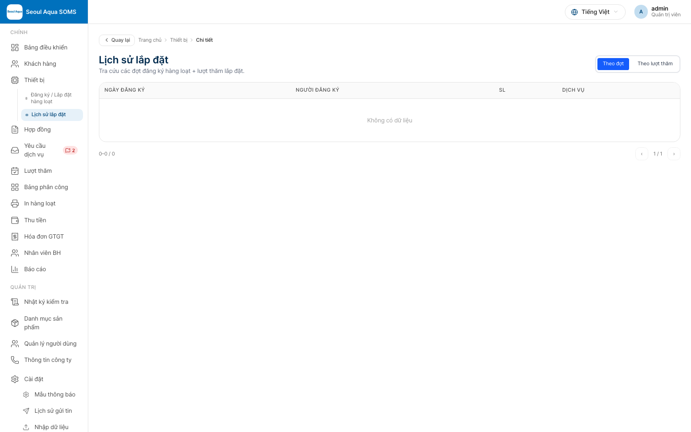

- **Theo đợt**: theo từng lần đăng ký hàng loạt — ai đăng ký bao nhiêu thiết bị lúc nào
- **Theo lượt thăm**: theo lượt lắp đặt — mỗi lượt thăm đã lắp những thiết bị nào

---

## Chương 8. Quản lý hợp đồng

### 8.1 Các loại hợp đồng

| Loại | Mô tả |
|---|---|
| Bán (SALE) | Thu tiền một lần và chuyển cho khách sở hữu |
| Thuê (RENTAL) | Thu tiền thuê hằng tháng. Khi hết hạn chuyển quyền sở hữu (mặc định) hoặc thu hồi |
| Bảo trì (MAINTENANCE) | Chỉ bảo trì thiết bị của khách. Thiết bị không có trong danh mục cũng được |

**Số hợp đồng**

- B2C: `HD-20261015/JH-KH00001`
- B2B: `HD-20261015/JH-SHV`, phụ lục là `-A1`, `-A2` …

### 8.2 Danh sách hợp đồng

**Thanh bên → Hợp đồng**

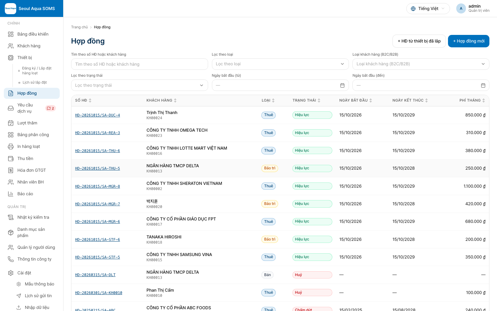

- Bộ lọc: tìm kiếm · loại hợp đồng · loại khách hàng · trạng thái · kỳ ngày bắt đầu
- Nút: **«+ Hợp đồng mới»**, **«+ HĐ từ thiết bị đã lắp»** (gộp các thiết bị đã lắp đặt thành hợp đồng)

### 8.3 Chi tiết hợp đồng

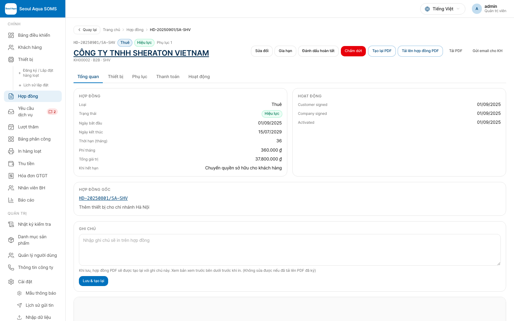

**Các tab**: Tổng quan · Thiết bị · Phụ lục · Thanh toán · Hoạt động

**Nút ở phần đầu** (nút hiển thị khác nhau tùy trạng thái hợp đồng)

| Nút | Quyền | Chức năng |
|---|---|---|
| Gửi đi ký | Mọi nhân viên | Nháp → Chờ ký |
| Kích hoạt | MANAGER+ | Chờ ký → Hiệu lực |
| Sửa đổi | MANAGER+ | Thay đổi hợp đồng đang hiệu lực (§8.7) |
| Gia hạn | MANAGER+ | Tạo hợp đồng nháp mới (§8.8) |
| Đánh dấu hoàn tất | MANAGER+ | Chuyển hợp đồng sang Hoàn tất |
| Chấm dứt | MANAGER+ | Chấm dứt giữa kỳ. Quyết định cùng lúc việc hoàn tiền và thu hồi thiết bị |
| Chuyển sang Bán | MANAGER+ | Thuê → Bán. Bao gồm xử lý hoàn tiền đặt cọc |
| Gửi SMS hết hạn | MANAGER+ | Từ thẻ «Nhắc hết hạn», gửi một lần SMS thông báo hết hạn thuê cho bên ký hợp đồng (hiện thất bại vì nội dung chưa đăng ký — §1.4) |
| Tạo lại PDF · Tải PDF | | PDF hợp đồng |
| Tải lên hợp đồng PDF | MANAGER+ | Thay bằng bản scan đã ký (§8.4) |
| Gửi email cho KH | | Gửi bản sao hợp đồng qua email (hiện là giả lập) |
| Huỷ | MANAGER+ | Hủy hợp đồng nháp·chờ ký |

Hợp đồng đang hiệu lực còn có nút «+ Lắp đặt thiết bị» để lắp thêm thiết bị cho hợp đồng này.

**Ngày thu tiền (hằng tháng)**: ô nằm ở tab «Tổng quan» của hợp đồng thuê·bảo trì. Đó là ngày trong tháng (1~31) thu phí, và hạn thanh toán của hóa đơn hằng tháng chính là ngày này. Để trống thì là ngày 10; ngày không có trong tháng (ví dụ 31 của tháng 2) được tính là ngày cuối tháng. Mọi nhân viên văn phòng đều nhập số và bấm «Lưu» để đổi được ở hợp đồng nháp·hiệu lực. Thay đổi chỉ áp dụng cho hóa đơn **được tạo từ sau đó**, hóa đơn đã tạo giữ nguyên. Nhắc nợ quá hạn (D+7, ...) cũng tính từ hạn này (§12.6).

Hợp đồng thuê·bảo trì chưa có phí tháng sẽ hiện cảnh báo. Không có phí tháng thì không tạo hóa đơn hằng tháng, hãy nhập phí bằng sửa đổi hợp đồng (§8.7).

### 8.4 Tải lên hợp đồng đã ký

MANAGER trở lên có thể tải lên **bản scan đã ký·đóng dấu** thay cho PDF tự tạo. «Tải lên hợp đồng PDF» → chọn PDF → Tải lên. Tệp tải lên sẽ thay thế bản tự tạo.

### 8.5 Sửa ghi chú hợp đồng

Nhập nội dung muốn in trên hợp đồng vào ô **Ghi chú** ở chi tiết hợp đồng rồi bấm **«Lưu & tạo lại»**, PDF hợp đồng được tạo lại và bản xem trước ngay bên dưới được cập nhật. MANAGER trở lên làm được với hợp đồng nháp·hiệu lực. Hợp đồng đã tải lên bản đã ký thì ưu tiên bản tải lên nên không hiện ô ghi chú.

### 8.6 Soạn hợp đồng mới

1. Danh sách hợp đồng → «+ Hợp đồng mới»
2. 4 bước: **Khách hàng → Loại & thiết bị → Giá → Xem lại**
3. Lưu thì tạo ra **hợp đồng nháp** và được cấp số hợp đồng.
4. In PDF hợp đồng để khách ký → «Gửi đi ký» → MANAGER bấm «Kích hoạt»

> **Kích hoạt hợp đồng không tạo lượt lắp đặt.** Lượt lắp đặt được tạo khi hoàn tất trình hướng dẫn đăng ký thiết bị (§7.5·§7.6). Nếu hợp đồng là để lắp thiết bị mới thì bắt đầu từ trình hướng dẫn đăng ký thiết bị sẽ nhanh hơn — thiết bị, hợp đồng và lượt lắp đặt được tạo cùng lúc.

### 8.7 Sửa hợp đồng (hợp đồng đang hiệu lực)

MANAGER trở lên, bấm «Sửa đổi» ở hợp đồng hiệu lực. Chọn loại thay đổi: **Điều chỉnh phí tháng · Thêm thiết bị · Loại bỏ thiết bị · Thay đổi phạm vi**

- B2C: sửa trực tiếp hợp đồng và tạo lại PDF.
- B2B: tạo phụ lục (`-A1`, `-A2` …) liên kết với hợp đồng gốc.

Nội dung trước và sau khi thay đổi được ghi vào nhật ký kiểm tra.

### 8.8 Gia hạn hợp đồng

MANAGER trở lên, ở hợp đồng **hiệu lực** bấm «Gia hạn» → nhập bảo trì hoặc thuê, phí tháng, thời hạn (tháng) thì tạo ra hợp đồng **nháp** mới. Hợp đồng ban đầu giữ nguyên. Việc kết thúc hợp đồng thuê và chuyển quyền sở hữu được xử lý tự động vào ngày kết thúc (§3.2 Kết thúc hợp đồng thuê).

### 8.9 Trạng thái hợp đồng

```
Nháp (DRAFT) → Chờ ký (PENDING_SIGNATURE) → Hiệu lực (ACTIVE) ─┬→ Đã sửa đổi (AMENDED)
      │                     │                                    ├→ Hoàn tất (COMPLETED)
      └──────── Huỷ (CANCELLED) ┘                                └→ Chấm dứt (TERMINATED)
```

- **Hoàn tất** chỉ xảy ra khi hệ thống tự xử lý ngày kết thúc thuê hoặc khi bấm «Đánh dấu hoàn tất». Hợp đồng không tự hoàn tất chỉ vì đã thu đủ tiền.
- Quá hạn không phải trạng thái hợp đồng mà hiển thị ở **trạng thái của khoản thu** (§12).

---

## Chương 9. Quản lý lượt thăm

### 9.1 Các loại lượt thăm

| Loại | Hiển thị trên màn hình | Được tạo như thế nào |
|---|---|---|
| INSTALLATION | Lắp đặt | Khi hoàn tất trình hướng dẫn đăng ký thiết bị / đăng ký hàng loạt |
| PERIODIC_INSPECTION | Bảo trì định kỳ | Nhân viên đăng ký, hoặc duyệt yêu cầu «Bảo trì định kỳ» của khách |
| REPAIR | Sửa chữa | Duyệt yêu cầu «Sửa chữa» hoặc nhân viên đăng ký |
| FILTER_REPLACEMENT | Thay lõi lọc | Duyệt yêu cầu «Thay phụ tùng» hoặc nhân viên đăng ký |
| RELOCATION | Di dời | Duyệt yêu cầu «Di dời» hoặc nhân viên đăng ký |
| PAYMENT_COLLECTION | Thu tiền | Nhân viên đăng ký |
| RETRIEVAL | Thu hồi thiết bị | Kết thúc hợp đồng thuê (điều kiện thu hồi) hoặc chấm dứt |
| CONSUMABLE_DELIVERY | Giao vật tư | Khi tạo đơn hàng (§10) |
| OTHER | Khác | Nhân viên đăng ký |

> **Loại bổ sung**: khi gắn đơn hàng vào một lượt thăm có sẵn (§10.2), lượt thăm đó được thêm loại bổ sung «Giao vật tư», để một lần thăm vừa bảo trì vừa giao hàng. Khi tạo lượt thăm mới không có ô chọn loại bổ sung.

### 9.2 Danh sách lượt thăm

**Thanh bên → Lượt thăm**

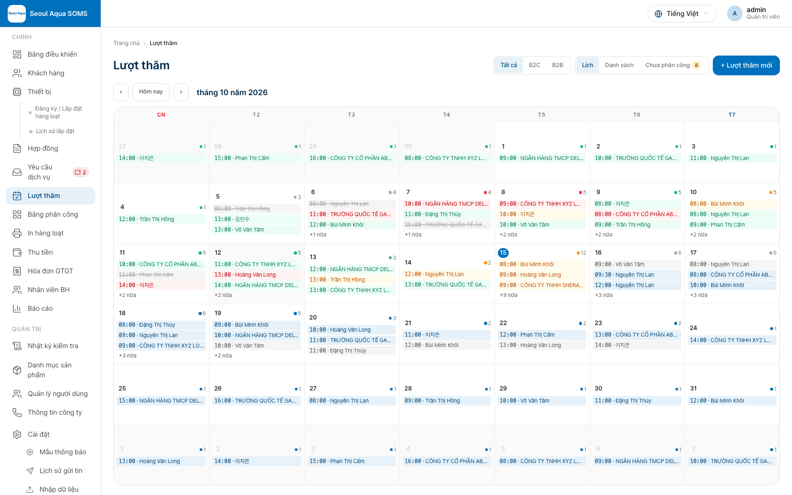

- 3 kiểu xem: **Lịch (mặc định) · Danh sách · Chưa phân công**. Nút xem Chưa phân công hiển thị số lượt chưa có KTV.
- Bộ lọc danh sách: trạng thái · loại · kỳ, và loại khách hàng

### 9.3 Chi tiết lượt thăm

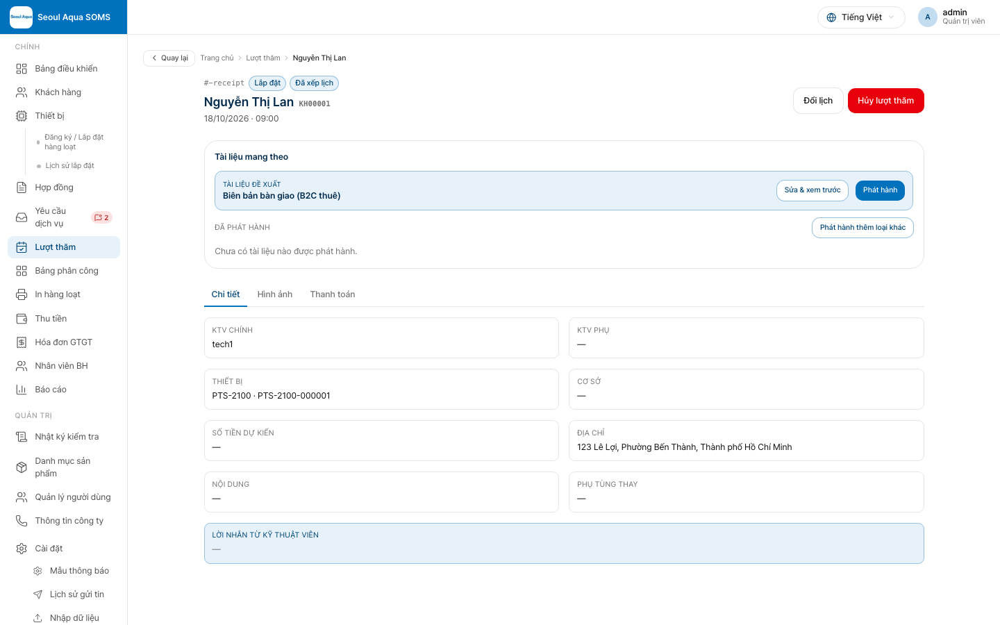

- **Phần đầu**: loại·trạng thái, khách hàng, ngày giờ. Nút «Đổi lịch» · «Hủy lượt thăm»
- **Thẻ tài liệu mang theo**: hiển thị **tài liệu đề xuất** phù hợp với loại lượt thăm và loại khách hàng, mỗi tài liệu có nút «Sửa & xem trước» và «Phát hành». «Phát hành thêm loại khác» để phát hành cả tài liệu ngoài đề xuất. Danh sách tài liệu đã phát hành xếp ở bên dưới.
- **Tab**: Chi tiết · Hình ảnh (ảnh hiện trường do KTV tải lên, bấm để xem ảnh gốc) · Thanh toán
  - Chi tiết: KTV chính · KTV phụ · thiết bị · cơ sở · số tiền dự kiến · địa chỉ · nội dung · phụ tùng thay · lời nhắn từ kỹ thuật viên
- **Phân công KTV**: lượt thăm chưa có KTV (Đề xuất) hiển thị 3 KTV được đề xuất hàng đầu, chọn KTV chính và KTV phụ để xác nhận.
- **Thẻ yêu cầu dịch vụ liên quan**: nếu lượt thăm được tạo từ yêu cầu dịch vụ thì hiện mã yêu cầu·loại·trạng thái và liên kết
- **Thẻ đơn mua liên quan**: nếu lượt thăm có đơn hàng gắn kèm thì hiện mặt hàng·số lượng·số tiền (chỉ xem)

#### Sửa tài liệu · xem trước

Bấm «Sửa & xem trước» thì ô **Ghi chú tài liệu** mở ra (điền sẵn nhận xét của lượt thăm). Bấm «Làm mới xem trước» để xem PDF thực tế và «Phát hành với nội dung đã sửa» để phát hành. Nội dung đã sửa chỉ nằm trong PDF đó, nhận xét gốc của lượt thăm không bị đổi. Khi cửa sổ sửa đang mở, nút «Phát hành» thông thường của tài liệu đó bị khóa.

**Điều kiện phát hành**: chỉ phát hành được cho lượt thăm đã có KTV chính và không ở trạng thái hủy·thất bại.

### 9.4 Tài liệu mang theo tự động đề xuất

| Loại lượt thăm | Khách hàng | Tài liệu đề xuất |
|---|---|---|
| Lắp đặt | B2C, hợp đồng bán | Biên lai bán hàng (SALE_RECEIPT_B2C) |
| Lắp đặt | B2C, hợp đồng khác | Biên bản bàn giao (DELIVERY_RECEIPT) |
| Lắp đặt | B2B | Phiếu xuất kho Mẫu 02-VT (DELIVERY_SLIP_B2B) |
| Bảo trì định kỳ | B2C | Phiếu bảo trì định kỳ (PERIODIC_CHECK_B2C) |
| Bảo trì định kỳ | B2B | Phiếu xác nhận bảo trì (PERIODIC_CHECK_B2B) |
| Giao vật tư | B2C | Biên lai bán hàng (SALE_RECEIPT_B2C) |
| Giao vật tư | B2B | Phiếu xuất kho (DELIVERY_SLIP_B2B) |
| Sửa chữa·thay lõi lọc·di dời·thu tiền·thu hồi thiết bị·khác | Tất cả | Phiếu xác nhận công việc (WORK_CONFIRMATION) |

Tài liệu giao vật tư có các mặt hàng của đơn hàng liên kết.

### 9.5 Tạo lượt thăm mới

**Lượt thăm → «+ Lượt thăm mới»**

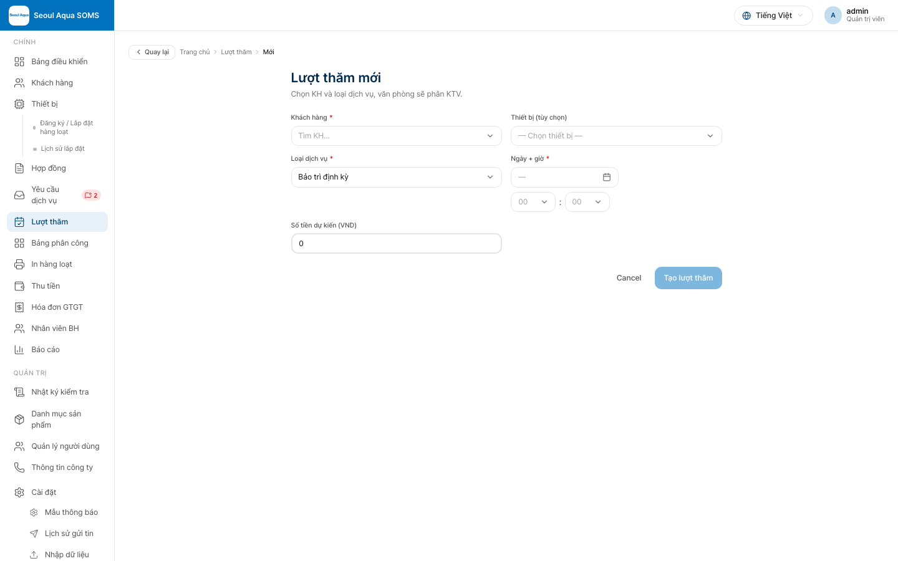

1. Chọn khách hàng · cơ sở · thiết bị
2. Nhập loại lượt thăm (chọn một) · ngày giờ · số tiền dự kiến
3. Lưu → tạo lượt thăm ở trạng thái **Đề xuất**.
4. Chọn KTV ở phần phân công KTV trong chi tiết lượt thăm (§9.3) hoặc ở bảng phân công hôm nay (§9.7) thì chuyển sang **Đã xếp lịch**.

Thứ tự đề xuất là **KTV ưu tiên → trùng khu vực → KTV có ít việc nhất trong ngày**. Đề xuất chỉ để tham khảo, bạn chọn ai cũng được.

> Tạo lượt thăm hay chọn KTV đều không gửi tin nhắn cho khách và KTV. Tin nhắn cho khách chỉ là SMS nhắc tự động lúc 16:00 ngày hôm trước (§3.2).

### 9.6 Đổi lịch và hủy

- **Đổi lịch**: chi tiết lượt thăm → «Đổi lịch» → ngày giờ mới và lý do → cùng lượt thăm đó chuyển thành **Đã xếp lịch** với thời gian mới (không tạo lượt thăm mới). Làm được ở trạng thái Đã xếp lịch·KH vắng·Đã đổi lịch, nên cũng dùng để xếp lại lượt thăm mà KTV đã báo thất bại. SMS nhắc hôm trước cũng được gửi lại theo ngày mới.
- **Hủy**: chi tiết lượt thăm → «Hủy lượt thăm» → lý do → **Đã hủy**

### 9.7 Bảng phân công hôm nay

**Thanh bên → Bảng phân công**

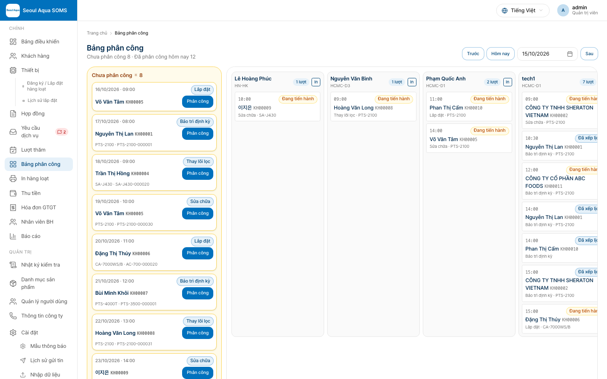

Bảng để xử lý việc phân công KTV trên một màn hình.

- Điều hướng ngày ở phía trên: Trước · Hôm nay · Sau · chọn ngày
- Bên trái: các thẻ lượt thăm chưa có KTV
- Bên phải: cột theo từng KTV, theo thứ tự thời gian
- **«Phân công»** trên thẻ chưa phân công → xem KTV đề xuất → chọn KTV chính (và KTV phụ nếu cần) → xác nhận. Thẻ chuyển sang cột của KTV đó.
- Nút in phía trên cột KTV → bộ tài liệu trong ngày của KTV đó (§9.8)

### 9.8 In hàng loạt

**Thanh bên → In hàng loạt** (hoặc nút in theo KTV trong bảng phân công hôm nay)

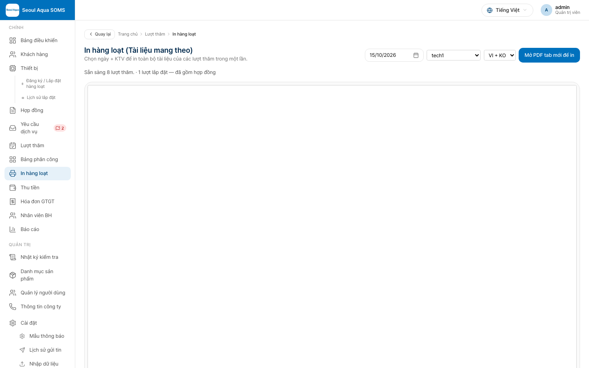

Chọn ngày và KTV thì tài liệu KTV mang đi trong ngày được gộp thành **một tệp PDF** và xem trước.

- Chỉ gồm lượt thăm Đã xếp lịch·Đang tiến hành·Đã đổi lịch (không gồm Đề xuất·Hoàn tất).
- Nếu có lượt lắp đặt thì kèm 2 bản hợp đồng (cho khách·cho công ty).
- Chọn ngôn ngữ tài liệu: tiếng Việt + tiếng Hàn hoặc tiếng Việt + tiếng Anh.
- Vì được tạo tức thời để in nên không ghi vào «Đã phát hành» của lượt thăm.
- «Mở PDF tab mới để in» → trong tab mới nhấn Ctrl+P (Mac là Cmd+P)

- Lượt thăm có loại bổ sung thì tài liệu của loại đó cũng được đưa vào (ví dụ: lượt thăm bảo trì + giao hàng → phiếu bảo trì định kỳ và biên lai bán hàng).

---

## Chương 10. Đơn hàng (vật tư và thiết bị mua thêm)

### 10.1 Đơn hàng là gì?

Dùng để ghi nhận vật tư·thiết bị·hàng khác bán cho khách. Một đơn hàng có thể có nhiều mặt hàng. Đơn hàng **luôn gắn với một lượt thăm** — vì hàng do KTV mang đến.

### 10.2 Tạo đơn hàng

Mọi nhân viên văn phòng đều làm được.

- **Chi tiết khách hàng → «+ Đơn mới»**
- **Chi tiết yêu cầu dịch vụ → «+ Đơn mới»** (trừ yêu cầu đã từ chối·hủy·hoàn tất)

1. Thêm mặt hàng (vật tư·thiết bị·khác, số lượng, đơn giá)
2. Chọn cách gắn lượt thăm.
   - **Tạo lượt thăm mới** — tạo một lượt thăm mới (Đề xuất). Loại được đề xuất tự động và có thể đổi: chỉ có vật tư → Giao vật tư, có thiết bị → Lắp đặt, lẫn lộn → Khác
   - **Thêm vào lượt thăm sắp tới** — gắn «Giao vật tư» làm loại bổ sung vào lượt thăm đã xếp lịch kế tiếp của khách này. Dùng khi tiện thể giao hàng trong chuyến đi bảo trì.
3. Lưu

### 10.3 Tài liệu giao hàng

Khi lượt thăm liên kết đã có KTV chính thì tài liệu giao hàng được chuẩn bị.

- B2C → Biên lai bán hàng (mỗi mặt hàng của đơn một dòng)
- B2B → Phiếu xuất kho Mẫu 02-VT

### 10.4 Xem đơn hàng

Xem ở tab **Lịch sử mua hàng** (mọi đơn) và **Đơn hàng (Bán)** (đơn có thiết bị) trong chi tiết khách hàng, và ở thẻ đơn mua liên quan trong chi tiết lượt thăm.

### 10.5 Đã giao và hủy đơn

- **Tự động**: khi KTV hoàn tất lượt thăm có gắn đơn hàng (dù giao vật tư là loại chính hay loại bổ sung), các đơn chưa giao của lượt thăm đó chuyển sang **Đã giao** và tồn kho vật tư bị trừ.
- **Thủ công**: ở các tab «Lịch sử mua hàng»·«Đơn hàng (Bán)» của chi tiết khách hàng, dòng đơn chưa giao có nút **«Đã giao»**·**«Hủy đơn»** (mọi nhân viên văn phòng). Có cửa sổ xác nhận và không thể hoàn tác. Khi chuyển sang Đã giao, tồn kho vật tư bị trừ.

> Không sửa được mặt hàng·số lượng của đơn đã tạo. Nếu tạo nhầm, hãy «Hủy đơn» rồi tạo lại.

---

## Chương 11. Xử lý yêu cầu dịch vụ

### 11.1 Loại yêu cầu và miễn phí·có phí

Khách gửi từ cổng, hoặc văn phòng nhận thay bằng «+ Yêu cầu mới».

| Loại | Điều kiện miễn phí |
|---|---|
| Bảo trì định kỳ | Đang trong hợp đồng thuê·bảo trì hoặc trong 90 ngày sau lắp đặt |
| Sửa chữa | Đang thuê hoặc trong 180 ngày sau lắp đặt |
| Thay phụ tùng | Đang trong hợp đồng thuê·bảo trì |
| Di dời | Lần di dời đầu trong 90 ngày sau lắp đặt |
| Khác | Luôn có phí |

- **Yêu cầu miễn phí** → ngay lập tức **Đã duyệt** + lượt thăm (Đề xuất) được tạo tự động. Lấy thời gian khách mong muốn, nếu không có thì đặt sau 3 ngày.
- **Yêu cầu có phí** → **Chờ duyệt**. Văn phòng duyệt hoặc từ chối.
- Dù trường hợp nào, khách cũng nhận email xác nhận đã tiếp nhận (hiện là giả lập).

### 11.2 Danh sách yêu cầu dịch vụ

**Thanh bên → Yêu cầu dịch vụ**

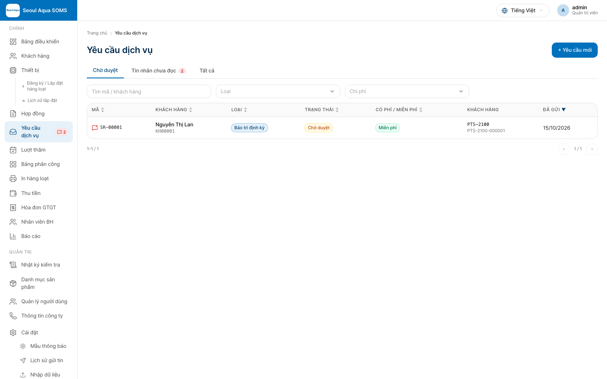

- Tab: **Chờ duyệt · Tin nhắn chưa đọc · Tất cả** (tab Tất cả có thêm bộ lọc trạng thái)
- Bộ lọc: loại · có phí / miễn phí
- Nếu có tin nhắn khách gửi mà chưa ai đọc thì cạnh «Yêu cầu dịch vụ» ở thanh bên hiện số màu đỏ.

### 11.3 Chi tiết yêu cầu — duyệt · từ chối

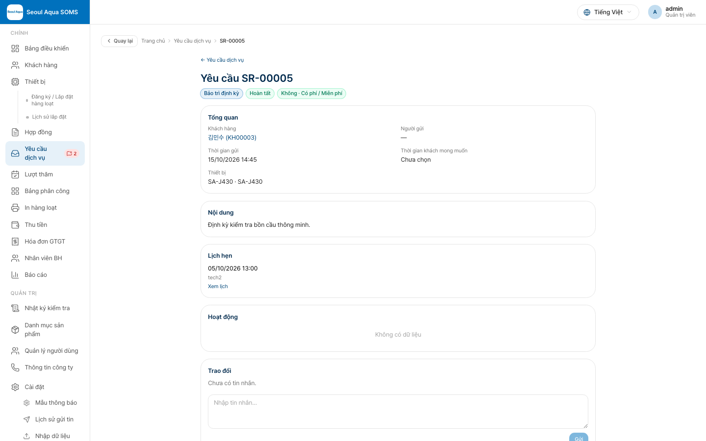

Có thông tin khách hàng, nội dung yêu cầu, hình ảnh và **tin nhắn** trao đổi với khách.

**Duyệt** (MANAGER trở lên)

1. «Duyệt» → giá (0 là miễn phí) · ngày duyệt · thời gian hẹn · KTV chính (tùy chọn) · ghi chú nội bộ
2. Lưu thì lượt thăm phù hợp với loại yêu cầu được tạo ngay. Nếu đã chọn KTV chính thì lượt thăm là **Đã xếp lịch**, yêu cầu là **Đã xếp lịch**; nếu chưa chọn thì lượt thăm là **Đề xuất**, yêu cầu là **Đã duyệt**.
3. Khách nhận SMS duyệt và email chi tiết — hiện SMS thất bại do nội dung chưa đăng ký còn email là giả lập. **Hãy gọi điện báo giá và lịch cho khách.**

**Từ chối** (mọi nhân viên văn phòng) — ghi lý do nội bộ và tin nhắn cho khách. SMS từ chối hiện cũng không đến được khách, hãy báo qua điện thoại.

**Hủy yêu cầu** (mọi nhân viên văn phòng) — hủy yêu cầu.

Trạng thái yêu cầu đi theo lượt thăm liên kết: lượt thăm được xếp lịch thì **Đã xếp lịch**, hoàn tất thì **Hoàn tất**.

---

## Chương 12. Thu tiền

### 12.1 Phương thức thanh toán và trạng thái

**Phương thức thanh toán**: Tiền mặt · Chuyển khoản · Thẻ · Khác

**Trạng thái khoản thu**

| Trạng thái | Ý nghĩa |
|---|---|
| Dự kiến | Đã lập phiếu, chưa thu |
| Đã thu | KTV thu tại hiện trường (KTV vẫn đang giữ) |
| Đã bàn giao | KTV đã nộp tiền mặt cho văn phòng |
| Đã đối soát | Văn phòng đã kiểm tra xong |
| Trễ 7n / 14n / 30n | Quá hạn (tự đổi lúc 08:00 hằng ngày) |
| Đã xóa | Đã xử lý là không thu nữa |

Phiếu thu hằng tháng (Dự kiến) của hợp đồng thuê·bảo trì được tự tạo vào ngày 1 hằng tháng (hạn là ngày thu tiền của hợp đồng, để trống thì ngày 10 — §8.3).

### 12.2 Danh sách thu tiền

**Thanh bên → Thu tiền**

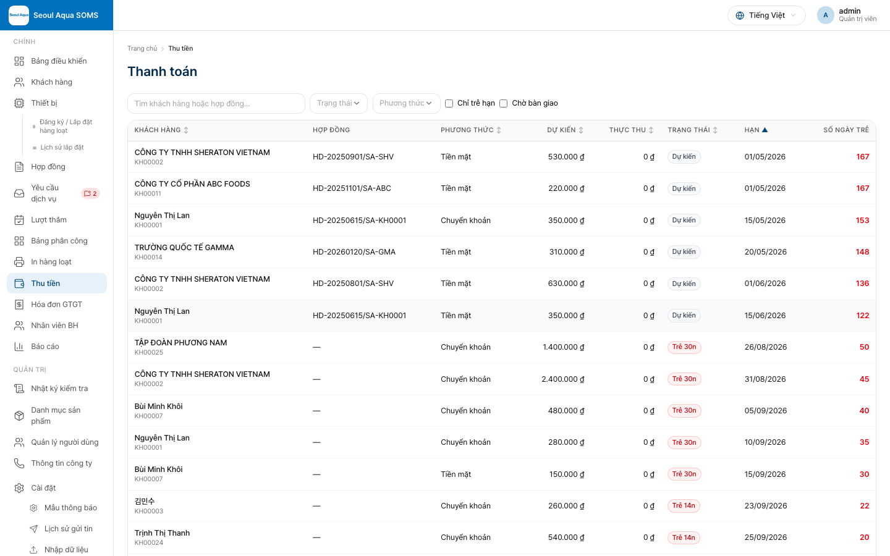

- Tìm kiếm (khách hàng·hợp đồng) · trạng thái · phương thức · **Chỉ trễ hạn** · **Chờ bàn giao**
- Các cột: khách hàng · hợp đồng · phương thức · dự kiến · thực thu · trạng thái · hạn · số ngày trễ
- Bấm vào một dòng để mở chi tiết khoản thu.

### 12.3 Các nút trong chi tiết khoản thu

| Nút | Quyền | Khi nào | Chức năng |
|---|---|---|---|
| Bàn giao văn phòng | Mọi nhân viên (hoặc KTV đã thu) | Đã thu | Ghi nhận đã nhận tiền mặt từ KTV → Đã bàn giao |
| Đối soát | MANAGER+ | Đã thu · Đã bàn giao | Kiểm tra xong → Đã đối soát |
| Thanh toán một phần | Mọi nhân viên | Dự kiến · Trễ 7n/14n/30n | Ghi số tiền đã nhận và đóng khoản này thành Đã đối soát. Ô số tiền được điền sẵn toàn bộ số tiền phải thu, nên lưu nguyên như vậy là thanh toán đủ. Nếu nhập ít hơn, số tiền còn lại chuyển thành khoản **Dự kiến** mới |
| Xóa nợ | MANAGER+ | Trừ Đã đối soát·Đã xóa | Xử lý là không thu nữa |

> **Chuyển khoản·nộp tại văn phòng được ghi bằng «Thanh toán một phần».** Khoản quá hạn cũng vậy. Nếu nhận đủ thì lưu nguyên số tiền đã điền sẵn. Không còn số dư nên cũng không phát sinh khoản tiếp theo.

### 12.4 Nhận tiền mặt từ KTV

1. Ở danh sách thu tiền, chọn **«Chờ bàn giao»** → hiện các khoản tiền mặt KTV đang giữ.
2. Đối chiếu số tiền với tiền mặt KTV mang đến, rồi ở chi tiết từng khoản bấm **«Bàn giao văn phòng»**.
3. Sau khi kiểm tra xong, MANAGER bấm «Đối soát».

Không có nút nhận hàng loạt. Quá 48 giờ kể từ khi KTV thu thì bảng điều khiển hiện cảnh báo (§3.2).

### 12.5 Sửa ghi chú biên lai

Ở chi tiết khoản thu → tab **Biên lai**, sửa ghi chú in trên biên lai rồi bấm **«Lưu & tạo lại»** thì PDF biên lai được tạo lại và bản xem trước được cập nhật. Ghi chú lưu vào bản ghi khoản thu nên mở lại vẫn còn. «Tải biên lai» để tải PDF dùng in.

### 12.6 Các giai đoạn quá hạn

| Giai đoạn | Xử lý tự động (08:00 hằng ngày) |
|---|---|
| D+7 | Trạng thái Trễ 7n + email (bên ký hợp đồng + liên hệ vận hành chính) |
| D+14 | Trạng thái Trễ 14n + email lần hai |
| D+30 | Trạng thái Trễ 30n + SMS cảnh báo cuối (bên ký hợp đồng + liên hệ vận hành chính) |

Trạng thái hợp đồng không thay đổi. Email là giả lập, SMS D+30 do nội dung chưa đăng ký nên hiện chưa đến được khách. **Hãy gọi điện trực tiếp cho khách quá hạn.**

---

## Chương 13. Hóa đơn GTGT (B2B)

Hóa đơn GTGT được phát hành ở hệ thống hóa đơn điện tử bên ngoài (Viettel SInvoice, MISA, …), còn trong SOMS bạn **tải PDF lên và liên kết với khoản thanh toán**.

**Thanh bên → Hóa đơn GTGT**

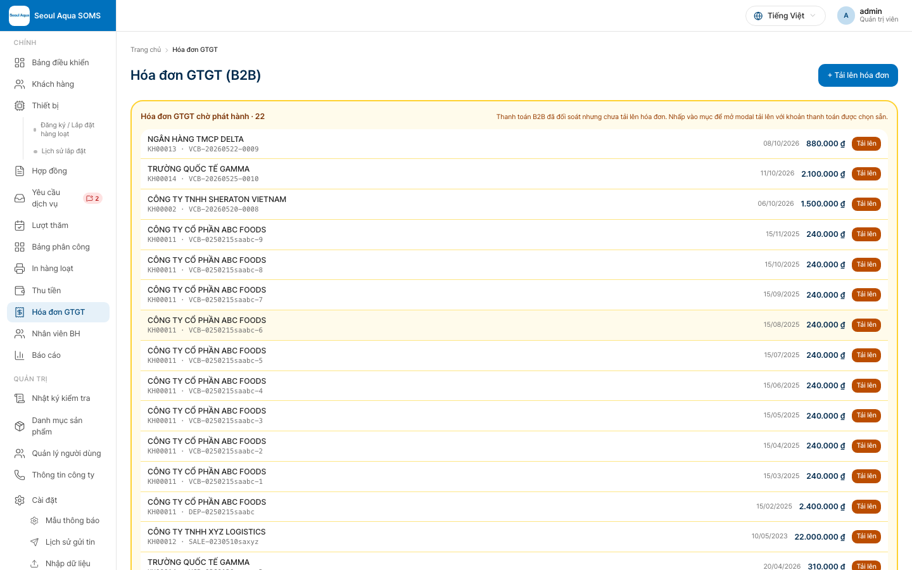

- **Chờ phát hành · N**: danh sách thanh toán B2B đã đối soát nhưng chưa có hóa đơn GTGT. Mỗi dòng có nút «Tải lên».
- **«+ Tải lên hóa đơn»**: Chọn thanh toán (thanh toán B2B đã đối soát) · Số hóa đơn · Ngày phát hành · PDF (tối đa 10MB) · Ghi chú
- Khi tải lên, khách nhận email hóa đơn GTGT (theo thứ tự kế toán → liên hệ vận hành chính → bên ký hợp đồng, hiện là giả lập).
- Tải lên·gửi lại·phát hành lại từ MANAGER trở lên, danh sách thì mọi nhân viên đều xem được.

Một hóa đơn GTGT liên kết với một khoản thanh toán.

---

## Chương 14. Báo cáo và nhật ký kiểm tra

### 14.1 Báo cáo

**Thanh bên → Báo cáo**

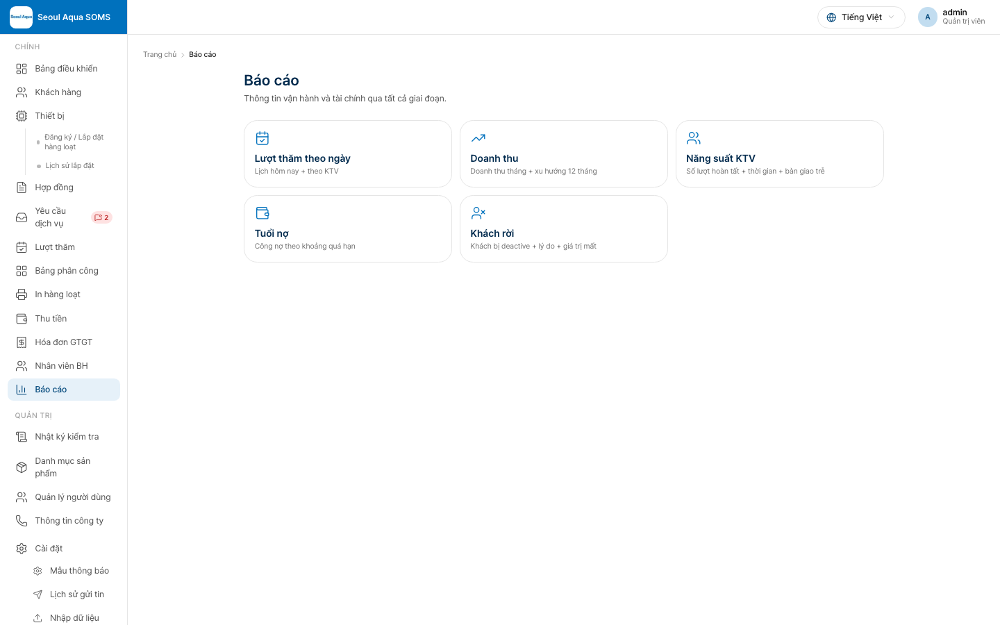

| Báo cáo | Nội dung |
|---|---|
| Lượt thăm trong ngày | Số lượt thăm tổng và theo KTV của ngày đã chọn (đã lên lịch·đang thực hiện·hoàn tất·thất bại) |
| Doanh thu theo tháng | Doanh thu theo loại hợp đồng + phí yêu cầu dịch vụ |
| Năng suất KTV | Số lượt hoàn tất · thời gian trung bình · số lần bàn giao tiền trễ (quá 48 giờ) của từng KTV |
| Tuổi nợ | Hiện hành / 1-7 ngày / 8-14 ngày / 15-30 ngày / Trên 30 ngày |
| Khách rời | Khách rời bỏ (vô hiệu hóa) theo quý, lý do và doanh thu tháng bị mất |

Mọi nhân viên văn phòng đều xem được tất cả báo cáo và tải CSV.

### 14.2 Nhật ký kiểm tra

**Thanh bên → Quản trị → Nhật ký kiểm tra** (ADMIN · MANAGER)

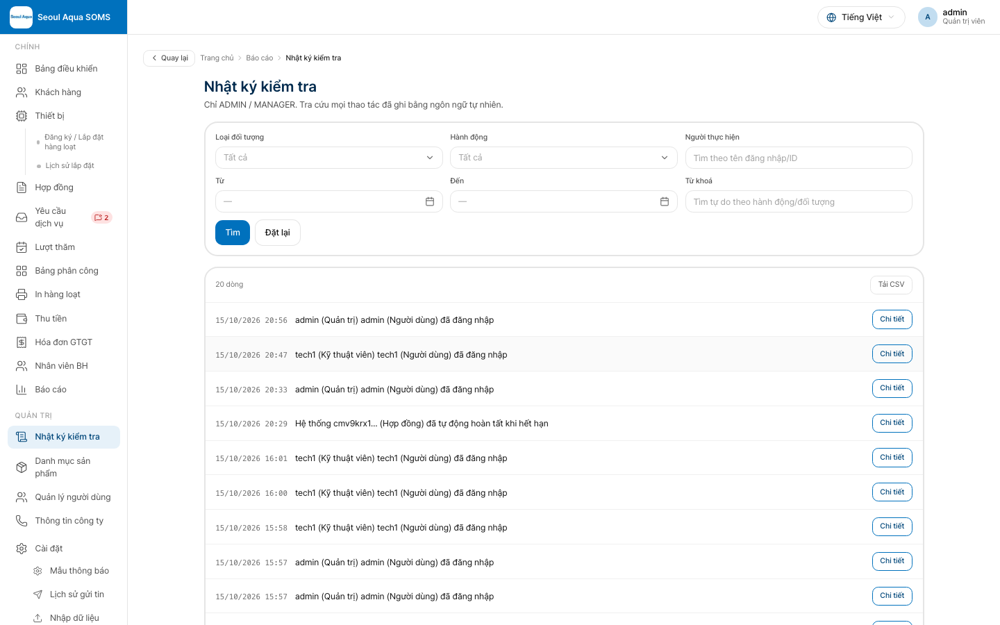

- Mọi thay đổi xảy ra trong hệ thống (thêm người dùng, kích hoạt hợp đồng, xóa nợ khoản thu, tải lên danh mục, …) đều được ghi lại.
- Mỗi dòng đọc như một câu "ai đã làm gì".
- **«Chi tiết»** → bên phải hiển thị bảng trước/sau chỉ với các mục đã thay đổi. Phần «Thông tin kỹ thuật» bên dưới cho xem dữ liệu gốc·IP·trình duyệt.
- Bộ lọc: loại đối tượng · hành động · người thực hiện · kỳ · từ khóa. Có thể tải CSV với cùng điều kiện.
- Nhật ký không bao giờ bị tự động xóa.

> Nhãn **màu cam «(chưa phân loại)»** cạnh tên hành động nghĩa là hành động đó chưa có câu mô tả. Bản ghi vẫn bình thường.

**Những gì không được ghi**: các thao tác ghi thẳng vào cơ sở dữ liệu không qua màn hình như nạp dữ liệu ban đầu (seed), đặt lại cơ sở dữ liệu, thay đổi cấu trúc cơ sở dữ liệu

---

## Chương 15. Menu quản trị

**Thanh bên → Quản trị** (ADMIN · MANAGER. Nhập dữ liệu chỉ ADMIN)

### 15.1 Quản lý người dùng

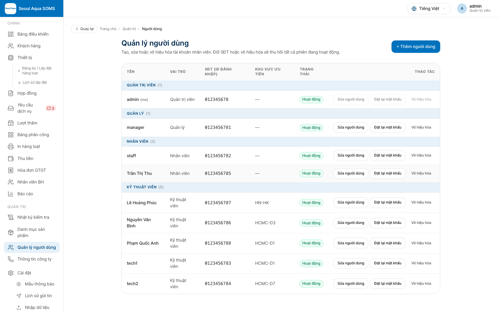

Người dùng được hiển thị **theo nhóm vai trò**: Quản trị viên → Quản lý → Nhân viên → Kỹ thuật viên. Vai trò không có người dùng vẫn giữ tiêu đề nhóm.

#### Phạm vi được làm — chỉ theo chiều xuống

| Vai trò của tôi | Tài khoản có thể quản lý |
|---|---|
| ADMIN | MANAGER · STAFF · KTV |
| MANAGER | STAFF · KTV |

Nút của dòng cùng vai trò, vai trò cao hơn và **chính mình** bị khóa. Việc tạo thêm hoặc sửa tài khoản ADMIN không làm được trên màn hình mà do bộ phận phát triển xử lý.

#### Thêm người dùng

«Thêm người dùng» → Tên · SĐT (ID đăng nhập) · Mật khẩu tạm thời (từ 8 ký tự) · Vai trò · Khu vực ưu tiên (KTV) → Lưu. Danh sách vai trò chỉ có các vai trò bạn quản lý được. Hãy **trực tiếp** cho người đó biết mật khẩu tạm thời (không gửi tin nhắn).

#### Nút trên từng dòng

- **Sửa người dùng** — tên·vai trò·SĐT·khu vực ưu tiên. Nếu đổi SĐT thì mọi phiên đăng nhập của người đó bị ngắt.
- **Đặt lại mật khẩu** — xem bên dưới
- **Vô hiệu hóa** — chặn đăng nhập. Lịch sử vẫn được giữ.

#### Đặt lại mật khẩu

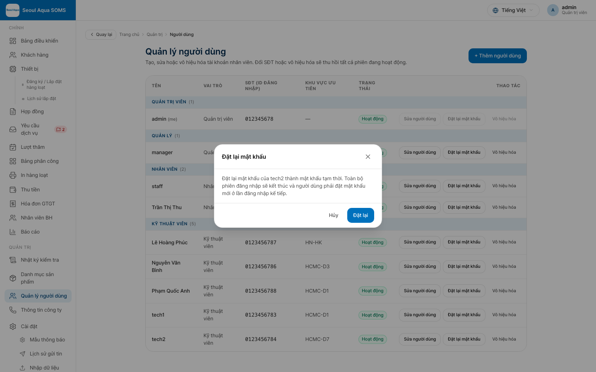

Khi nhân viên hoặc KTV quên mật khẩu, bạn nhận điện thoại rồi đặt lại tại đây.

1. Ở dòng tương ứng bấm «Đặt lại mật khẩu» → trong cửa sổ xác nhận bấm «Đặt lại»
2. Mật khẩu tạm thời mới hiện trên màn hình **chỉ một lần**. Hãy đọc cho người đó ngay tại chỗ.

- Không gửi qua tin nhắn.
- Mọi phiên đăng nhập của người đó bị ngắt và khóa cũng được mở.
- Lần đăng nhập tới, người đó phải đặt mật khẩu mới ở màn hình «Đổi mật khẩu».
- Bản ghi trong nhật ký kiểm tra là «Nhân viên đặt lại mật khẩu».

### 15.2 Danh mục sản phẩm

**Quản trị → Danh mục sản phẩm** (ADMIN · MANAGER)

7 tab: **Thương hiệu · Nhóm sản phẩm · Loại sản phẩm · Model · Vật tư tiêu hao · Phụ kiện · Chính sách tính phí**
Góc trên bên phải: «Tải lên CSV danh mục» · «Tải CSV danh mục sản phẩm» · «Xuất Excel» — về tải lên CSV, xem [Hướng dẫn tải lên danh mục hàng loạt](./catalog-upload.md).

#### Cấu trúc phân loại

```
Nhóm sản phẩm (ví dụ: máy lọc nước nóng lạnh, máy lọc không khí)
  ├─ Loại sản phẩm (ví dụ: lọc trực tiếp, dạng đứng) — thuộc từ 1 nhóm sản phẩm trở lên
  ├─ Model            — từ 1 nhóm sản phẩm trở lên + 0–1 loại sản phẩm
  └─ Vật tư·phụ kiện  — 0 nhóm sản phẩm trở lên + 0 loại sản phẩm trở lên (để tìm kiếm·phân loại)
```

- Nếu model đã chọn loại sản phẩm thì các nhóm sản phẩm của model đó **đều phải nằm trong các nhóm sản phẩm của loại đó**.
- Nhóm sản phẩm·loại sản phẩm gắn cho vật tư·phụ kiện chỉ là **nhãn để dễ tìm**. Nó không tự áp dụng cho các model của nhóm sản phẩm đó. Model nào dùng lõi lọc nào được quyết định trong «Cấu hình Filter» của model.

**Thứ tự đăng ký model mới**

1. Đăng ký trước các lõi lọc của model đó ở tab Vật tư tiêu hao (đăng ký được khi chưa có model)
2. Đăng ký model ở tab Model
3. Trong «Cấu hình Filter» của biểu mẫu model, chọn các lõi lọc ở bước 1 để gắn vào

#### Tab Thương hiệu · Nhóm sản phẩm · Loại sản phẩm

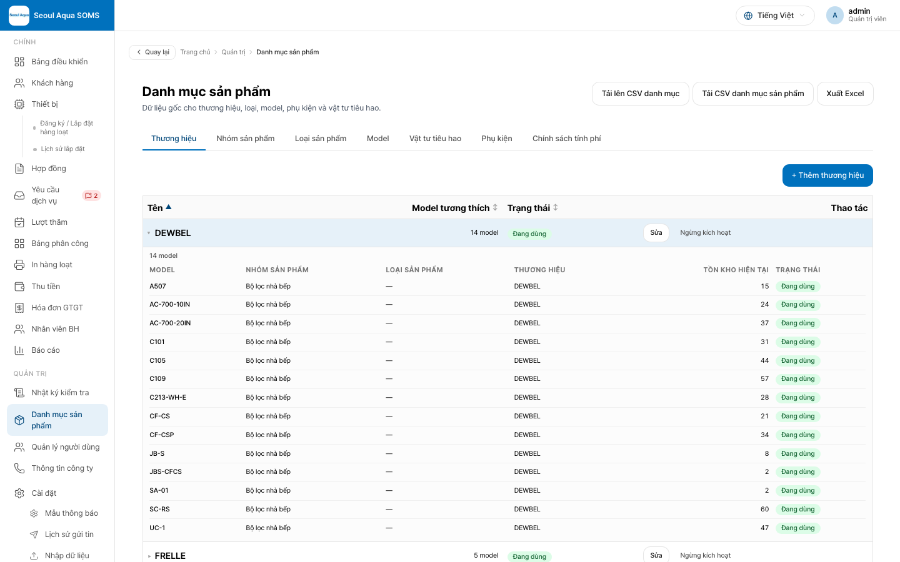

- Ba tab có bảng cùng dạng. **Bấm một dòng thì danh sách model thuộc dòng đó mở ra bên dưới** (model·nhóm sản phẩm·loại sản phẩm·thương hiệu·tồn kho hiện tại·trạng thái). Bấm lần nữa để thu lại.
- Các nút «Sửa»·«Ngừng kích hoạt» của dòng hoạt động ngay mà không mở rộng dòng.

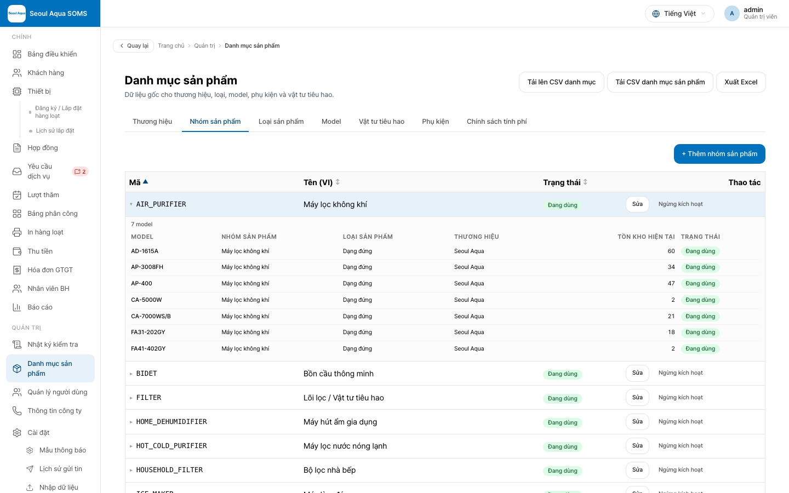

- **Nhóm sản phẩm**: tên (tiếng Hàn·tiếng Việt·tiếng Anh, mỗi ngôn ngữ một dòng, bắt buộc) và mã. Danh sách trên màn hình chỉ hiện tên theo ngôn ngữ đang xem.

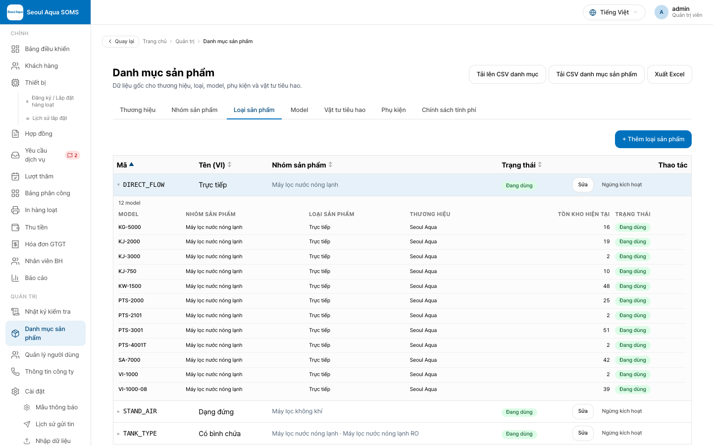

- **Loại sản phẩm**: tên 3 ngôn ngữ (bắt buộc) + **nhóm sản phẩm (từ 1 trở lên, bắt buộc)** + mã

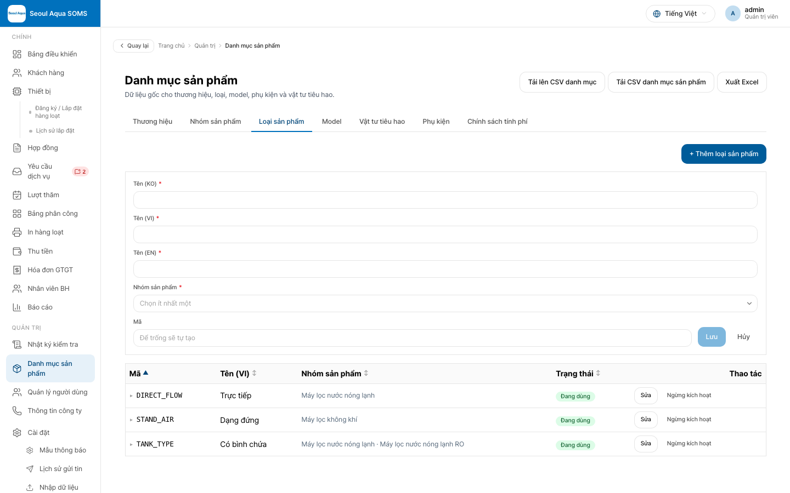

**Quy tắc mã** (chung cho nhóm sản phẩm và loại sản phẩm)

- Khi đăng ký nếu để trống thì mã dạng `MAY_LOC_NUOC` được tự tạo từ tên tiếng Anh (nếu không có thì từ tên tiếng Việt).
- Ở cửa sổ «Sửa» có thể tự sửa mã. Khi nhập, chữ tự đổi thành chữ in hoa và khoảng trắng thành `_`.
- Nếu mã đã được dùng thì hiện "Mã X đã được sử dụng." và không lưu được.

> Nếu bạn bỏ một nhóm sản phẩm khỏi loại sản phẩm mà model của loại đó vẫn đang dùng nhóm sản phẩm đó thì không lưu được. Hãy đổi nhóm sản phẩm của model trước.

#### Tab Model · Vật tư tiêu hao — chi tiết bên trái / danh sách bên phải

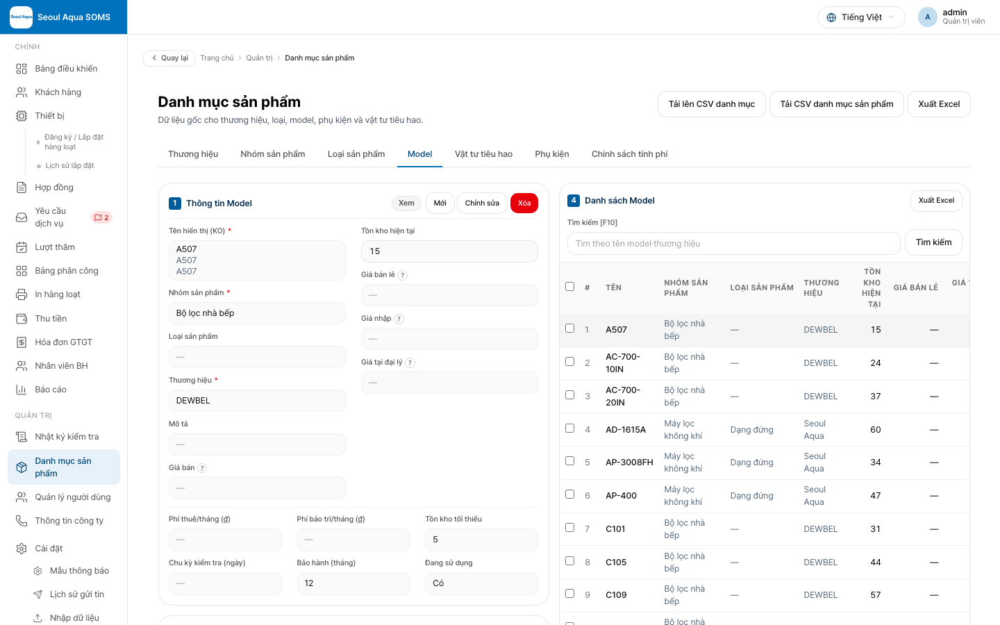

- Bấm một dòng ở **danh sách bên phải** thì mục đó hiện ở **chi tiết bên trái** trong trạng thái **Xem**.
- Ở phần đầu chi tiết bên trái có **«Mới»** (F2) · **«Chỉnh sửa»** (F3) · **«Xóa»** (F4). Khi đang tạo mới·chỉnh sửa chỉ hiện **«Lưu»** (F5) · **«Hủy»** (Esc), và không chọn được dòng khác ở danh sách bên phải.
- «Xóa» là ngừng kích hoạt. Chọn nhiều dòng ở danh sách model rồi xóa thì ngừng kích hoạt một lần.
- Phía trên danh sách có tìm kiếm (F10) và «Xuất Excel».

**Biểu mẫu model**

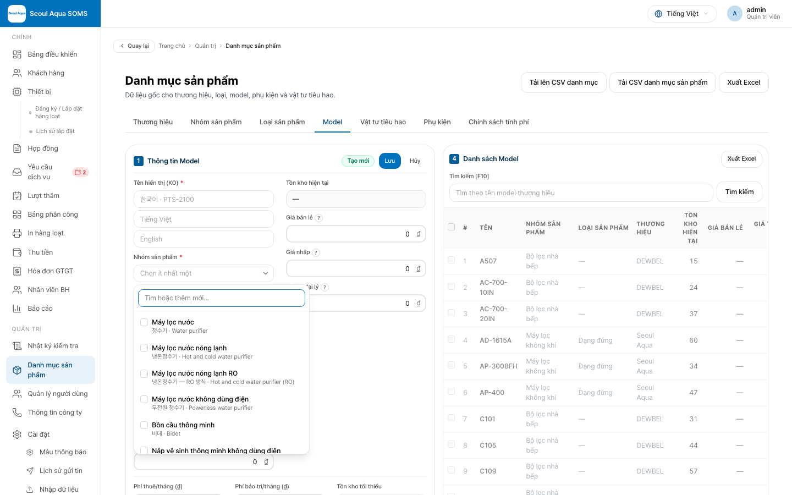

| Vị trí | Mục |
|---|---|
| Bên trái | Tên hiển thị (tiếng Hàn·tiếng Việt·tiếng Anh, bắt buộc) · **Nhóm sản phẩm (nhiều, bắt buộc)** · **Loại sản phẩm (tùy chọn)** · Thương hiệu (bắt buộc) · Mô tả · Giá bán |
| Bên phải | Tồn kho hiện tại (chỉ đọc + «Điều chỉnh tồn kho») · Giá bán lẻ · Giá nhập · Giá tại đại lý |
| Bên dưới | Phí thuê/tháng · Phí bảo trì/tháng · Tồn kho tối thiểu · Chu kỳ kiểm tra (ngày) · Bảo hành (tháng) · Đang sử dụng |
| ② Cấu hình Filter | Lõi lọc dùng cho model này, số lượng mỗi lõi (mặc định 1) và chu kỳ thay ở model này |

- **Nhóm sản phẩm** là ô vừa tìm kiếm vừa chọn nhiều mục. Nhóm đã chọn hiển thị dạng thẻ, nếu không có trong danh sách thì tạo mới ngay bằng «Thêm nhóm sản phẩm “tên”».
- Danh sách **Loại sản phẩm** **chỉ hiện các loại bao gồm tất cả nhóm sản phẩm đã chọn**. Khi chọn loại, các nhóm sản phẩm ngoài loại đó bị làm mờ không chọn được. Nếu không có trong danh sách thì tạo ngay bằng «Thêm loại sản phẩm “tên”».
- **Thương hiệu** cũng tìm kiếm·thêm nhanh theo cách tương tự.
- Mục bắt buộc có dấu `*` đỏ. Nếu lưu bị từ chối thì câu báo lỗi cho biết ô nào có vấn đề.
- Khi danh sách thả xuống đang mở, nhấn Esc chỉ đóng danh sách thả xuống, cửa sổ đăng ký vẫn giữ nguyên.

**Cấu hình Filter**: «+ Thêm lõi lọc» → tìm lõi lọc (theo tên·SKU, và cả theo **tên nhóm sản phẩm**) → chọn. Ô **Số lượng** là số lõi lọc đó lắp trong model này (mặc định 1 — với model dùng 2~4 lõi giống nhau như máy làm đá thì nhập đúng số đó). Chu kỳ thay mặc định của lõi lọc hiện làm giá trị gợi ý; nếu muốn dùng chu kỳ khác chỉ cho model này thì nhập vào ô chu kỳ thay (ngày). Mỗi lõi lọc chỉ thêm được một lần. Khi sửa model hiện có, cấu hình hiện tại được điền sẵn, và trong lúc đang tải nút lưu tạm thời bị khóa.

Thứ tự ưu tiên chu kỳ: **chu kỳ tùy chỉnh theo thiết bị > chu kỳ theo model > chu kỳ mặc định của lõi lọc**

**Biểu mẫu vật tư tiêu hao**

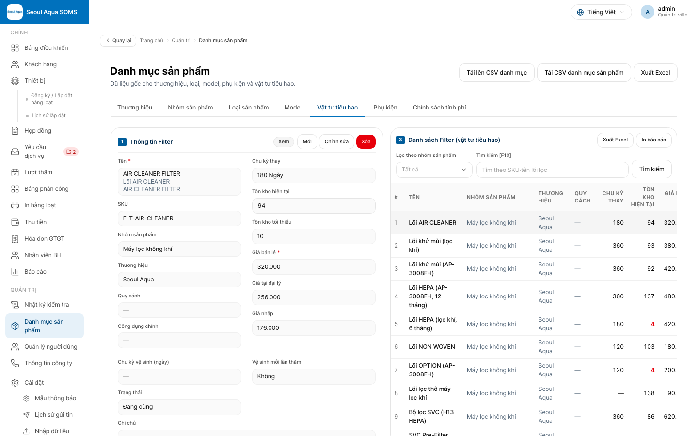

| Vị trí | Mục |
|---|---|
| Bên trái | Tên (3 ngôn ngữ, bắt buộc) · SKU · Nhóm sản phẩm (nhiều, tùy chọn) · Loại sản phẩm (nhiều, tùy chọn) · Thương hiệu · Quy cách · Công dụng chính |
| Bên phải | Chu kỳ thay (ngày/tháng) · Tồn kho hiện tại (+ Điều chỉnh tồn kho) · Tồn kho tối thiểu · Giá bán lẻ (bắt buộc) · Giá tại đại lý · Giá nhập |
| Bên dưới | Chu kỳ vệ sinh (ngày) · Vệ sinh mỗi lần thăm · Trạng thái · Ghi chú |
| ② Thiết bị (Model) áp dụng | Danh sách model dùng lõi lọc này (tên·nhóm sản phẩm·thương hiệu·số lượng lắp sẵn) |

- Nếu để trống **SKU** thì mã như `FLT-000001` được cấp tự động. Sau khi đăng ký không đổi được.
- Khi đổi đơn vị chu kỳ thay giữa ngày ↔ tháng, con số được quy đổi để giữ nguyên khoảng thời gian (1 tháng = 30 ngày, lưu theo ngày). Cột chu kỳ thay trong danh sách hiện theo đúng đơn vị đã nhập (ví dụ 6 tháng). «Cấu hình dịch vụ» ở màn hình thiết bị hiện theo ngày (6 tháng → 180 ngày).
- **«Lọc theo nhóm sản phẩm»** phía trên danh sách để thu hẹp, và có cả «In báo cáo».
- Liên kết model↔lõi lọc hiển thị giống hệt ở cấu hình Filter của model và ở thiết bị áp dụng của vật tư.

#### Tab Phụ kiện

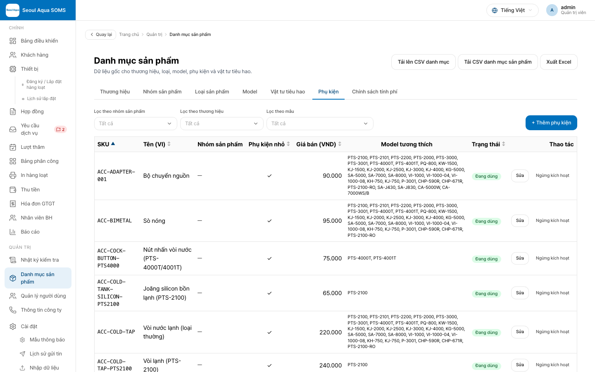

- «Thêm phụ kiện» → tên (tiếng Hàn·tiếng Việt·tiếng Anh, mỗi ngôn ngữ một dòng, bắt buộc) · giá bán (bắt buộc) · SKU + chọn «Phụ kiện nhỏ» · nhóm sản phẩm (nhiều) · loại sản phẩm (nhiều) · model tương thích
- Nếu để trống SKU thì mã như `ACC-000001` được cấp tự động và không sửa được ở cửa sổ sửa.
- **Phụ kiện nhỏ** là các bộ phận nhỏ được đổi miễn phí cho khách có hợp đồng bảo trì (vòi·van·ống, …).
- Phía trên danh sách có thể lọc theo thương hiệu·model·nhóm sản phẩm.

#### Tab Chính sách tính phí

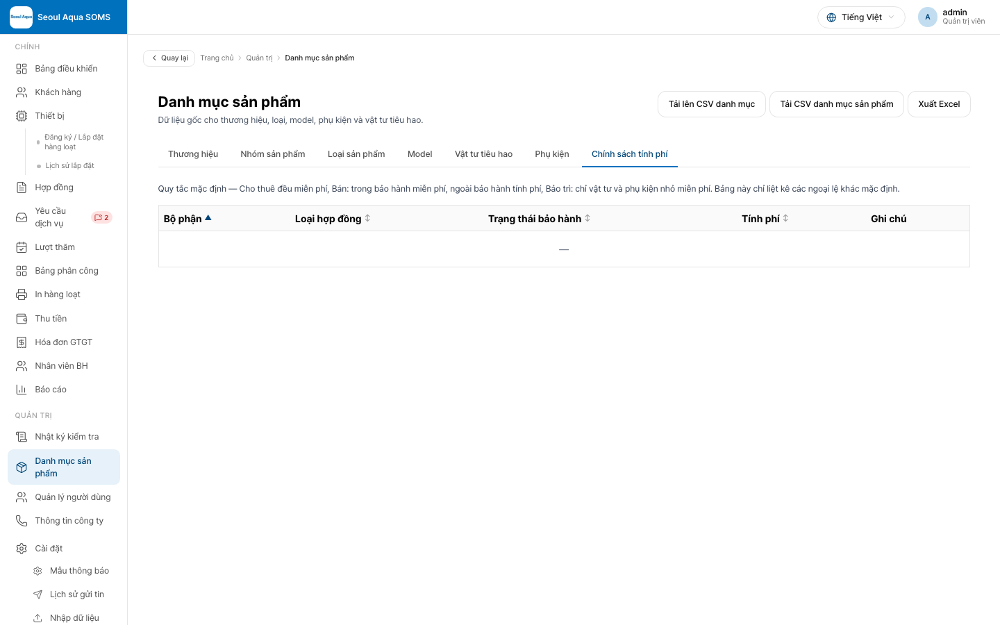

Quy tắc mặc định — thuê đều miễn phí, bán thì trong bảo hành miễn phí·sau đó tính phí, bảo trì chỉ vật tư và phụ kiện nhỏ miễn phí. Bảng này hiển thị **các ngoại lệ khác với quy tắc mặc định** (bộ phận · loại hợp đồng · trạng thái bảo hành · tính phí · ghi chú).

#### Điều chỉnh tồn kho

**«Điều chỉnh tồn kho»** cạnh tồn kho hiện tại trong biểu mẫu model·vật tư (chỉ hiện khi đang tạo mới·chỉnh sửa)

- **Nhập kho**: cộng thêm / **Xuất kho**: trừ đi / **Điều chỉnh**: đặt về số lượng mục tiêu theo kiểm kê thực tế
- Mọi biến động được ghi vào lịch sử tồn kho kèm thời gian·người làm·lý do (ghi chú) và cũng ghi vào nhật ký kiểm tra.
- Tự động trừ: lắp đặt thiết bị → model −1, thay lõi lọc ở lượt thăm → vật tư −1
- Tồn kho hiện tại ít hơn tồn kho tối thiểu thì hiện màu đỏ. Để không chặn công việc hiện trường nên cho phép tồn kho âm; nếu lệch thì dùng «Điều chỉnh» để khớp lại.

#### 4 loại giá

**Giá nhập** (giá vốn mua vào) ≤ **Giá tại đại lý** (giá cung cấp cho đại lý) ≤ **Giá bán lẻ** (giá bán lẻ đề xuất). **Giá bán** là giá giao dịch thực tế dùng trong hợp đồng·báo giá.

### 15.3 Thông tin công ty

**Quản trị → Thông tin công ty**

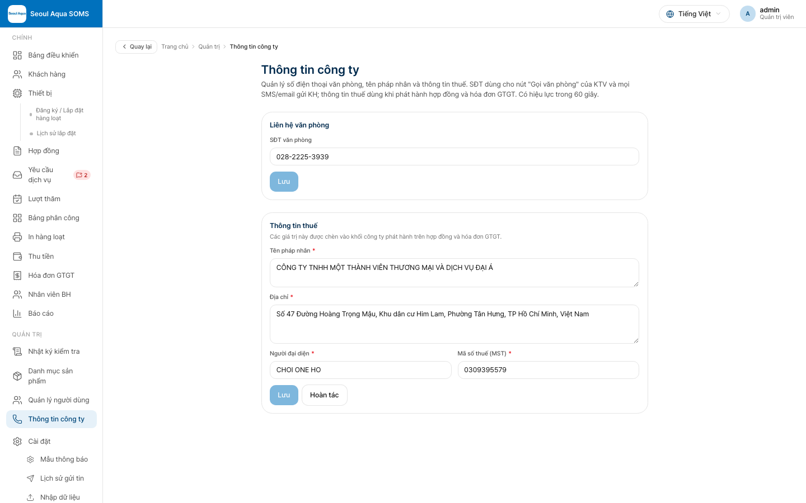

- **Liên hệ văn phòng**: số điện thoại văn phòng chính. Dùng cho nút «Gọi văn phòng» trong ứng dụng KTV và làm thông tin liên hệ trong SMS·email gửi khách.
- **Thông tin thuế**: tên pháp nhân · địa chỉ · người đại diện · mã số thuế (MST). Được điền nguyên vẹn vào khối thông tin công ty của hợp đồng và hóa đơn GTGT.

Sau khi lưu, có hiệu lực trong vòng 60 giây.

### 15.4 Mẫu thông báo

**Quản trị → Cài đặt → Mẫu thông báo**

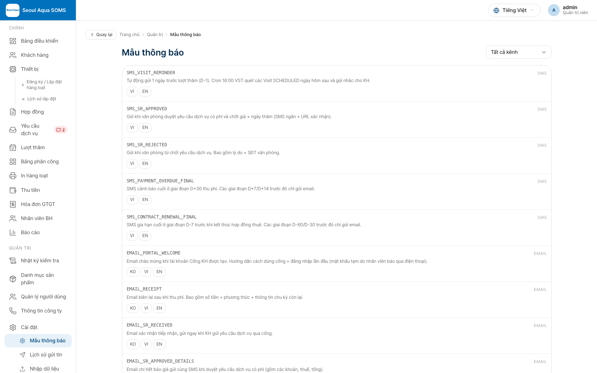

Danh sách nội dung SMS·email gửi cho khách. Lọc theo kênh (SMS/email) ở góc trên bên phải.

- Mở một mẫu để sửa nội dung theo từng ngôn ngữ (email có cả tiêu đề), khôi phục về nội dung mặc định, hoặc bật/tắt mẫu. Mẫu đã tắt thì không được gửi.
- **SMS chỉ có hai ngôn ngữ tiếng Việt (VI) và tiếng Anh (EN).** Khách dùng tiếng Hàn nhận SMS tiếng Anh. Email có ba ngôn ngữ tiếng Hàn·tiếng Việt·tiếng Anh.
- **Nội dung SMS phải giống hệt câu đã đăng ký với nhà mạng thì mới gửi được.** Nếu đổi câu của SMS đã đăng ký (nhắc lượt thăm trước một ngày) thì có thể bị từ chối. Hãy sửa câu SMS cùng với việc đăng ký với nhà mạng.

### 15.5 Lịch sử gửi tin

**Quản trị → Cài đặt → Lịch sử gửi tin**

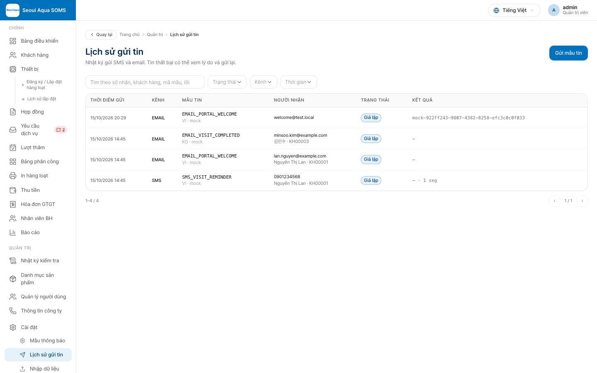

Màn hình để kiểm tra SMS và email đã thực sự được gửi đi chưa.

- Danh sách: thời điểm gửi · kênh · mã mẫu · số nhận và tên khách · trạng thái · kết quả (thành công thì là mã tin nhắn của nhà cung cấp, thất bại thì là lý do)
- **Trạng thái**
  - **Thành công** — nhà cung cấp (eSMS) đã tiếp nhận. Việc nhà mạng giao đến nơi là chuyện riêng.
  - **Giả lập** — không thực sự gửi. Hiện **toàn bộ email** thuộc loại này.
  - **Bỏ qua** — khách từ chối nhận hoặc không có số·email
  - **Thất bại** — nhà cung cấp từ chối. `146` = nội dung chưa đăng ký với nhà mạng, `104` = vấn đề tên thương hiệu, `101` = vấn đề khóa xác thực
- **Dòng thất bại** có nút «Gửi lại». Hệ thống không gửi lại nguyên văn nội dung đã lưu mà tạo mới theo mẫu hiện tại và liên hệ hiện tại rồi gửi. Bản ghi thất bại ban đầu được giữ và có thêm một dòng ghi nhận gửi lại.

#### Gửi theo mẫu tin (thủ công)

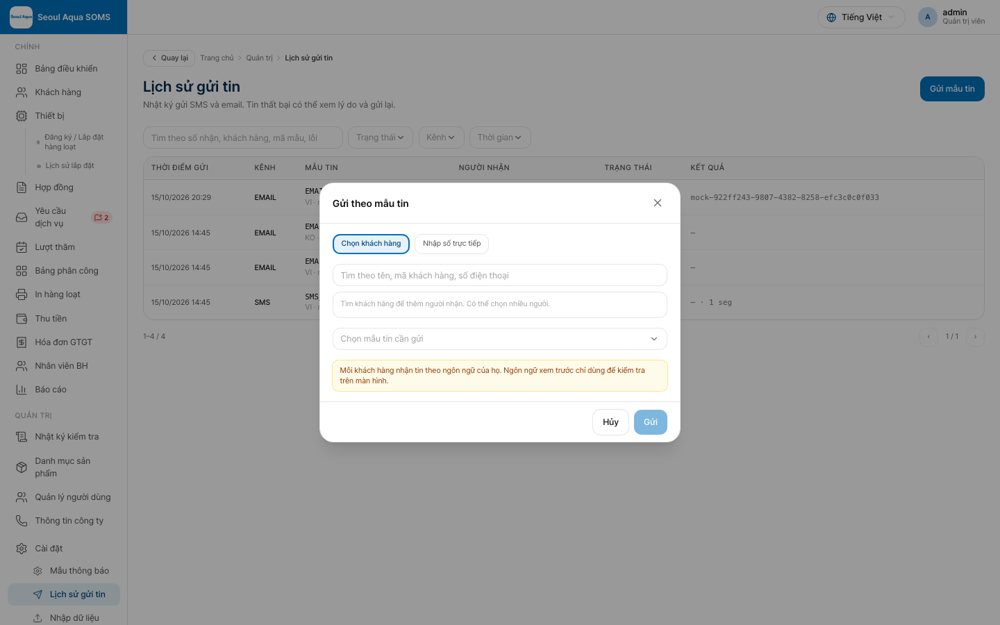

Dùng **«Gửi mẫu tin»** ở góc trên bên phải để gửi SMS bằng tay.

1. Chọn mẫu thì các ô biến của mẫu đó xuất hiện. Điền giá trị thì câu sẽ gửi thực tế cùng số ký tự·segment được xem trước.
2. Người nhận: tìm và chọn nhiều khách hàng (hiển thị dạng thẻ) hoặc nhập số trực tiếp
3. Gửi — được gửi riêng từng người nên một tin thất bại thì các tin còn lại vẫn đi. Khi chọn khách hàng thì theo ngôn ngữ và thiết lập từ chối nhận của liên hệ đó.

- Không có ô gõ tự do nội dung. Nhà mạng chỉ nhận nội dung đã đăng ký.
- Số điện thoại văn phòng được tự điền từ giá trị trong thông tin công ty.
- Danh sách mẫu hiện đủ 5 loại SMS, nhưng **thực tế chỉ có tin nhắc lượt thăm trước một ngày là đến được khách**. Các tin còn lại thất bại với mã 146.

### 15.6 Nhập dữ liệu (chỉ ADMIN)

**Quản trị → Cài đặt → Nhập dữ liệu**


Chuyển khách hàng·hợp đồng·thiết bị·vật tư từ hệ thống cũ hoặc sổ sách sang bằng một tệp Excel trong một lần. Chỉ một tệp sai cũng có thể làm thay đổi cả sổ khách hàng nên chỉ ADMIN mới mở được.

1. **Tải mẫu** — gồm 6 sheet (Guide + khách hàng·hợp đồng·thiết bị·vật tư + sheet tùy chọn Payments). Sheet đầu (Guide) có hướng dẫn điền từng ô bằng tiếng Hàn và tiếng Việt, các sheet còn lại mỗi sheet có một dòng ví dụ. Các ví dụ đều bắt đầu bằng `SAMPLE-` nên hãy xóa đi rồi điền (nếu để lại sẽ bị báo lỗi).
2. **Kiểm tra file** — không lưu gì cả, chỉ cho biết số mục sẽ nhập mới·số mục đã có sẽ bỏ qua·các ô sai (sheet·số dòng).
3. **Xác nhận nhập** — nút chỉ xuất hiện khi không có lỗi. Mọi thứ được lưu một lần, nếu thất bại giữa chừng thì không lưu gì.

Lưu ý khi điền:

- Mã model và SKU vật tư phải được **đăng ký trước trong danh mục**. Chỉ cần có một mã không tồn tại thì toàn bộ tệp không được lưu. Với phụ tùng không có trong danh mục, nếu ghi tên vào ô «Custom Name» của sheet vật tư thì nó chỉ được đăng ký cho thiết bị đó.
- Mã khách hàng và số hợp đồng ghi đúng giá trị đã dùng trước đây. Mã khách hàng·số hợp đồng của SOMS được tạo tự động. Dù tải cùng một tệp hai lần, khách hàng·hợp đồng đã có sẽ được bỏ qua.
- Sheet thiết bị phân biệt thiết bị bằng tổ hợp **mã model + mã tài sản**. Vì số thứ tự mã tài sản chạy riêng cho từng model. Nếu để trống mã model và điền «Custom Description» thì đăng ký là thiết bị ngoài danh mục.
- Hợp đồng được nhập vào ở trạng thái **hiệu lực**, và **lượt lắp đặt đã hoàn tất** theo ngày lắp đặt thực tế cũng được ghi cùng. Ngày bảo trì tiếp theo được tính từ ngày lắp đặt và chu kỳ.
- **Cột tùy chọn**: sheet khách hàng có Status (ACTIVE/INACTIVE), Contact Phone 2, Notes (Contact Phone không còn bắt buộc); sheet hợp đồng có State (ACTIVE/COMPLETED/TERMINATED), End Date, Billing Day (1~31, ngày thu tiền); sheet thiết bị có Status (ACTIVE/TERMINATED/DEACTIVATED). Để trống trạng thái thì là ACTIVE, và thiết bị không ở trạng thái ACTIVE sẽ không nhận nhắc thay lõi lọc.
- **Sheet Payments (tùy chọn)**: ghi lịch sử thu tiền đã thu ở hệ thống cũ. Các cột: Equipment Key · Billing Month (YYYY-MM) · Paid Date · Amount · Currency (VND/USD) · Method (CASH/BANK_TRANSFER/CARD/OTHER) · Notes. Chúng được nhập thành khoản thu đã tất toán và hóa đơn của tháng đó sẽ không bị tạo lại. Bảng kiểm tra·kết quả cũng hiện số lượng «Lịch sử thu tiền».
- Mọi khách hàng được nhập đều được sao chép bên ký hợp đồng thành liên hệ vận hành chính kèm nhãn «Cần xác nhận». Hãy xử lý ở «Mục cần kiểm tra» trong chi tiết khách hàng (§5.4, §5.6).
- Với đợt nhập lớn, hãy **chia thành nhiều tệp** (mỗi tệp dưới 10MB) rồi tải lên; tệp trên 10MB sẽ bị từ chối. Thứ tự không quan trọng, tải lại thì phần đã có sẽ được bỏ qua. Nên chuyển đổi (bắt đầu dùng thật sau khi nhập) vào **đầu tháng**.
- **Trong lúc nhập dữ liệu, không gửi gì cho khách hàng và cũng không tạo tài khoản cổng.**

**«Tải dữ liệu hiện có»** trên cùng màn hình tải dữ liệu hiện tại theo cùng mẫu với tệp tải lên. Dùng để sửa rồi tải lên lại hoặc làm bản sao lưu trước khi nhập.

### 15.7 Trọng số scheduler (chỉ ADMIN)

Quyết định điểm đề xuất KTV. Không có ở thanh bên, mở bằng địa chỉ `/o/vi/admin/scheduler-weights`.

| Mục | Mặc định |
|---|---|
| Trùng KTV ưu tiên | +100 điểm |
| Trùng khu vực | +30 điểm |
| Lượt thăm đã có trong ngày | −5 điểm mỗi lượt |

---

## Chương 16. Các tình huống thường gặp

### Tình huống 1: Khách nói "ngày mai tôi không tiếp được"

1. Lượt thăm → mở lượt thăm đó
2. «Đổi lịch» → ngày mới và lý do → Lưu
3. Khách sẽ nhận lại SMS nhắc lúc 16:00 ngày hôm trước ngày mới. Hãy tự báo cho KTV.

### Tình huống 2: Trên đường đi bảo trì cần bán thêm lõi lọc

1. Chi tiết khách hàng → «+ Đơn mới» → nhập mặt hàng lõi lọc
2. Chọn «Thêm vào lượt thăm sắp tới» → Lưu
3. Thẻ tài liệu mang theo của lượt thăm đó hiện cả tài liệu bảo trì và biên lai bán hàng (B2B là phiếu xuất kho). Hãy phát hành từng loại, hoặc in một lần bằng In hàng loạt.

### Tình huống 3: Khách B2B nói "cho tôi hóa đơn GTGT"

1. Phát hành ở hệ thống hóa đơn điện tử bên ngoài → lưu PDF
2. Hóa đơn GTGT → «+ Tải lên hóa đơn» → chọn khoản thanh toán đã đối soát tương ứng → số·ngày phát hành·PDF → Lưu (MANAGER trở lên)

### Tình huống 4: Có nhân viên bán hàng mới

1. Nhân viên BH → «Thêm NVKD» → Họ tên (bắt buộc)·Điện thoại·Chức danh → Lưu
2. Với từng khách hàng người đó phụ trách, vào chi tiết khách hàng → «Đổi NV phụ trách» để gán
3. Nếu nhân viên bán hàng là người cần đăng nhập hệ thống thì tạo tài khoản riêng ở Quản lý người dùng. Danh sách nhân viên bán hàng và tài khoản người dùng không liên kết với nhau.

### Tình huống 5: Đăng ký nhiều thiết bị cùng lúc

1. Thiết bị → Đăng ký / Lắp đặt hàng loạt
2. Khách hàng → Thông tin thiết bị → Phương thức dịch vụ → Cấu hình dịch vụ → Xác nhận (kiểm tra số hợp đồng sẽ tạo) → «Hoàn tất»
3. Thiết bị·hợp đồng·lượt lắp đặt được tạo cùng lúc. Nếu lượt lắp đặt chưa có KTV thì chọn ở Bảng phân công.

### Tình huống 6: In trước tài liệu ngày mai của KTV

1. In hàng loạt → chọn ngày (ngày mai) · KTV
2. Kiểm tra bản xem trước PDF → «Mở PDF tab mới để in» → Ctrl+P

### Tình huống 7: Xử lý khách quá hạn

1. Bảng điều khiển «Thanh toán trễ hạn» hoặc Thu tiền → chọn «Chỉ trễ hạn»
2. Xem giai đoạn (Trễ 7n/14n/30n) → gọi điện cho khách
3. Khi tiền về, vào chi tiết khoản thu đó → «Thanh toán một phần» → số tiền nhận được (nếu đủ thì giữ nguyên) → Lưu

### Tình huống 8: Xem thành tích của nhân viên bán hàng

1. Nhân viên BH → bấm vào thẻ
2. Đặt kỳ xem → xem các tab «Doanh thu theo kỳ»·«Công nợ theo kỳ»

### Tình huống 9: Khách quên mật khẩu cổng

1. Xác minh danh tính
2. Chi tiết khách hàng → «Sửa» → ở thẻ «Đặt lại mật khẩu cổng KH» bên dưới, đặt lại cho liên hệ tương ứng (MANAGER trở lên)
3. Đọc qua điện thoại mật khẩu tạm thời hiện trên màn hình, và hướng dẫn khách đặt mật khẩu mới ở lần đăng nhập đầu tiên

### Tình huống 10: Nhân viên quên mật khẩu ứng dụng văn phòng

1. Người có vai trò cao hơn nhân viên đó vào Quản trị → Quản lý người dùng → «Đặt lại mật khẩu»
2. Cho người đó biết mật khẩu tạm thời hiện trên màn hình
3. Nhân viên đăng nhập bằng mật khẩu tạm thời rồi đặt mật khẩu mới ngay ở màn hình «Đổi mật khẩu» hiện ra

---

## Phụ lục A. Tìm nhanh menu thanh bên

| Chức năng cần tìm | Menu |
|---|---|
| Đăng ký·tìm khách hàng | Khách hàng |
| Gán nhân viên bán hàng phụ trách | Chi tiết khách hàng → Đổi NV phụ trách |
| Đăng ký·thành tích nhân viên bán hàng | Nhân viên BH |
| Đăng ký thiết bị (nhiều dòng) | Thiết bị → nút «Đăng ký / Lắp đặt thiết bị» |
| Đăng ký thiết bị (nhiều máy cùng mẫu) | Thiết bị → Đăng ký / Lắp đặt hàng loạt |
| Lịch sử lắp đặt | Thiết bị → Lịch sử lắp đặt |
| Soạn·sửa hợp đồng | Hợp đồng |
| Lịch lượt thăm | Lượt thăm |
| Phân công KTV | Bảng phân công |
| In bộ tài liệu mang theo | In hàng loạt |
| Xem xét yêu cầu dịch vụ | Yêu cầu dịch vụ |
| Thu tiền·nhận tiền mặt | Thu tiền |
| Tải lên hóa đơn GTGT | Hóa đơn GTGT (tải lên là MANAGER+) |
| Báo cáo | Báo cáo |
| Nhật ký kiểm tra | Quản trị → Nhật ký kiểm tra |
| Quản lý sản phẩm·lõi lọc | Quản trị → Danh mục sản phẩm |
| Tài khoản nhân viên·KTV | Quản trị → Quản lý người dùng |
| SĐT văn phòng·thông tin thuế | Quản trị → Thông tin công ty |
| Nội dung SMS·email | Quản trị → Cài đặt → Mẫu thông báo |
| Kiểm tra đã gửi·gửi lại·gửi thủ công | Quản trị → Cài đặt → Lịch sử gửi tin |
| Nhập dữ liệu cũ hàng loạt | Quản trị → Cài đặt → Nhập dữ liệu (ADMIN) |
| Đặt lại mật khẩu cổng | Chi tiết khách hàng → Sửa → Đặt lại mật khẩu cổng KH (MANAGER+) |

---

## Phụ lục B. Ma trận tài liệu mang theo

| Tài liệu | Mã | Khi nào được đề xuất |
|---|---|---|
| Biên bản bàn giao | DELIVERY_RECEIPT | Lắp đặt + B2C (trừ hợp đồng bán) |
| Biên lai bán hàng | SALE_RECEIPT_B2C | Lắp đặt (hợp đồng bán B2C) hoặc giao vật tư (B2C) |
| Phiếu xuất kho Mẫu 02-VT | DELIVERY_SLIP_B2B | Lắp đặt (B2B) hoặc giao vật tư (B2B) |
| Phiếu bảo trì định kỳ (hộ gia đình) | PERIODIC_CHECK_B2C | Bảo trì định kỳ + B2C |
| Phiếu xác nhận bảo trì (B2B) | PERIODIC_CHECK_B2B | Bảo trì định kỳ + B2B |
| Phiếu xác nhận công việc | WORK_CONFIRMATION | Sửa chữa·thay lõi lọc·di dời·thu tiền·thu hồi thiết bị·khác |

Mọi tài liệu đều là mẫu hai ngôn ngữ, ghi **tiếng Việt ở trên, tiếng Hàn (hoặc tiếng Anh) ở dưới**.

---

## Phụ lục C. Danh mục mẫu thông báo

**SMS** (tất cả chỉ dành cho SMS)

| Mã | Người nhận | Khi nào | Hiện trạng |
|---|---|---|---|
| SMS_VISIT_REMINDER | Liên hệ cơ sở → liên hệ vận hành chính → liên hệ vận hành → bên ký hợp đồng | 16:00 ngày hôm trước lượt thăm | **Gửi được** |
| SMS_SR_APPROVED | Bên ký hợp đồng | Duyệt yêu cầu dịch vụ | Chưa đăng ký (146) |
| SMS_SR_REJECTED | Bên ký hợp đồng | Từ chối yêu cầu dịch vụ | Chưa đăng ký (146) |
| SMS_PAYMENT_OVERDUE_FINAL | Bên ký hợp đồng + liên hệ vận hành chính | Quá hạn D+30 | Chưa đăng ký (146) |
| SMS_CONTRACT_RENEWAL_FINAL | Bên ký hợp đồng | Hết hạn thuê D-7, hoặc «Gửi SMS hết hạn» trong chi tiết hợp đồng | Chưa đăng ký (146) |

**Email** (tất cả chỉ dành cho email, hiện đều là giả lập)

| Mã | Khi nào |
|---|---|
| EMAIL_PORTAL_WELCOME | Mở tài khoản cổng (có ID đăng nhập và câu "nhân viên sẽ báo mật khẩu qua điện thoại", không có mật khẩu) |
| EMAIL_RECEIPT | Thu tiền tại hiện trường |
| EMAIL_SR_RECEIVED | Tiếp nhận yêu cầu dịch vụ |
| EMAIL_SR_APPROVED_DETAILS | Duyệt yêu cầu dịch vụ (chi tiết số tiền) |
| EMAIL_FILTER_DUE_D14 | 14 ngày trước khi thay·vệ sinh lõi lọc |
| EMAIL_PAYMENT_DUE_D7 | Quá hạn D+7 |
| EMAIL_PAYMENT_DUE_D14 | Quá hạn D+14 |
| EMAIL_RENTAL_DUE_D60 | 60 ngày trước khi hết hạn thuê |
| EMAIL_RENTAL_DUE_D30 | 30 ngày trước khi hết hạn thuê |
| EMAIL_VISIT_COMPLETED | Hoàn tất lượt thăm |
| EMAIL_TAX_INVOICE | Tải lên·gửi lại hóa đơn GTGT |
| EMAIL_CONTRACT_COPY | «Gửi email cho KH» trong chi tiết hợp đồng |
| EMAIL_RENTAL_COMPLETED | Kết thúc hợp đồng thuê |

- Nếu người nhận không có kênh tương ứng (số điện thoại hoặc email) thì gửi thay bằng kênh khác.
- Nếu khách bật từ chối nhận thì mọi thông báo đều bị bỏ qua, trừ biên lai·hóa đơn GTGT·bản sao hợp đồng·thông báo mở cổng.

---

## Phụ lục D. Từ điển mã trạng thái

### Lượt thăm

| Mã | Hiển thị trên màn hình | Ý nghĩa |
|---|---|---|
| SUGGESTED | Đề xuất | Đã tạo nhưng chưa có KTV |
| SCHEDULED | Đã xếp lịch | Đã phân công KTV |
| IN_PROGRESS | Đang tiến hành | KTV bắt đầu tại hiện trường |
| COMPLETED | Hoàn tất | KTV đã gửi hoàn tất |
| FAILED_NO_SHOW | KH vắng | Thất bại do khách vắng, … |
| RESCHEDULED | Đã đổi lịch | Lịch đã thay đổi |
| CANCELLED | Đã hủy | Hủy |

### Hợp đồng

| Mã | Hiển thị trên màn hình |
|---|---|
| DRAFT | Nháp |
| PENDING_SIGNATURE | Chờ ký |
| ACTIVE | Hiệu lực |
| AMENDED | Đã sửa đổi |
| COMPLETED | Hoàn tất |
| TERMINATED | Chấm dứt |
| CANCELLED | Huỷ |

### Thu tiền

| Mã | Hiển thị trên màn hình |
|---|---|
| EXPECTED | Dự kiến |
| COLLECTED | Đã thu |
| HANDED_OVER | Đã bàn giao |
| RECONCILED | Đã đối soát |
| OVERDUE_D7 / D14 / D30 | Trễ 7n / 14n / 30n |
| WRITTEN_OFF | Đã xóa |

### Yêu cầu dịch vụ

| Mã | Hiển thị trên màn hình |
|---|---|
| PENDING_REVIEW | Chờ duyệt |
| APPROVED | Đã duyệt |
| SCHEDULED | Đã xếp lịch |
| COMPLETED | Hoàn tất |
| REJECTED | Từ chối |
| CANCELLED | Đã hủy |

### Đơn hàng

| Mã | Hiển thị trên màn hình |
|---|---|
| PENDING | Chưa giao |
| DELIVERED | Đã giao |
| CANCELLED | Đã huỷ |

### Thiết bị

| Mã | Hiển thị trên màn hình |
|---|---|
| ACTIVE | Đang hoạt động |
| RELOCATED | Đã chuyển |
| REPLACED | Đã thay thế |
| DEACTIVATED | Đã vô hiệu |
| TERMINATED | Đã kết thúc |

---

## Phụ lục E. Những việc chưa làm được trên màn hình hiện tại

Đây là các phần hệ thống chưa có màn hình hoặc còn hạn chế, tính đến ngày 15/10/2026. Nếu cần, hãy nhờ bộ phận phát triển.

| Việc muốn làm | Hiện trạng và cách xử lý |
|---|---|
| Thêm·sửa·đặt lại tài khoản ADMIN | Không làm được trên màn hình (quản lý người dùng chỉ theo chiều xuống) |
| Sửa mặt hàng·số lượng của đơn hàng | Không sửa được sau khi tạo. Hãy «Hủy đơn» rồi tạo lại |
| Gửi email cho khách | Cho đến khi máy chủ vận hành được cấu hình khóa gửi (Resend) và xác thực tên miền `jakeshomeappliances.com.vn`, toàn bộ email là giả lập |
| 4 loại SMS (duyệt·từ chối·quá hạn cuối·hết hạn thuê) | Do nhà mạng chưa đăng ký nội dung nên thất bại (146). Hãy báo qua điện thoại |
| Các tab của khách hàng «Lịch sử bảo trì·Lịch sử thay lõi lọc·Tình hình thanh toán·Ghi chú & Đính kèm» | Đang chuẩn bị. Xem ở vùng chi tiết của tab Thiết bị và trang chi tiết thiết bị |
